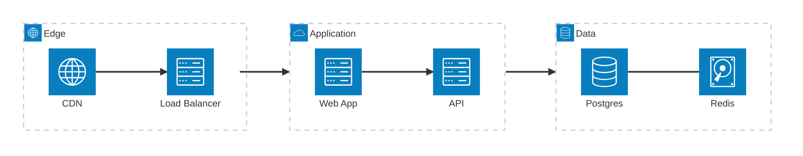
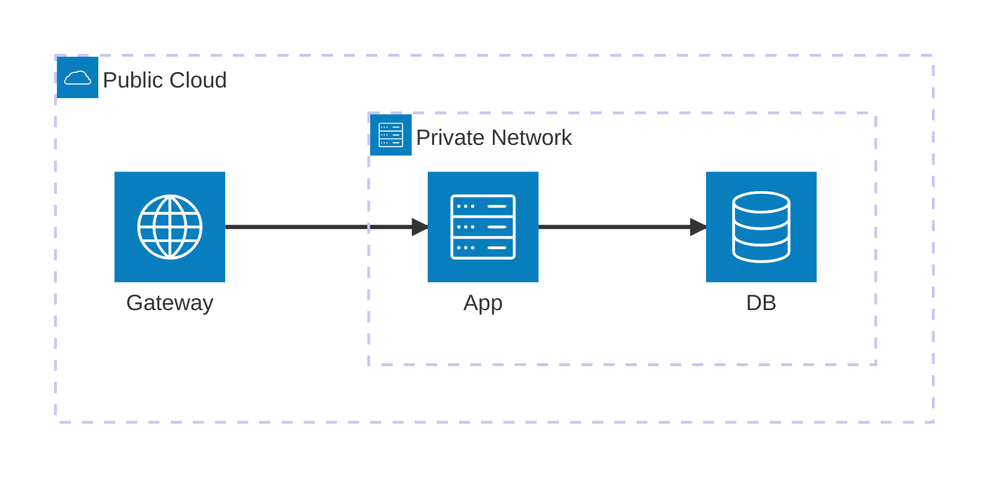
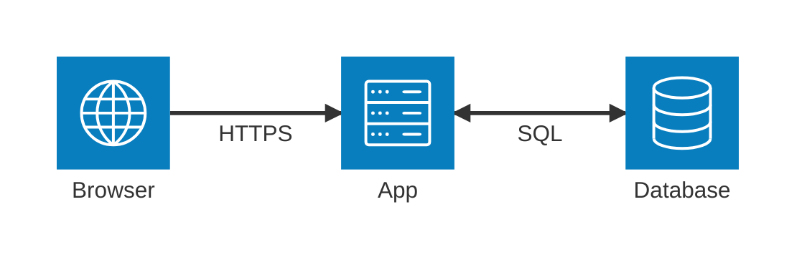
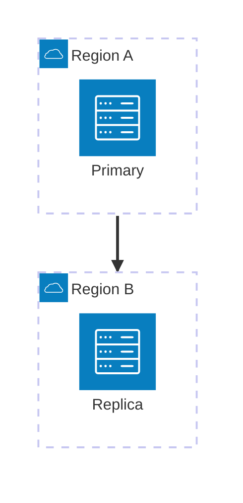
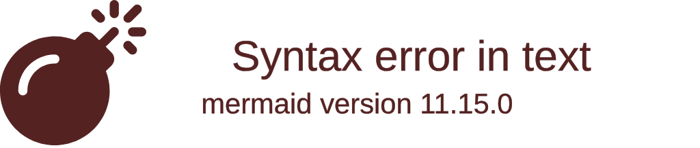
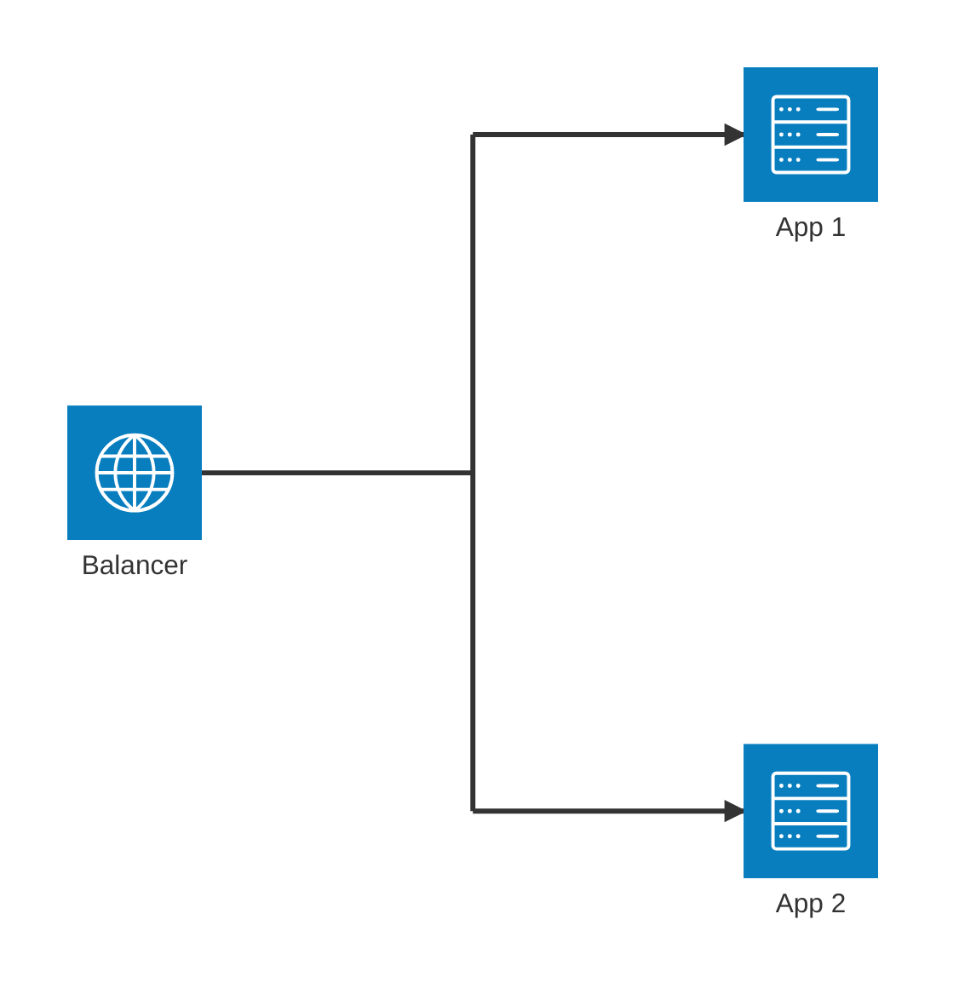

# Architecture Diagram

## Summary

Architecture diagrams in Mermaid show the relationship between services and resources, as commonly found in cloud or CI/CD deployments. Services are drawn as icon tiles with a label underneath, related services are framed by groups, and edges connect a chosen side of one service with a chosen side of another.

> **Note:** The diagram type is still beta: the keyword is `architecture-beta` (plain `architecture` is a syntax error).

### Use Cases

- **Cloud Architecture**: Visualize cloud services, storage, databases, and their connections.
- **CI/CD Pipelines**: Show deployment flows and service dependencies.
- **Microservices**: Illustrate service-to-service communication and resource usage.
- **Infrastructure Documentation**: Communicate system structure to stakeholders.

### When to Use

- When you need to document or communicate cloud or infrastructure architecture.
- When visualizing service relationships and resource groupings.
- Not for more than roughly 12 services or for dense many-to-many wiring: the layout is driven by the edge sides you write, and it has no automatic edge routing. Use a flowchart for that.

## Syntax

- Start with the `architecture-beta` keyword.
- Declare groups and services first, then the edges. An id must be declared before an edge uses it.
- Ids are unique across groups, services and junctions (letters, digits, `_`, `-`).
- The sides you name on an edge (`L`, `R`, `T`, `B`) are not decoration: they decide where the services are placed relative to each other.
- `%%` starts a comment line.

### Basic Structure

A left-to-right chain; the edge between the two groups uses the `{group}` modifier so that it starts and ends at the group frames.



### Groups

```text
group group_id(icon)[Label]
group child_group(icon)[Label] in group_id
```

The icon or the label may be left out (`group g[Label]`, `group g(cloud)`). Groups can be nested with `in`:



### Services

```text
service service_id(icon)[Label]
service service_id(icon)[Label] in group_id
```

- The label is drawn centred below the icon. Long labels wrap onto several lines; `<br/>` forces a line break.
- Labels may contain spaces, umlauts, `-`, `/`, `:`, `&`, `%`, `(`, `)`; quote the label (`["Text [x]"]`) if it contains square brackets.
- Without an icon (`service a[Label]`) an empty dashed box is drawn, so always give an icon.

### Edges

```text
serviceA:R -- L:serviceB
serviceA:R --> L:serviceB
serviceA:R <-- L:serviceB
serviceA:R <--> L:serviceB
serviceA:R -[Label]-> L:serviceB
serviceA{group}:B --> T:serviceB{group}
```

- The letter next to each id is the side of that service the edge attaches to: `T`, `B`, `L`, `R`.
- `<` before the dashes puts an arrowhead at the left service, `>` after them at the right service.
- `-[Label]-` puts a text on the edge (rotated on vertical edges). Combine with arrows as `-[Label]->` or `<-[Label]->`.
- `{group}` after a service id lets the edge start or end at the frame of the group that contains the service. Group ids themselves cannot be used in edges (`group_id:R -- L:x` crashes the renderer).

Arrows and edge labels:



Vertical connections are cleanest between groups, because the edge then starts below the frame and not on top of a label:



### Fan-out and `align`

Several services that hang on the same side of one service get the same position and are drawn on top of each other. `align` spreads them out; the order of the ids is the order on screen.

```text
align column idA idB idC
align row idA idB idC
```

- `align column` (stack vertically) fits edges that all use `R --> L` or `L --> R`.
- `align row` (side by side) fits edges that all use `B --> T` or `T --> B`.
- The ids must already be declared; at least two per line.



### Junctions

A junction is an invisible node with four sides. Use it to split one line into several right-angled branches.

```text
junction junction_id
junction junction_id in group_id
```



Give every branch its own corner junction as above; a junction edge that changes direction in one step (`split:T --> L:app1`) is drawn as a skewed line. Arrowheads belong on the last segment only.

### Icons

- Built-in icons: `cloud`, `database`, `disk`, `internet`, `server`.
- Only these five work in this skill's renderer. Iconify names such as `logos:aws-s3` or `mdi:database`, and any unknown name, render as a blue tile with a white question mark without any error message. Put the product name into the label instead (`service s3(disk)[S3 Bucket]`).

### Spacing

Optional frontmatter under `config.architecture`: `iconSize` (default 80), `fontSize` (default 16), `padding` (default 40) and `idealEdgeLengthMultiplier` (default 1.5, larger values stretch the edges inside a group). Leave the defaults unless a label does not fit; a small `padding` lets the group title run into the first service.

## Rules and Pitfalls

- **Build left to right.** An edge that leaves a service at `B` is drawn straight through that service's label (and a short label then looks like an arrowhead). Use `L`/`R` sides for chains and `align column` for fan-out; go vertical between groups with `{group}`, or accept that the upper label is crossed.
- **One neighbour per side.** Two edges from the same side to two different services without `align` or junctions stack the targets on top of each other or produce diagonal lines.
- **Sides must be consistent.** `a:R --> L:b` places `b` to the right of `a`. A later edge or an `align` order that says the opposite (for example `c:L --> R:a` at the end of an `a → b → c` chain, or `align row b a`) does not fail: it silently draws wrong or missing edges. Never close a cycle; draw the way back as `<-->` on an existing edge.
- Opposite sides only for straight lines (`R`/`L`, `B`/`T`). Same-side pairs such as `a:R --> R:b` give a diagonal line.
- No title: a frontmatter `title:` and a `title` line are accepted but nothing is drawn. Name the diagram through an outer group instead.
- Declaring the same id twice is an error ("already in use"); an edge to an undeclared id is an error as well.
- Unknown icon names never fail, they show a question mark. Check the picture.
- Diagrams with many services become very wide; keep to one screen of 8–12 services and split larger systems.

**References:**
- [Mermaid.js Architecture Diagram Documentation](https://mermaid.js.org/syntax/architecture.html)
- [Mermaid.js Documentation](https://mermaid.js.org/)
