# Architecture Diagram

## Summary

Architecture diagrams in Mermaid are used to show the relationship between services and resources, commonly found within cloud or CI/CD deployments. They provide a clear, high-level view of how services (nodes) and resources are organized and interact, with support for grouping and custom icons.

> **Note:** Architecture diagrams are available in Mermaid v11.1.0+ and are still evolving.

### Use Cases

- **Cloud Architecture**: Visualize cloud services, storage, databases, and their connections.
- **CI/CD Pipelines**: Show deployment flows and service dependencies.
- **Microservices**: Illustrate service-to-service communication and resource usage.
- **Infrastructure Documentation**: Communicate system structure to stakeholders.

### When to Use

- When you need to document or communicate cloud or infrastructure architecture.
- When visualizing service relationships and resource groupings.
- When planning or reviewing deployment strategies.

## Syntax

- Start with the `architecture-beta` keyword.
- Define groups, services, edges, and junctions.
- Use icons for services and groups.
- Use edges to show connections and specify direction.

### Basic Structure


### Groups

Define a group with an icon and label:

```
group group_id(icon)[Label]
group child_group(cloud)[Child] in group_id
```

### Services

Define a service with an icon and label, optionally inside a group:

```
service service_id(icon)[Label] in group_id
```

### Edges

Connect services or groups with edges, specifying direction:

```
serviceA:R -- L:serviceB
serviceA:T --> B:serviceB
```

- `T`, `B`, `L`, `R` = Top, Bottom, Left, Right
- Use `<` or `>` for arrowheads

### Junctions

Junctions act as 4-way splits for edges:

```
junction junction_id
junction junction_id in group_id
```

### Icons

- Default icons: `cloud`, `database`, `disk`, `internet`, `server`
- Use any icon from [iconify.design](https://iconify.design/) by registering icon packs.

```mermaid
architecture-beta
    group api(logos:aws-lambda)[API]
    service db(logos:aws-aurora)[Database] in api
    service disk1(logos:aws-glacier)[Storage] in api
    service disk2(logos:aws-s3)[Storage] in api
    service server(logos:aws-ec2)[Server] in api
    db:L -- R:server
    disk1:T -- B:server
    disk2:T -- B:db
```



## Tips

- Use groups to organize related services.
- Use icons for clarity and visual appeal.
- Use junctions for complex edge routing.
- Keep diagrams focused for readability.

**References:**
- [Mermaid.js Architecture Diagram Documentation](https://mermaid.js.org/syntax/architecture.html)
- [Mermaid.js Documentation](https://mermaid.js.org/)