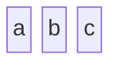
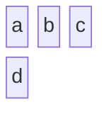
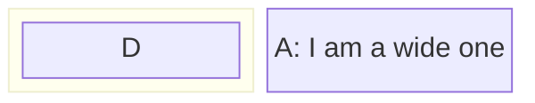
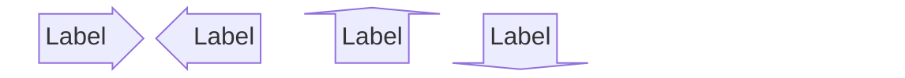
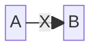

# Block Diagram

## Summary

Block diagrams are intuitive and efficient tools for visually representing complex systems, processes, or architectures. They consist of blocks (representing components or functions) and connectors (showing relationships or flows). Block diagrams provide a high-level view, making them ideal for simplifying and explaining the structure and interactions within a system.

### Use Cases

- **Software Architecture**: Illustrate application modules, services, and their interactions.
- **Network Diagrams**: Represent network devices, services, and data flow.
- **Process Flowcharts**: Visualize business or manufacturing processes.
- **Electrical Systems**: Show high-level structure and component interactions.
- **Education**: Explain complex concepts in a simplified manner.

### When to Use

- When you need a high-level overview of a system.
- When you want full control over block positioning (unlike flowcharts).
- When explaining or analyzing system structure and relationships.

## Syntax

- Start with the `block` keyword.
- Use simple labels for blocks.
- Use `columns N` to define the number of columns.
- Use connectors (`-->`, `---`, etc.) to show relationships.
- Use `block`/`end` for composite (nested) blocks.
- Use `space` to add empty space between blocks.

### Basic Structure



### Multi-Column Layout



### Composite Blocks



### Block Shapes

- Rectangle: `A`
- Rounded: `id1("Text")`
- Stadium: `id1(["Text"])`
- Subroutine: `id1[["Text"]]`
- Cylinder: `id1(("Database"))`
- Circle: `id1(("Text"))`
- Asymmetric: `id1>"Text"]`
- Rhombus: `id1{"Text"}`
- Hexagon: `id1{{"Text"}}`
- Parallelogram: `id1[/"Text"/]`
- Trapezoid: `id1[\"Text"\]`
- Double Circle: `id1((("Text")))`

### Block Arrows and Space



### Connecting Blocks



### Styling

- Individual: `style id fill:#969,stroke:#333,stroke-width:4px`
- Class: `classDef blue fill:#6e6ce6,stroke:#333,stroke-width:4px; class A blue`

## Examples

### System Architecture

```mermaid
block
  columns 3
  Frontend blockArrowId6<[" " ]>(right) Backend
  space:2 down<[" " ]>(down)
  Disk left<[" " ]>(left) Database(("Database"))
  classDef front fill:#696,stroke:#333;
  classDef back fill:#969,stroke:#333;
  class Frontend front
  class Backend,Database back
```

### Business Process Flow

```mermaid
block
  columns 3
  Start(("Start")) space:2
  down<[" " ]>(down) space:2
  Decision{{"Make Decision"}} right<["Yes"]>(right) Process1["Process A"]
  downAgain<["No"]>(down) space r3<["Done"]>(down)
  Process2["Process B"] r2<["Done"]>(right) End(("End"))
  style Start fill:#969;
  style End fill:#696;
```

## Tips

- Use columns and spaces for precise layout control.
- Use composite blocks for hierarchical systems.
- Style blocks and connectors for clarity and emphasis.
- Use comments (`%%`) for documentation within diagrams.

**References:**
- [Mermaid.js Block Diagram Documentation](https://mermaid.js.org/syntax/block.html)
- [Mermaid.js Documentation](https://mermaid.js.org/)