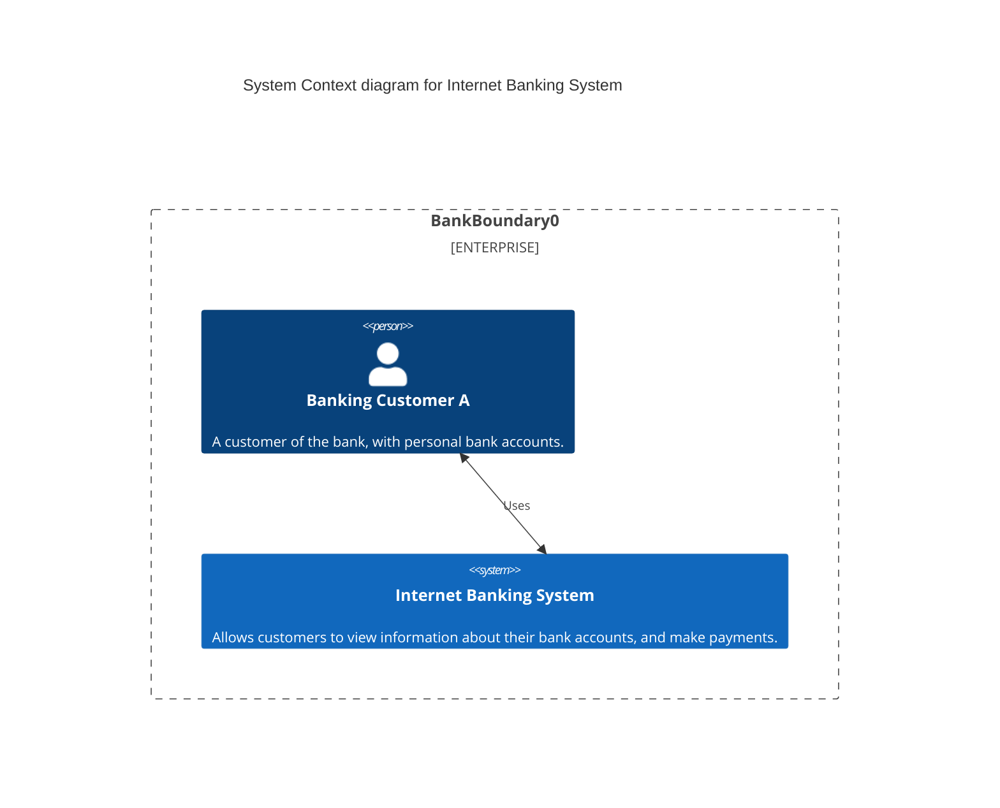
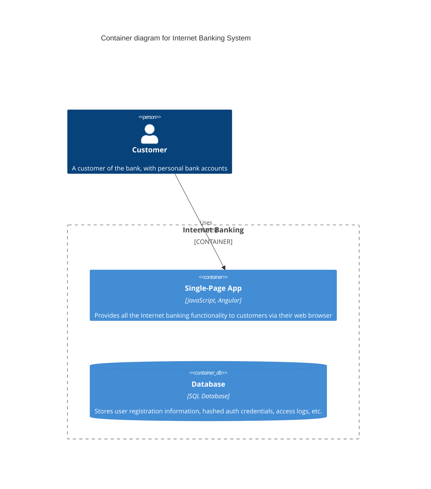
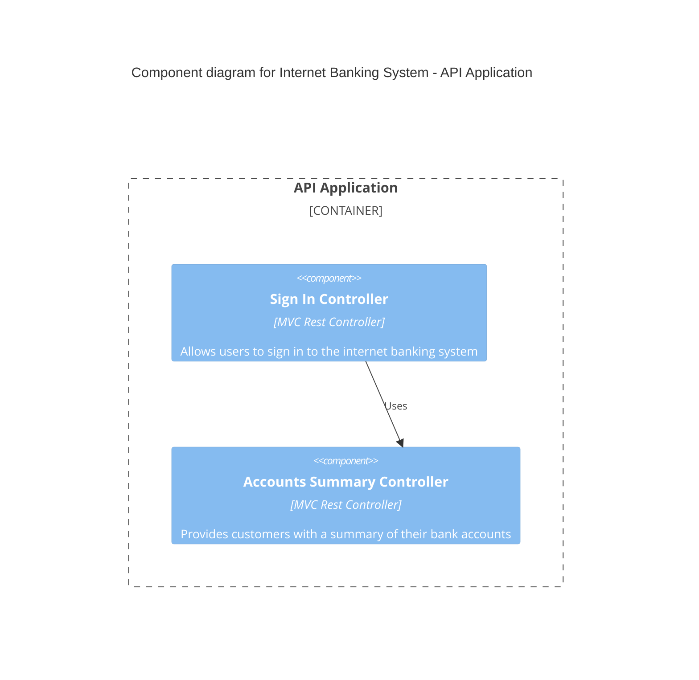

# C4 Diagrams

## Summary

C4 diagrams are a set of hierarchical diagrams for visualizing the architecture of software systems. They provide multiple levels of abstraction, from high-level system context down to detailed component and deployment views. Mermaid supports C4 diagrams with syntax compatible with PlantUML's C4-PlantUML.

> **Note:** C4 diagrams in Mermaid are experimental. Syntax and properties may change in future releases.

### Use Cases

- **System Architecture**: Visualize the structure and boundaries of software systems.
- **Documentation**: Communicate system context, containers, components, and deployment.
- **Stakeholder Communication**: Provide different levels of detail for technical and non-technical audiences.
- **DevOps**: Map out infrastructure and deployment strategies.

### When to Use

- When you need to document or communicate software architecture at multiple abstraction levels.
- When onboarding new team members to a system's structure.
- When planning or reviewing system design.

## Syntax

Mermaid supports five types of C4 diagrams:

- System Context (`C4Context`)
- Container diagram (`C4Container`)
- Component diagram (`C4Component`)
- Dynamic diagram (`C4Dynamic`)
- Deployment diagram (`C4Deployment`)

### Basic Structure



### Example: System Context


### Example: Container Diagram



### Example: Component Diagram



### Example: Deployment Diagram

```mermaid
C4Deployment
  title Deployment Diagram for Internet Banking System - Live
  Deployment_Node(mob, "Customer's mobile device", "Apple IOS or Android"){
    Container(mobile, "Mobile App", "Xamarin", "Provides a limited subset of the Internet Banking functionality to customers via their mobile device.")
  }
  Rel(mobile, api, "Makes API calls to", "json/HTTPS")
```

### Styling and Layout

- Use `UpdateElementStyle` and `UpdateRelStyle` to customize element and relationship styles.
- Use `UpdateLayoutConfig` to adjust layout (e.g., number of shapes per row).

## Tips

- Use the appropriate C4 diagram type for the level of abstraction you need.
- Group related elements within boundaries for clarity.
- Use relationships (`Rel`, `BiRel`) to show interactions.
- Refer to [C4-PlantUML syntax](https://github.com/plantuml-stdlib/C4-PlantUML/blob/master/README.md) for advanced features.

**References:**
- [Mermaid.js C4 Diagram Documentation](https://mermaid.js.org/syntax/c4.html)
- [Mermaid.js Documentation](https://mermaid.js.org/)