# Class Diagram

## Summary

Class diagrams in Unified Modeling Language (UML) are a type of static structure diagram that describes the structure of a system by showing the system's classes, their attributes, operations (or methods), and relationships among objects. They are the main building block of object-oriented modeling and are essential for visualizing software architecture, data models, and system designs.

### Use Cases

Class diagrams are best used for:

- **Software Architecture**: Visualizing the structure and relationships of software components
- **Data Modeling**: Designing database schemas and data structures
- **Object-Oriented Design**: Showing relationships between classes in object-oriented programming
- **System Analysis**: Documenting existing systems for understanding and modification
- **API Design**: Illustrating interfaces and class relationships for service architectures
- **Domain Modeling**: Representing business concepts and their relationships
- **Code Generation**: Creating blueprints for programming implementation

### When to Use

Class diagrams are ideal when you need to:
- Show the static structure of a system
- Define relationships between different components
- Design object-oriented software architecture
- Document data models and schemas
- Plan class hierarchies and inheritance structures
- Create technical documentation for developers
- Analyze existing systems for refactoring

## Syntax

### Basic Structure

The diagram starts with the keyword `classDiagram`, followed by class definitions and relationship lines, one statement per line.

```text
classDiagram
    class <ClassName> { <members> }
    <ClassA> <arrow> <ClassB> : <label>
```

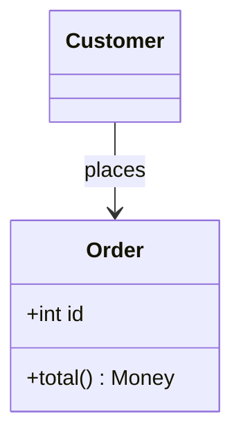

### Class Definition

#### Basic Class
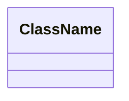

A class is also created implicitly when its name appears in a relationship line. Class names consist of letters, digits, underscores and dashes. For other display text use a label (`class Item["Order Item"]`) or backticks (``class `Order Item` ``).

#### Class with Members
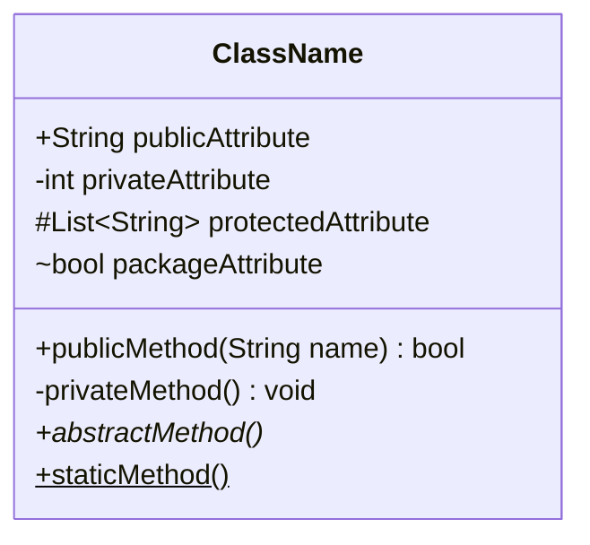

- A member with parentheses is a method, everything else is an attribute.
- The return type follows the closing `)` after a **space**. Do not write `method(): Type`; the renderer adds its own colon and shows `method() : : Type`.
- `*` after a method marks it abstract (italic), `$` after a method or attribute marks it static (underlined).
- Single members can also be added outside the block: `ClassName : +String extra`.

#### Class with Annotations
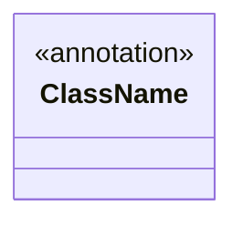

Common annotations are `<<interface>>`, `<<abstract>>`, `<<service>>` and `<<enumeration>>`. Inside a member block the annotation is written on its own first line (see "Interface Implementation").

### Relationships

A relationship line names two classes with an arrow between them and nothing else, except optional quoted multiplicities and an optional `: label`. The `class` keyword does not belong in a relationship line.

```text
Arrow    Example            Meaning
<|--     Parent <|-- Child  Inheritance ("is-a"), triangle at Parent
*--      Whole *-- Part     Composition (strong ownership), diamond at Whole
o--      Whole o-- Part     Aggregation (weak ownership), diamond at Whole
-->      A --> B            Association, arrow at B
..>      A ..> B            Dependency ("uses"), arrow at B
..|>     Impl ..|> Iface    Realization ("implements"), triangle at Iface
--       A -- B             Link (solid)
..       A .. B             Link (dashed)
```

Every arrow can be mirrored (`Child --|> Parent`, `Part --* Whole`, `Iface <|.. Impl`); the symbol always sits next to the class it belongs to.

### Visibility Modifiers

| Symbol | Meaning | Description |
|--------|---------|---------|
| `+` | Public | Accessible from anywhere |
| `-` | Private | Accessible only within the class |
| `#` | Protected | Accessible within class and subclasses |
| `~` | Package/Internal | Accessible within package |

### Generic Types

Generics are written with tildes instead of angle brackets, for class names, attribute types, parameters and return types. Nested generics work (`List~List~int~~`). A simple `Map~K, V~` rendered correctly with the installed version, but the official docs list generics with a comma as unsupported, so check the picture when using one. The generic part does not belong to the class name: relationships refer to `ClassName` only.

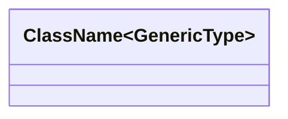

### Return Types

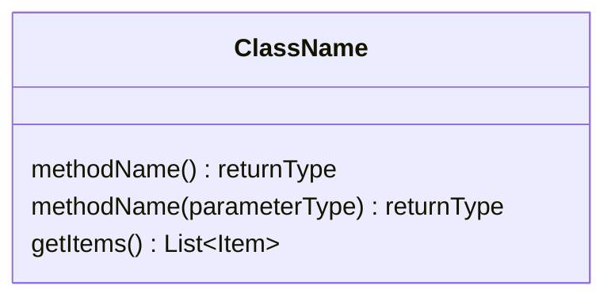

### Notes, Comments and Direction

- `note "text"` adds a free-floating note, `note for ClassName "text"` attaches one to a class. Use `<br>` for a line break; `\n` is printed literally.
- `%%` starts a comment. Put it on a line of its own. A single `%` is a parse error.
- `direction TB` (default), `BT`, `LR` or `RL` sets the layout orientation.

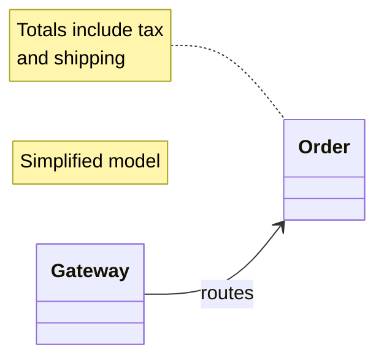

## Examples

### Basic Class Structure

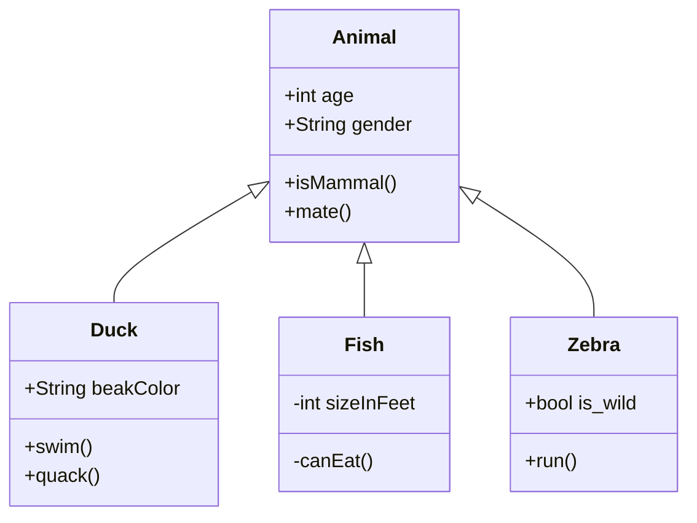

### Inheritance Hierarchy

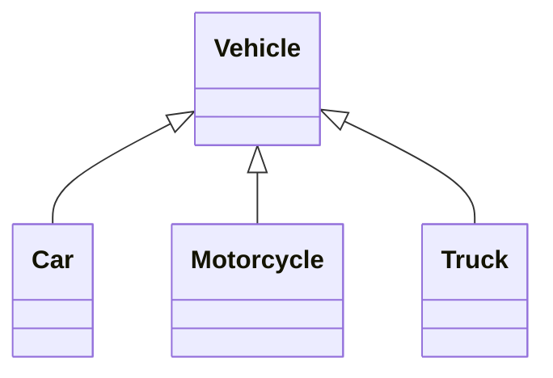

### Composition and Aggregation

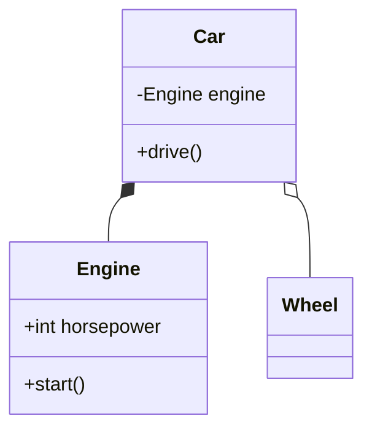

### Interface Implementation

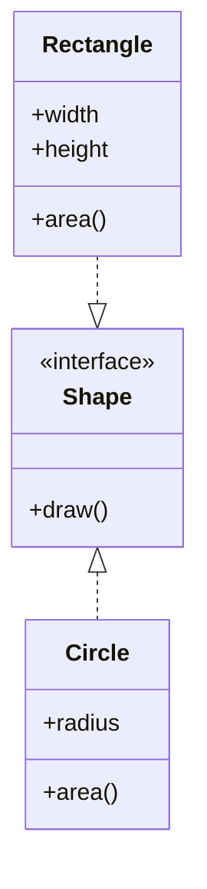

### Multiplicity Examples

Multiplicities are quoted texts directly before and/or after the arrow. Usual values are `1`, `0..1`, `1..*`, `*`, `n`, `0..n` and `1..n`. An arrow is always required between the two classes.

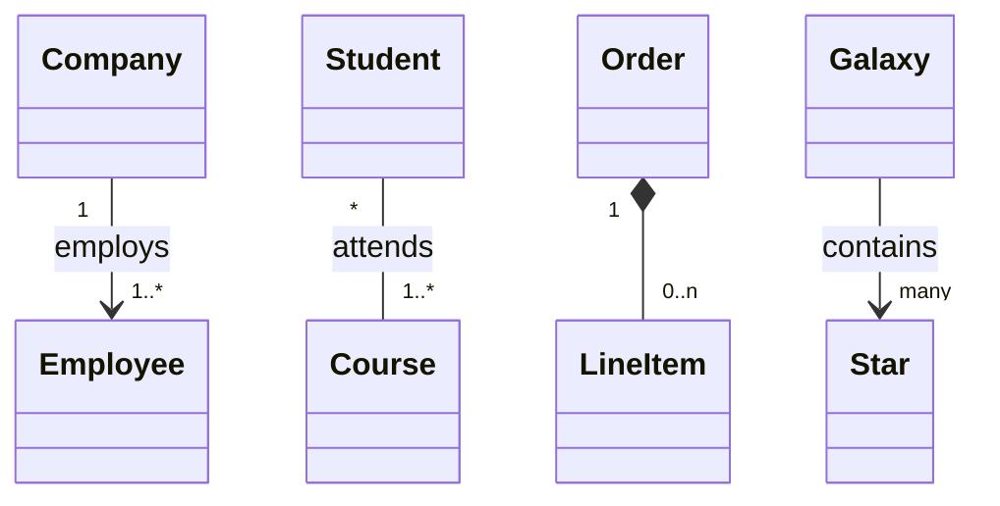

### Annotated Classes

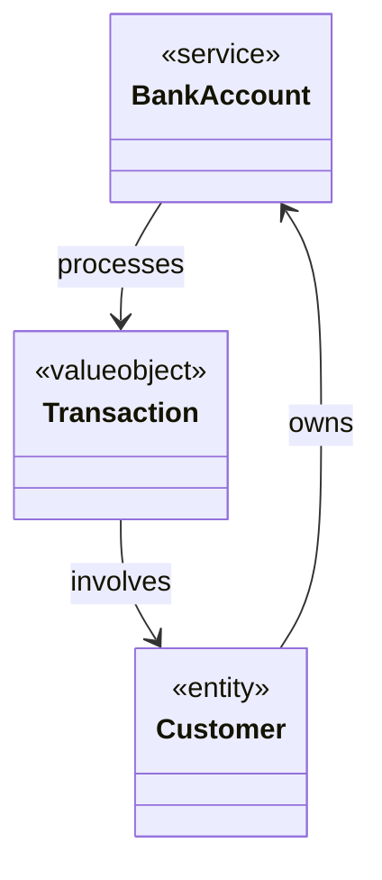

### Namespace Organization

A `namespace` block draws a frame around its classes. It may contain only class definitions; relationships and notes are written outside the blocks.

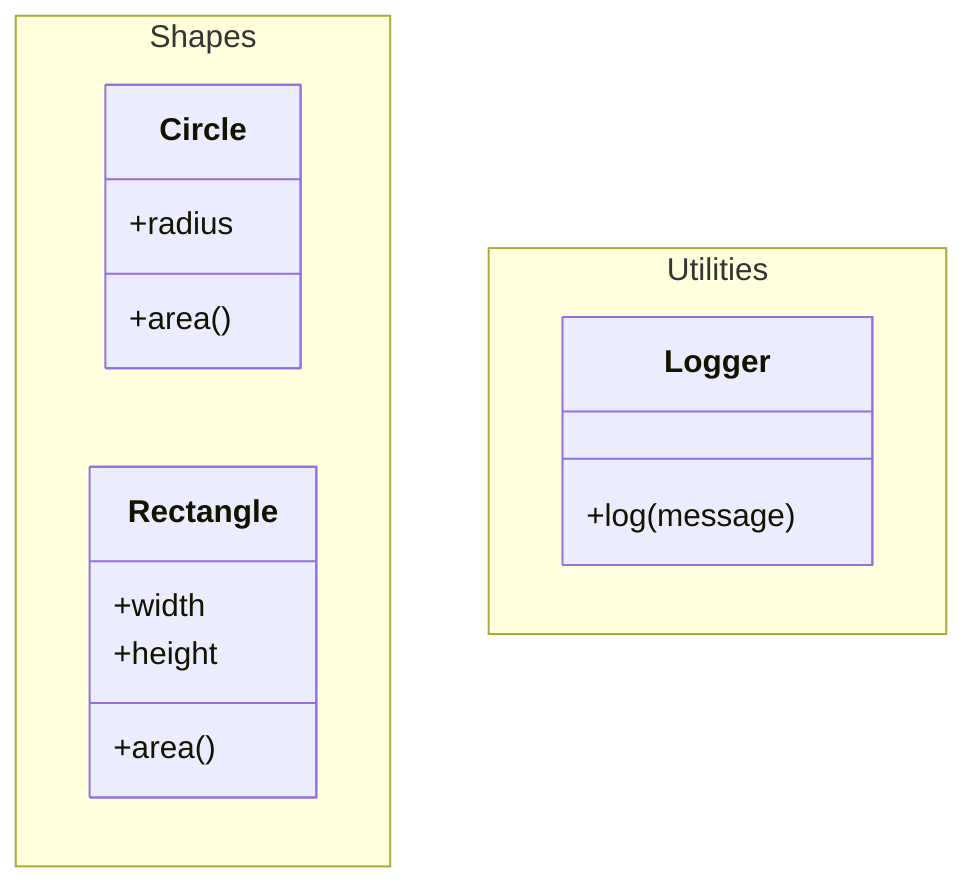

### Nested Namespaces

Namespaces can be nested by placing blocks inside each other or with dot notation (`namespace Infra.Storage` creates `Infra` and, inside it, `Storage`). A label in square brackets replaces the displayed name.

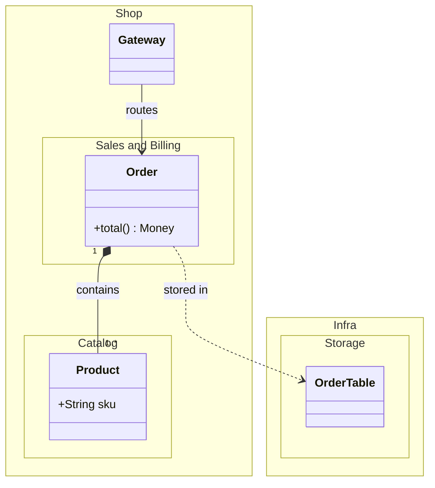

## Tips and Best Practices

1. **Use meaningful class names** that reflect their purpose in the system
2. **Follow UML conventions** for consistent and readable diagrams
3. **Group related classes** using `namespace` blocks to organize complex systems
4. **Show relationships clearly** - use appropriate arrow types for different relationships
5. **Limit complexity** - avoid creating overly complex diagrams that are hard to understand
6. **Use visibility modifiers** to properly encapsulate class members
7. **Document important attributes** - include type information and constraints
8. **Consider cardinality** - define multiplicity to show relationship constraints
9. **Use interfaces** to define contracts and abstract behaviors
10. **Add notes** (`note for ClassName "text"`) to explain complex relationships or design decisions
11. **Keep diagrams focused** - show only relevant classes and relationships for the current context

**References:**
- [Mermaid.js Class Diagram Documentation](https://mermaid.js.org/syntax/classDiagram.html)
- [Mermaid.js Documentation](https://mermaid.js.org/)