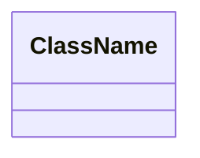
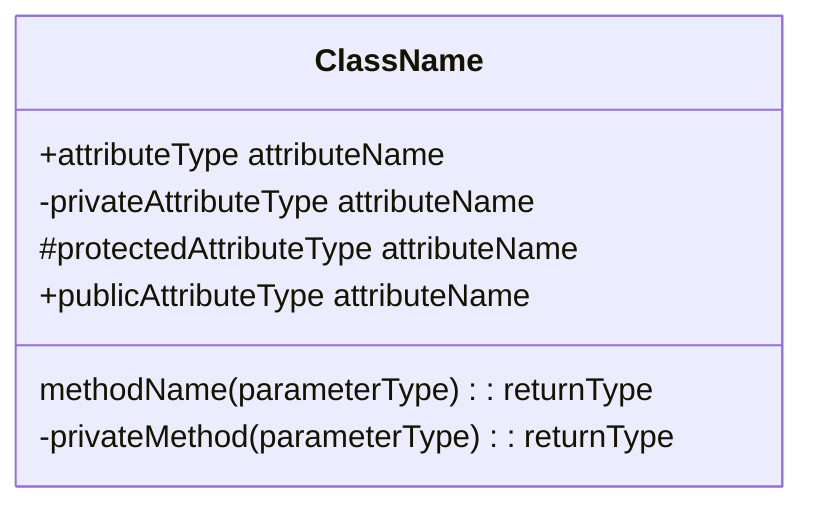
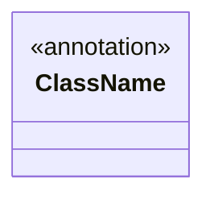
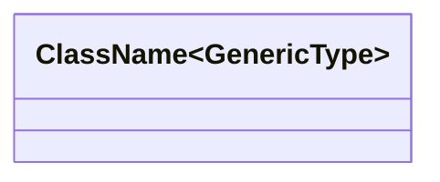
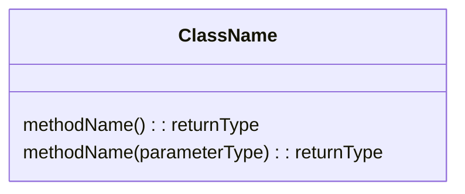
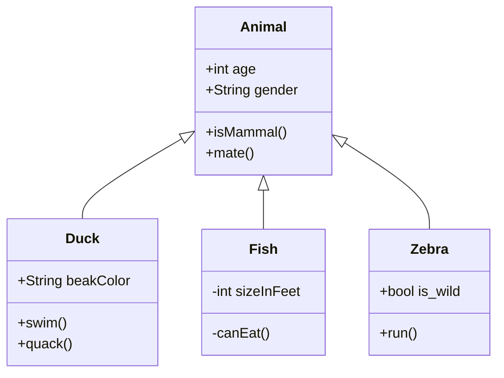
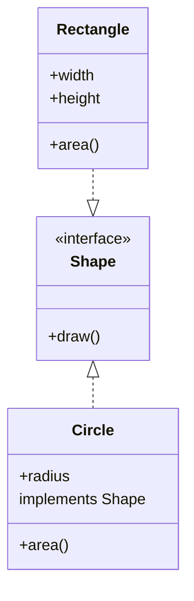
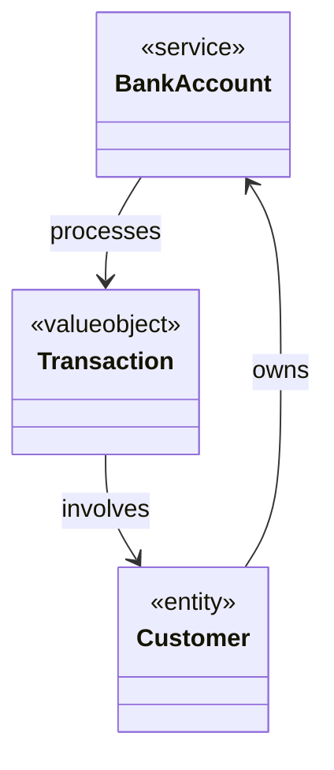
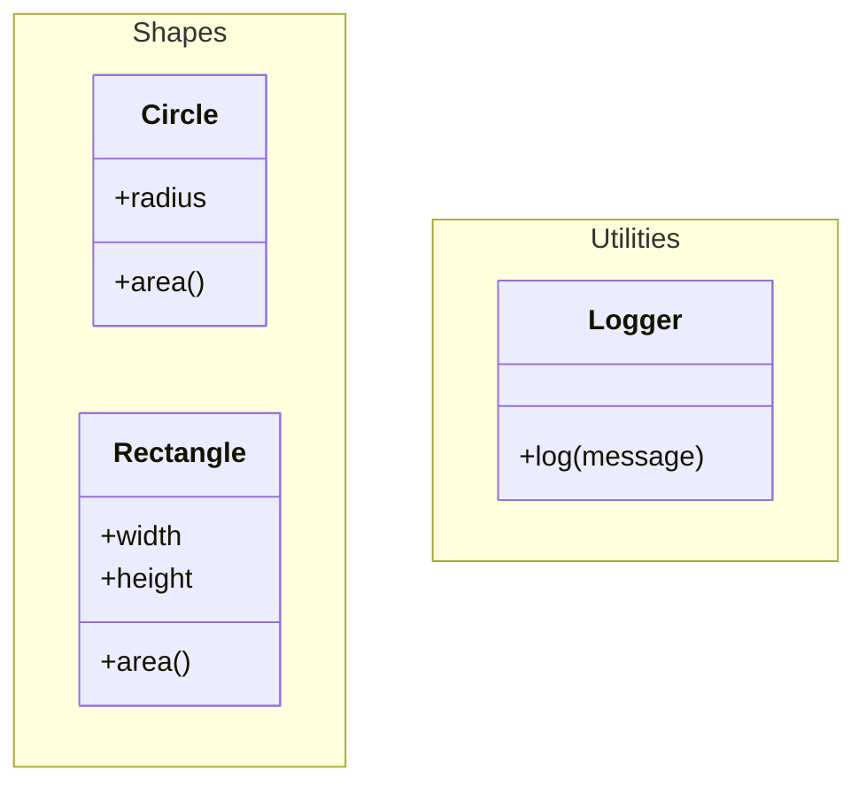

# Class Diagram

## Summary

Class diagrams in Unified Modeling Language (UML) are a type of static structure diagram that describes the structure of a system by showing the system's classes, their attributes, operations (or methods), and relationships among objects. They are the main building block of object-oriented modeling and are essential for visualizing software architecture, data models, and system designs.

### Use Cases

Class diagrams are best used for:

- **Software Architecture**: Visualizing the structure and relationships of software components
- **Data Modeling**: Designing database schemas and data structures
- **Object-Oriented Design**: Showing relationships between classes in object-oriented programming
- **System Analysis**: Documenting existing systems for understanding and modification
- **API Design**: Illustrating interfaces and class relationships for service architectures
- **Domain Modeling**: Representing business concepts and their relationships
- **Code Generation**: Creating blueprints for programming implementation

### When to Use

Class diagrams are ideal when you need to:
- Show the static structure of a system
- Define relationships between different components
- Design object-oriented software architecture
- Document data models and schemas
- Plan class hierarchies and inheritance structures
- Create technical documentation for developers
- Analyze existing systems for refactoring

## Syntax

### Basic Structure

```mermaid
classDiagram
    [class definitions]
    [relationships]
```

### Class Definition

#### Basic Class


#### Class with Members


#### Class with Annotations


### Relationships

| Relationship Type | Syntax | Description |
|----------------|---------|-----------|
| Inheritance | `Parent <|-- Child` | "is-a" relationship |
| Composition | `Parent *-- Child` | "has-a" relationship (strong ownership) |
| Aggregation | `Parent o-- Child` | "has-a" relationship (weak ownership) |
| Association | `Parent --> Child` | Basic relationship |
| Dependency | `Parent ..> Child` | "uses" relationship |
| Realization | `Parent ..|> Child` | "implements" relationship |
| Link (Solid) | `Parent -- Child` | Simple connection |
| Link (Dashed) | `Parent .. Child` | Weak connection |

### Visibility Modifiers

| Symbol | Meaning | Syntax |
|--------|---------|---------|
| Public | `+` | Accessible from anywhere |
| Private | `-` | Accessible only within the class |
| Protected | `#` | Accessible within class and subclasses |
| Package/Internal | `~` | Accessible within package |

### Generic Types



### Return Types



## Examples

### Basic Class Structure



### Inheritance Hierarchy

```mermaid
classDiagram
    class Vehicle
    class Car <|-- Vehicle
    class Motorcycle <|-- Vehicle
    class Truck <|-- Vehicle
    
    Vehicle <|-- Car
    Vehicle <|-- Motorcycle
    Vehicle <|-- Truck
```

### Composition and Aggregation

```mermaid
classDiagram
    class Engine {
        +int horsepower
        +start()
    }
    class Car {
        -Engine engine
        +drive()
    }
    
    Car *-- Engine  % Composition (strong ownership)
    Car o-- Wheel    % Aggregation (weak ownership)
```

### Interface Implementation



### Multiplicity Examples

```mermaid
classDiagram
    Company "1" --> "*" Employee
    Employee "1..*" Company
    Student "1" --> "1..*" Course
    Course "*" --> "0..n" Student
```

### Annotated Classes



### Namespace Organization



## Tips and Best Practices

1. **Use meaningful class names** that reflect their purpose in the system
2. **Follow UML conventions** for consistent and readable diagrams
3. **Group related classes** using packages or namespaces to organize complex systems
4. **Show relationships clearly** - use appropriate arrow types for different relationships
5. **Limit complexity** - avoid creating overly complex diagrams that are hard to understand
6. **Use visibility modifiers** to properly encapsulate class members
7. **Document important attributes** - include type information and constraints
8. **Consider cardinality** - define multiplicity to show relationship constraints
9. **Use interfaces** to define contracts and abstract behaviors
10. **Add notes** to explain complex relationships or design decisions
11. **Keep diagrams focused** - show only relevant classes and relationships for the current context

**References:**
- [Mermaid.js Class Diagram Documentation](https://mermaid.js.org/syntax/classDiagram.html)
- [Mermaid.js Documentation](https://mermaid.js.org/)