# Entity Relationship Diagram

## Summary

Entity Relationship diagrams (ER diagrams) describe interrelated things of interest in a specific domain of knowledge. They are composed of entity types, attributes, and relationships that connect them. ER diagrams are fundamental tools for database design, system modeling, and business process documentation.

### Use Cases

Entity Relationship diagrams are best used for:

- **Database Design**: Visualizing database schemas and table relationships
- **System Architecture**: Documenting relationships between system components
- **Data Modeling**: Creating conceptual data models and their relationships
- **Business Analysis**: Mapping out business entities and their connections
- **API Documentation**: Showing relationships between services and data models
- **Software Refactoring**: Understanding existing data structures before making changes

### When to Use

Entity Relationship diagrams are ideal when you need to:
- Design or document database schemas
- Model data relationships and constraints
- Plan system architecture and component interactions
- Document business rules and entity relationships
- Create data models for software development
- Analyze existing systems for improvement opportunities

## Syntax

### Basic Structure

The diagram starts with the keyword `erDiagram`. After that, every statement stands on its own line: either an entity (optionally with an attribute block) or a relationship.

```text
erDiagram
    <entity> { <type> <name> [<keys>] ["<comment>"] ... }
    <first-entity> <relationship> <second-entity> : <label>
```

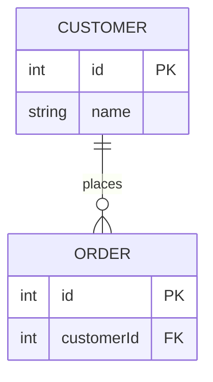

### Entity Definition

#### Basic Entity
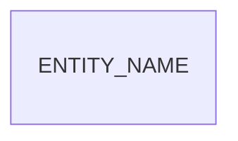

Entities that only appear in a relationship line are created automatically; they need no separate declaration. Names with spaces must be written in double quotes (`"Order Item"`).

#### Entity with Attributes
```mermaid
erDiagram
    ENTITY_NAME {
        int id PK
        string title
        varchar(255) description
        string? optionalNote
        string[] tags
    }
```

#### Attribute Syntax Rules

- Every attribute line is `type name`, in this order, one attribute per line (e.g. `string name`).
- `type` and `name` start with a letter and may contain digits, hyphens, underscores, parentheses and square brackets (`varchar(255)`, `string[]`). A type may end with `?` to mark it as optional. Neither may contain spaces.
- Class-diagram style lines are **not** valid: no visibility prefix (`+string name`, `-int id`), no `name: type`, no attribute without a type.
- When the true datatype is unknown, use a neutral placeholder type (`string`, `int`, `number`, `any`) so that the type token is still present.
- Optional parts follow the name, see "Keys and Comments" below. Nothing else is allowed inside the block: no `{ min: 18 }` constraint objects, no default values, no nested blocks.

### Relationships

A relationship line has exactly this form; the colon and the label are mandatory:

```text
<first-entity> <left-cardinality><line><right-cardinality> <second-entity> : <label>
```

Each end of the line carries a two-character cardinality marker. The outer character is the maximum, the inner character (next to the line) is the minimum:

```text
Left    Right   Meaning
|o      o|      zero or one
||      ||      exactly one
}o      o{      zero or more
}|      |{      one or more
```

The line between the markers is `--` (solid, identifying: the child cannot exist without the parent) or `..` (dashed, non-identifying: both exist independently).

Common combinations:

```text
A ||--|| B : label     one-to-one (exactly one on both sides)
A ||--o| B : label     one A, at most one B
A ||--o{ B : label     one-to-many (zero or more B)
A ||--|{ B : label     one-to-many (at least one B)
A }o--|| B : label     many-to-one
A }o--o{ B : label     many-to-many
A }|..|{ B : label     same markers with a dashed, non-identifying line
```

### Cardinality and Multiplicity

UML-style multiplicities such as `1`, `0..1` or `1..*` are **not** written in quotes next to the entity as in class diagrams; they are expressed only through the markers above. Instead of the symbols, word aliases can be used:

```text
exactly one     only one | 1
zero or one     zero or one | one or zero
zero or more    zero or more | zero or many | many(0) | 0+
one or more     one or more | one or many | many(1) | 1+
solid line      to
dashed line     optionally to
```

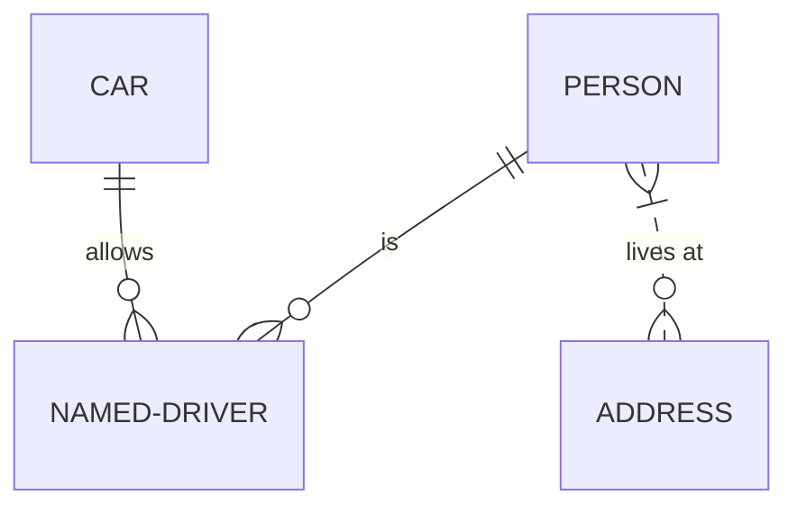

### Relationship Labels

The label is the text after the colon. It describes the relationship from the first entity's point of view. A single word may be written bare; a label with spaces or special characters must be in double quotes. Only one label per relationship is possible, and it must not be omitted (use `""` if no text is wanted).

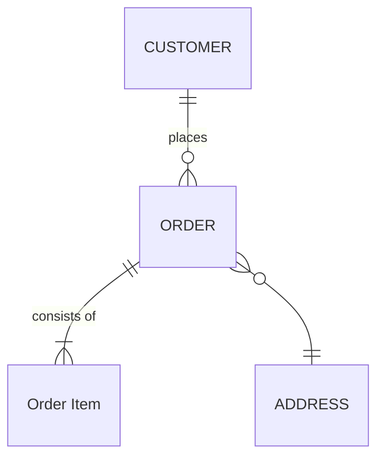

### Advanced Features

#### Keys and Comments

After the attribute name an optional key and an optional comment may follow. Valid keys are `PK`, `FK` and `UK` only; several keys are separated by commas (`PK, FK`). A comment is a double-quoted text at the end of the line and is the place for constraints, defaults or explanations. Comments cannot contain double quotes.

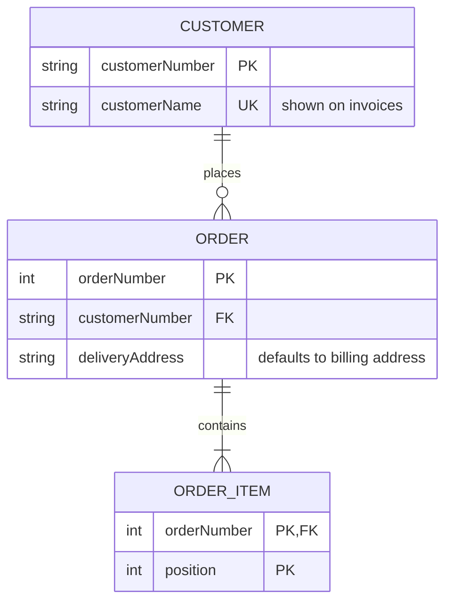

#### Entity Aliases

`id[Alias]` or `id["Alias with spaces"]` displays the alias in the box while relationships keep using the short id.

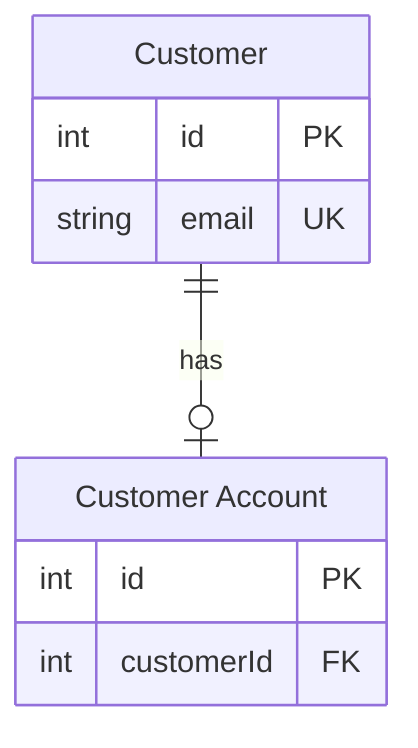

#### Unicode and Markdown Formatting

Quoted names and aliases may contain Unicode characters and Markdown emphasis (`**bold**`, `_italic_`).

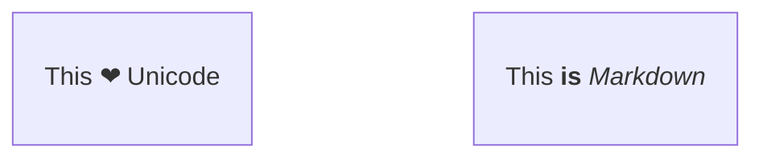

#### Direction

`direction TB` (default), `BT`, `LR` or `RL` on its own line sets the layout orientation.

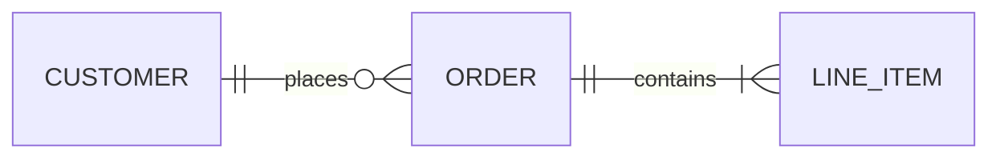

#### Grouping with Subgraphs

`subgraph ... end` draws a frame around entities. The id is a single word, optionally followed by a title in square brackets, or a quoted text that serves as both. Entities and relationships may be declared inside; relationships across groups go outside. Subgraphs can be nested, and a subgraph id can itself be an end of a relationship.

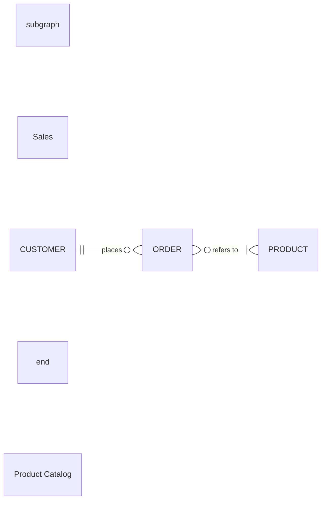

#### Comments and Styling

A line starting with `%%` is a comment. Entities can be colored with `style ORDER fill:#e8f4ff,stroke:#1f6feb` or with `classDef core fill:#ffe9a8` plus `CUSTOMER:::core`.

## Examples

### Simple Customer-Order Relationship

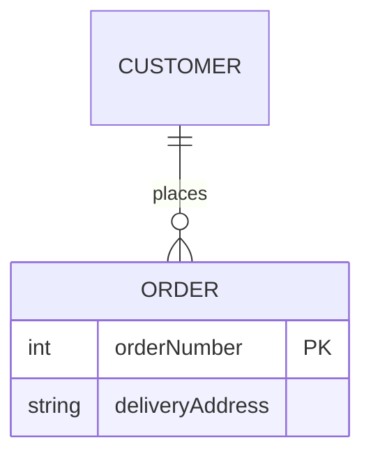

### One-to-Many Relationship

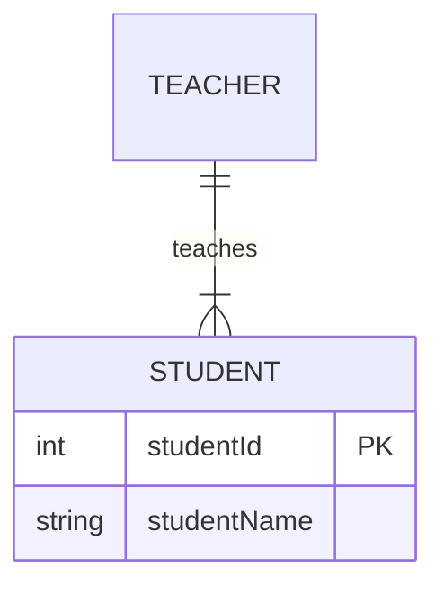

### Many-to-Many Relationship

Shown directly on the left; resolved through a junction entity with a composite key on the right, as it would be implemented in a relational database.

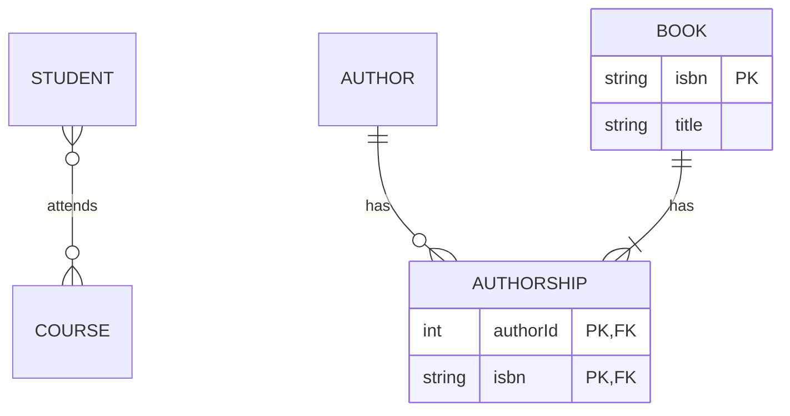

### Complete Database Schema

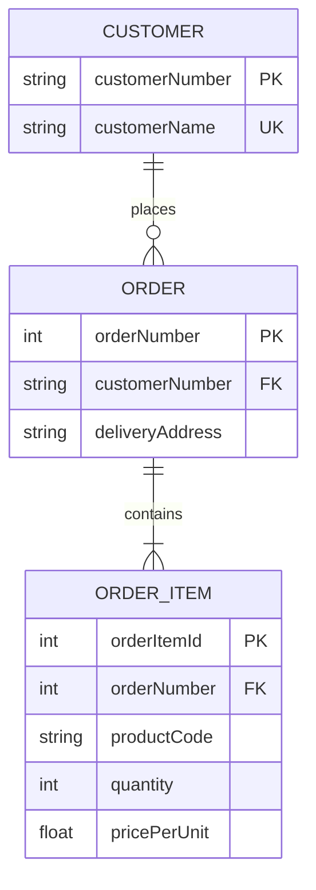

### Self-Referencing Relationship

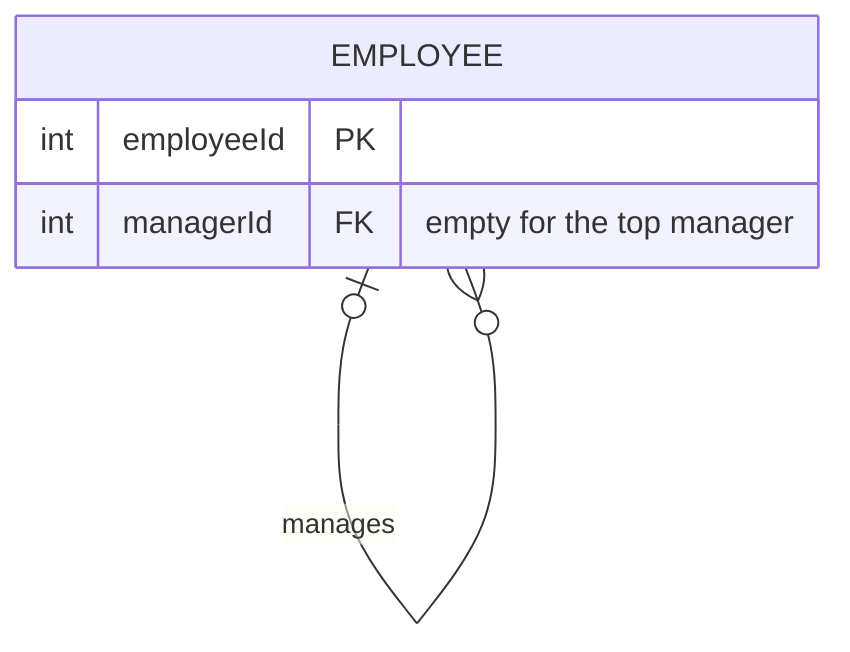

### Attributes with Constraints

There is no constraint syntax; constraints and defaults are written as comments.

```mermaid
erDiagram
    USER {
        string username PK
        string email UK
        int age "min 18, max 100"
        datetime registrationDate
        datetime? lastLoginDate
        bool isActive "default: true"
    }
```

## Tips and Best Practices

1. **Use meaningful entity names** that reflect their business purpose
2. **Follow naming conventions** - use singular nouns for entity names; avoid spaces and hyphens in ids (use an alias for display text)
3. **Define keys clearly** - mark them with `PK`, `FK` or `UK` after the attribute name
4. **Use appropriate relationships** - choose both cardinality markers deliberately and always add `: label`
5. **Document constraints** - put ranges, defaults and validation rules into attribute comments
6. **Group related entities** - use `subgraph` blocks to organize complex diagrams
7. **Keep diagrams focused** - show only relevant entities and relationships
8. **One statement per line** - never continue a relationship line with an attribute block; declare the block separately
9. **Consider normalization** - resolve many-to-many relationships with a junction entity when modeling tables
10. **Define each entity block once** - a second block for the same entity is merged into the first, which makes the source hard to follow

**References:**
- [Mermaid.js Entity Relationship Diagram Documentation](https://mermaid.js.org/syntax/entityRelationshipDiagram.html)
- [Mermaid.js Documentation](https://mermaid.js.org/)
