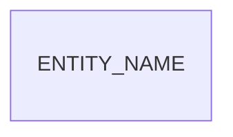
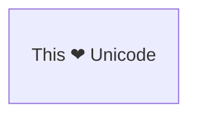
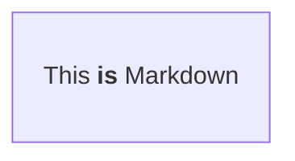

# Entity Relationship Diagram

## Summary

Entity Relationship diagrams (ER diagrams) describe interrelated things of interest in a specific domain of knowledge. They are composed of entity types, attributes, and relationships that connect them. ER diagrams are fundamental tools for database design, system modeling, and business process documentation.

### Use Cases

Entity Relationship diagrams are best used for:

- **Database Design**: Visualizing database schemas and table relationships
- **System Architecture**: Documenting relationships between system components
- **Data Modeling**: Creating conceptual data models and their relationships
- **Business Analysis**: Mapping out business entities and their connections
- **API Documentation**: Showing relationships between services and data models
- **Software Refactoring**: Understanding existing data structures before making changes

### When to Use

Entity Relationship diagrams are ideal when you need to:
- Design or document database schemas
- Model data relationships and constraints
- Plan system architecture and component interactions
- Document business rules and entity relationships
- Create data models for software development
- Analyze existing systems for improvement opportunities

## Syntax

### Basic Structure

```mermaid
erDiagram
    [entity definitions]
    [relationships]
```

### Entity Definition

#### Basic Entity


#### Entity with Attributes
```mermaid
erDiagram
    ENTITY_NAME {
        +attributeType attributeName
        -privateAttributeType attributeName
        #protectedAttributeType attributeName
        +publicAttributeType attributeName
    }
```

#### Attribute Syntax Rules

- Every attribute line must begin with a datatype token followed by the attribute name (e.g. `string name`).
- Optional markers such as `PK`, `FK`, `NN`, or `UK` appear after the attribute name.
- Attribute-only syntax like `+attributeName` (class diagram style) is **not** valid for Mermaid ER diagrams.
- Minimal placeholder types (`string`, `int`, `integer`, `number`, `any`, etc.) are acceptable when the true datatype is unknown, provided the token still precedes the attribute name.


### Relationships

| Relationship Type | Syntax | Description |
|----------------|---------|-----------|
| One-to-One | `A ||--o B` | One A relates to one B |
| One-to-Many | `A ||--|{ B }` | One A relates to many B |
| Many-to-One | `A }|..o{ B }` | Many A relate to one B |
| Many-to-Many | `A }|..|{ B }` | Many A relate to many B |

### Cardinality and Multiplicity

| Symbol | Meaning | Syntax |
|--------|---------|-----------|
| `1` | Exactly one | `A ||--o B` |
| `0..1` | Zero or one | `A ||--|{ B }` |
| `1..*` | One or more | `A ||--|{ B }` |
| `*` | Many | `A }|..|{ B }` |
| `n` | Zero to n | `A ||--|{ B }` |
| `1..n` | One to n | `A ||--|{ B }` |

### Relationship Labels

```mermaid
erDiagram
    A --|Label| B
```

### Advanced Features

#### Keys and Identifiers

```mermaid
erDiagram
    CUSTOMER {
        +string customerNumber PK
        -string customerName UK
    }
    ORDER {
        +int orderNumber PK
        -string deliveryAddress
    }
    
    CUSTOMER ||--|{ ORDER : places } ORDER {
        +int orderNumber PK
        -string deliveryAddress
    }
```

#### Unicode and Special Characters



#### Markdown Formatting



## Examples

### Simple Customer-Order Relationship

```mermaid
erDiagram
    CUSTOMER ||--|{ ORDER : places } ORDER {
        +int orderNumber PK
        -string deliveryAddress
    }
```

### One-to-Many Relationship

```mermaid
erDiagram
    TEACHER ||--|{ STUDENT : teaches } STUDENT {
        +int studentId PK
        -string studentName
    }
```

### Many-to-Many Relationship

```mermaid
erDiagram
    AUTHOR ||--|{ BOOK : writes } BOOK {
        +string title
        -string isbn
    }
```

### Complete Database Schema

```mermaid
erDiagram
    CUSTOMER {
        +string customerNumber PK
        -string customerName UK
    }
    ORDER {
        +int orderNumber PK
        -string deliveryAddress
    }
    ORDER_ITEM {
        +int orderItemId PK
        -string productCode
        -int quantity
        -float pricePerUnit
    }
    
    CUSTOMER ||--|{ ORDER : places } ORDER {
        +int orderNumber PK
        -string deliveryAddress
    }
    ORDER ||--|{ ORDER_ITEM : contains } ORDER_ITEM {
        +int orderItemId PK
        -string productCode
        -int quantity
        -float pricePerUnit
    }
```

### Self-Referencing Relationship

```mermaid
erDiagram
    EMPLOYEE {
        +int employeeId PK
        -int managerId FK
    }
    
    EMPLOYEE ||--|{ EMPLOYEE : manages } EMPLOYEE {
        +int employeeId PK
        -int managerId FK
    }
```

### Attributes with Constraints

```mermaid
erDiagram
    USER {
        +string username PK
        -string email UK
        -int age { min: 18, max: 100 }
        -datetime registrationDate
    -datetime lastLoginDate
    -bool isActive { default: true }
    }
```

## Tips and Best Practices

1. **Use meaningful entity names** that reflect their business purpose
2. **Follow naming conventions** - use singular nouns for entity names
3. **Define primary keys clearly** - mark with PK or UK notation
4. **Use appropriate relationships** - choose the right relationship type for each connection
5. **Document constraints** - include data types, ranges, and validation rules
6. **Group related entities** - use containers or subgraphs to organize complex diagrams
7. **Keep diagrams focused** - show only relevant entities and relationships
8. **Use consistent notation** - follow established ER diagramming conventions
9. **Consider normalization** - design entities to reduce redundancy and improve data integrity
10. **Add descriptive attributes** - include field definitions that explain the purpose of each attribute

**References:**
- [Mermaid.js Entity Relationship Diagram Documentation](https://mermaid.js.org/syntax/entityRelationshipDiagram.html)
- [Mermaid.js Documentation](https://mermaid.js.org/)
