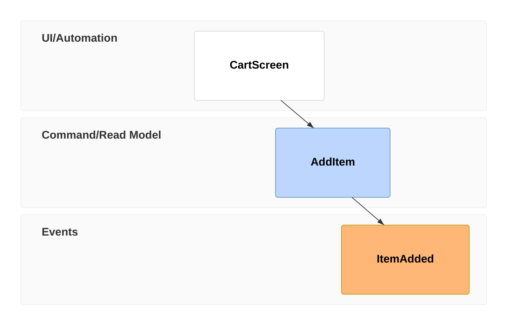
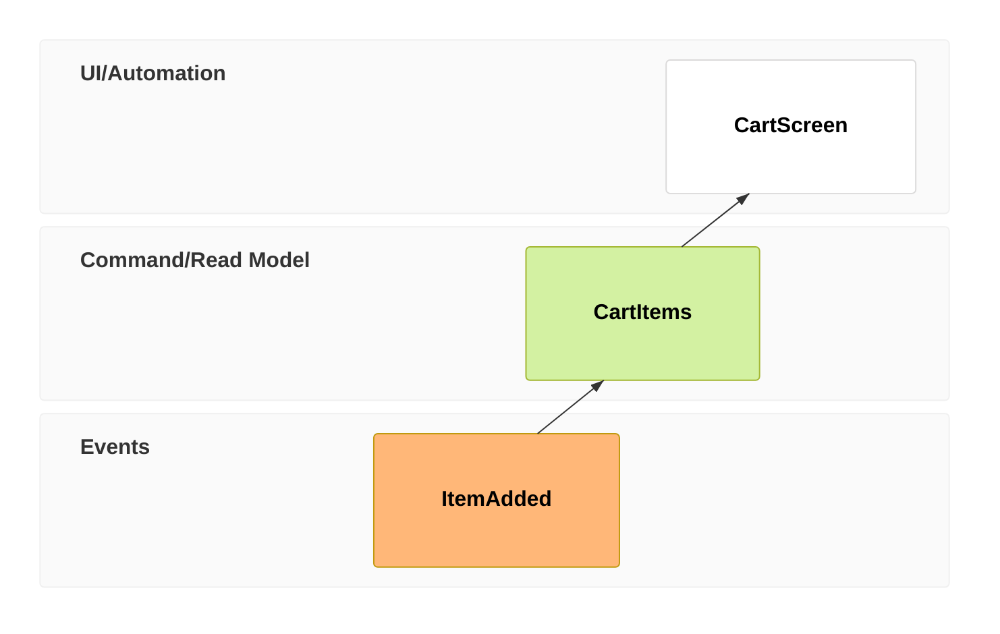
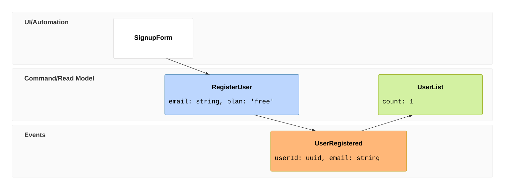
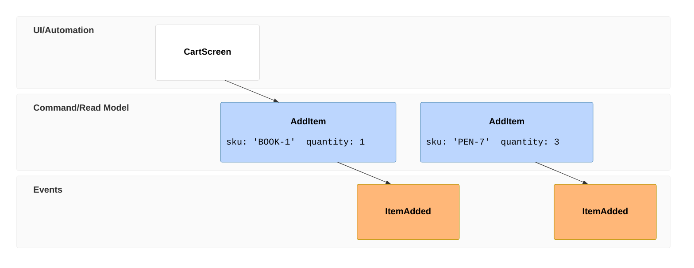
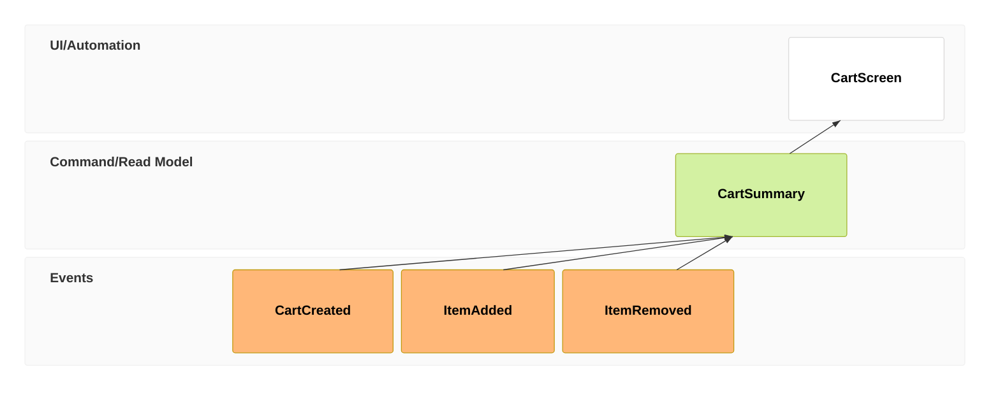
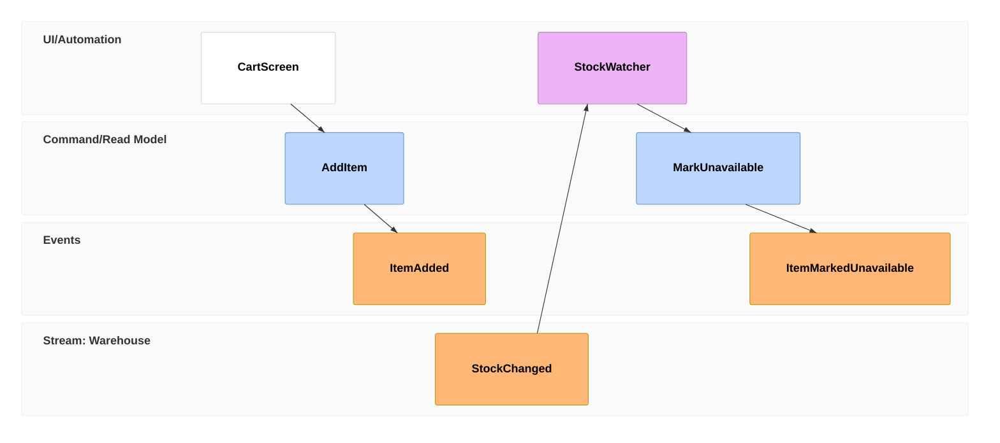
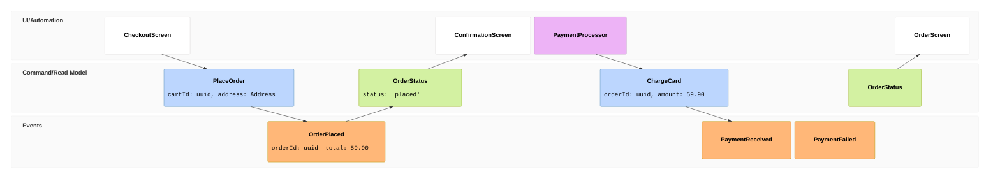

# Event Modeling Diagram

## Summary

An **Event Modeling diagram** tells the story of a system as a timeline: what the user sees, which command they trigger, which event gets recorded and which read model is built from the events. Mermaid lays the steps out from left to right in swimlanes and draws most arrows by itself.

**Use Cases:**
- Designing or documenting event-sourced and CQRS systems
- Walking through a business process step by step with example data
- Showing which events feed which screen or report
- Showing automations that react to events (processors) and events arriving from other systems

**When to Use:**
- When the order of steps over time and the kind of each step (screen, command, event, read model) are the point.
- For message exchange between named participants use a sequence diagram; for branching logic use a flowchart.

---

## Syntax Description

- First line: `eventmodeling` (all lowercase, no direction, no title statement).
- Each further line is one **frame**, a step on the timeline. Frames appear from left to right in the order they are written.
- Indentation and blank lines do not matter. Comments start with `%%`.

**Frame:**
```text
tf <number> <type> <Name>
tf <number> <type> <Name> ->> <number> ->> <number>
tf <number> <type> <Name> { inline data }
tf <number> <type> <Name> [[DataBlockName]]
rf <number> <type> <Name>
```
- `tf` (long form `timeframe`): a normal step. It gets an arrow from an earlier step automatically.
- `rf` (long form `resetframe`): a step without an automatic incoming arrow. Use it where a new strand of the story starts.
- `<number>`: an id that must be unique in the diagram (`01`, `02`, ...). It is not shown and does not set the order; it is only the target for `->>`.
- `<Name>`: one word, shown in the box. The same name may be used in several frames.
- `->> <number>`: draws an arrow from the frame with that number to this frame. Repeat it for several sources. As soon as a frame has `->>`, it gets no automatic arrow.

**Types** (short and long form are interchangeable):

| Short | Long | Meaning | Lane | Box colour |
| --- | --- | --- | --- | --- |
| `ui` | `ui` | Screen or other trigger | UI/Automation | white |
| `pcr` | `processor` | Automation reacting to events | UI/Automation | purple |
| `cmd` | `command` | Intent to change something | Command/Read Model | blue |
| `rmo` | `readmodel` | View built from events | Command/Read Model | green |
| `evt` | `event` | Recorded fact | Events | orange |

**Automatic arrows:** a `tf` frame is connected from the nearest earlier frame that sits in a different lane. Written in the natural order (screen, command, event, read model, screen) this gives the expected chain. Two events in a row both hang on the command before them.

**Namespaces:** a name written as `Namespace.Name` takes the frame out of the three default lanes and gives it a lane of its own, added below the default lanes. The box shows only `Name`; the lane is titled `UI/A: Namespace`, `C/RM: Namespace` or `Stream: Namespace`. In this version every namespaced frame gets a separate lane, even when the namespace repeats, so use a namespace only for the few frames that belong to another system.

**Data:**
- Inline: `{ ... }` at the end of the frame line, on one line. The text between the braces is shown as is in monospace below the name.
- Data block: `[[BlockName]]` at the end of the frame line, plus a separate block:
```text
data BlockName {
  field: value
  other: value
}
```
- Optional type tag in backticks before the brace, for example `` `json`{ "id": 1 } ``. Allowed tags: `json`, `jsobj`, `figma`, `salt`, `uri`, `md`, `html`, `text`. The tag does not change the rendering.
- If a frame has both `->>` and data, the arrows come first: `tf 05 rmo Cart ->> 03 { items: 2 }`.

---

## Examples

### State Change (minimal)

A screen triggers a command, the command produces an event.



### State View

An event feeds a read model, the read model feeds a screen.



### Long Keywords and Inline Data



### Data Blocks and Repeated Names

The second `AddItem` is a reset frame so that it is not connected from the event before it; `->> 01` connects it to the screen instead.



### Read Model from Several Events



### Automation with an External Event

An event from another system starts a new strand (`rf`) and gets its own lane through the namespace; a processor translates it into a command of the own system.



### Realistic Flow: Order and Payment



---

## Rules and Pitfalls

- **Names are single identifiers:** letters, digits and underscores, starting with a letter (`ItemAdded`, `cart_ui`, `Item2Added`). Spaces, hyphens, quotes and non-ASCII letters are syntax errors; there is no quoting. Use CamelCase.
- **Reserved names:** the lowercase keywords `tf`, `rf`, `cmd`, `evt`, `rmo`, `pcr`, `event`, `command`, `readmodel`, `processor`, `timeframe`, `resetframe` cannot be used as a name. With a capital letter they work (`Command`).
- **Frame numbers must be unique.** A repeated number stops rendering with `Duplicate event modeling frame ID`.
- **`->>` to a number that does not exist is not reported**, the arrow is simply missing. The same goes for `[[Block]]` without a matching `data` block: the box is drawn without data.
- **Automatic arrows can be wrong for the story.** A command written directly after an event gets an arrow from that event. If that is not meant, write the frame as `rf` and add the arrows you want with `->>`.
- **Do not namespace everything.** `Shop.CartScreen`, `Shop.AddItem`, `Shop.ItemAdded` produce one lane per frame and several lanes with the same title. Leave the own system without namespace.
- **Order on the frame line:** type, name, then `->>` arrows, then data. `[[Block]] ->> 01` is a syntax error.
- **Inline data must stay on one line.** For several lines use a data block.
- **Data blocks are not shown line by line.** The renderer joins and re-wraps the lines, so keep blocks to two or three short fields; long blocks become hard to read.
- **No title:** a `title` line is a syntax error and a `title:` in the front matter is accepted but not drawn. `accTitle` is rejected as well.
- The diagram grows to the right with every frame. Beyond roughly 12 frames the boxes get small; split the story into several diagrams.

---

## References

- [Official Mermaid Event Modeling Documentation](https://mermaid.js.org/syntax/eventmodeling.html)
- [Mermaid.js Documentation](https://mermaid.js.org/)
