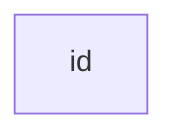
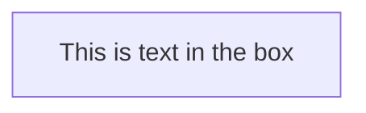
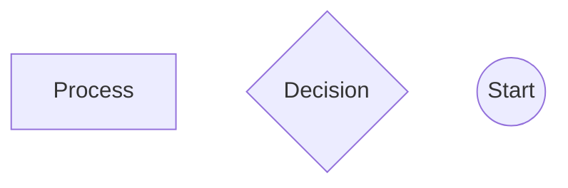
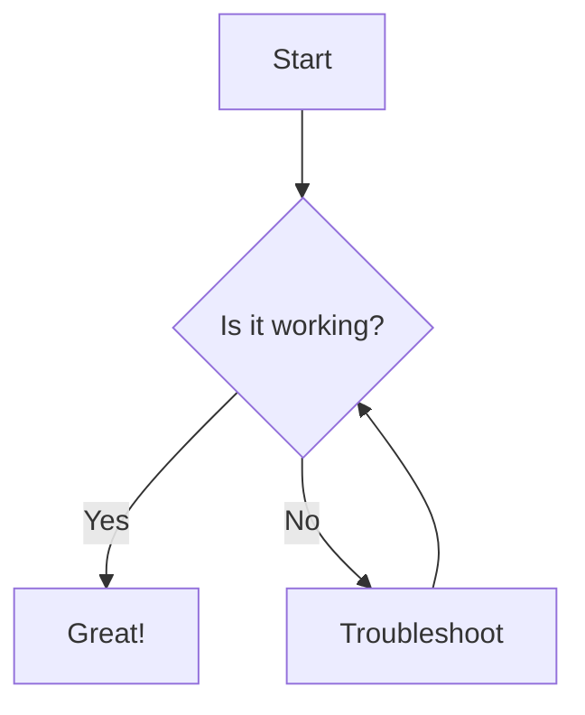
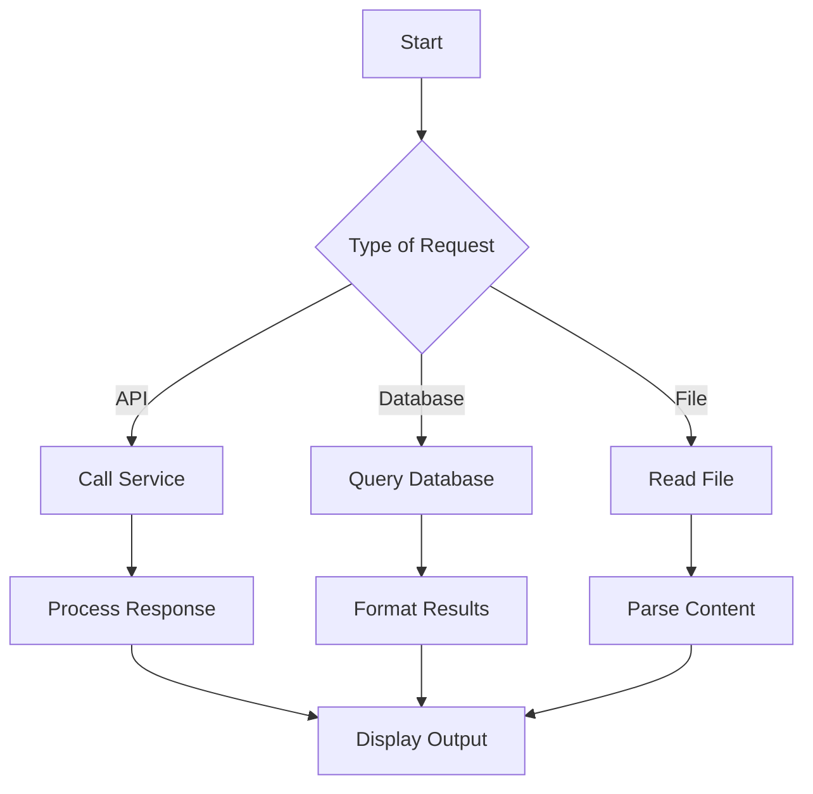
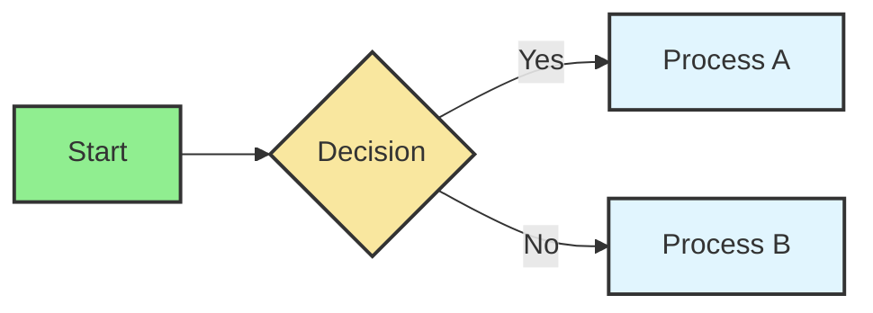
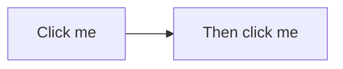

# Flowchart

## Summary

Flowcharts are composed of **nodes** (geometric shapes) and **edges** (arrows or lines). They are one of the most fundamental and widely-used diagram types for visualizing processes, workflows, and decision paths.

### Use Cases

Flowcharts are best used for:

- **Process Visualization**: Mapping out step-by-step processes and workflows
- **Decision Making**: Showing conditional logic and decision points with multiple outcomes
- **System Design**: Illustrating system architectures and component interactions
- **Algorithm Representation**: Visualizing algorithmic flow and logic
- **Business Processes**: Documenting business workflows and procedures
- **Troubleshooting Guides**: Creating step-by-step problem-solving flows
- **Educational Materials**: Teaching concepts through visual process representation

### When to Use

Flowcharts are ideal when you need to:
- Show sequential steps in a process
- Represent decision points with multiple branches
- Communicate complex processes to non-technical audiences
- Document existing workflows for analysis or improvement
- Create visual documentation for procedures

## Syntax

### Basic Structure

```mermaid
flowchart [direction]
    [node definitions]
    [connections]
```

### Direction Declaration

- `TB` - Top to bottom (default)
- `TD` - Top-down (same as top to bottom)
- `BT` - Bottom to top
- `RL` - Right to left
- `LR` - Left to right

### Node Syntax

#### Basic Node


#### Node with Text


#### Node Shapes (Traditional Syntax)

| Shape | Syntax | Example |
|--------|---------|---------|
| Rectangle | `id[text]` | `A[Process]` |
| Rounded Rectangle | `id(text)` | `A(Start)` |
| Stadium | `id([text])` | `A([Terminal])` |
| Subroutine | `id[[text]]` | `A[[Subroutine]]` |
| Cylinder | `id[(text)]` | `A[(Database)]` |
| Circle | `id((text))` | `A((Loop))` |
| Asymmetric | `id>text]` | `A>Input]` |
| Diamond | `id{text}` | `A{Decision}` |
| Hexagon | `id{{text}}` | `A{{Prepare}}` |
| Parallelogram | `id[/text/]` | `A[/Data/]` |
| Trapezoid | `A[/text/]` | `A[/Operation/]` |

#### Node Shapes (New Syntax v11.3.0+)



### Connection Syntax

#### Basic Connections
```mermaid
flowchart LR
    A --> B        % Arrow
    A --- B         % Line
    A -- text --> B % Arrow with text
    A ---|text| B   % Line with text
```

#### Advanced Connections
```mermaid
flowchart LR
    A ==> B        % Thick arrow
    A -.-> B       % Dotted arrow
    A == text ==> B % Thick arrow with text
```

#### Special Connections
```mermaid
flowchart LR
    A --o B        % Circle edge
    A --x B        % Cross edge
```

### Subgraphs

```mermaid
flowchart TB
    subgraph Subgraph Title
        A --> B
    end
    C --> Subgraph Title
```

## Examples

### Simple Process Flow



### Complex Workflow with Subgraphs

```mermaid
flowchart LR
    subgraph Input Phase
        A[User Input] --> B[Validation]
    end
    
    subgraph Processing Phase
        C[Process Data] --> D[Transform]
    end
    
    subgraph Output Phase
        E[Generate Report] --> F[Display Results]
    end
    
    Input Phase --> Processing Phase
    Processing Phase --> Output Phase
```

### Decision Tree with Multiple Outcomes



### Styling Example



### Interactive Flowchart with Click Events




### Project-specific validator constraints

In this project, diagrams are validated via `mmdc` using a strict Mermaid parser.
To avoid parse errors, please follow these additional constraints when using the classic `id[text]` syntax:

- Do **not** use parentheses `(` `)` inside the label text of `id[text]` nodes.
- Avoid using the pipe character `|` inside labels.
- Prefer simple labels such as:
  - `D[Dashboard - logged in]` instead of `D[Dashboard (logged in)]`.

For more complex labels that must include such characters, consider:
- Shortening or rephrasing the label, or
- (If supported by the Mermaid version in this project) using the new v11+ syntax `id@{ shape: ..., label: "..." }`.


## Tips and Best Practices

1. **Use meaningful node IDs** that describe the function of each step
2. **Keep flowcharts simple** - avoid overcrowding with too many nodes
3. **Use consistent direction** throughout your diagram
4. **Group related processes** using subgraphs for better organization
5. **Add descriptive text** to connections to clarify relationships
6. **Use appropriate shapes** for different types of operations (diamonds for decisions, cylinders for data, etc.)
7. **Consider color coding** different types of operations or process phases

**References:**
- [Mermaid.js Flowchart Documentation](https://mermaid.js.org/syntax/flowchart.html)
- [Mermaid.js Documentation](https://mermaid.js.org/)