# Flowchart

## Summary

Flowcharts are composed of **nodes** (geometric shapes) and **edges** (arrows or lines). They are one of the most fundamental and widely-used diagram types for visualizing processes, workflows, and decision paths.

### Use Cases

Flowcharts are best used for:

- **Process Visualization**: Mapping out step-by-step processes and workflows
- **Decision Making**: Showing conditional logic and decision points with multiple outcomes
- **System Design**: Illustrating system architectures and component interactions
- **Algorithm Representation**: Visualizing algorithmic flow and logic
- **Business Processes**: Documenting business workflows and procedures
- **Troubleshooting Guides**: Creating step-by-step problem-solving flows
- **Educational Materials**: Teaching concepts through visual process representation

### When to Use

Flowcharts are ideal when you need to:
- Show sequential steps in a process
- Represent decision points with multiple branches
- Communicate complex processes to non-technical audiences
- Document existing workflows for analysis or improvement
- Create visual documentation for procedures

## Syntax

### Basic Structure

Template (placeholders, not runnable):

```text
flowchart <direction>
    <node definitions>
    <connections>
```

Minimal complete diagram:

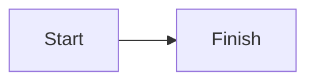

Comments start with `%%` and must stand on a line of their own. A comment after a statement on the same line (`A --> B %% note`, or with a single `%`) is a parse error.

### Direction Declaration

- `TB` - Top to bottom (default)
- `TD` - Top-down (same as top to bottom)
- `BT` - Bottom to top
- `RL` - Right to left
- `LR` - Left to right

### Node Syntax

#### Basic Node
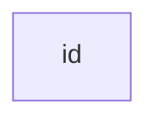

#### Node with Text
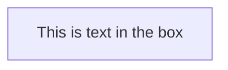

#### Node Shapes (Traditional Syntax)

| Shape | Syntax | Example |
|--------|---------|---------|
| Rectangle | `id[text]` | `A[Process]` |
| Rounded Rectangle | `id(text)` | `A(Start)` |
| Stadium | `id([text])` | `A([Terminal])` |
| Subroutine | `id[[text]]` | `A[[Subroutine]]` |
| Cylinder | `id[(text)]` | `A[(Database)]` |
| Circle | `id((text))` | `A((Loop))` |
| Asymmetric | `id>text]` | `A>Input]` |
| Diamond | `id{text}` | `A{Decision}` |
| Hexagon | `id{{text}}` | `A{{Prepare}}` |
| Parallelogram | `id[/text/]` | `A[/Data/]` |
| Parallelogram (alt) | `id[\text\]` | `A[\Data\]` |
| Trapezoid | `id[/text\]` | `A[/Operation\]` |
| Trapezoid (alt) | `id[\text/]` | `A[\Manual/]` |
| Double Circle | `id(((text)))` | `A(((Stop)))` |

Put the label in double quotes whenever it contains anything other than letters, digits and spaces: `A["Dashboard (logged in)"]`.

#### Node Shapes (New Syntax v11.3.0+)

`id@{ shape: <name>, label: "<text>" }` selects a shape by name. Edges are written separately and refer to the id.

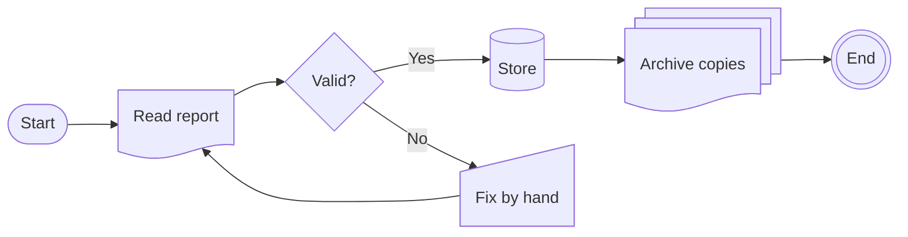

Shape names verified with this renderer: `rect`, `rounded`, `stadium`, `subproc`, `cyl`, `circle`, `dbl-circ`, `diamond`, `hex`, `lean-r`, `lean-l`, `trap-b`, `trap-t`, `odd`, `doc`, `docs`, `procs`, `manual-input`, `manual-file`, `paper-tape`, `delay`, `das`, `lin-cyl`, `datastore`, `notch-rect`, `text`, `braces`. The shapes `fork`, `hourglass`, `sm-circ`, `framed-circle` and `bolt` are drawn without their label.

### Connection Syntax

#### Basic Connections
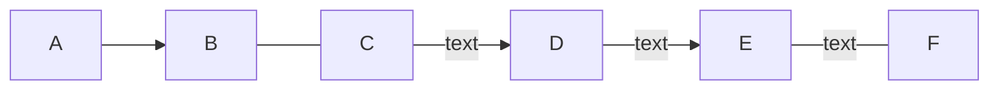

#### Advanced Connections
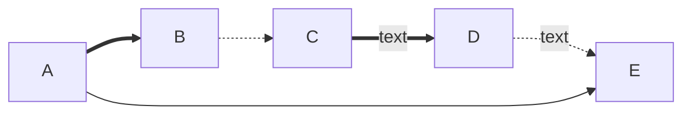

#### Special Connections
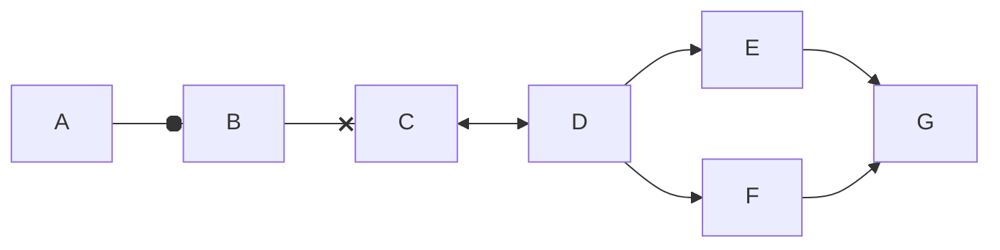

Keep a space between the link and a node id that starts with `o` or `x`: `A---oB` is read as a circle edge, not as a link to `oB`.

### Subgraphs

A subgraph that is the source or target of an edge needs an id. Write `subgraph <id> [<Title>]` and use the id in edges; a title with spaces cannot be used as an edge endpoint.

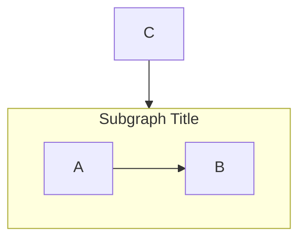

`direction TB|LR|...` as the first line inside a subgraph sets its own layout direction. The word `end` in lower case is reserved; do not use it as a node id.

### Styling Links

Links have no ids. `linkStyle` addresses them by the order in which they are defined, starting at 0; several numbers can be separated by commas, and `default` applies to all links.

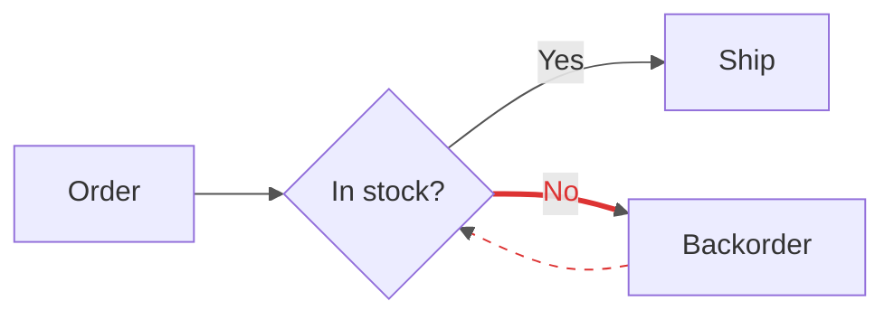

Here link 2 (`B -->|No| D`) is drawn thick and red with a red label, link 3 (`D --> B`) dashed red, and the other links grey.

## Examples

### Simple Process Flow

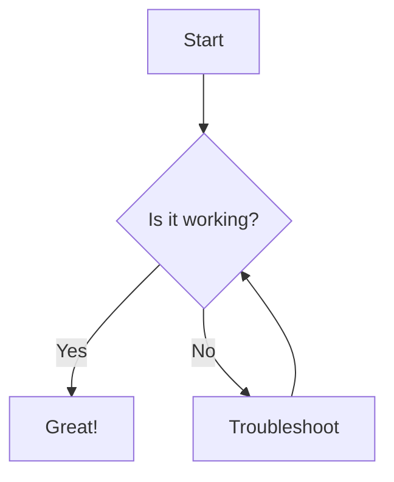

### Complex Workflow with Subgraphs

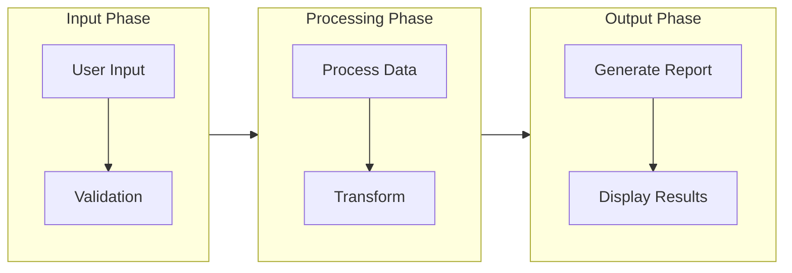

### Decision Tree with Multiple Outcomes

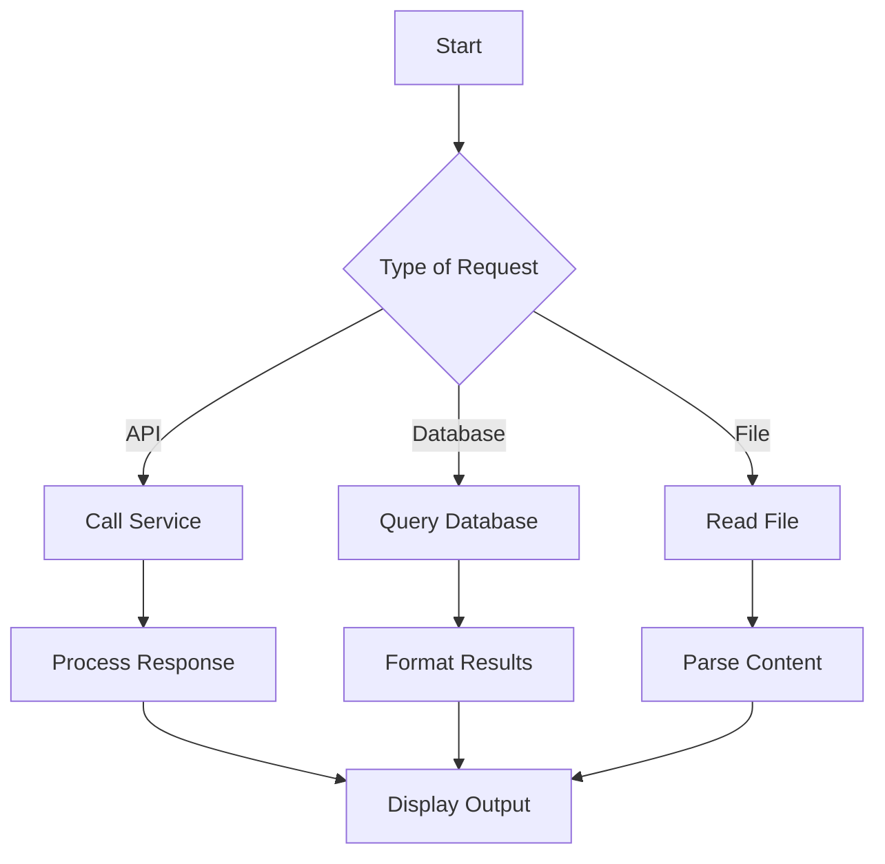

### Styling Example

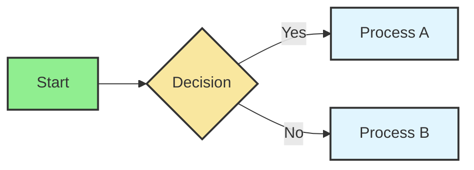

### Interactive Flowchart with Click Events

Links only work in the SVG; the PNG is a static picture.

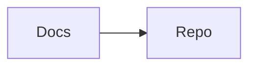


### Project-specific validator constraints

In this project, diagrams are validated via `mmdc` using a strict Mermaid parser.
To avoid parse errors, please follow these additional constraints when using the classic `id[text]` syntax:

- Unquoted labels must not contain parentheses `(` `)` or the pipe character `|`: `D[Dashboard (logged in)]` and `D[Dashboard | admin]` are parse errors.
- Quote such labels instead: `D["Dashboard (logged in) | admin"]`. Inside a quoted label write a double quote as `#quot;`.
- The new syntax `id@{ shape: ..., label: "..." }` always takes a quoted label and has the same effect.
- Comments are `%%` lines of their own, never trailing text after a statement.
- Subgraphs used in edges need an id: `subgraph id [Title]`.


## Tips and Best Practices

1. **Use meaningful node IDs** that describe the function of each step
2. **Keep flowcharts simple** - avoid overcrowding with too many nodes
3. **Use consistent direction** throughout your diagram
4. **Group related processes** using subgraphs for better organization
5. **Add descriptive text** to connections to clarify relationships
6. **Use appropriate shapes** for different types of operations (diamonds for decisions, cylinders for data, etc.)
7. **Consider color coding** different types of operations or process phases

**References:**
- [Mermaid.js Flowchart Documentation](https://mermaid.js.org/syntax/flowchart.html)
- [Mermaid.js Documentation](https://mermaid.js.org/)