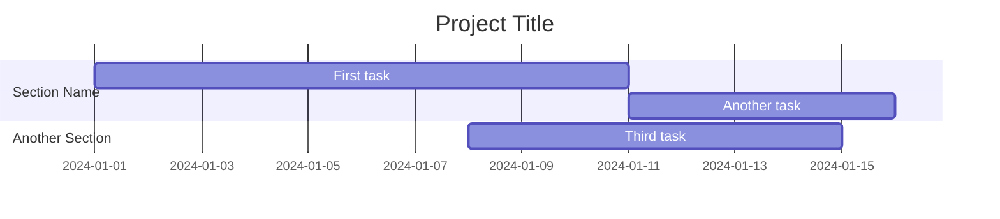
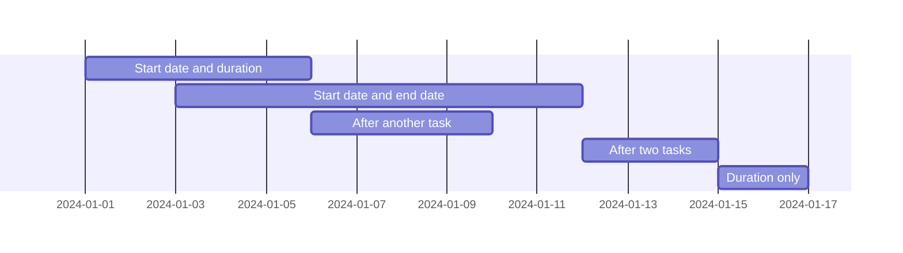
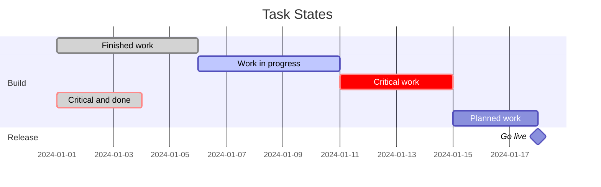
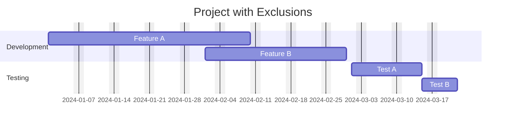
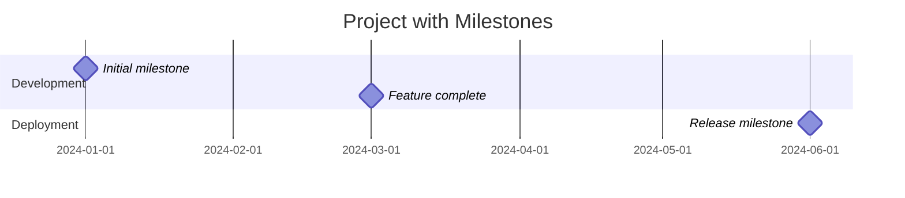
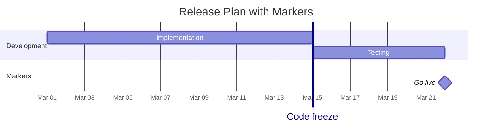
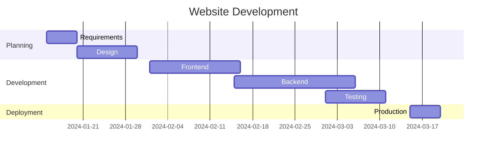
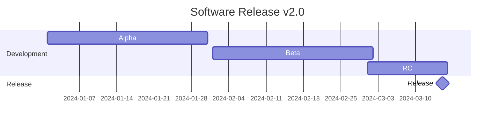
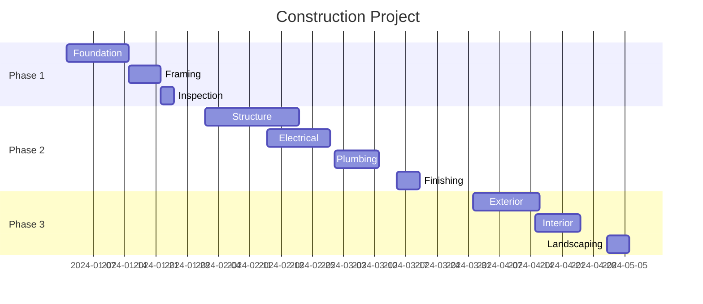
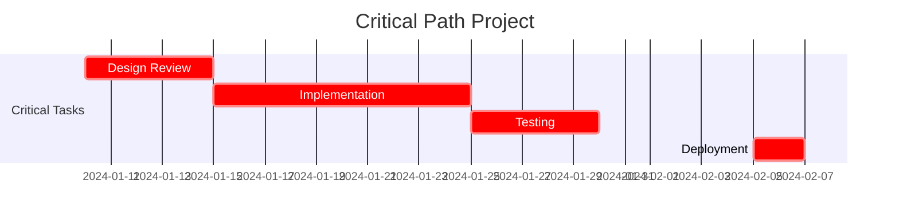

# Gantt Chart

## Summary

A Gantt chart is a type of bar chart that illustrates a project schedule and the amount of time it would take for any one project to finish. It was first developed by Karol Adamiecki in 1896 and independently by Henry Gantt in 1910s. Gantt charts are particularly useful for project management, timeline visualization, and resource planning.

### Use Cases

Gantt charts are best used for:

- **Project Management**: Visualizing project timelines, dependencies, and milestones
- **Resource Planning**: Allocating resources and personnel across project phases
- **Task Scheduling**: Planning and tracking work items with start and end dates
- **Timeline Visualization**: Showing historical project data and future projections
- **Product Development**: Mapping out development phases and release schedules
- **Event Planning**: Coordinating events and deadlines across teams
- **Construction Projects**: Scheduling building phases with critical paths
- **Academic Planning**: Breaking down research projects into manageable tasks

### When to Use

Gantt charts are ideal when you need to:
- Plan and track project timelines with specific dates
- Show dependencies between tasks and project phases
- Visualize critical paths and milestones
- Allocate resources across time periods
- Monitor progress against planned schedules
- Create project roadmaps and release plans
- Document complex projects with multiple phases

## Syntax

### Basic Structure

Template (placeholders, not runnable):

```text
gantt
    title <Project Title>
    dateFormat YYYY-MM-DD
    section <Section Name>
        <Task name> :<tags>, <task id>, <start date | after id>, <duration | end date>
```

Minimal complete chart:



### Task Definition

A task is `Task name :metadata`, with the metadata items separated by commas in this order: optional tags (`done`, `active`, `crit`, `milestone`, `vert`), optional task id, start, end.

- Start: a date in `dateFormat`, or `after <id>` (several ids separated by spaces: the latest end wins). Without a start the task begins when the previous one ends.
- End: a date, or a duration such as `30m`, `4h`, `3d`, `2w`.
- The task name must not contain a colon; everything after the first colon is read as metadata.
- Dates must be real dates in the declared `dateFormat`; a placeholder such as `start date` gives "Invalid date".



### Sections

`section <name>` starts a group of tasks; the name is required. Tasks before the first section are drawn without a group label.

### Date Formats

| Input | Example | Description |
|-------|---------|-----------|
| `YYYY` | 2014 | 4 digit year |
| `YY` | 14 | 2 digit year |
| `Q` | 1-4 | Quarter of year, sets the month to the first month of the quarter |
| `M MM` | 1-12 | Month number (1=Jan, 12=Dec) |
| `MMM MMMM` | Jan, January | Month name (short, full) |
| `D DD` | 1-31 | Day of month |
| `Do` | 1st-31st | Day with ordinal |
| `H HH` | 0-23 | 24-hour time, e.g. `dateFormat HH:mm` |
| `h hh` | 1-12 | 12-hour time, used with `a`/`A` (am/pm) |
| `m mm` | 0-59 | Minutes |
| `s ss` | 0-59 | Seconds |
| `X` | 1410715640.579 | Unix timestamp in seconds |
| `x` | 1410715640579 | Unix timestamp in milliseconds |

`dateFormat` describes the dates you type (default `YYYY-MM-DD`). The labels on the time axis are set separately with `axisFormat` (strftime style, e.g. `axisFormat %d.%m.` or `%b %d`), their spacing with `tickInterval` (e.g. `1day`, `1week`, `1month`).

### Task States

Tags are the first metadata items of a task and can be combined.

| Tag | Example | Description |
|-------|---------|-----------|
| `done` | `Design :done, d1, 2024-01-01, 5d` | Completed task (grey) |
| `active` | `Build :active, b1, after d1, 5d` | Task in progress |
| `crit` | `Fix :crit, f1, after b1, 4d` | Critical task (red) |
| `milestone` | `Go live :milestone, m1, after f1, 0d` | Single point in time (diamond) |
| `vert` | `Freeze :vert, v1, 2024-01-10, 0d` | Vertical marker line, see below |



### Exclusions

`excludes` takes `weekends`, a weekday name such as `sunday`, or dates in `YYYY-MM-DD` format, separated by commas. Excluded days are shaded and do not count towards a duration, so the task bar gets longer.



### Milestones



### Vertical Markers

A task with the tag `vert` is drawn as a vertical line across the whole chart with its name below the axis. It marks a date such as a deadline and does not take up a row of its own.



## Examples

### Simple Project Schedule



### Software Release Timeline



### Multi-Phase Project



### Critical Path Visualization



## Tips and Best Practices

1. **Use meaningful section titles** that clearly indicate project phases
2. **Define clear dependencies** - show how tasks relate to each other
3. **Set realistic durations** - estimate task completion times accurately
4. **Use milestones** for important project checkpoints and deliverables
5. **Identify critical paths** - highlight tasks that impact project timeline
6. **Group related tasks** into logical sections for better organization
7. **Use consistent date formats** - declare `dateFormat` and write every date in exactly that pattern
8. **Consider resource allocation** - plan personnel and equipment across phases
9. **Update progress regularly** - keep Gantt chart current with actual project status
10. **Use the tags for emphasis** - `crit`, `active` and `done` are the way to colour tasks; there is no per-task colour syntax
11. **Give tasks ids** and use `after <id>` instead of hard-coded start dates, so that dependencies stay visible
12. **Comments** are `%%` lines of their own

**References:**
- [Mermaid.js Gantt Chart Documentation](https://mermaid.js.org/syntax/gantt.html)
- [Mermaid.js Documentation](https://mermaid.js.org/)