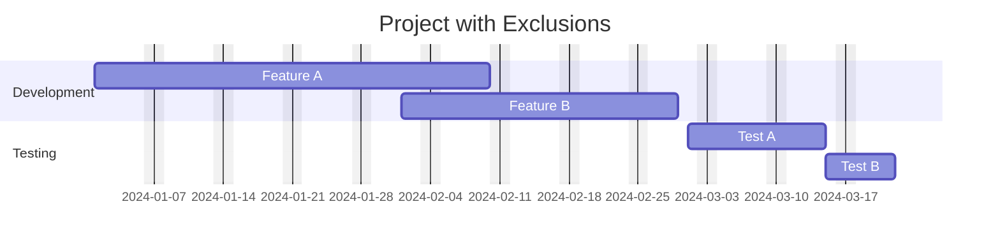
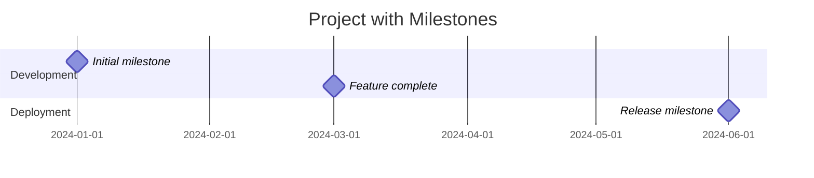
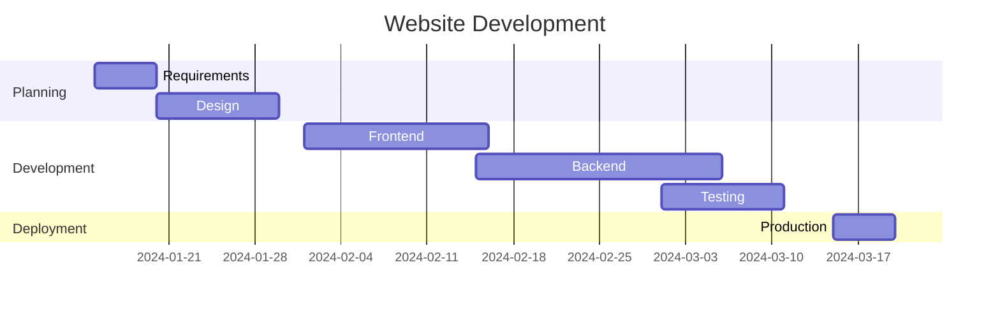
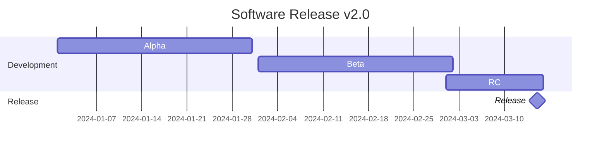
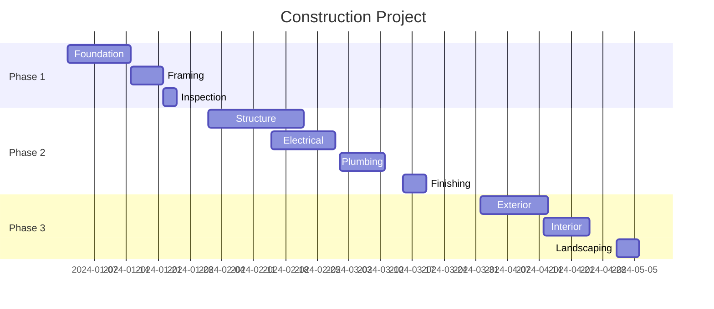
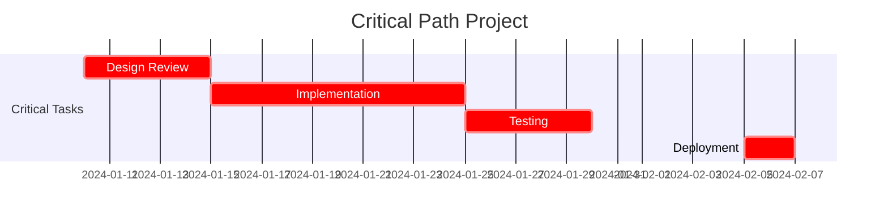

# Gantt Chart

## Summary

A Gantt chart is a type of bar chart that illustrates a project schedule and the amount of time it would take for any one project to finish. It was first developed by Karol Adamiecki in 1896 and independently by Henry Gantt in 1910s. Gantt charts are particularly useful for project management, timeline visualization, and resource planning.

### Use Cases

Gantt charts are best used for:

- **Project Management**: Visualizing project timelines, dependencies, and milestones
- **Resource Planning**: Allocating resources and personnel across project phases
- **Task Scheduling**: Planning and tracking work items with start and end dates
- **Timeline Visualization**: Showing historical project data and future projections
- **Product Development**: Mapping out development phases and release schedules
- **Event Planning**: Coordinating events and deadlines across teams
- **Construction Projects**: Scheduling building phases with critical paths
- **Academic Planning**: Breaking down research projects into manageable tasks

### When to Use

Gantt charts are ideal when you need to:
- Plan and track project timelines with specific dates
- Show dependencies between tasks and project phases
- Visualize critical paths and milestones
- Allocate resources across time periods
- Monitor progress against planned schedules
- Create project roadmaps and release plans
- Document complex projects with multiple phases

## Syntax

### Basic Structure

```mermaid
gantt
    title Project Title
    dateFormat YYYY-MM-DD
    section Section Name
        Task name: start date, duration
        Another task: after previous task, duration
    section Another Section
        Task name: start date, duration
```

### Task Definition

```mermaid
gantt
    Task name: start date, duration
```

### Sections

```mermaid
gantt
    section Section Name
        Task definitions
```

### Date Formats

| Input | Example | Description |
|-------|---------|-----------|
| `YYYY` | 2014 | 4 digit year |
| `YY` | 14 | 2 digit year |
| `Q` | 1-4 | Quarter of year (1=Jan-Mar, 4=Apr-Jun) |
| `M MM` | 1-12 | Month number (1=Jan, 12=Dec) |
| `MMM` | January-Dec | Full month name |
| `D DD` | 01-31 | Day of month |
| `Do` | 1st-31st | Day with ordinal |
| `HH:mm` | 00:00-23:59 | 24-hour time |
| `h hh` | 1-12 | 12-hour time |
| `m mm` | 0-59 | Minutes |
| `s ss` | 0-59 | Seconds |
| `X` | 1410715640.579 | Unix timestamp in milliseconds |

### Task States

| State | Syntax | Description |
|-------|---------|-----------|
| `done` | Task name: date | Completed task |
| `active` | Task name: date | Currently active task |
| `crit` | Task name: date | Critical task |
| `milestone` | Task name: date | Important milestone |

### Exclusions



### Milestones



## Examples

### Simple Project Schedule



### Software Release Timeline



### Multi-Phase Project



### Critical Path Visualization



## Tips and Best Practices

1. **Use meaningful section titles** that clearly indicate project phases
2. **Define clear dependencies** - show how tasks relate to each other
3. **Set realistic durations** - estimate task completion times accurately
4. **Use milestones** for important project checkpoints and deliverables
5. **Identify critical paths** - highlight tasks that impact project timeline
6. **Group related tasks** into logical sections for better organization
7. **Use consistent date formats** - ensure all dates follow the same pattern
8. **Consider resource allocation** - plan personnel and equipment across phases
9. **Update progress regularly** - keep Gantt chart current with actual project status
10. **Use color coding** - apply different colors to task types or priorities

**References:**
- [Mermaid.js Gantt Chart Documentation](https://mermaid.js.org/syntax/gantt.html)
- [Mermaid.js Documentation](https://mermaid.js.org/)