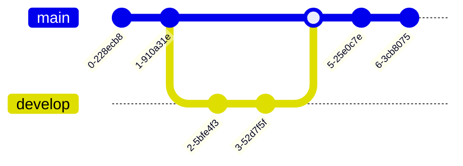
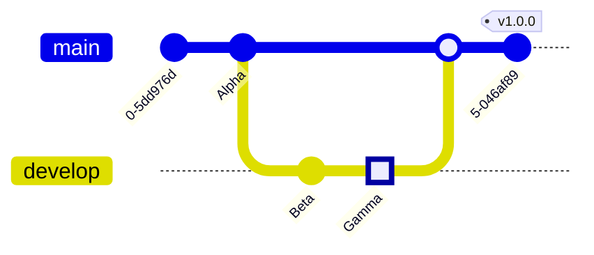
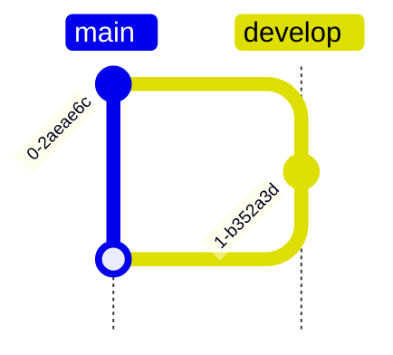
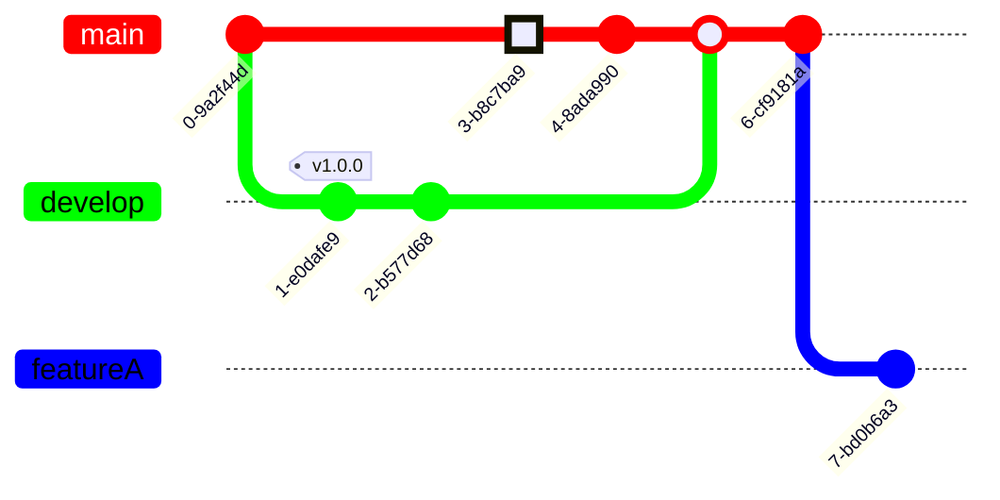

# GitGraph Diagram

## Summary

A GitGraph diagram is a pictorial representation of Git commits and actions (commands) on various branches. It helps developers and DevOps teams visualize branching strategies, workflows, and repository history, making it easier to communicate and understand Git operations.

### Use Cases

- **Branching Strategy Visualization**: Show how branches are created, merged, and managed.
- **Release Management**: Illustrate release, hotfix, and feature branch flows.
- **Training and Documentation**: Teach Git concepts and workflows.
- **Project History**: Visualize the commit and merge history of a project.

### When to Use

- When explaining or documenting Git workflows.
- When visualizing complex branching and merging scenarios.
- When onboarding new team members to a project's Git strategy.

## Syntax

- Start with the `gitGraph` keyword.
- By default, the main branch is created and set as the current branch.
- Use commands to add commits, create branches, checkout branches, merge, and cherry-pick.

### Basic Structure

### Supported Commands

- `commit` : Add a new commit to the current branch.
- `commit id: "label"` : Add a commit with a custom label.
- `commit type: HIGHLIGHT|REVERSE` : Change commit type (highlighted, reverse, or normal).
- `commit tag: "v1.0.0"` : Add a tag to a commit.
- `branch branchName` : Create and switch to a new branch.
- `checkout branchName` : Switch to an existing branch.
- `merge branchName` : Merge another branch into the current branch.
- `cherry-pick id: "commitId"` : Cherry-pick a commit from another branch.

### Example

### Orientation

Set orientation after `gitGraph`:
- `LR:` (default, left-to-right)
- `TB:` (top-to-bottom)
- `BT:` (bottom-to-top)

### Configuration

| Option             | Description                                 | Default   |
|--------------------|---------------------------------------------|-----------|
| showBranches       | Show/hide branch names and lines            | true      |
| showCommitLabel    | Show/hide commit labels                     | true      |
| mainBranchName     | Name of the main branch                     | "main"    |
| mainBranchOrder    | Order of the main branch                    | 0         |
| parallelCommits    | Show commits at the same level if parallel  | false     |
| rotateCommitLabel  | Rotate commit labels (true/false)           | true      |

### Theming

- Customize branch and commit colors using theme variables (`git0` to `git7`, `gitBranchLabel0` to `gitBranchLabel7`, etc.).
- Change themes: `base`, `forest`, `dark`, `default`, `neutral`.

## Tips

- Use custom commit IDs and tags for clarity.
- Use orientation and theming to match your documentation style.
- Keep diagrams focused on key workflows for readability.

**References:**  
- [Mermaid.js GitGraph Documentation](https://mermaid.js.org/syntax/gitgraph.html)
- [Mermaid.js Documentation](https://mermaid.js.org/)