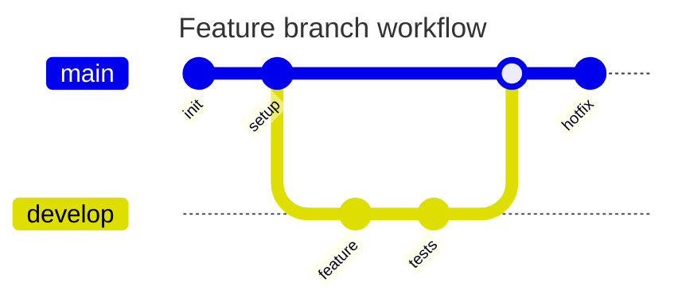
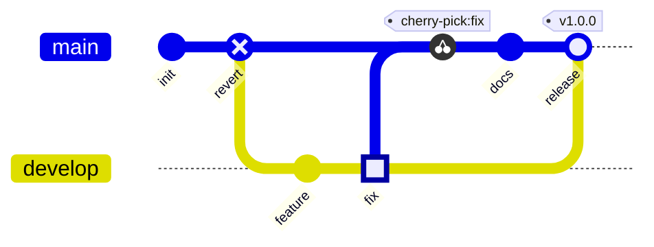
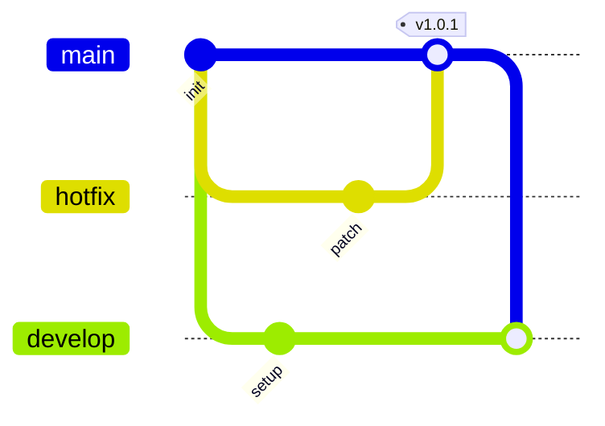
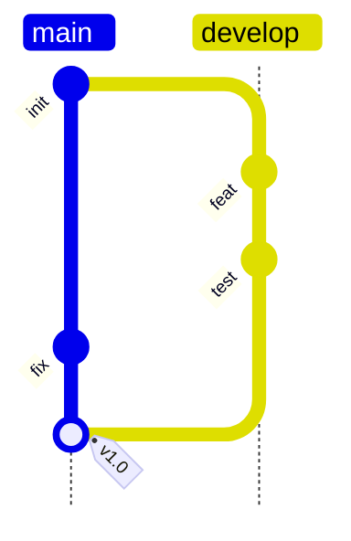
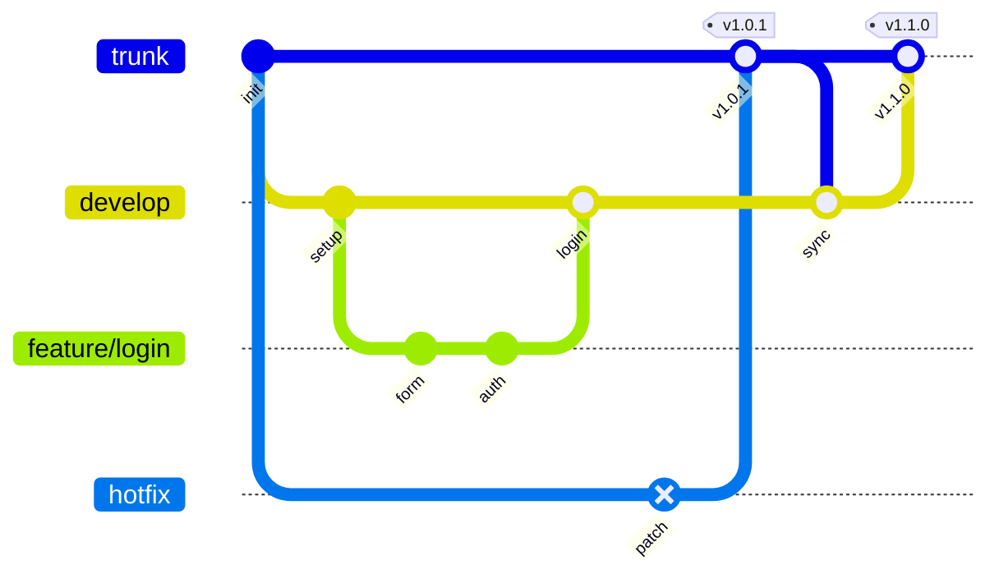
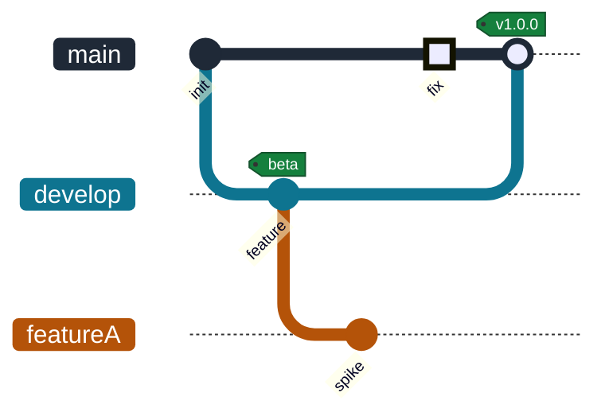

# GitGraph Diagram

## Summary

A GitGraph diagram is a pictorial representation of Git commits and actions (commands) on various branches. It helps developers and DevOps teams visualize branching strategies, workflows, and repository history, making it easier to communicate and understand Git operations.

### Use Cases

- **Branching Strategy Visualization**: Show how branches are created, merged, and managed.
- **Release Management**: Illustrate release, hotfix, and feature branch flows.
- **Training and Documentation**: Teach Git concepts and workflows.
- **Project History**: Visualize the commit and merge history of a project.

### When to Use

- When explaining or documenting Git workflows.
- When visualizing complex branching and merging scenarios.
- When onboarding new team members to a project's Git strategy.

## Syntax

- Start with the `gitGraph` keyword.
- The branch `main` exists from the start and is the current branch.
- Commands are executed in the order written, exactly like a Git session: every command acts on the current branch.
- `%%` starts a comment line.

### Basic Structure

A frontmatter `title:` is drawn above the graph.

### Supported Commands

| Command | Effect |
|---------|--------|
| `commit` | New commit on the current branch with a generated id such as `3-74ce9cc` |
| `commit id: "label"` | Commit with your own id; the id is the text shown at the commit |
| `commit type: NORMAL` / `REVERSE` / `HIGHLIGHT` | Circle (default) / crossed circle / square. Upper case only |
| `commit tag: "v1.0.0"` | Tag flag above the commit; repeat `tag:` for several tags |
| `branch name` | Create a branch at the current commit and switch to it |
| `branch name order: 2` | Same, with a fixed position in the branch list |
| `checkout name` or `switch name` | Switch to an existing branch |
| `merge name` | Merge branch `name` into the current branch (hollow circle) |
| `merge name id: "x" tag: "y" type: REVERSE` | Merge commit with its own id, tag or type |
| `cherry-pick id: "x"` | Copy the commit with id `x` from another branch onto the current branch |
| `cherry-pick id: "m" parent: "p"` | Required form when `m` is a merge commit; `p` is one of its direct parents |

`id`, `type` and `tag` can be combined in any order: `commit id: "fix" type: HIGHLIGHT tag: "v1.0.1"`.

### Example

Commit types, tags, a decorated merge and a cherry-pick (drawn as a cherry icon with a `cherry-pick:<id>` tag):

### Branch Names and Order

- Plain names may contain letters, digits, `/`, `-`, `_` and `.` (`feature/login`, `release-1.0`).
- Quote names that are only digits, contain spaces or equal a keyword: `branch "2024"`, `branch "release 1.0"`, `branch "cherry-pick"`, `branch "merge"`.
- Branches are listed in the order they are created, `main` first. `order:` moves a branch: branches without `order` come first, then the ordered ones by ascending number.

### Orientation

Write the orientation with a trailing colon after `gitGraph`:
- `LR:` (default) commits run left to right, branches are stacked.
- `TB:` commits run top to bottom, branches side by side.
- `BT:` commits run bottom to top.

`gitGraph TB` without the colon is a syntax error.

### Configuration

Set under `config.gitGraph` in the frontmatter.

| Option             | Description                                                        | Default   |
|--------------------|--------------------------------------------------------------------|-----------|
| showBranches       | Show branch names and branch lines                                 | true      |
| showCommitLabel    | Show the commit ids                                                | true      |
| mainBranchName     | Name of the initial branch (use this name in `checkout`)           | "main"    |
| mainBranchOrder    | Position of the main branch among branches that have an `order`    | 0         |
| parallelCommits    | Draw commits with the same distance to their parent side by side instead of one column per commit | false |
| rotateCommitLabel  | `true`: ids at 45° below the commit; `false`: horizontal           | true      |

### Theming

- Without a `theme:` in the frontmatter this skill's renderer draws the classic `default` theme (blue `main`, yellow second branch), not the `redux-color` look that the Mermaid 12 documentation calls the default. Other light themes: `base`, `forest`, `neutral`, `neo`, `redux`, `redux-color`.
- Avoid the dark themes (`dark`, `neo-dark`, `redux-dark`, `redux-dark-color`): the image has a transparent background, and on a white page their commit ids and partly the lines disappear.
- Theme variables (`config.themeVariables`): `git0`–`git7` branch colours, `gitBranchLabel0`–`gitBranchLabel7` text colour of the branch names, `gitInv0`–`gitInv7` border of `HIGHLIGHT` commits, `commitLabelColor`, `commitLabelBackground`, `commitLabelFontSize`, `tagLabelColor`, `tagLabelBackground`, `tagLabelBorder`, `tagLabelFontSize`.
- Index 0 is the first branch in display order, 1 the second, and so on. Only eight colours exist; the ninth branch reuses the colour of the first.
- When you change a `gitN` colour, set the matching `gitBranchLabelN` too, otherwise the branch name can become unreadable (black text on a dark colour).

## Rules and Pitfalls

- **Give every commit a short, unique `id`** (one or two words). Generated ids like `0-a01e46e` are noise, and a second commit with an id that already exists is silently dropped: the picture just has one commit fewer.
- Long ids collide: the id of the first commit runs into the branch names on the left, and with `rotateCommitLabel: false` neighbouring ids overlap each other. In `TB:`/`BT:` the ids stand left of the commit and cross the lines of the branches further left. Keep ids under about 12 characters.
- Tags sit above their commit. Tags on neighbouring commits overlap each other, and a tag on the top branch near the horizontal centre collides with a frontmatter `title:`. Leave a commit between two tagged commits and do not combine a title with tags in the middle of `main`.
- Do not use `<` or `>` in ids or tags; they are printed as `&lt;` and `&gt;`. `&`, `:`, `(`, `)` and umlauts are fine.
- The text of `commit "message"` and `commit msg: "..."` is accepted but never drawn. Use `id:`.
- `merge` needs something to merge: merging a branch into itself, or a branch without new commits ("Both branches have same head"), is an error.
- `checkout` of a branch that was not created, and `branch` with a name that already exists, are errors.
- `cherry-pick` needs an existing `id` from another branch; picking a commit of the current branch or an unknown id is an error. For a merge commit add `parent:`.
- `type:` values are upper case; `type: highlight` is a syntax error.
- With `mainBranchName`, every `checkout`/`merge` must use the new name; `main` no longer exists.
- More than five or six branches make an `LR:` graph tall and the text small; show only the branches that matter for the workflow.

**References:**
- [Mermaid.js GitGraph Documentation](https://mermaid.js.org/syntax/gitgraph.html)
- [Mermaid.js Documentation](https://mermaid.js.org/)
