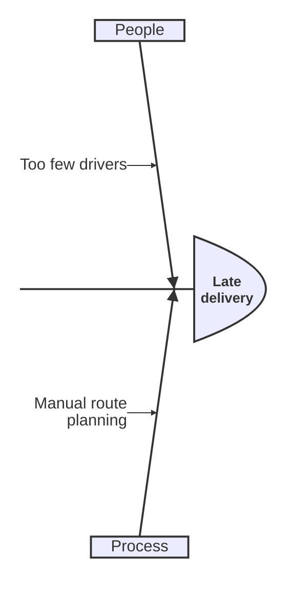
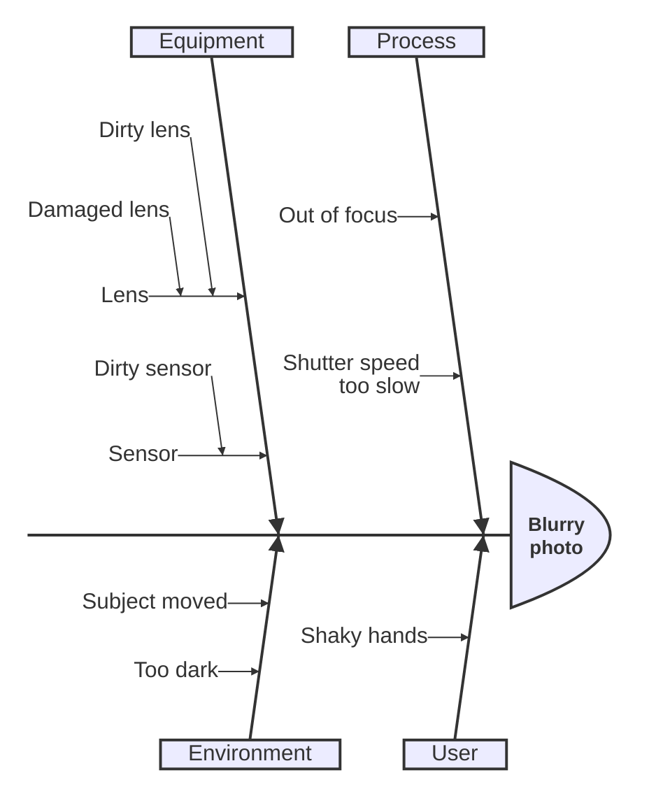
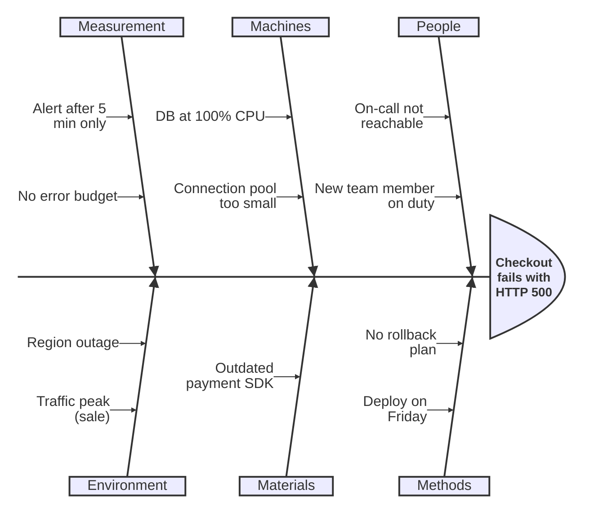
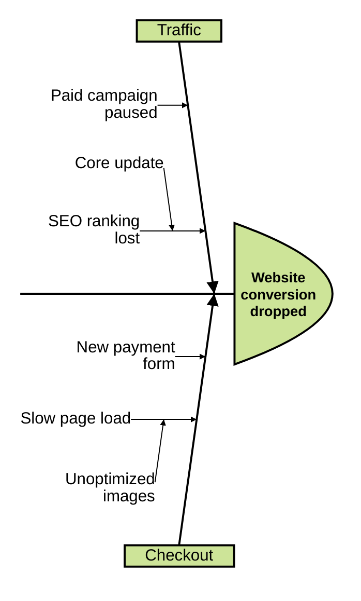

# Ishikawa Diagram (Fishbone)

## Summary

An **Ishikawa diagram** (fishbone or cause-and-effect diagram) in Mermaid shows one problem as the head of a fish and its possible causes as bones that branch off the spine. Causes are grouped into categories, and each cause can have sub-causes.

**Use Cases:**
- Root cause analysis after an incident or a quality problem
- Collecting the results of a brainstorming by category (for example the 6 M: Man, Machine, Method, Material, Measurement, Milieu)
- Post-mortems and retrospectives
- Structuring hypotheses before an investigation

**When to Use:**
- When there is exactly one effect and many possible causes
- When the causes fall into a handful of categories
- Not for sequences or dependencies between causes; the diagram has no connections other than "contributes to"

---

## Syntax Description

- Start with the `ishikawa-beta` keyword.
- The **first line** after the keyword is the problem (the effect). It becomes the fish head.
- Every following line is a cause. The **indentation** alone decides the level:
  - one level below the problem: a category (a box at the end of a main bone, alternating above and below the spine),
  - one level deeper: a cause on that bone,
  - deeper still: sub-causes of the cause above.
- All lines are plain text. There are no ids, no brackets, no quotes and no arrows.
- `%%` starts a comment line. Blank lines are ignored.
- There is no `title` statement, and a `title:` in front matter is not shown either. The problem line is the only heading.

**Basic Syntax:**
```text
ishikawa-beta
  <Problem>
  <Category>
    <Cause>
      <Sub-cause>
  <Category>
    <Cause>
```

**Layout:**
- Categories are placed starting at the head: the 1st, 3rd, 5th ... above the spine, the 2nd, 4th, 6th ... below it.
- Long texts are wrapped automatically (the head and the causes), so no manual line breaks are needed.

**Theme:** the usual front matter works, for example `config: theme: forest`. There are no diagram-specific options.

---

## Examples

### Minimal



### Categories with Sub-Causes



### Incident Analysis with Six Categories (6 M)



### With Comments and a Theme



---

## Rules and Pitfalls

- **The first line is always the problem.** A line such as `title Root causes` is not a title: it becomes the fish head, and the real problem slides down to become the first category.
- **Indentation is the structure.** Use spaces and the same step (2 or 4) for every level. A line that is indented deeper than intended silently becomes a sub-cause of the line above; nothing fails.
- **Do not quote.** Quotation marks are printed as part of the text (`"Quoted cause"` shows up with the quotes). Characters such as `(`, `)`, `:`, `;`, `,`, `%`, `&`, `>`, `[`, `]` and `'` can be written as they are.
- **Keep causes short** (up to about 25 characters). Longer texts are wrapped onto several lines, and on a bone with sub-causes the wrapped lines run into the neighboring labels.
- **Two levels below the category are the practical limit.** Deeper nesting is accepted (five levels render), but the sub-sub-causes hang on thin arrows that are hard to follow.
- **A category without causes** is drawn as a very short bone whose box sits right next to the spine, in the middle of the picture. Give every category at least one cause or leave it out.
- **Balance the categories.** The bone length follows the category with the most causes; one category with many causes and sub-causes makes the whole picture tall.
- **Two categories give a tall, narrow picture** (one bone up, one down). Four to six categories give the typical fishbone shape; eight still render cleanly.

---

## References

- [Official Mermaid Ishikawa Diagram Documentation](https://mermaid.js.org/syntax/ishikawa.html)
- [Mermaid.js Documentation](https://mermaid.js.org/)
