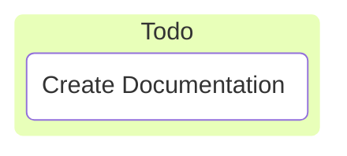
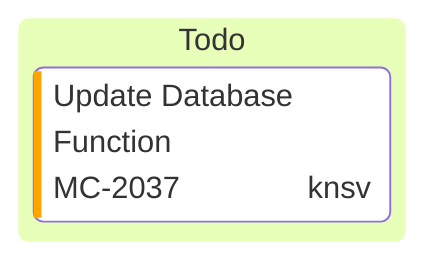
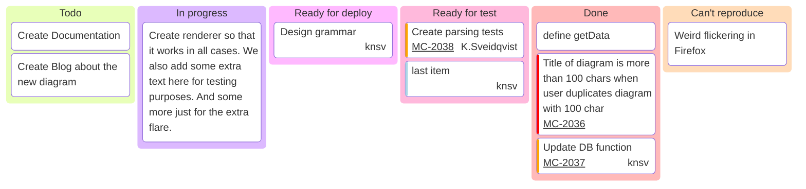

# Kanban Diagram

## Summary

A **Kanban diagram** in Mermaid allows you to visually represent tasks as they move through different stages of a workflow. It is ideal for project management, tracking progress, and visualizing work in progress.

**Use Cases:**
- Visualizing project workflows (e.g., Todo, In Progress, Done)
- Task management and tracking
- Agile and Lean process boards
- Team collaboration and status reporting

**When to Use:**
- When you want to track tasks through various workflow stages
- When you need a visual board for project or process management

---

## Syntax Description

- Start with the `kanban` keyword.
- Define columns (stages) using a unique identifier and a title in square brackets: `columnId[Column Title]`.
- List tasks under each column, indented, with a unique identifier and a description in square brackets: `taskId[Task Description]`.
- Add metadata to tasks using the `@{ ... }` syntax for key-value pairs (e.g., assigned, ticket, priority).
- Use a configuration block at the top for global settings (e.g., ticketBaseUrl).

**Basic Syntax:**
```
kanban
  column1[Column Title]
    task1[Task Description]
```

**Column Definition:**
```
columnId[Column Title]
```

**Task Definition:**
```
taskId[Task Description]
```

**Task Metadata:**
```
taskId[Task Description]@{ ticket: MC-2037, assigned: 'knsv', priority: 'High' }
```

**Configuration Block Example:**
```yaml
---
config:
  kanban:
    ticketBaseUrl: 'https://yourproject.atlassian.net/browse/#TICKET#'
---
```

---

## Examples

### Basic Kanban



### Kanban with Metadata



### Full Example



---

## Tips

- Use unique identifiers for columns and tasks.
- Indent tasks under their parent columns.
- Use metadata to add context (assignee, ticket, priority).
- Use the configuration block to enable ticket linking.

---

## References

- [Official Mermaid Kanban Diagram Documentation](https://mermaid.js.org/syntax/kanban.html)
- [Mermaid.js Documentation](https://mermaid.js.org/)