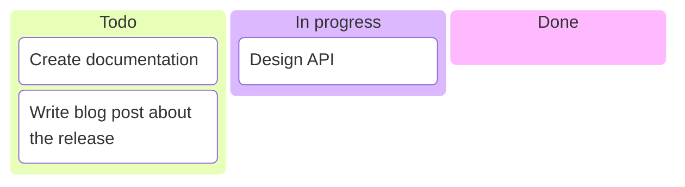
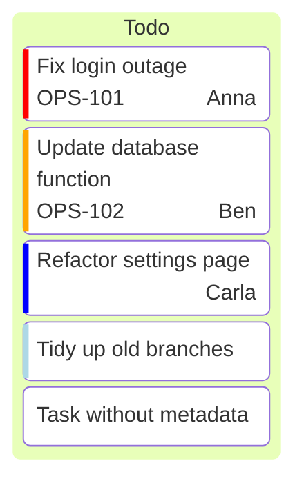
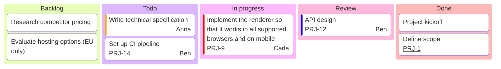

# Kanban Diagram

## Summary

A **Kanban diagram** in Mermaid allows you to visually represent tasks as they move through different stages of a workflow. Each stage is a coloured column, each task a white card inside it. It is ideal for project management, tracking progress, and visualizing work in progress.

**Use Cases:**
- Visualizing project workflows (e.g., Todo, In Progress, Done)
- Task management and tracking
- Agile and Lean process boards
- Team collaboration and status reporting

**When to Use:**
- When you want to track tasks through various workflow stages
- When you need a visual board for project or process management
- Not for dependencies between tasks or for dates: the board has no arrows and no time axis (use a flowchart or a Gantt chart).

---

## Syntax Description

- Start with the `kanban` keyword.
- A line on the first indentation level is a column: `columnId[Column Title]`.
- A line indented deeper than its column is a task card: `taskId[Task Description]`.
- Metadata is attached directly to the closing bracket with `@{ ... }` (assignee, ticket, priority).
- A frontmatter configuration block sets board-wide options.
- `%%` starts a comment line.

**Basic Syntax:**
```text
kanban
  columnId[Column Title]
    taskId[Task Description]
    taskId[Task Description]@{ assigned: 'Name', ticket: 'ABC-1', priority: 'High' }
```

**Columns and tasks:**

- Ids are single words (letters, digits, `_`, `-`). The id can be left out: `[In progress]`, or just the bare text `Todo`. Prefer the full `id[Text]` form.
- A column without tasks is drawn as an empty coloured header; that is fine for showing an empty stage.
- Long task texts wrap automatically inside the card; `<br/>` forces a line break. Column titles wrap as well, so keep them to one or two words.
- Text inside `[...]` may contain `:`, `;`, `,`, `&`, `#`, `%`, `@`, `"`, umlauts and emoji. If it contains `(`, `)`, `{`, `}` or `[`, `]`, wrap it in quotes: `t1["Deploy (staging)"]`.
- Markdown formatting works with the backtick form: ``t1["`**Bold** and *italic*`"]``.

**Task Metadata:**

| Key | Rendered as |
|-----|-------------|
| `assigned` | Name at the bottom right of the card |
| `ticket` | Ticket number at the bottom left; underlined link when `ticketBaseUrl` is set |
| `priority` | Coloured bar at the left edge of the card: `'Very High'` red, `'High'` orange, `'Low'` blue, `'Very Low'` light blue |

- Values may be written with single quotes, double quotes or without quotes (`assigned: Bob Miller`). Quote values that contain a comma: unquoted `assigned: A, B` shows only "A".
- The metadata block may span several lines, one `key: value` per line, closing `}` on its own line.
- Other keys (`due`, `estimate`, ...) and other priority values (`'Medium'`, `'high'`) are accepted and ignored: nothing is drawn.

**Configuration Block:**

| Option | Effect | Default |
|--------|--------|---------|
| `ticketBaseUrl` | Link template for tickets; `#TICKET#` is replaced by the task's `ticket` value | none |
| `sectionWidth` | Column width in pixels; raise it when cards hold long texts | 200 |

```text
---
config:
  kanban:
    ticketBaseUrl: 'https://yourproject.atlassian.net/browse/#TICKET#'
    sectionWidth: 260
---
```

---

## Examples

### Basic Kanban



### Kanban with Metadata

All four priority colours, assignee and ticket:



### Full Example



---

## Rules and Pitfalls

- **Indentation decides what a line is.** A task written on the same indentation level as its column becomes a new, empty column. Indenting a task deeper than its siblings does not create a sub-task; it stays a normal card.
- **Column ids must be unique.** Two columns with the same id are both drawn, and each of them shows the cards of both. Keep task ids unique as well.
- No space between `]` and `@{`: `t1[Task] @{ ... }` is a parse error.
- Unquoted `(`, `)`, `{`, `}` or nested `[ ]` inside a title are parse errors. Quote the text.
- There is no board title: a frontmatter `title:` is not drawn, and a `title ...` line inside the diagram becomes a column named "title ...". Name the board in the surrounding text.
- Only the four priority values in the table produce a colour, and they are case-sensitive.
- Other bracket shapes (`t1(Text)`, `t1((Text))`) parse but look exactly like `t1[Text]`.
- Every column adds `sectionWidth` pixels to the width. More than six columns make the board very wide and the text small; merge stages or split the board.
- Columns are coloured automatically in the order they appear; there is no per-column colour syntax.

---

## References

- [Official Mermaid Kanban Diagram Documentation](https://mermaid.js.org/syntax/kanban.html)
- [Mermaid.js Documentation](https://mermaid.js.org/)
