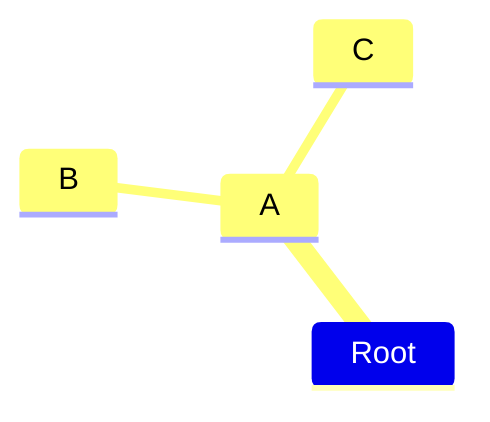
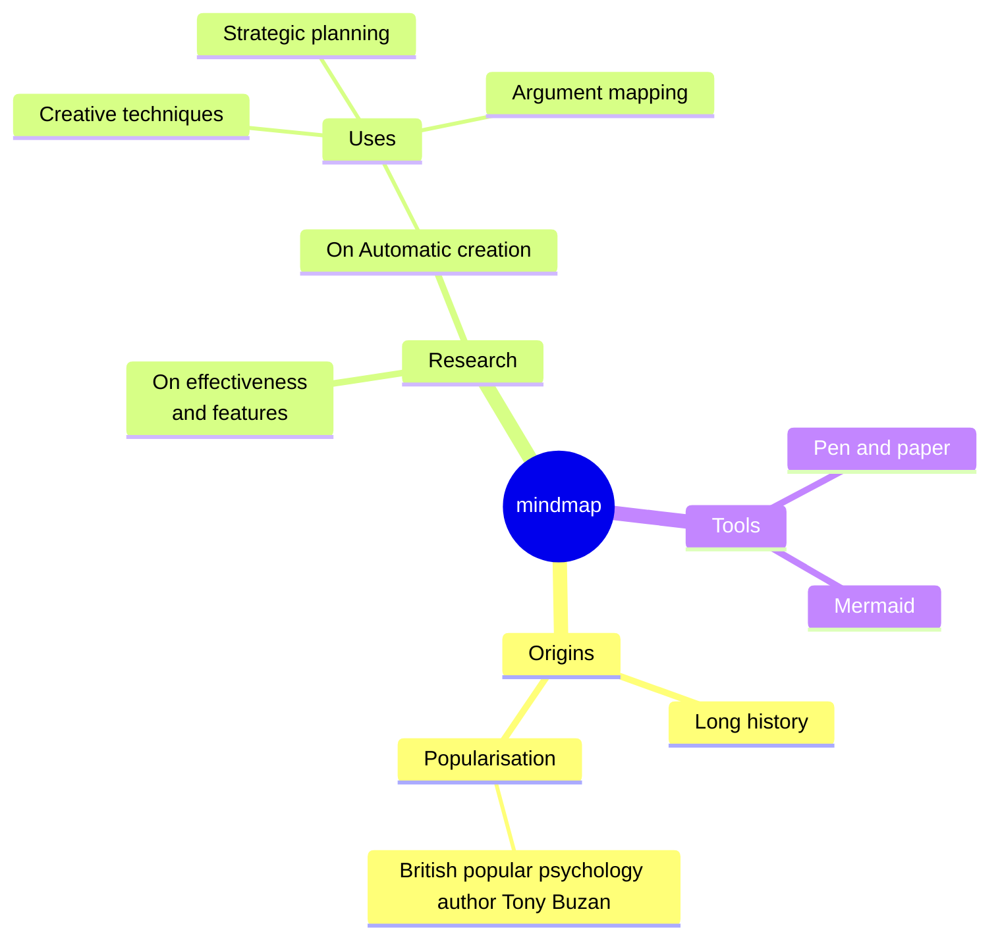
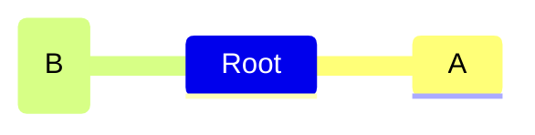
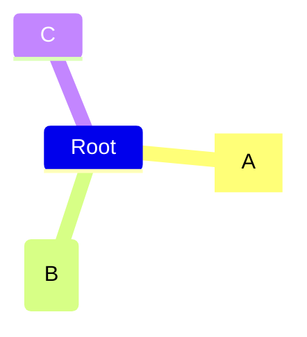
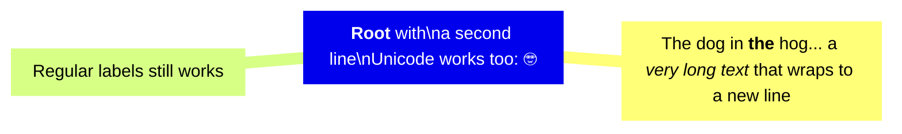
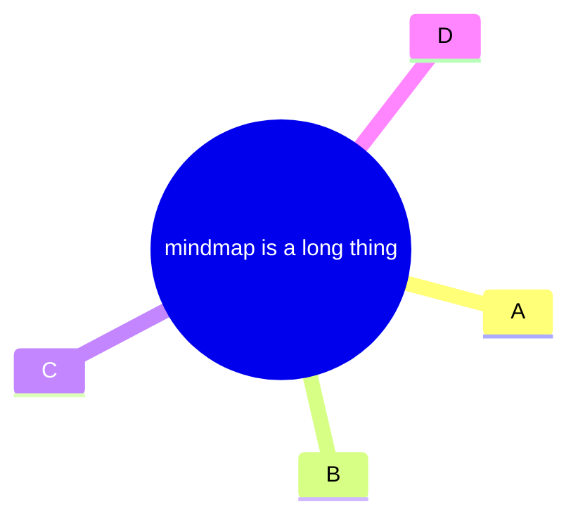

# Mindmap

## Summary

A Mindmap is a diagram used to visually organize information into a hierarchy, showing relationships among pieces of the whole. It is often created around a single concept, with major ideas branching out and further sub-ideas branching from those. Mindmaps are ideal for brainstorming, planning, and structuring complex information.

> **Note:** Mindmap diagrams in Mermaid are experimental. Syntax and properties may change in future releases.

### Use Cases

- **Brainstorming**: Capture and organize ideas around a central concept.
- **Project Planning**: Break down projects into tasks and subtasks.
- **Note-taking**: Structure notes for better recall and understanding.
- **Knowledge Mapping**: Visualize relationships between concepts.

### When to Use

- When you need to organize ideas hierarchically.
- When visualizing relationships and dependencies.
- When planning or outlining complex topics.

## Syntax

- Start with the `mindmap` keyword.
- Use indentation to define hierarchy levels.
- Nodes can have different shapes and icons.
- Markdown formatting is supported in labels.

### Basic Structure

### Example

### Node Shapes

- Square: `id[Square]`
- Rounded Square: `id(Rounded Square)`
- Circle: `id((Circle))`
- Bang: `id))Bang((`
- Cloud: `id)Cloud(`
- Hexagon: `id{{Hexagon}}`
- Default: `Label`

### Icons

Add icons using `::icon(class names)` after a node.

### Classes

Add CSS classes using triple colons:

### Markdown Strings

Use backticks and quotes for formatted, wrapped text:

### Layouts

Tidy Tree layout is supported:

## Tips

- Use indentation to clearly define hierarchy.
- Use shapes and icons for emphasis and clarity.
- Use Markdown formatting for better label presentation.

**References:**  
- [Mermaid.js Mindmap Documentation](https://mermaid.js.org/syntax/mindmap.html)
- [Mermaid.js Documentation](https://mermaid.js.org/)