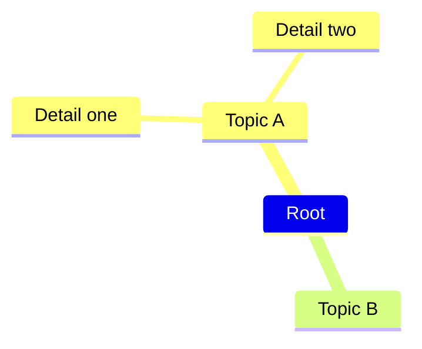
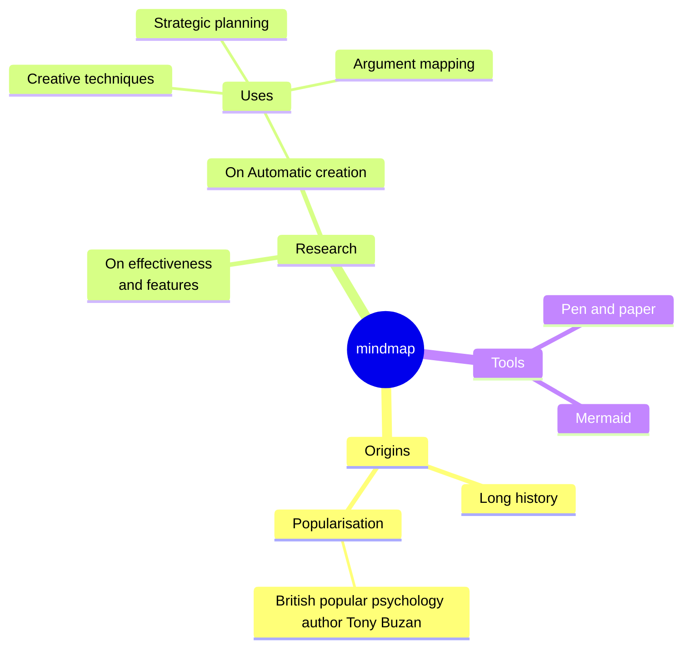
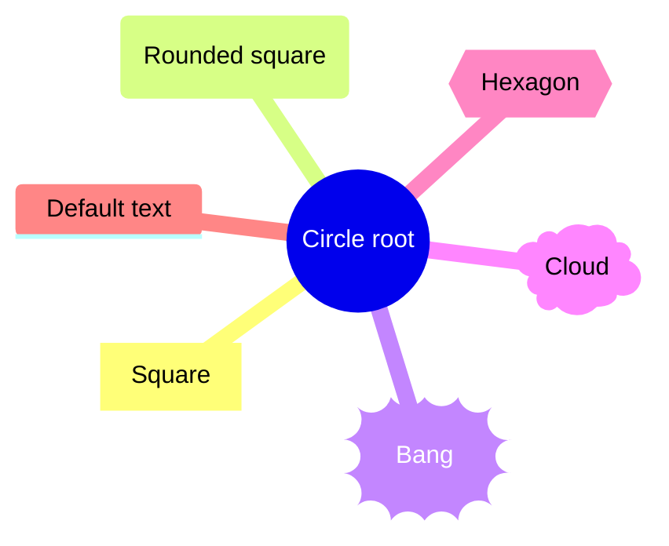
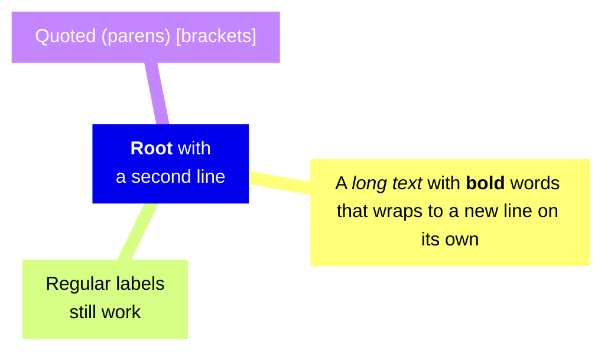
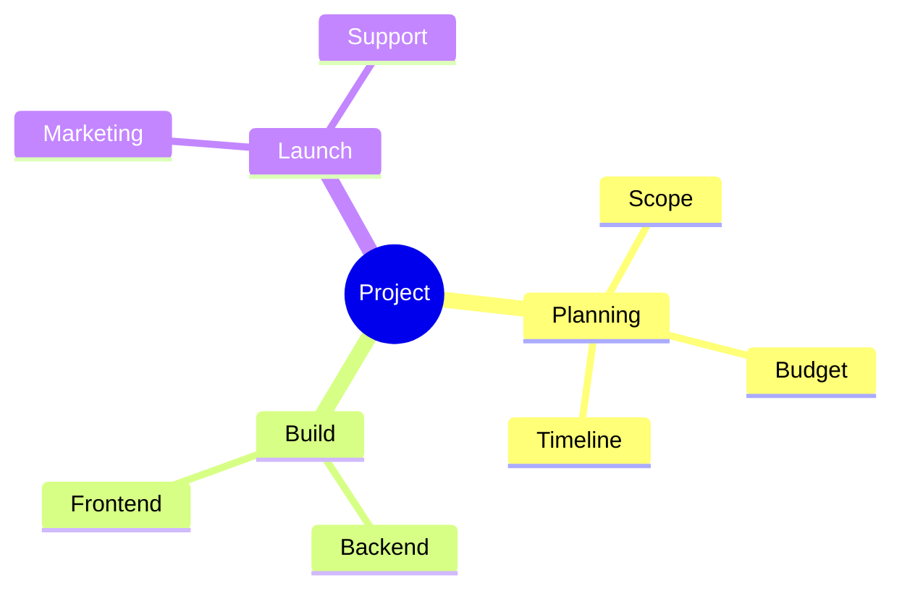
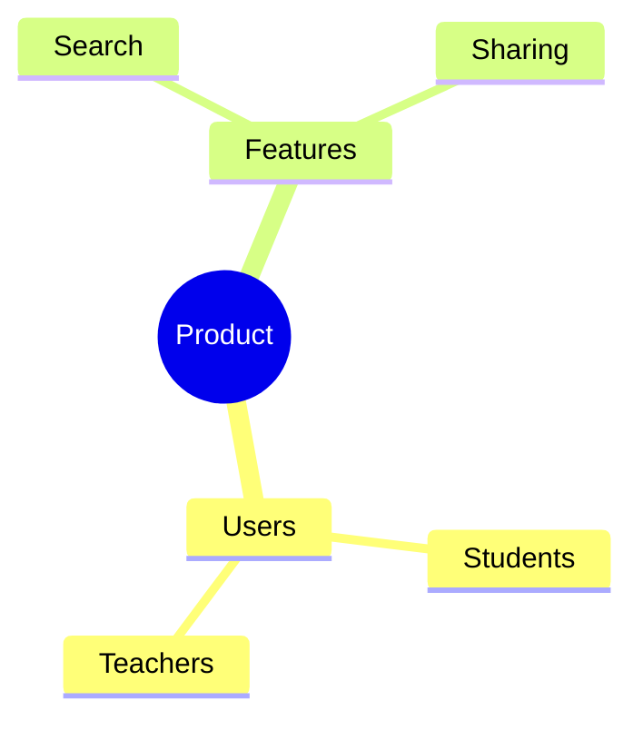

# Mindmap

## Summary

A Mindmap is a diagram used to visually organize information into a hierarchy, showing relationships among pieces of the whole. It is created around a single concept, with major ideas branching out and further sub-ideas branching from those. Mindmaps are ideal for brainstorming, planning, and structuring complex information.

### Use Cases

- **Brainstorming**: Capture and organize ideas around a central concept.
- **Project Planning**: Break down projects into tasks and subtasks.
- **Note-taking**: Structure notes for better recall and understanding.
- **Knowledge Mapping**: Visualize relationships between concepts.

### When to Use

- When you need to organize ideas hierarchically around one central topic.
- When planning or outlining complex topics.
- Not for cross-links between branches or labelled relations: a mindmap is a strict tree with exactly one root and unlabelled lines.

## Syntax

- Start with the `mindmap` keyword.
- One node per line; indentation defines the hierarchy (spaces or tabs, any consistent step).
- The first node is the root. There must be exactly one root.
- A node is either plain text or `id` + shape brackets + text.
- `%%` starts a comment line.

### Basic Structure

Only the indentation relative to the lines above counts. A line that is indented less than the previous one becomes a child of the nearest line above it with a smaller indentation.

### Example

### Node Shapes

| Syntax | Shape |
|--------|-------|
| `Label` | Default: rounded box with an underline |
| `id[Text]` | Square |
| `id(Text)` | Rounded square |
| `id((Text))` | Circle |
| `id))Text((` | Bang (spiky burst) |
| `id)Text(` | Cloud |
| `id{{Text}}` | Hexagon |

The `id` is a single word and is not displayed; it does not have to be unique.

### Label Text

- Plain labels may contain spaces, umlauts, emoji and `: ; , . ? ! ' " / - = & % $ # @ < >`.
- **Brackets need quotes.** Put any text that contains `(`, `)`, `[`, `]`, `{` or `}` into a shape with a quoted string: `n1["Costs (2024) [draft]"]` or `n1("Costs (2024)")`.
- Long labels wrap automatically at about 200 px (`config.mindmap.maxNodeWidth`). ` ` forces a line break in plain and quoted labels.

### Markdown Strings

A label in double quotes plus backticks supports `**bold**`, `*italic*` and real line breaks: press Enter inside the string, the continuation line may start in column 1.

### Layouts

The default layout places the branches radially around the root; positions and angles are chosen by the engine and long branches can end up in any direction. `layout: tidy-tree` gives a tidy horizontal tree with the branches split left and right of the root. Prefer it for maps with more than about ten nodes or three levels.

### Colours

By default every first-level branch gets its own colour and its descendants inherit it. With `colorBy: depth` all nodes of the same level share a colour instead:

A different palette is chosen with `config.theme`: `default` (used when nothing is set), `forest`, `base`, `neo`, `redux-color`. `neutral` and the dark themes give near-white or black nodes on the transparent background and are not useful here. Single nodes cannot be coloured: there is no `style` or `classDef` in mindmaps.

## Rules and Pitfalls

- **Unquoted brackets silently change the text.** `Label (with parens)` is read as id `Label` + rounded shape and only "with parens" is shown; `Label [draft]` shows only "draft". A `{` in a plain label, or brackets inside an unquoted shape (`a[Text (x)]`), are parse errors. Quote such texts (see Label Text).
- **Exactly one root.** A second line on the root's indentation level fails with "There can be only one root". This also hits any unsupported statement written at the end, such as `classDef ...`.
- **No icons.** `::icon(fa fa-book)` is accepted but nothing is drawn, because the renderer has no icon fonts. Use an emoji in the label if a pictogram is needed.
- **No classes.** `:::name` lines are accepted but have no visible effect, since the CSS classes cannot be defined from the diagram.
- **No title.** A frontmatter `title:` is not drawn; make the root the title.
- In Markdown strings `\n` is printed literally. Use a real line break or ` `.
- `layout: elk` crashes the renderer for mindmaps. Only the default layout and `tidy-tree` work.
- A single very long word does not wrap and makes its node as wide as the word.
- Keep labels to a few words and the map to about 30 nodes; beyond that the text gets small. Split a large map by turning a branch into its own mindmap.

**References:**
- [Mermaid.js Mindmap Documentation](https://mermaid.js.org/syntax/mindmap.html)
- [Mermaid.js Documentation](https://mermaid.js.org/)
