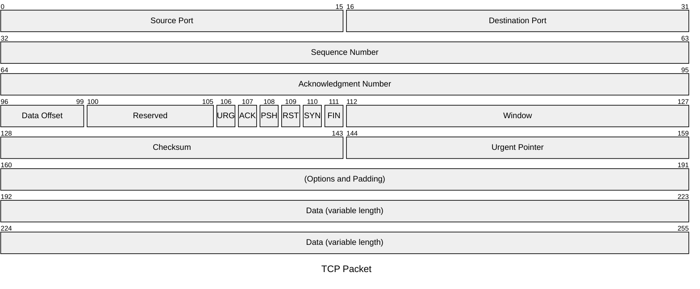
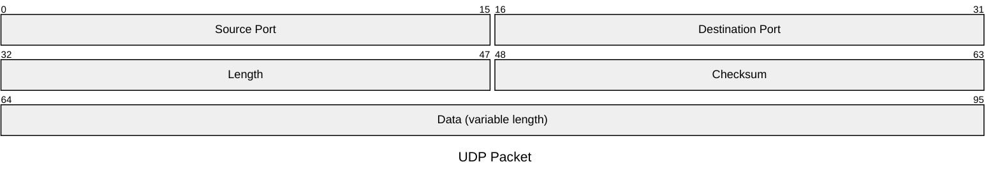

# Packet Diagram

## Summary

A **Packet diagram** is a visual representation used to illustrate the structure and contents of a network packet. It is especially useful for developers, network engineers, educators, and students who need to clearly represent the structure of network packets, including the bit layout and field descriptions.

**Use Cases:**
- Visualizing the structure of network protocol packets (e.g., TCP, UDP, custom protocols)
- Explaining bit-level layouts in technical documentation
- Teaching or learning about network data formats

**When to Use:**
- When you need to show the bitwise structure of a data packet
- When documenting or designing network protocols

---

## Syntax Description

- Start with the `packet` keyword.
- Each line after the title represents a field in the packet.
- Use `start-end: "Block name"` for multi-bit fields.
- Use `start: "Block name"` for single-bit fields.
- Use `+<count>: "Block name"` to automatically increment bit positions (v11.7.0+).
- Add comments with `%%`.

**Basic Syntax:**
```
packet
start: "Block name" %% Single-bit block
start-end: "Block name" %% Multi-bit block
+<count>: "Block name" %% Auto-increment bit count
```

---

## Examples

### TCP Packet Example



### UDP Packet Example (with bit count syntax)



---

## Tips

- Use `+<count>` for easier field definition when modifying packet layouts.
- Use comments (`%%`) to annotate fields for clarity.
- Refer to the [configuration guide](https://mermaid.js.org/config/schema-docs/config-defs-packet-diagram-config.html) for advanced options.

---

## References

- [Official Mermaid Packet Diagram Documentation](https://mermaid.js.org/syntax/packet.html)
- [Mermaid.js Documentation](https://mermaid.js.org/)