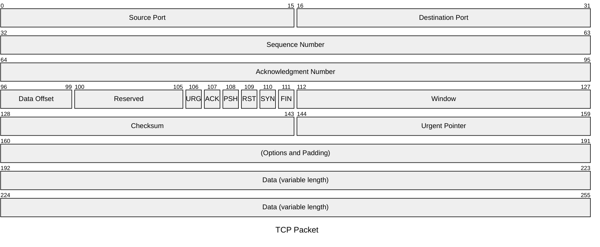
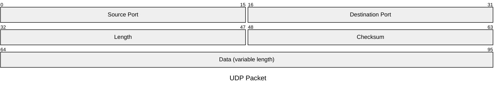
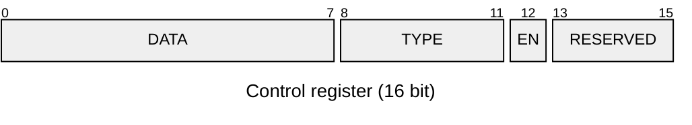
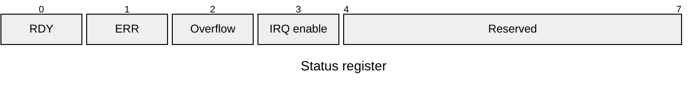

# Packet Diagram

## Summary

A **Packet diagram** shows the bit layout of a network packet, protocol header or hardware register: rows of bits, split into labelled fields.

**Use Cases:**
- Visualizing the structure of network protocol packets (e.g., TCP, UDP, custom protocols)
- Explaining bit-level layouts in technical documentation
- Documenting hardware registers (status/control registers, bit fields)

**When to Use:**
- When you need to show the bitwise structure of a data packet or register
- When documenting or designing network protocols

---

## Syntax Description

- Start with the `packet` keyword (`packet-beta` is still accepted).
- Optional `title Some text` line. A front-matter `title:` works too; if both are given the `title` line wins. The title is drawn **below** the diagram.
- One field per line; the label must be in quotes (double or single). An unquoted label is a syntax error.
- `start-end: "Label"` for a multi-bit field, `start: "Label"` for a single bit, both zero-based and inclusive.
- `+<count>: "Label"` for a field of `count` bits that starts right after the previous field. Ranges and `+count` can be mixed freely.
- Comments with `%%`, on their own line or after a field.

```text
packet
title <optional title>
<start>: "<single-bit field>"
<start>-<end>: "<multi-bit field>"   %% inclusive, zero-based
+<count>: "<field of count bits>"
```

**Fields must be gapless and in ascending order.** The first field starts at bit 0 and every field starts exactly one bit after the previous one ends. Anything else is rejected:

| Written | Renderer says |
|---------|---------------|
| first field `8-15` | `Packet block 8 - 15 is not contiguous. It should start from 0.` |
| `0-7` then `16-23` (gap) | `... is not contiguous. It should start from 8.` |
| `0-7` then `4-15` (overlap) | `... is not contiguous. It should start from 8.` |
| `7-0` (descending range) | `End must be greater than start.` |
| `+0` | `Cannot have a zero bit field.` |

Reserved or unused bits therefore need their own field (`"Reserved"`). `+count` avoids all of these errors and is the safer way to write a layout.

---

## Examples

### TCP header (explicit ranges)



A row holds 32 bits by default. A field that crosses a row boundary (here `192-255`) is split and its label is repeated in every row.

### UDP header (bit counts)



### Hardware register (MSB on the left)

By default bit 0 is on the left. For registers set `bitOrder: descending` (new in Mermaid 12) to put the highest bit on the left, and set `bitsPerRow` to the register width, otherwise a 16-bit register only fills half of a 32-bit row.



Only the drawing is mirrored: fields are still declared from bit 0 upwards (`0-7`, never `7-0`). Each row is mirrored separately, so with several rows the first row shows bits 31..0, the second 63..32; a partly filled last row is right-aligned.

### Narrow fields with longer labels

Labels are neither wrapped nor shrunk; text that is wider than its field runs over the borders. Widen the bits with `bitWidth` (and use fewer bits per row) instead of abbreviating everything.



---

## Configuration

Set under `config: packet:` in the front matter (all verified):

| Option | Default | Effect |
|--------|---------|--------|
| `bitsPerRow` | 32 | Bits per row; the diagram is always this wide, even if fewer bits are defined |
| `bitWidth` | 32 | Width of one bit in px |
| `rowHeight` | 32 | Height of a field box in px |
| `showBits` | true | `false` hides the bit numbers above the fields |
| `bitOrder` | ascending | `descending` puts the highest bit of each row on the left (Mermaid 12+) |
| `paddingX` / `paddingY` | 5 | Gap between fields / between rows |

Theme variables under `config: themeVariables: packet:` work only partly in this version: `labelColor`, `labelFontSize`, `titleColor` and `titleFontSize` are applied; `blockFillColor`, `blockStrokeColor`, `blockStrokeWidth`, `byteFontSize`, `startByteColor` and `endByteColor` are ignored. To change the box colours pick another `theme` (e.g. `forest`).

---

## Rules and Pitfalls

- Start at bit 0, no gaps, no overlaps, ascending order; give unused bits a `"Reserved"` field. Prefer `+count`.
- Always quote labels. Inside double quotes `\"` gives a quote character; HTML tags such as `<b>` or `<br/>` are printed literally, and `#...;` entity codes are dropped. Keep labels plain.
- With the default `bitWidth` of 32 a single-bit field fits about 3 characters (`ACK`, `SYN`) and a 4-bit field about 14. Longer labels overflow the box: shorten them or raise `bitWidth`.
- Set `bitsPerRow` to the natural word size (8, 16, 32). A layout with fewer bits than `bitsPerRow` leaves the rest of the row empty.
- With `bitOrder: descending` still write ranges ascending.
- Do not use `theme: dark`: bit numbers and title turn light and disappear on the white background of the rendered image.
- The title is placed under the diagram, not above it.

---

## References

- [Official Mermaid Packet Diagram Documentation](https://mermaid.js.org/syntax/packet.html)
- [Packet configuration schema](https://mermaid.js.org/config/schema-docs/config-defs-packet-diagram-config.html)
