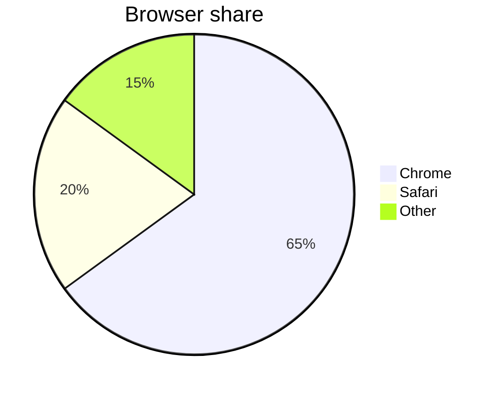
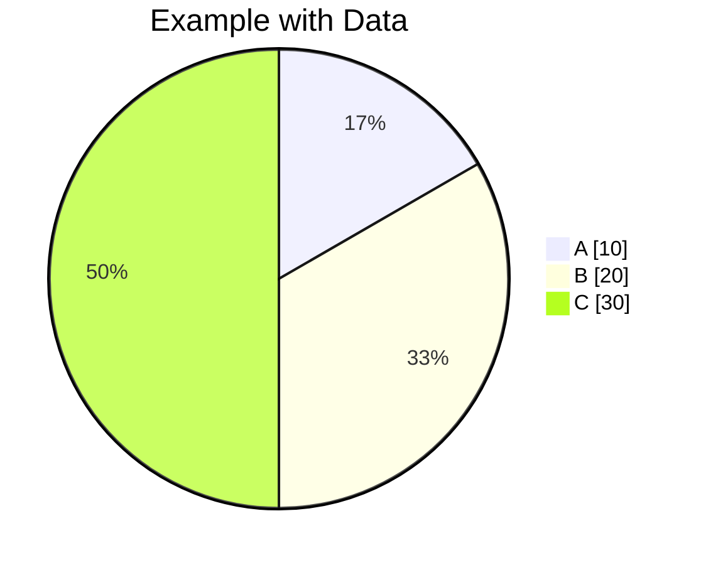
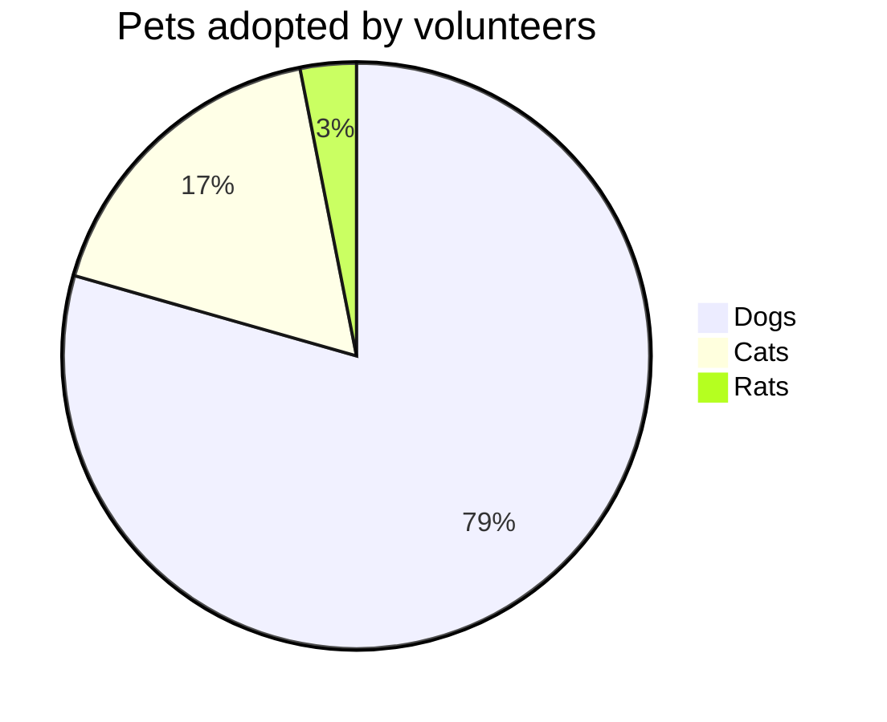
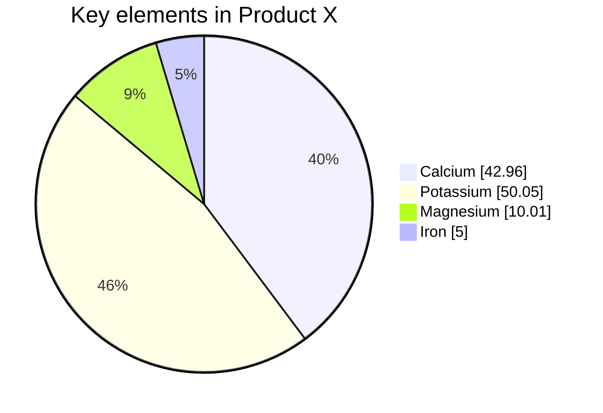
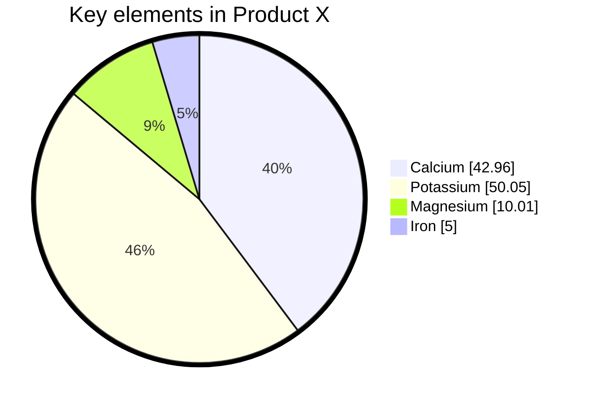
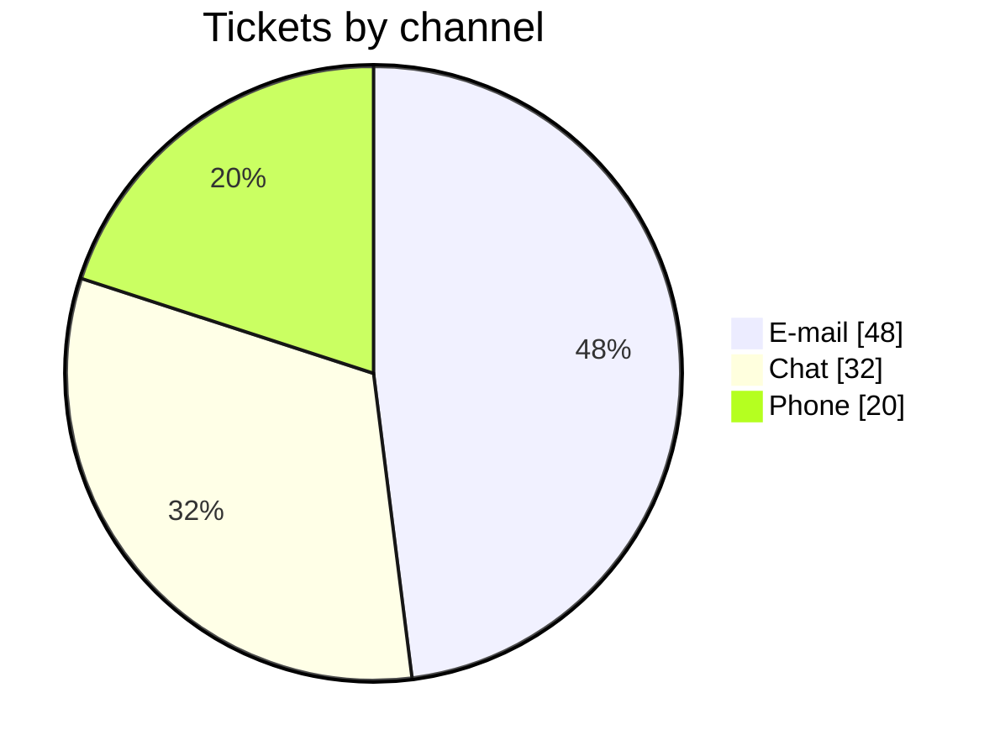

# Pie Chart

## Summary

A Pie Chart is a circular statistical graphic divided into slices to illustrate numerical proportions. Each slice's arc length, central angle, and area are proportional to the quantity it represents. Pie charts are ideal for visualizing part-to-whole relationships in datasets.

### Use Cases

- **Data Proportion Visualization**: Show how different categories contribute to a whole.
- **Survey Results**: Display the distribution of responses.
- **Market Share**: Illustrate the share of different companies or products.
- **Resource Allocation**: Visualize budget or resource splits.

### When to Use

- When you need to show the relative sizes of parts of a whole.
- When comparing a small number of categories.
- When you want a quick, visual representation of proportions.

## Syntax

Drawing a pie chart in Mermaid is simple:

- Start with the `pie` keyword.
- Optionally, use `showData` to display actual data values after the legend text.
- Optionally, use the `title` keyword to give the chart a title.
- List each data entry as `"Label" : value` (label in quotes, colon, positive numeric value).

**Note:** Pie chart values must be positive numbers greater than zero. Negative values are not allowed.

### Basic Structure

Template (placeholders, not runnable):

```text
pie [showData]
    title <Chart Title>
    "<Label 1>" : <number>
    "<Label 2>" : <number>
```

Minimal complete chart:



### With Data Values



### Syntax Details

- `pie` [showData] (OPTIONAL)
- `title` [titleValue] (OPTIONAL)
- `"Label"` : value (repeat for each slice)

## Examples

### Basic Example



### Example with Data Values and Custom Title



### Configuration

| Parameter      | Description                                                        | Default value |
| -------------- | ------------------------------------------------------------------ | ------------- |
| `textPosition` | Axial position of pie slice labels (0.0=center, 1.0=outer edge)    | `0.75`        |
| `donutHole`    | Size of the hole of a donut chart, `0` to `0.9`                    | `0`           |
| `legendPosition` | `top`, `bottom`, `left`, `right` or `center`                     | `right`       |
| `highlightSlice` | Label of one slice that is pulled out of the circle              | none          |

Example with configuration (YAML frontmatter):



### Donut Chart

A `donutHole` greater than 0 turns the pie into a donut. The example also moves the legend below the chart; `showData` adds the raw values to the legend.



## Tips

- Use pie charts for simple, clear part-to-whole comparisons.
- Avoid using too many slices; 5-7 categories is ideal.
- Always label slices clearly for readability.
- Labels must be in double quotes; values are plain numbers (up to two decimals), not expressions or percentages with a `%` sign.
- The slices show percentages; the absolute values only appear with `showData`.

**References:**
- [Mermaid.js Pie Chart Documentation](https://mermaid.js.org/syntax/pie.html)
- [Mermaid.js Documentation](https://mermaid.js.org/)