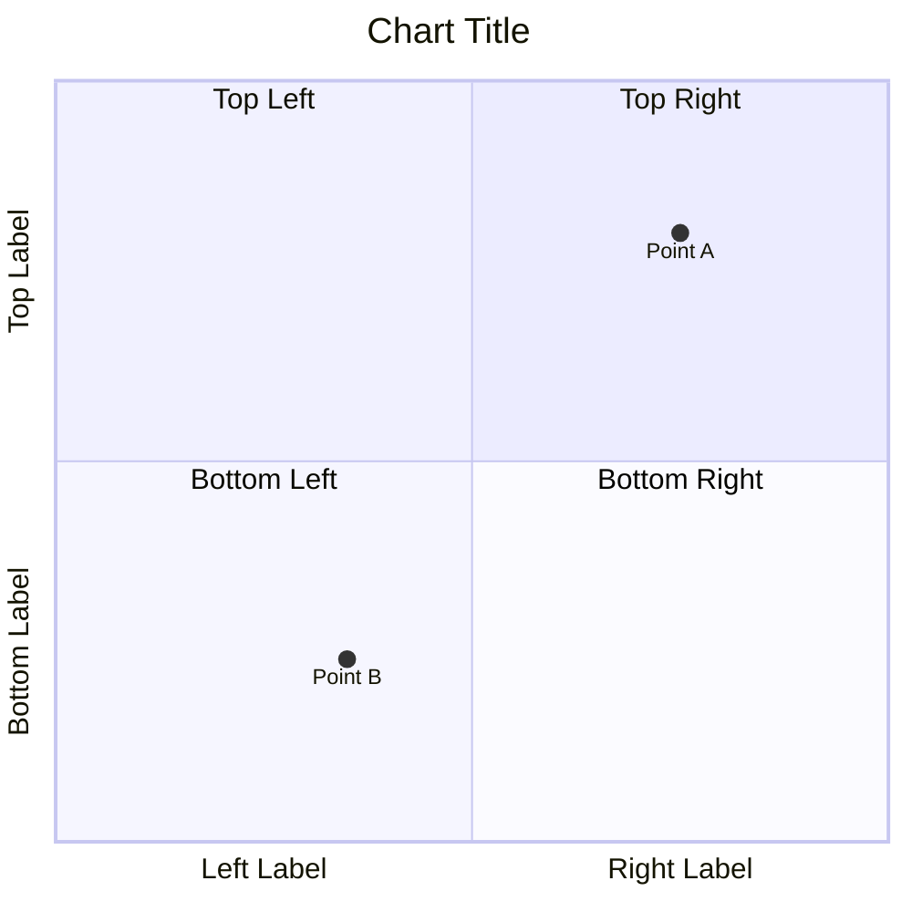
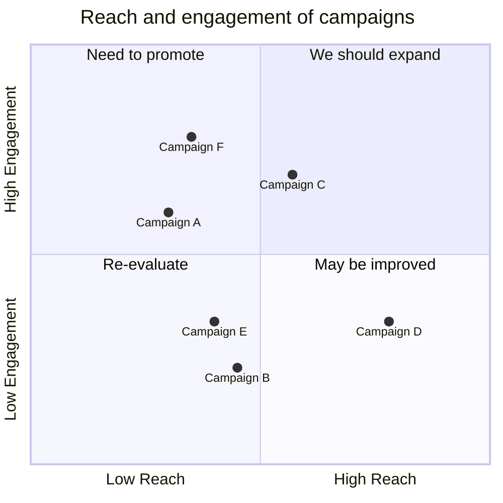
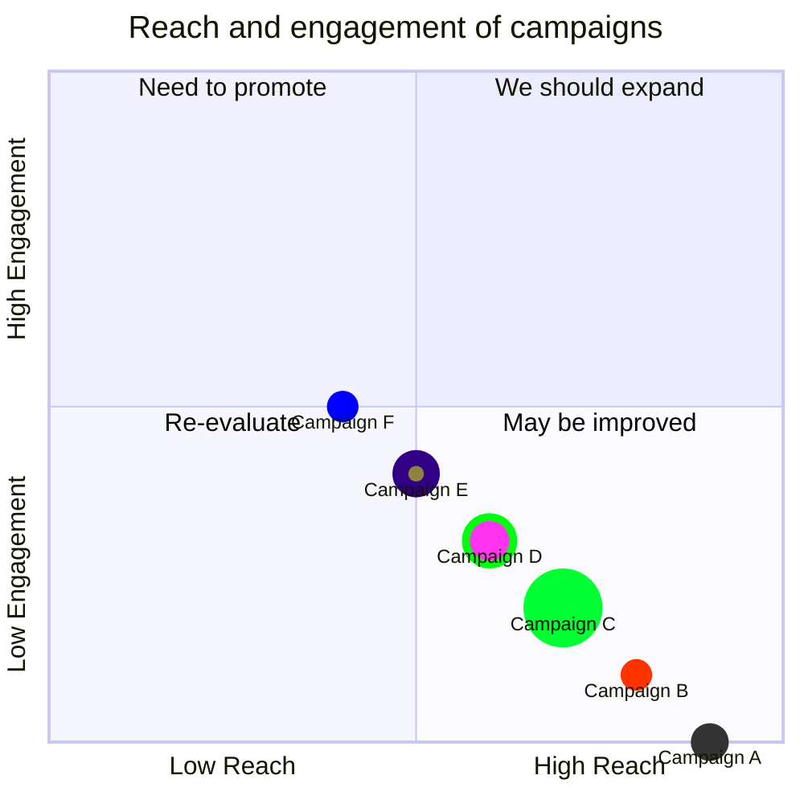

# Quadrant Chart

## Summary

A Quadrant Chart is a visual representation of data divided into four quadrants on a two-dimensional grid. Each axis represents a variable, and data points are plotted according to their values. Quadrant charts are useful for identifying patterns, trends, and priorities based on the position of data points within the chart.

### Use Cases

- **Business Analysis**: Prioritize projects, products, or actions based on two key metrics.
- **Marketing**: Segment campaigns or customers by reach and engagement.
- **Risk Management**: Plot risks by likelihood and impact.
- **Performance Assessment**: Compare entities across two performance dimensions.

### When to Use

- When you need to compare items across two variables.
- When you want to visually segment data into four categories for decision-making.
- When prioritizing actions based on position in the chart.

## Syntax

- Start with the `quadrantChart` keyword.
- Use `title` to set the chart title (optional).
- Define axes with `x-axis` and `y-axis` (use `-->` to separate left/right or bottom/top labels).
- Label each quadrant with `quadrant-1` to `quadrant-4`.
- Plot points as `Label: [x, y]` where x and y are between 0 and 1.
- Points can be styled directly or with classes.

### Basic Structure

### Example

### Point Styling

- Direct styling: `Label: [x, y] color: #hex, radius: N, stroke-color: #hex, stroke-width: Npx`
- Class styling: `Label:::className: [x, y]`
- Define classes with `classDef`

#### Example

## Configuration

| Parameter                        | Description                                         | Default |
|-----------------------------------|-----------------------------------------------------|---------|
| chartWidth                        | Width of the chart                                  | 500     |
| chartHeight                       | Height of the chart                                 | 500     |
| titlePadding                      | Top and bottom padding of the title                 | 10      |
| titleFontSize                     | Title font size                                     | 20      |
| quadrantPadding                   | Padding outside all quadrants                       | 5       |
| quadrantTextTopPadding            | Quadrant text top padding                           | 5       |
| quadrantLabelFontSize             | Quadrant text font size                             | 16      |
| quadrantInternalBorderStrokeWidth | Border stroke width inside quadrants                | 1       |
| quadrantExternalBorderStrokeWidth | Quadrant external border stroke width               | 2       |
| xAxisLabelPadding                 | Top and bottom padding of x-axis text               | 5       |
| xAxisLabelFontSize                | X-axis text font size                               | 16      |
| xAxisPosition                     | Position of x-axis (top, bottom)                    | 'top'   |
| yAxisLabelPadding                 | Left and right padding of y-axis text               | 5       |
| yAxisLabelFontSize                | Y-axis text font size                               | 16      |
| yAxisPosition                     | Position of y-axis (left, right)                    | 'left'  |
| pointTextPadding                  | Padding between point and below text                | 5       |
| pointLabelFontSize                | Point text font size                                | 12      |
| pointRadius                       | Radius of the point                                 | 5       |

## Tips

- Use quadrant charts for clear, actionable segmentation.
- Keep axis and quadrant labels concise.
- Style points for emphasis and clarity.

**References:**
- [Mermaid.js Quadrant Chart Documentation](https://mermaid.js.org/syntax/quadrantChart.html)
- [Mermaid.js Documentation](https://mermaid.js.org/)