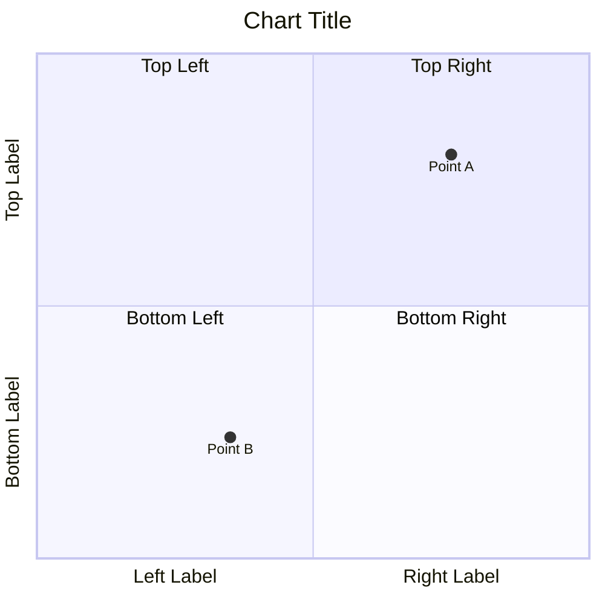
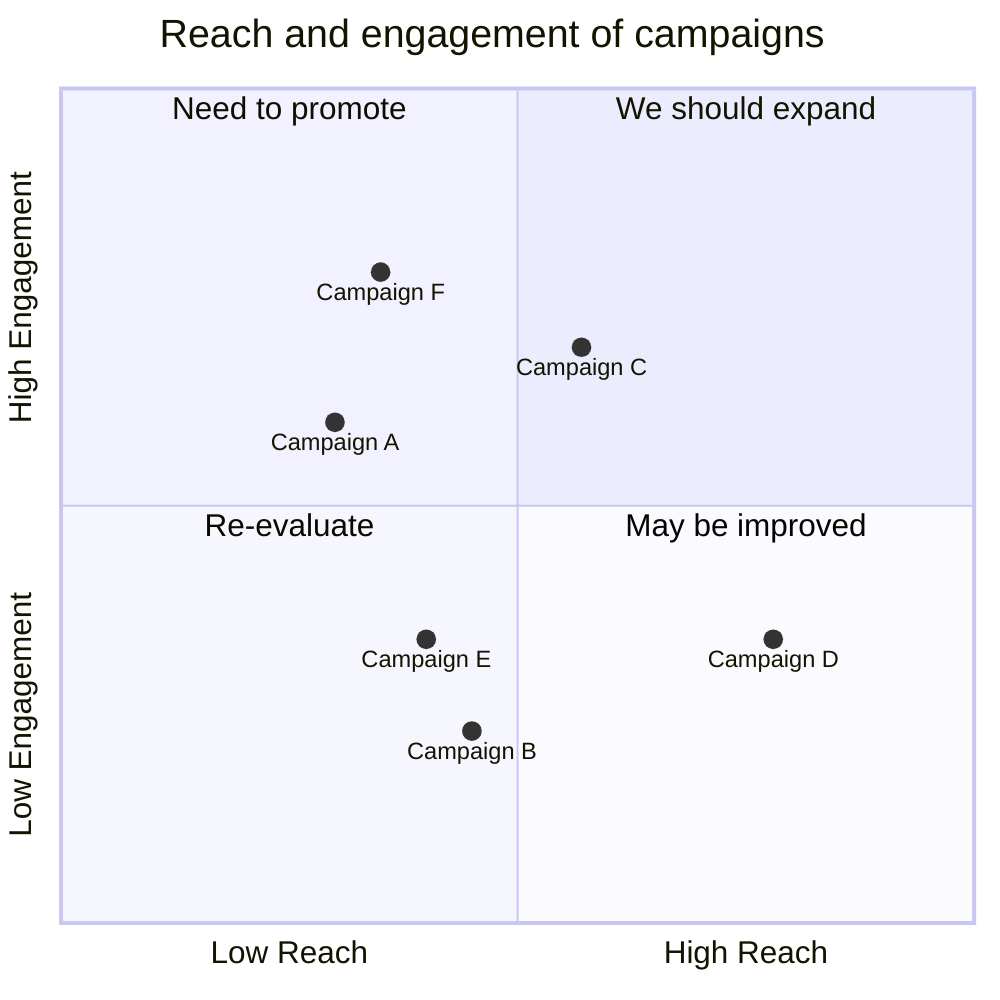
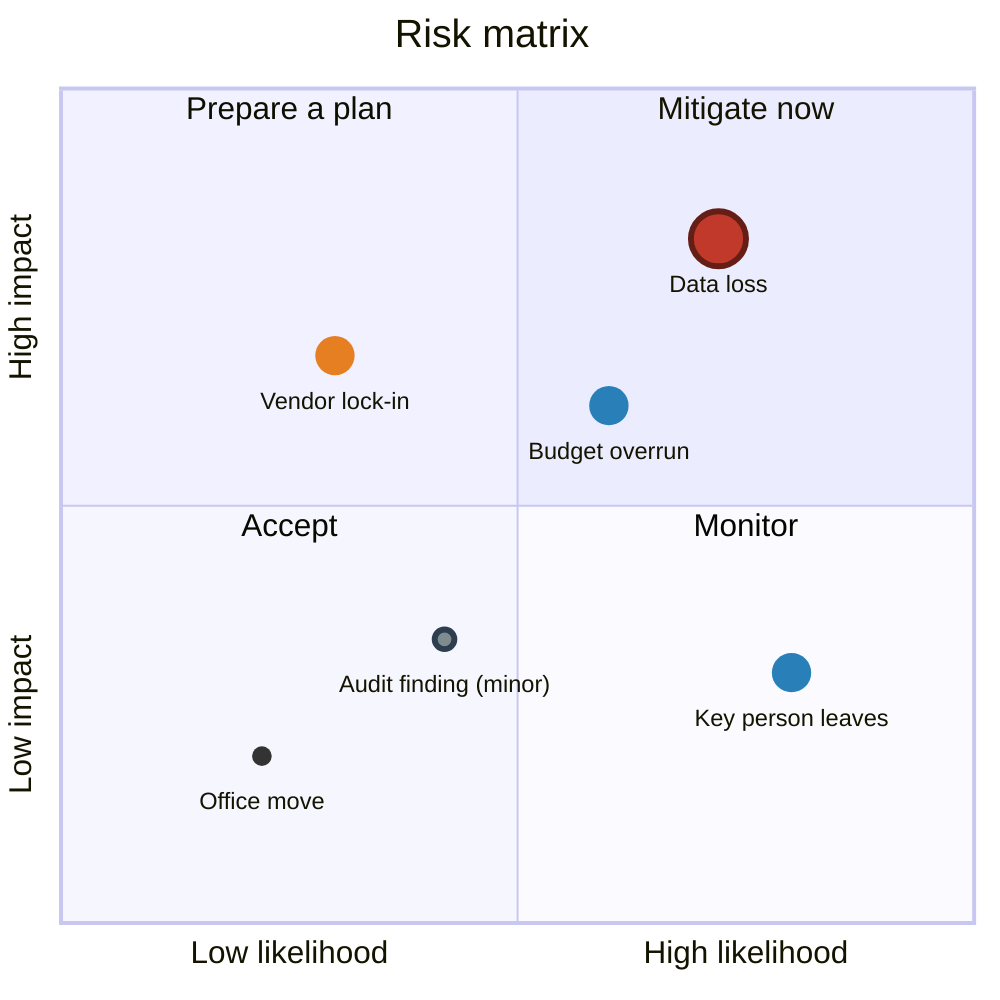
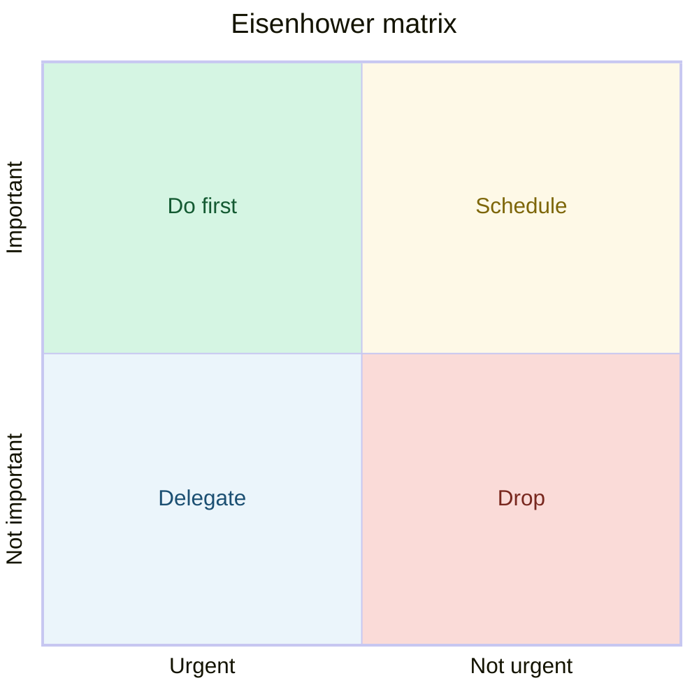

# Quadrant Chart

## Summary

A Quadrant Chart is a two-dimensional grid divided into four quadrants. Each axis represents a variable, and data points are plotted according to their values. Quadrant charts are useful for identifying patterns and priorities based on the position of data points within the chart.

### Use Cases

- **Business Analysis**: Prioritize projects, products, or actions based on two key metrics.
- **Marketing**: Segment campaigns or customers by reach and engagement.
- **Risk Management**: Plot risks by likelihood and impact.
- **Performance Assessment**: Compare entities across two performance dimensions.

### When to Use

- When you need to compare items across two variables.
- When you want to visually segment data into four categories for decision-making.
- A chart without points is a plain 2x2 matrix (e.g. Eisenhower matrix).

## Syntax

- Start with the `quadrantChart` keyword. All other statements are optional and may appear in any order.
- `title Some text` sets the title (a front-matter `title:` works as well).
- `x-axis Left --> Right` and `y-axis Bottom --> Top`. The part after `-->` is optional; with only one text the label sits at the left / bottom end.
- `quadrant-1` = top right, `quadrant-2` = top left, `quadrant-3` = bottom left, `quadrant-4` = bottom right (counter-clockwise, as in mathematics).
- Points: `Label: [x, y]` with x and y from 0 to 1 (0,0 is bottom left).
- Comments with `%%`, on their own line or at the end of a statement.

```text
quadrantChart
    title <title>
    x-axis <left text> --> <right text>
    y-axis <bottom text> --> <top text>
    quadrant-1 <top right>
    quadrant-2 <top left>
    quadrant-3 <bottom left>
    quadrant-4 <bottom right>
    <point label>: [<x 0..1>, <y 0..1>]
```

### Basic Structure



### Example



### Layout depends on whether there are points

- **With points**: quadrant labels sit at the top edge of each quadrant, the x-axis labels are at the bottom.
- **Without points**: quadrant labels are centred in their quadrant and the x-axis labels move to the top (see the matrix example below). `xAxisPosition: bottom` moves them down again; it has no effect once there are points.

### Text rules (verified)

| Where | Works unquoted | Needs `"double quotes"` |
|-------|----------------|-------------------------|
| Title | everything tested, including `: ( ) / & % , !` and umlauts | - |
| Axis and quadrant texts | letters, digits, umlauts, emoji, `, . / & % ! ? ' - _ + = * #` | `( )`, `:`, `;`, `<` |
| Point labels | same as axis texts | `( )`, `:`, `<`, and any label containing a keyword: `title`, `x-axis`, `y-axis`, `quadrant-1`..`quadrant-4`, `classDef` |

Example: `"Item: c (v2)": [0.7, 0.7]`, `y-axis "Low: value" --> "High (value)"`. A point literally named `title` is silently read as the chart title. HTML tags are not interpreted.

Coordinates must be written as `0`, `1` or with a leading digit (`0.5`). `.5`, negative values and values above 1 (`1.2`) are syntax errors.

## Point Styling

- Direct: `Label: [x, y] color: #ff3300, radius: 10, stroke-color: #000000, stroke-width: 3px`
- Class: `Label:::className: [x, y]` plus `classDef className color: #109060, radius: 10`
- Precedence: direct styles override class styles, which override the theme.

| Style | Accepted value | Rejected |
|-------|----------------|----------|
| `color` | hex only: `#f00` or `#ff3300` | names (`red`), `rgb(...)`, 8-digit hex |
| `radius` | whole number without unit: `10` | `10px`, `7.5` |
| `stroke-width` | whole number **with** `px`: `3px` | `3`, `2.5px` |
| `stroke-color` | hex; only visible together with `stroke-width` | - |

Other properties (e.g. `opacity`) are syntax errors. The label is drawn at a fixed distance below the point centre, so with a radius above about 6 the circle covers its own label. Raise `pointTextPadding` to at least the largest radius plus 4:



## Configuration

Set under `config: quadrantChart:` in the front matter.

| Parameter                         | Description                                                    | Default |
|-----------------------------------|----------------------------------------------------------------|---------|
| chartWidth                        | Width of the chart                                             | 500     |
| chartHeight                       | Height of the chart                                            | 500     |
| titlePadding                      | Top and bottom padding of the title                            | 10      |
| titleFontSize                     | Title font size                                                | 20      |
| quadrantPadding                   | Padding outside all quadrants                                  | 5       |
| quadrantTextTopPadding            | Top padding of quadrant text when it is drawn at the top       | 5       |
| quadrantLabelFontSize             | Quadrant text font size                                        | 16      |
| quadrantInternalBorderStrokeWidth | Border stroke width inside quadrants                           | 1       |
| quadrantExternalBorderStrokeWidth | Quadrant external border stroke width                          | 2       |
| xAxisLabelPadding                 | Top and bottom padding of x-axis text                          | 5       |
| xAxisLabelFontSize                | X-axis text font size                                          | 16      |
| xAxisPosition                     | `top` or `bottom`; ignored (always bottom) when there are points | top   |
| yAxisLabelPadding                 | Left and right padding of y-axis text                          | 5       |
| yAxisLabelFontSize                | Y-axis text font size                                          | 16      |
| yAxisPosition                     | `left` or `right` (works with and without points)              | left    |
| pointTextPadding                  | Distance between point centre and its label                    | 5       |
| pointLabelFontSize                | Point text font size                                           | 12      |
| pointRadius                       | Default radius of points                                       | 5       |

### Theme variables

Set under `config: themeVariables:`; values are quoted hex colours. All of these were verified:
`quadrant1Fill` .. `quadrant4Fill`, `quadrant1TextFill` .. `quadrant4TextFill`, `quadrantPointFill`, `quadrantPointTextFill`, `quadrantXAxisTextFill`, `quadrantYAxisTextFill`, `quadrantInternalBorderStrokeFill`, `quadrantExternalBorderStrokeFill`, `quadrantTitleFill`.

The default quadrant fills are four nearly identical pale violets. Set the fills when the quadrants should be told apart by colour:



## Rules and Pitfalls

- Nothing is wrapped or shrunk. With the default 500 px chart keep quadrant and axis texts to about 22 characters each and the title to about 45; longer texts run into each other or are cut off at the border. For more room raise `chartWidth` or lower the font sizes.
- Point labels are centred under the point and clipped at the chart border. Keep points between about 0.08 and 0.92 on x (further inside for long labels) and above about 0.05 on y, otherwise labels are cut off or collide with the x-axis text.
- Labels of neighbouring points overlap; there is no collision avoidance. Spread close points a little or shorten the labels. Points just below the top edge of a quadrant (y around 0.40-0.50 or 0.90-1.0) collide with the quadrant label, as their label hangs below the point.
- All points have the same dark colour by default; use `color:` or classes to distinguish groups, and explain the colours in the title since there is no legend.
- Colours must be hex, `radius` has no unit, `stroke-width` needs `px` (see table above).
- Quote texts containing `( ) : ; <` and point labels containing a keyword.
- Remember the numbering: `quadrant-1` is top right, then counter-clockwise.

**References:**
- [Mermaid.js Quadrant Chart Documentation](https://mermaid.js.org/syntax/quadrantChart.html)
