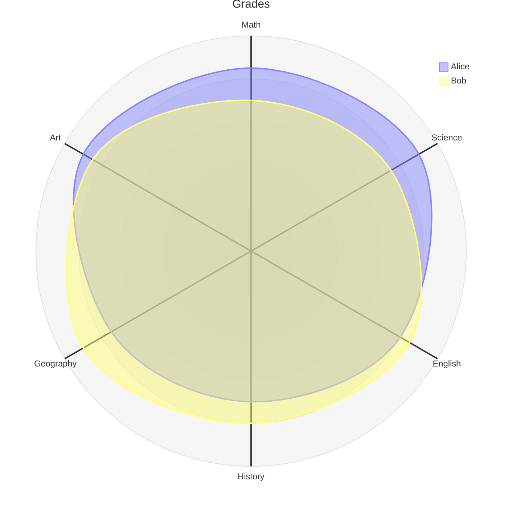
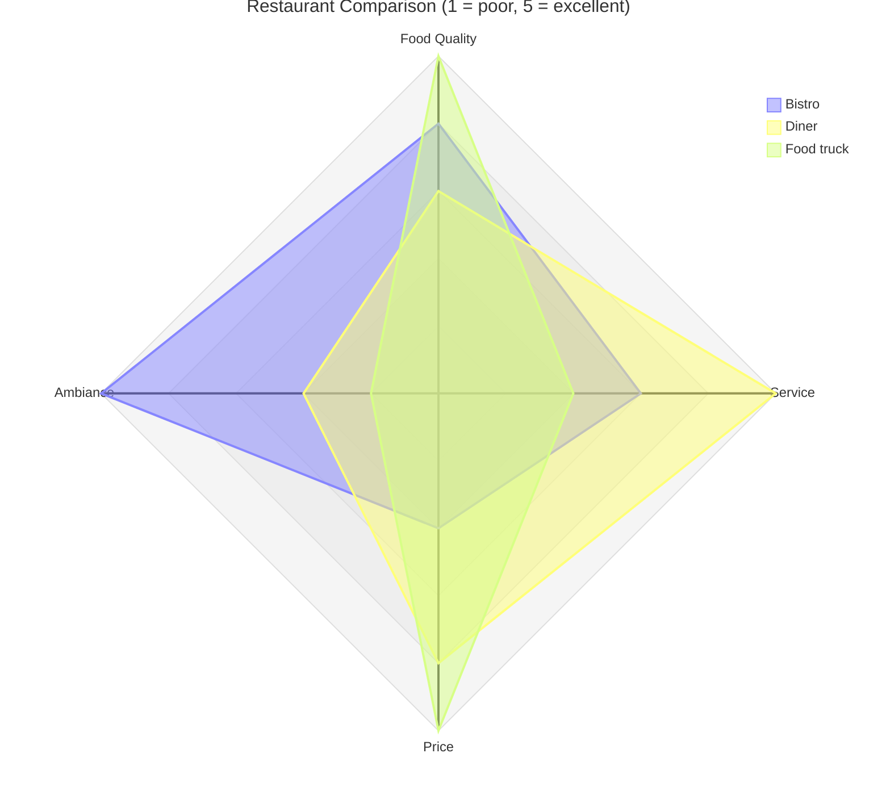
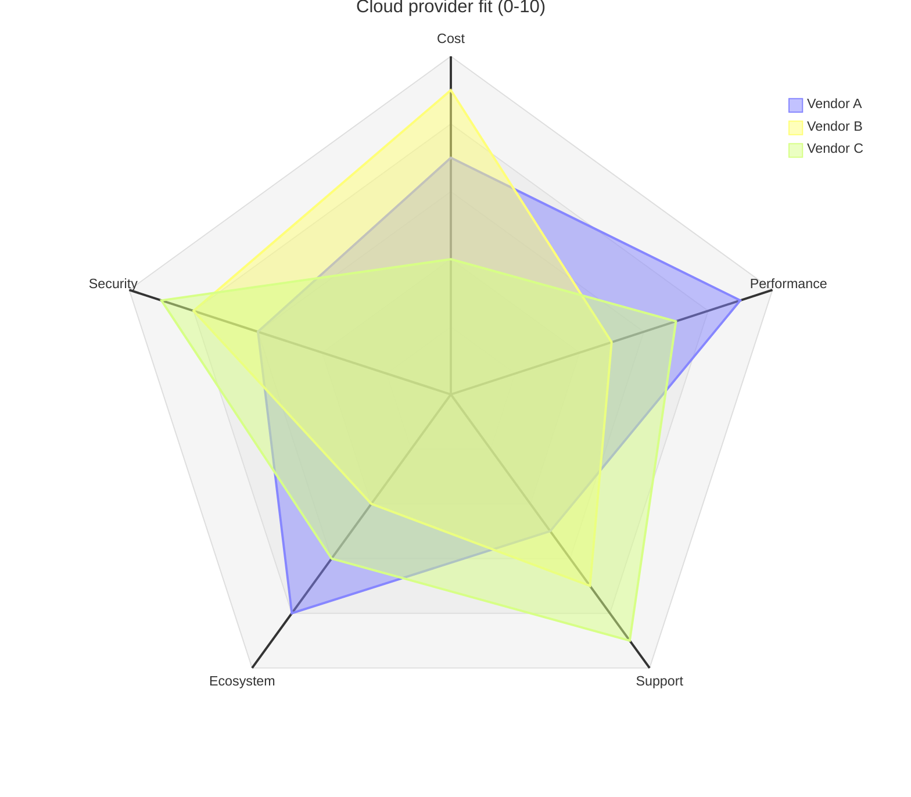
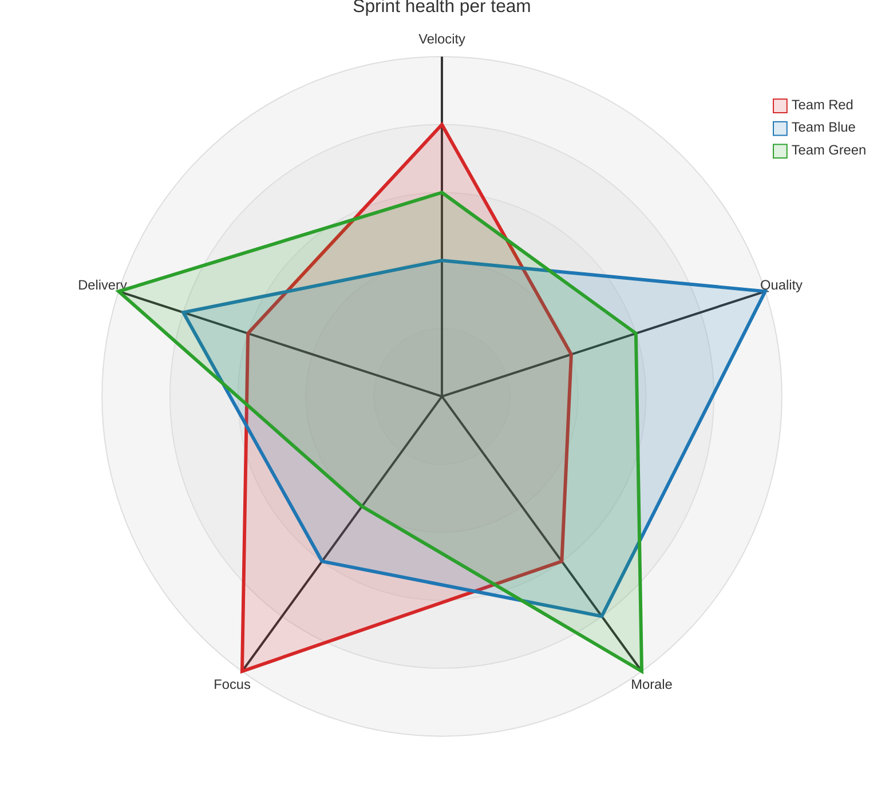

# Radar Diagram

## Summary

A **Radar diagram** (also known as a radar chart, spider chart, star chart, cobweb chart, polar chart, or Kiviat diagram) plots a few data series over several axes that radiate from a common centre. It is useful for comparing the profiles of a small number of entities across the same dimensions.

**Use Cases:**
- Comparing multiple entities (e.g., people, products, teams) across several quantitative attributes
- Visualizing skill sets, performance metrics, or survey results
- Summarizing multi-dimensional data in a compact, visual way

**When to Use:**
- When you want to compare 2-4 items across the same 3-12 variables
- When the overall shape (strengths and weaknesses) matters more than exact numbers: the chart draws **no scale numbers**

---

## Syntax Description

- Start with the `radar-beta` keyword. Plain `radar` is not recognised ("No diagram type detected").
- `title Some text` (optional). Write it unquoted; quotes would be printed. A front-matter `title:` also works; the `title` line wins if both exist.
- `axis id["Label"], id2["Label 2"]` defines axes, clockwise starting at the top. The label is optional (`axis A, B, C`); several `axis` lines are allowed.
- `curve id["Label"]{v1, v2, ...}` defines a data series. Values are listed in axis order, or as `{ axisId: value, ... }` in any order. Several curves may share one line, separated by commas.
- Options, each on its own line: `max <n>`, `min <n>`, `graticule circle|polygon`, `ticks <n>`, `showLegend true|false`.
- Statements may appear in any order; `%%` comments are allowed on their own line or at the end of a line.

```text
radar-beta
  title <title>
  axis <id>["<label>"], <id>["<label>"], <id>["<label>"]
  curve <id>["<legend label>"]{<v1>, <v2>, <v3>}
  curve <id>["<legend label>"]{ <axisId>: <v>, <axisId>: <v>, <axisId>: <v> }
  max <number>
  min <number>
  graticule polygon
  ticks <number>
  showLegend false
```

| Option | Default | Meaning |
|--------|---------|---------|
| `max` | largest value in the data | Value at the outer ring |
| `min` | 0 | Value at the centre |
| `graticule` | `circle` | `circle`: round grid, curves are smoothed. `polygon`: straight grid, curves are straight-edged polygons |
| `ticks` | 5 | Number of grid rings |
| `showLegend` | `true` | Only `true` or `false` are accepted |

**IDs** (axes and curves) must start with an ASCII letter and may contain letters, digits, `_` and `-`. Umlauts or a leading digit are syntax errors; put such text into the `["label"]`. Labels may contain spaces, umlauts and punctuation such as `: ( ) / , % &`.

---

## Examples

### Grades (round grid)



With the default `graticule circle` the curves are smoothed and bulge between the axes; only the crossing points on the axes are data.

### Restaurant Comparison (polygon grid, room for side labels)



Axis labels on the left and right side grow outward from the axis end. With the default margins a label on a horizontal axis (here `Service` and `Ambiance`) has only about 30 px and is cut off after roughly 5 characters; labels on slanted axes get a little more. The margins above fix that. Since no numbers are drawn, the scale is stated in the title.

### Key-value curves, several curves per line, options



A key-value curve must name **every** axis, otherwise rendering fails with `Missing entry for axis ...`.

### Colours and line style



`curveTension: 0` gives straight edges on a round grid. A low `curveOpacity` with a thicker stroke keeps overlapping curves readable.

---

## Configuration

Under `config: radar:` (verified: `width`, `height`, the four margins, `curveTension`):

| Parameter | Default | Description |
|-----------|---------|-------------|
| `width`, `height` | 600 | Size of the plot area; the image is this plus the margins |
| `marginTop`, `marginBottom`, `marginLeft`, `marginRight` | 50 | Space around the plot for title, axis labels and legend |
| `axisLabelFactor` | 1.05 | Distance of axis labels from the centre, relative to the radius |
| `curveTension` | 0.17 | Rounding of curves with `graticule circle`; 0 = straight |
| `axisScaleFactor` | 1 | Scales only the axis lines, not grid or curves; leave at 1 |

Under `config: themeVariables:`: `cScale0`, `cScale1`, ... set the colour of the 1st, 2nd, ... curve (quoted hex). They work with the default theme; `theme: base` is not required.

Under `config: themeVariables: radar:` (all verified): `axisColor`, `axisStrokeWidth`, `axisLabelFontSize` (default `12px`), `curveOpacity` (0.7), `curveStrokeWidth` (2), `graticuleColor`, `graticuleOpacity`, `graticuleStrokeWidth`, `legendBoxSize`, `legendFontSize`.

---

## Rules and Pitfalls

- **Count the values.** A curve whose number of values differs from the number of axes still renders without an error, but the curve is silently missing; only its legend entry appears.
- Negative values are a syntax error. Values above `max` are drawn on the outer ring, values below `min` at the centre, so set `max`/`min` to cover the data.
- Choose `max` to match the data. With `max 100` and values below 10 all curves collapse into a dot at the centre. Without `max` the largest value touches the outer ring.
- There are no tick labels or value labels. Put the scale into the title or the axis labels (`"Cost (0-10)"`).
- Legend labels longer than about 11 characters are cut off at the right edge. Larger `marginRight` hardly helps (4 px of margin yield 1 px for the legend), so keep legend labels short.
- Axis labels on the left and right are cut off after about 5-8 characters with default margins (`Service`, `Performance` and `Delivery` were all clipped in tests). Whenever a side label is longer than 5 characters set `marginLeft`/`marginRight` to roughly 7 px per character plus 20. Larger label or legend fonts need more. Labels are not wrapped and `<br/>` is printed literally.
- Use at most 3-4 curves. With the default theme, fills are semi-opaque and more curves blend into one blob whose colours can no longer be told apart; with 6 or more curves the legend also grows into the chart. If more are needed, lower `curveOpacity`.
- Use at least 3 axes; with 2 axes every curve degenerates into a line.
- `showLegend` takes only `true`/`false`, `graticule` only `circle`/`polygon`.
- The title sits flush at the top edge of the image, directly above the top axis label; keep it to one short line.
- The diagram is still beta (`radar-beta`); the syntax may change in later Mermaid versions.

---

## References

- [Official Mermaid Radar Diagram Documentation](https://mermaid.js.org/syntax/radar.html)
- [Radar configuration schema](https://mermaid.js.org/config/schema-docs/config-defs-radar-diagram-config.html)
