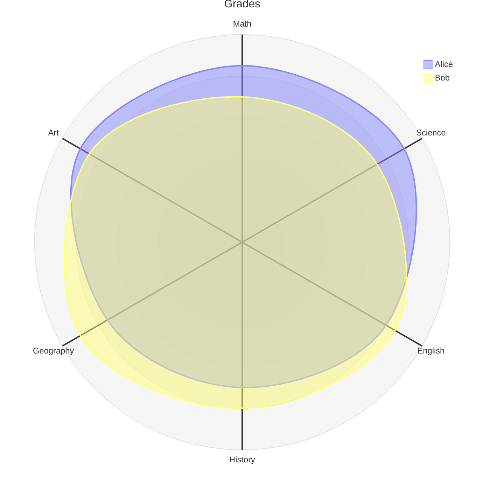
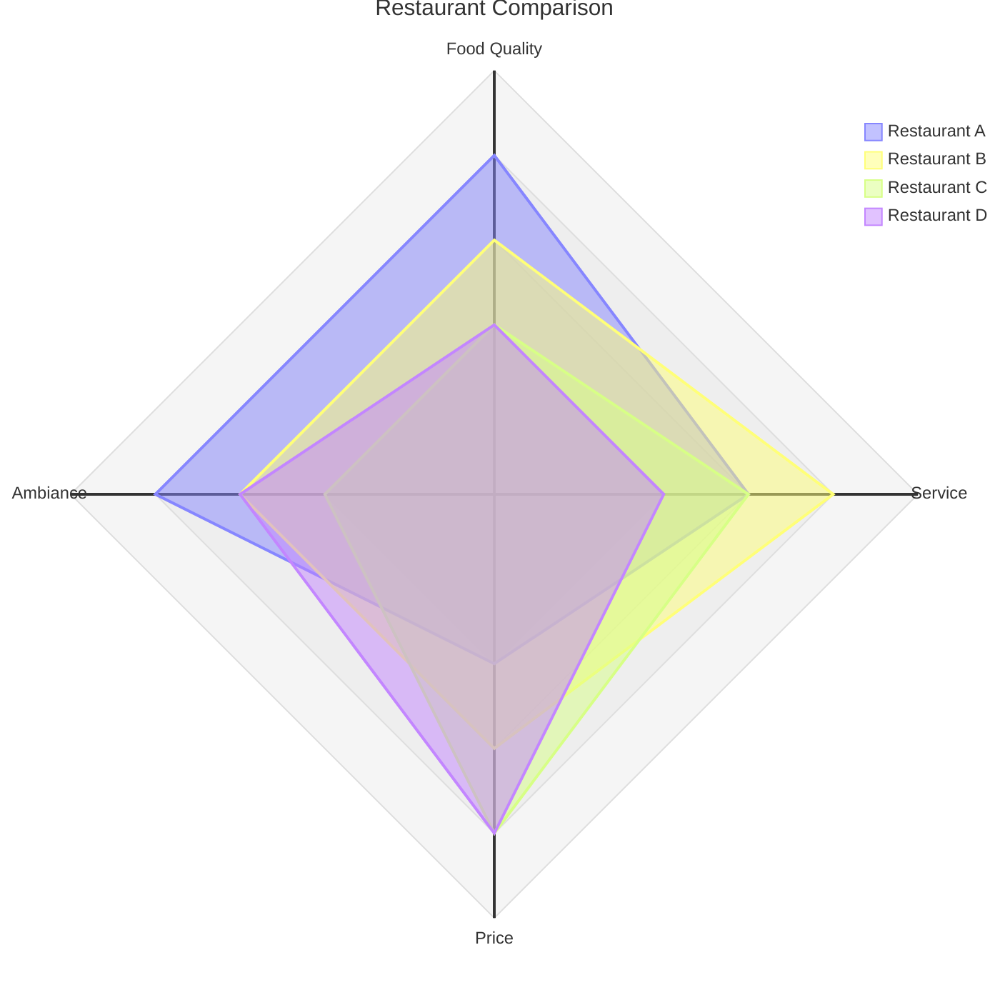
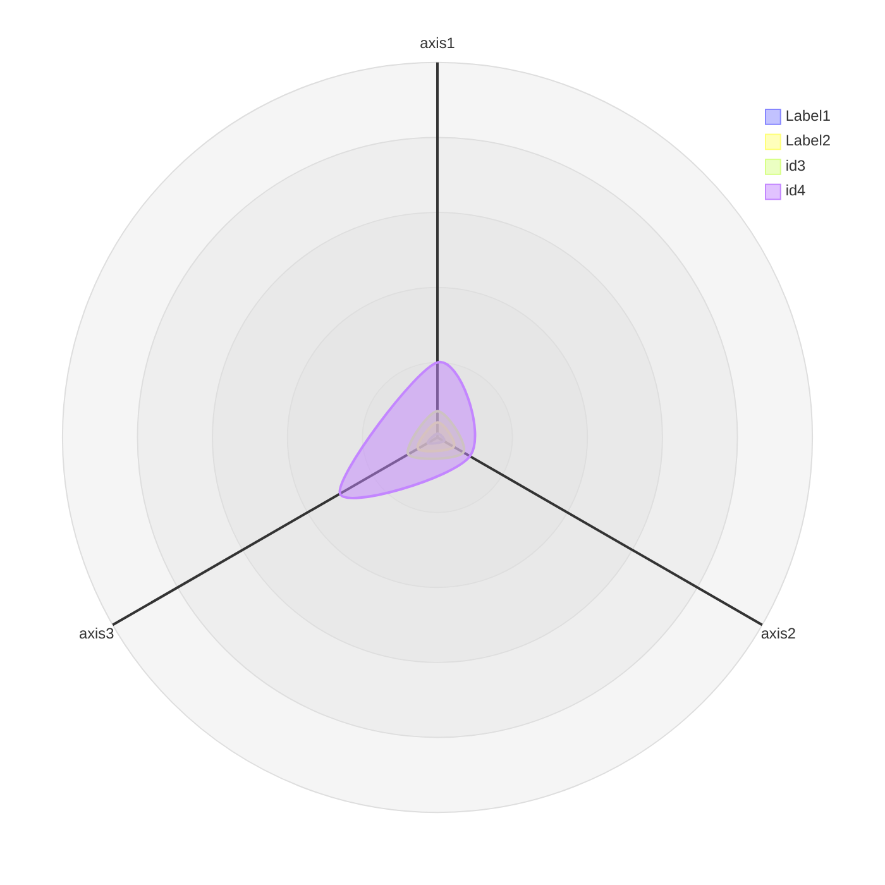
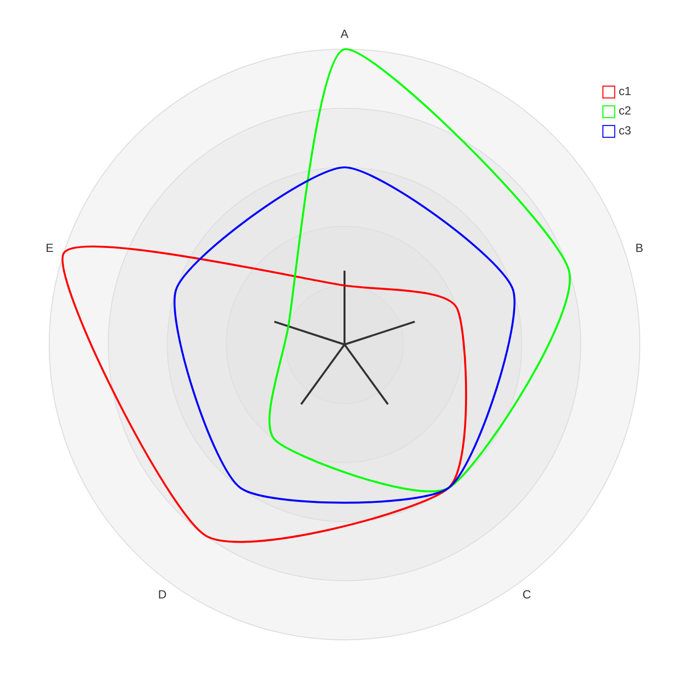

# Radar Diagram

## Summary

A **Radar diagram** (also known as a radar chart, spider chart, star chart, cobweb chart, polar chart, or Kiviat diagram) is a way to plot low-dimensional data in a circular format. It is useful for graphically summarizing and comparing the performance of multiple entities across multiple dimensions.

**Use Cases:**
- Comparing multiple entities (e.g., people, products, teams) across several quantitative attributes
- Visualizing skill sets, performance metrics, or survey results
- Summarizing multi-dimensional data in a compact, visual way

**When to Use:**
- When you want to compare several items across the same set of variables
- When you need to show strengths and weaknesses in a visual, circular format

---

## Syntax Description

- Start with the `radar-beta` keyword.
- Define axes using the `axis` keyword, with optional IDs and labels.
- Define data series (curves) using the `curve` keyword, with an ID, optional label, and a list of values.
- Optionally set `title`, `max`, `min`, `graticule`, `ticks`, and `showLegend`.
- Curves can use ordered values or key-value pairs for axis mapping.

**Basic Syntax:**
```
radar-beta
axis A, B, C, D, E
curve c1{1,2,3,4,5}
curve c2{5,4,3,2,1}
```

---

## Examples

### Grades Example



### Restaurant Comparison



### Advanced Syntax



### Theme and Configuration Example



---

## Tips

- Use `axis` to define each dimension; you can provide labels for clarity.
- Use `curve` for each entity or data series.
- Use `max` and `min` to control the scale.
- Use `graticule` to choose between circular or polygonal grid lines.
- Use the configuration block to customize appearance and theme.

---

## References

- [Official Mermaid Radar Diagram Documentation](https://mermaid.js.org/syntax/radar.html)
- [Mermaid.js Documentation](https://mermaid.js.org/)