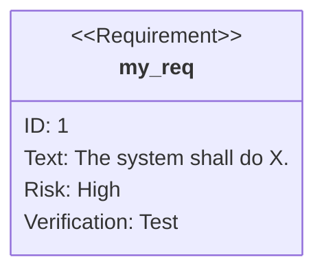
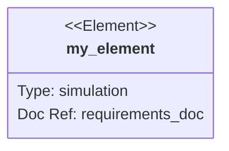
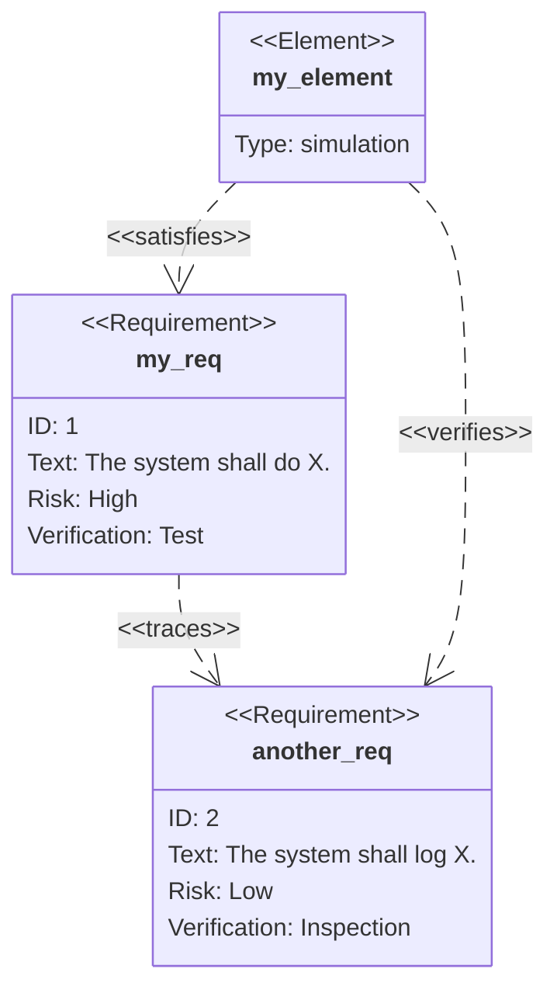
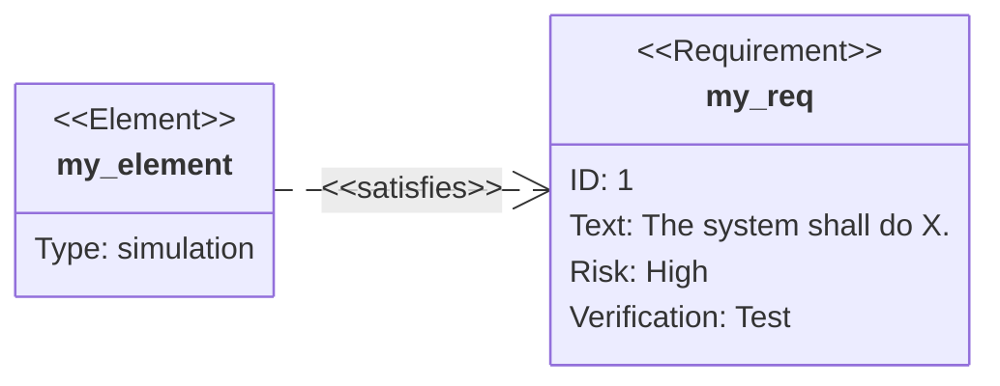
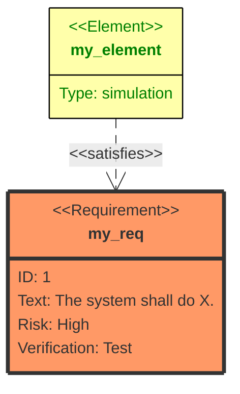
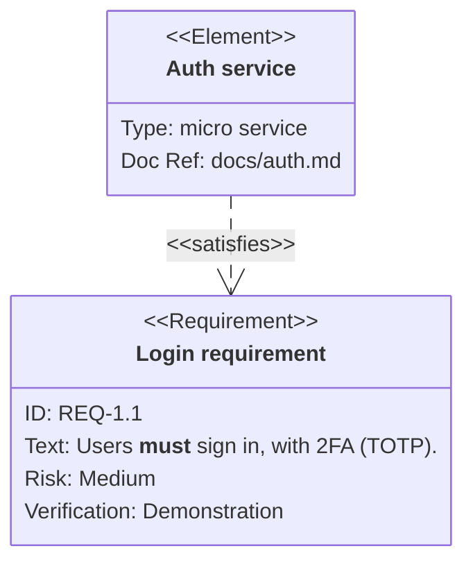
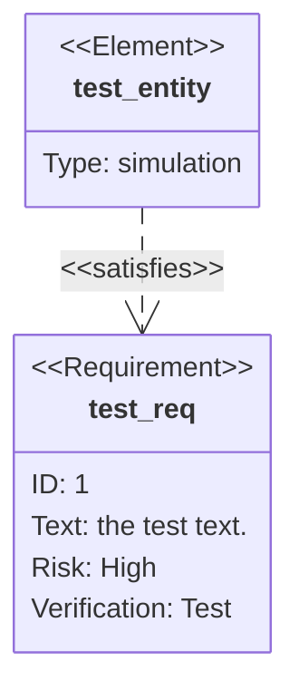
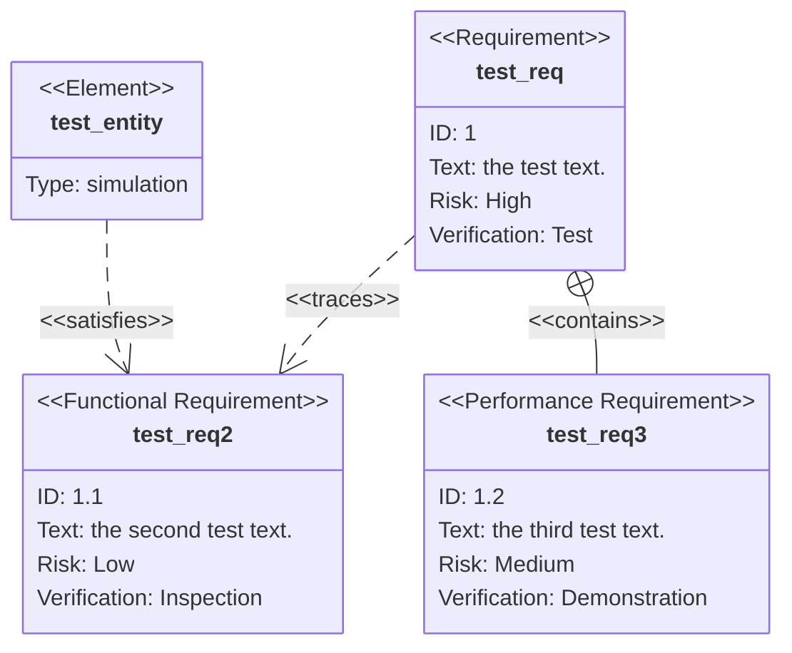

# Requirement Diagram

## Summary

A Requirement Diagram provides a visualization for requirements and their connections to each other and to other documented elements. The modeling follows SysML v1.6 specifications. These diagrams are useful for documenting, analyzing, and tracing requirements in engineering, software, and systems projects.

### Use Cases

- **Requirements Management**: Visualize and manage system, software, or business requirements.
- **Traceability**: Show how requirements are satisfied, verified, or refined by elements or other requirements.
- **Compliance**: Document verification methods and risk levels for regulatory or quality assurance.
- **System Engineering**: Connect requirements to design elements and constraints.

### When to Use

- When you need to document and trace requirements in a project.
- When you want to visualize relationships between requirements and system elements.
- When you need to show verification methods and risk levels.

## Syntax

There are three main components: requirements, elements, and relationships.

### Requirement

Defines a requirement with type, name, id, text, risk, and verification method.



**Requirement Types:**  
- requirement  
- functionalRequirement  
- interfaceRequirement  
- performanceRequirement  
- physicalRequirement  
- designConstraint  

**Risk Levels:** Low, Medium, High  
**Verification Methods:** Analysis, Inspection, Test, Demonstration

### Element

Defines an element with a name, type, and optional document reference.



### Relationship

Connects requirements and elements using relationships:

```text
<source> - <type> -> <destination>
<destination> <- <type> - <source>
```

Both ends must be names of a requirement or element defined in the same diagram:



**Relationship Types:** contains, copies, derives, satisfies, verifies, refines, traces

### Direction

Set diagram direction (default is TB):

The `direction` statement goes right after the `requirementDiagram` header:



Options: TB (top-bottom), BT (bottom-top), LR (left-right), RL (right-left)

### Styling

Apply styles directly or with classes:



`style` and `class` take the name of a requirement or element; several names can be separated by commas.

### Quoted Names and Text

Quote a name that contains spaces, and quote any id, text, type or docref that contains a hyphen or a comma: unquoted `id: REQ-1` and `text: a, b` are parse errors. Markdown (`**bold**`, `*italic*`) works inside quotes.



## Examples

### Basic Example



### Larger Example



## Tips

- Every diagram starts with the `requirementDiagram` header; requirement, element, relationship, `direction` and style lines are not valid on their own.
- Use quotes for names with spaces, for text with punctuation and for Markdown formatting.
- Use classes for reusable styling.
- Use relationships to show traceability and verification.

**References:**  
- [Mermaid.js Requirement Diagram Documentation](https://mermaid.js.org/syntax/requirementDiagram.html)
- [Mermaid.js Documentation](https://mermaid.js.org/)