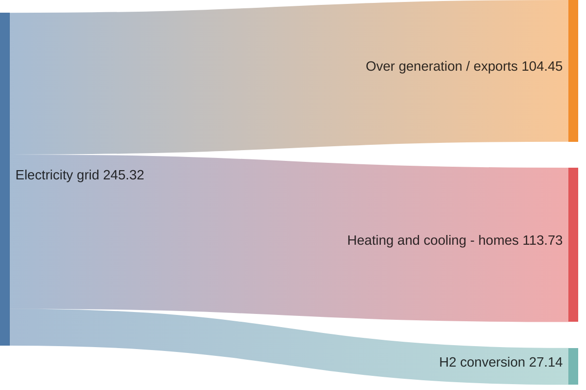
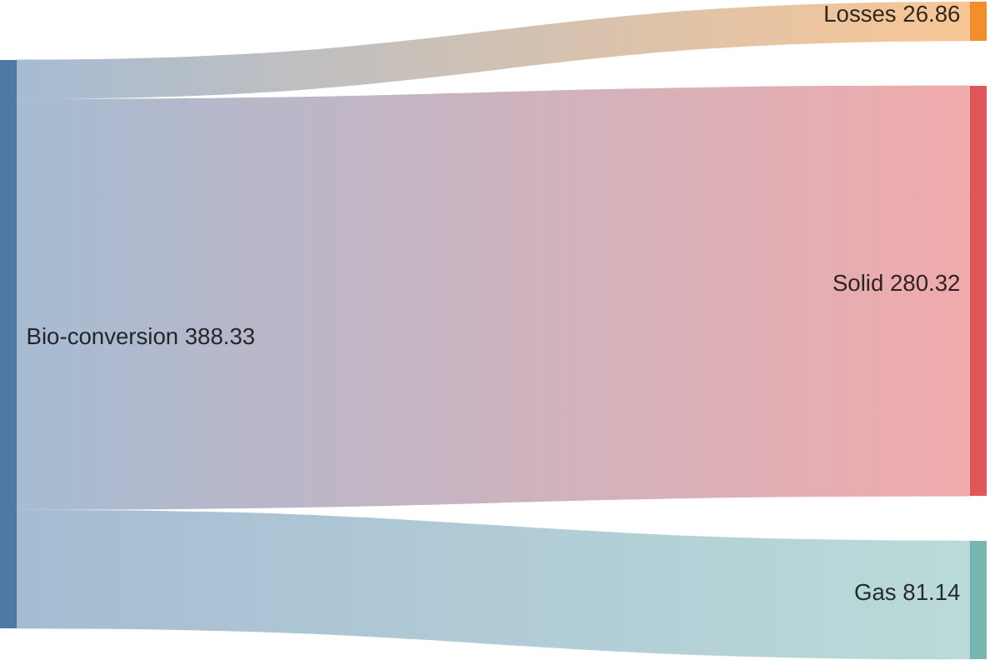
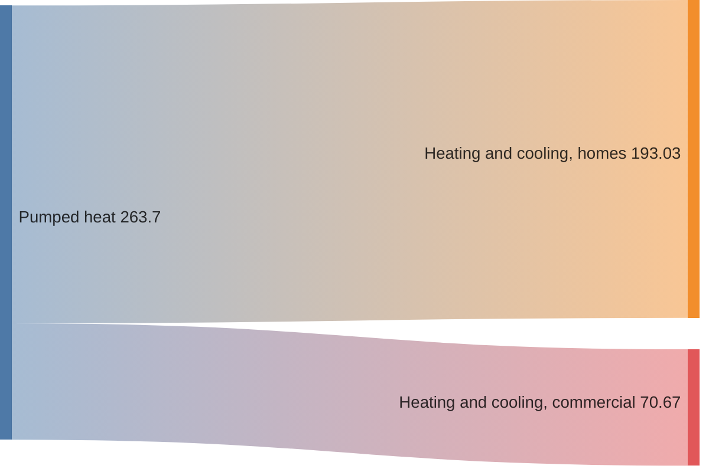
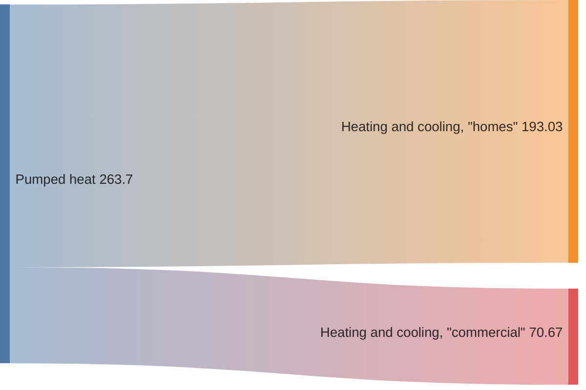

# Sankey Diagram

## Summary

A **Sankey diagram** is a flow diagram that visualizes the transfer or flow of quantities between different nodes. The width of each link is proportional to the flow quantity it represents, making it ideal for visualizing energy, material, or cost transfers in a process.

**Use Cases:**
- Visualizing energy or material flows in systems (e.g., energy balance, supply chains)
- Showing cost breakdowns and allocations
- Mapping user journeys or process flows with quantitative transitions

**When to Use:**
- When you need to show how quantities split and merge between different stages or categories
- When the magnitude of flow between nodes is important to understand

---

## Syntax Description

- Start with the `sankey` keyword.
- Provide data in CSV format with **three columns**: `source`, `target`, and `value`.
- Each row represents a flow from a source node to a target node with a specified value.
- Empty lines are allowed for readability.
- If a value contains a comma, wrap it in double quotes.
- To include double quotes in a value, use a pair of double quotes inside a quoted string.

**Basic Syntax:**
```
sankey

Source,Target,Value
A,B,10
B,C,5
...
```


The `showValues` option controls whether numeric values are displayed on the links of a **Sankey diagram** in Mermaid.

```yaml
---
config:
  sankey:
    showValues: false
---
```


**Configuration Options:**
You can customize the diagram using Mermaid's configuration, e.g., to set width, height, link color, and node alignment.

```html
<script>
  const config = {
    startOnLoad: true,
    securityLevel: 'loose',
    sankey: {
      width: 800,
      height: 400,
      linkColor: 'source', // or 'target', 'gradient', or a hex color
      nodeAlignment: 'left', // or 'justify', 'center', 'right'
    },
  };
  mermaid.initialize(config);
</script>
```

---

## Examples

### Basic Example



### Example with Empty Lines



### Example with Commas in Values



### Example with Double Quotes



---

## Tips

- Ensure each row has exactly three columns: source, target, and value.
- Use double quotes to escape commas or double quotes in node names.
- Experiment with configuration options to best fit your visualization needs.

---

## References

- [Official Mermaid Sankey Diagram Documentation](https://mermaid.js.org/syntax/sankey.html)
- [Mermaid.js Documentation](https://mermaid.js.org/)