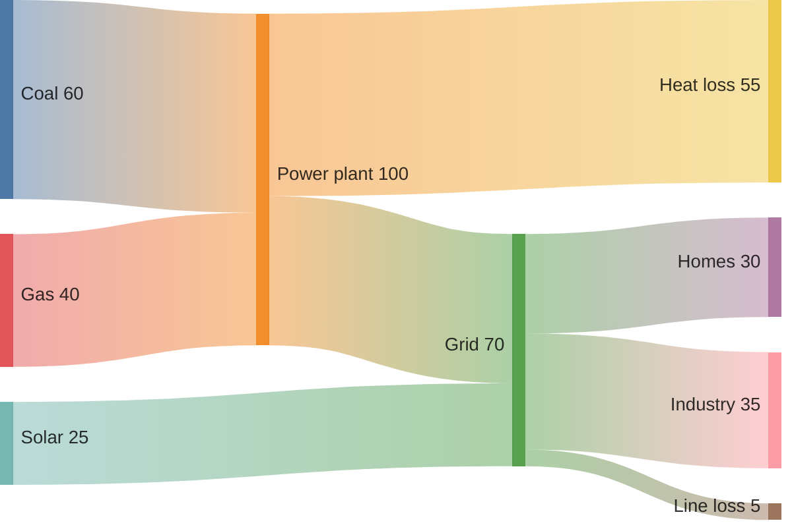
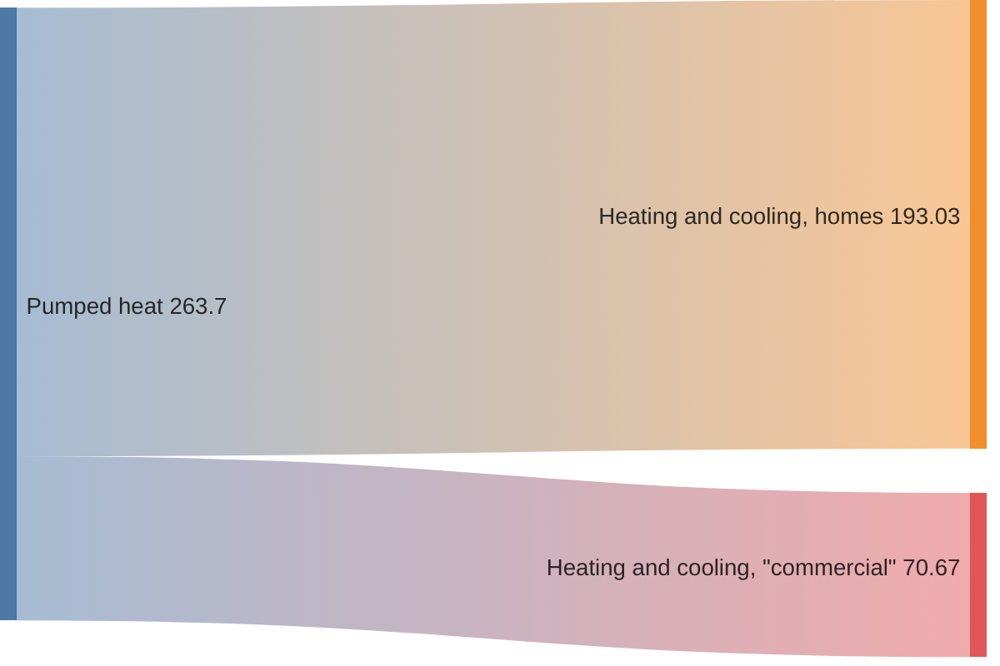
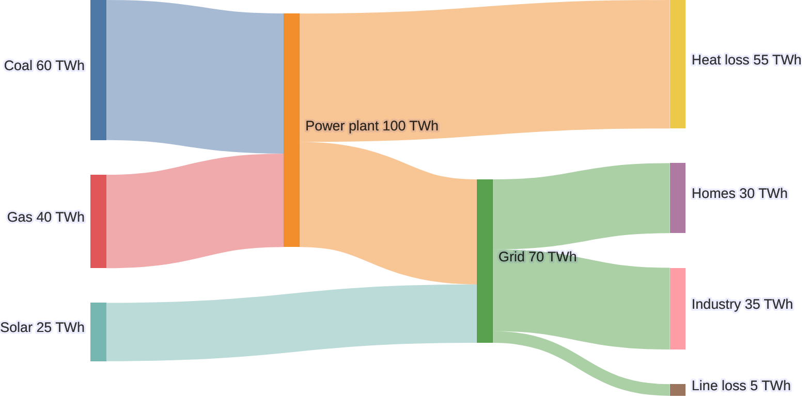
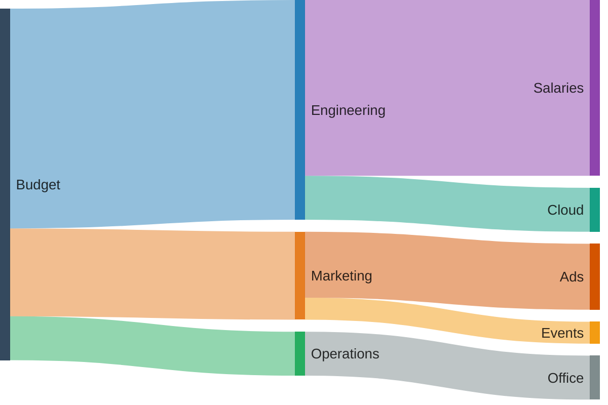

# Sankey Diagram

## Summary

A **Sankey diagram** is a flow diagram that visualizes the transfer of quantities between nodes. The width of each link is proportional to the flow it represents, making it ideal for energy, material, money or user flows.

**Use Cases:**
- Visualizing energy or material flows in systems (e.g., energy balance, supply chains)
- Showing cost breakdowns and budget allocations
- Mapping user journeys or funnels with quantitative transitions

**When to Use:**
- When you need to show how quantities split and merge between stages or categories
- When the magnitude of each flow matters
- Not for flows that loop back: cycles cannot be drawn

---

## Syntax Description

- Start with the `sankey` keyword (`sankey-beta` is still accepted).
- Then one flow per line as CSV with **exactly three columns**: `source,target,value`.
- There is **no header row**; every line is data.
- Nodes are created implicitly from the names. The same name in several rows is the same node; names are case-sensitive.
- Empty lines are allowed. Comments with `%%` work on their own line or after a row.
- Spaces around the commas are ignored.
- A name containing a comma must be wrapped in double quotes; a double quote inside a quoted name is written twice (`""`).
- Values are plain non-negative numbers with `.` as decimal separator (`104.453`, `1e3`). No thousands separators, no units.

```text
sankey

<source>,<target>,<value>
<source>,<target>,<value>
"<name, with comma>",<target>,<value>
```

Options are set in the front matter under `config: sankey:` (see Configuration).

---

## Examples

### Basic multi-stage flow



The number next to each node name is the node's total throughput, not the value of a single link. A node's position (column) follows from the links; by default the last nodes are pushed to the right edge.

### Commas and double quotes in names



### Outlined labels, units, links in source colour



`labelStyle: outlined` places the labels of the first and last column outside the diagram and gives all labels a white outline, which is easier to read than the default labels drawn on top of the links.

### Fixed node colours, values hidden



---

## Configuration

All options go under `config: sankey:` in the front matter and were verified with this renderer.

| Option | Default | Effect |
|--------|---------|--------|
| `showValues` | `true` | `false` hides the totals next to the node names |
| `prefix`, `suffix` | empty | Text before / after each value, e.g. `suffix: " TWh"` |
| `linkColor` | `gradient` | `source`, `target`, `gradient`, or a quoted hex colour such as `"#a1a1a1"` for all links |
| `nodeAlignment` | `justify` | `justify`, `left`, `right`, `center` (see pitfalls) |
| `labelStyle` | `legacy` | `outlined`: outlined labels, outer columns labelled outside the diagram (Mermaid 11.15+) |
| `nodeWidth` | 10 | Width of the node bars in px (11.15+) |
| `nodePadding` | 12 | Vertical gap between nodes in px (11.15+) |
| `nodeColors` | - | Map `Node name: "#hex"`; nodes not listed keep automatic colours (11.15+) |
| `width`, `height` | 600, 400 | Size of the diagram in px |

---

## Rules and Pitfalls

- **ASCII only in the data rows.** Umlauts, accents, `€`, typographic dashes, emoji and tabs are a parse error, also inside quotes, and entity codes (`&ouml;`) are printed literally. Transliterate (`Groesse`, `EUR`). Non-ASCII text is fine in the front matter (`prefix`, `suffix`).
- **No header row.** A line such as `Source,Target,Value` is not skipped: it renders without error as two extra nodes "Source 0" and "Target 0". Use a `%%` comment instead.
- **No title.** A `title` line is a parse error and a front-matter `title:` is accepted but not drawn. Put the title in the surrounding document.
- **No cycles.** `A,B` together with `B,A` (or a longer loop, or `A,A`) fails with `circular link`. Model a return flow as a separate node (`Recycled`).
- **Values must be numbers.** A non-numeric or missing value is not always reported: `A,B,ten` renders an empty picture. Negative values produce a broken layout, and a value of `0` leaves a node without a bar. A fourth column or `1,000` (thousands separator) is a parse error.
- Exactly three columns per row; quote names that contain commas.
- `nodeColors` keys must match the node names exactly; nodes not listed are recoloured automatically, so list all nodes when colours carry meaning.
- `nodeAlignment: left` or `center` moves end nodes into inner columns and usually creates crossing links; stay with the default `justify` (or `right`) unless there is a reason.
- With the default label style, labels are drawn on top of the links and long names in the middle columns can overlap neighbouring links. Keep names short or use `labelStyle: outlined`.
- Very small flows next to very large ones shrink to hairlines; aggregate tiny flows into an `Other` node when they are not the point.
- Repeating the same `source,target` pair draws two separate links between the nodes; sum them beforehand.
- HTML is not interpreted in names; `<` appears as `&lt;`.

---

## References

- [Official Mermaid Sankey Diagram Documentation](https://mermaid.js.org/syntax/sankey.html)
