# Sequence Diagram

## Summary

Sequence diagrams are interaction diagrams that show how processes operate with one another and in what order. They are particularly useful for visualizing the chronological flow of messages between different components, actors, or systems in a time-ordered sequence.

### Use Cases

Sequence diagrams are best used for:

- **System Interactions**: Showing how different components or services communicate with each other
- **API Documentation**: Documenting the sequence of API calls between client and server
- **Use Case Modeling**: Visualizing user interactions with a system step by step
- **Protocol Design**: Illustrating communication protocols and message exchanges
- **Object-Oriented Design**: Showing method calls and object interactions in software
- **Business Process Flows**: Mapping out business transactions and handoffs between departments
- **Troubleshooting**: Analyzing communication patterns to identify issues

### When to Use

Sequence diagrams are ideal when you need to:
- Show the order of operations or events over time
- Document communication between multiple actors or systems
- Model complex interactions with clear temporal relationships
- Design and understand system architectures
- Create technical documentation for developers
- Analyze existing systems for improvement opportunities

## Syntax

### Basic Structure

```mermaid
sequenceDiagram
    [participant definitions]
    [messages and interactions]
```

### Participants

#### Basic Participants
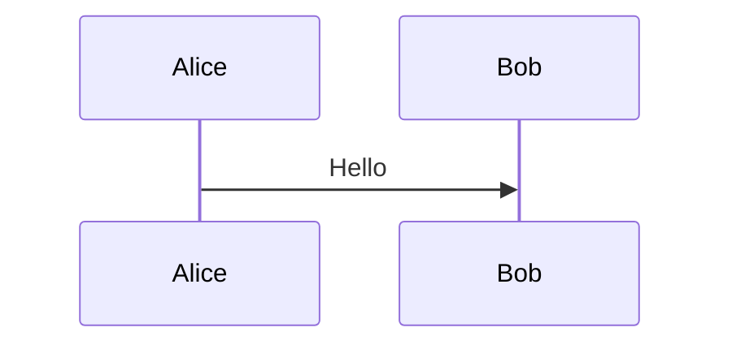

#### Actor vs Participant
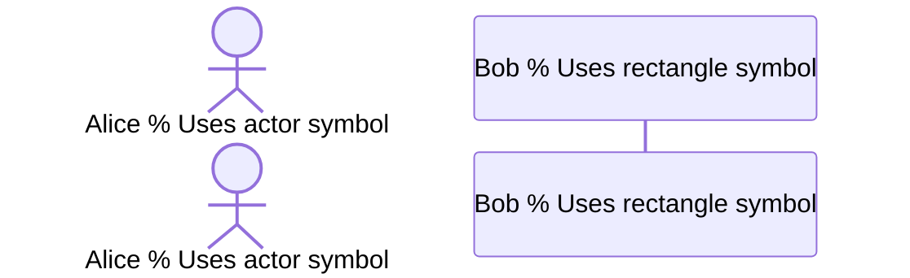

#### Participant Types (v10.3.0+)
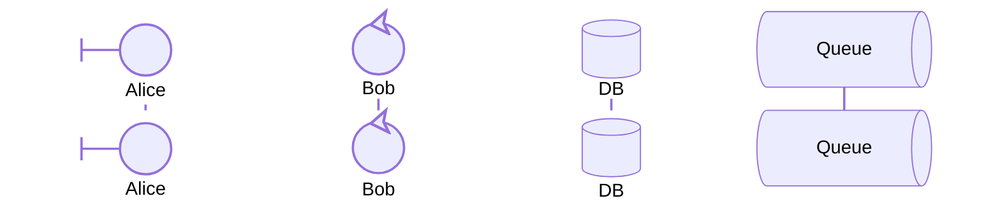

### Message Types

| Arrow Type | Syntax | Description |
|------------|---------|-----------|
| Solid Arrow | `A->B` | Standard message |
| Dotted Arrow | `A-->B` | Reply message |
| Solid with Open Arrow | `A-)B` | Asynchronous message |
| Dotted with Open Arrow | `A--)B` | Asynchronous reply |
| Bidirectional | `A<->B` | Bidirectional communication |
| Cross End | `A-xB` | Message with cross (error/cancel) |
| Circle End | `A-oB` | Message with circle end |

### Control Structures

#### Loops
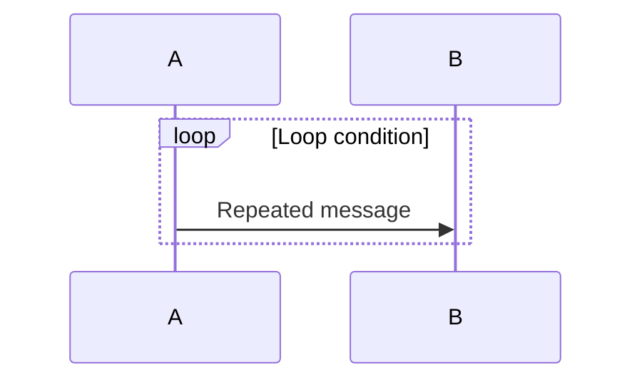

#### Alternative Paths
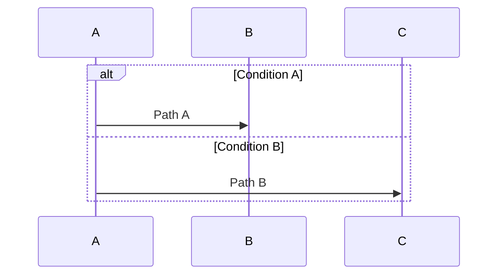

#### Optional Paths
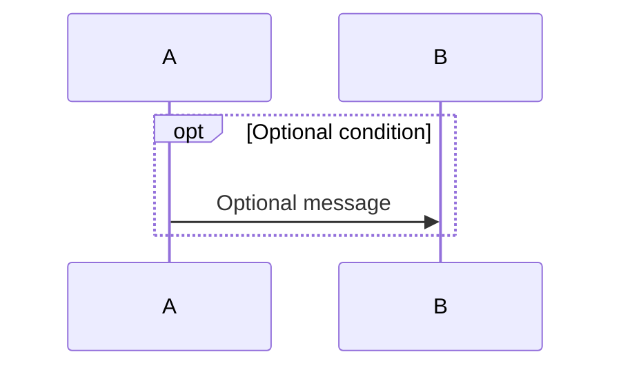

#### Parallel Actions
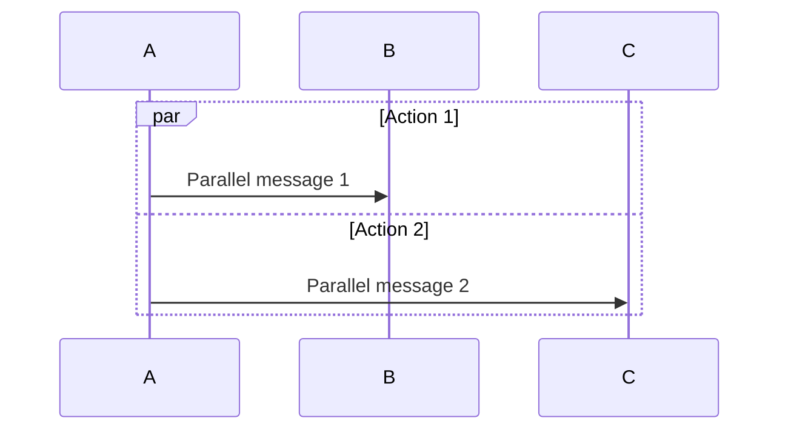

#### Critical Regions
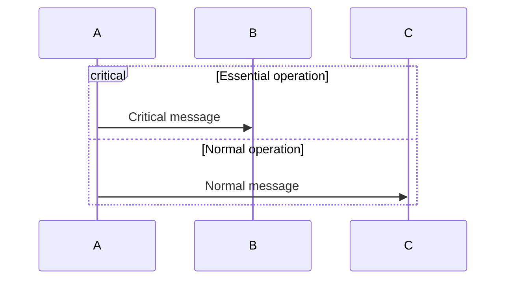

#### Break Points
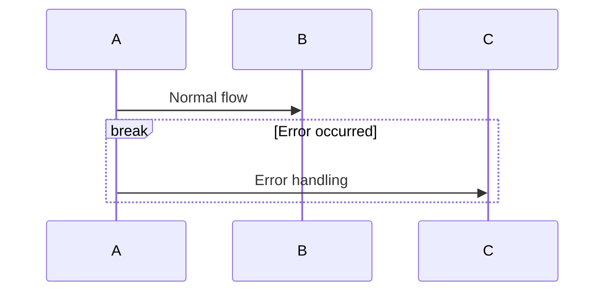

### Advanced Features

#### Activations
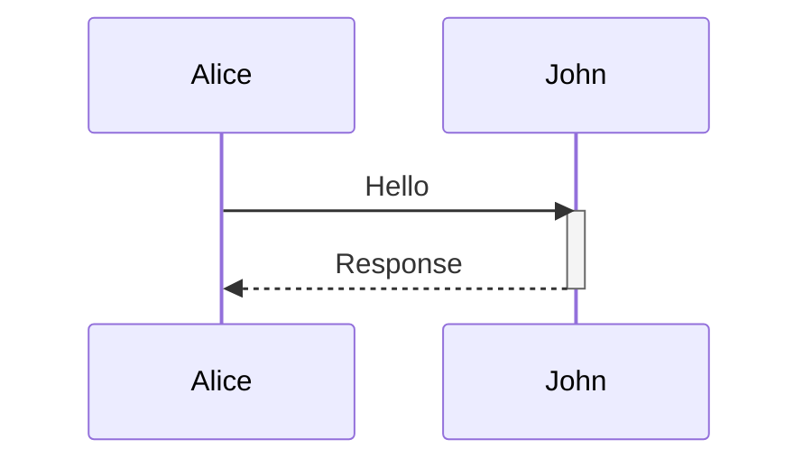

#### Notes
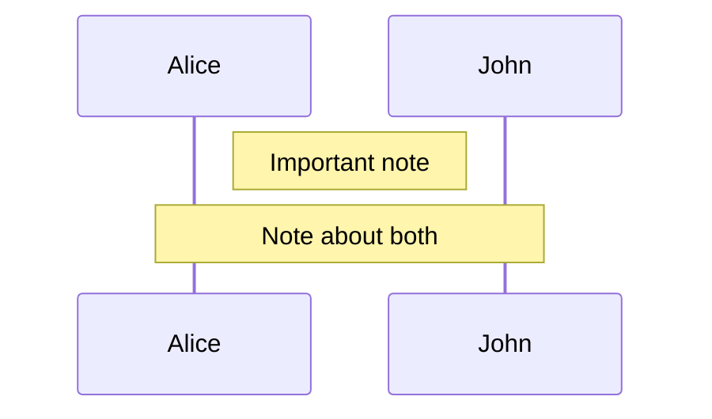

#### Grouping
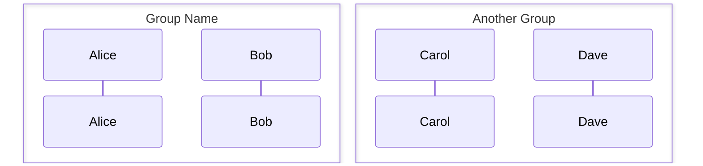

## Examples

### Basic Communication

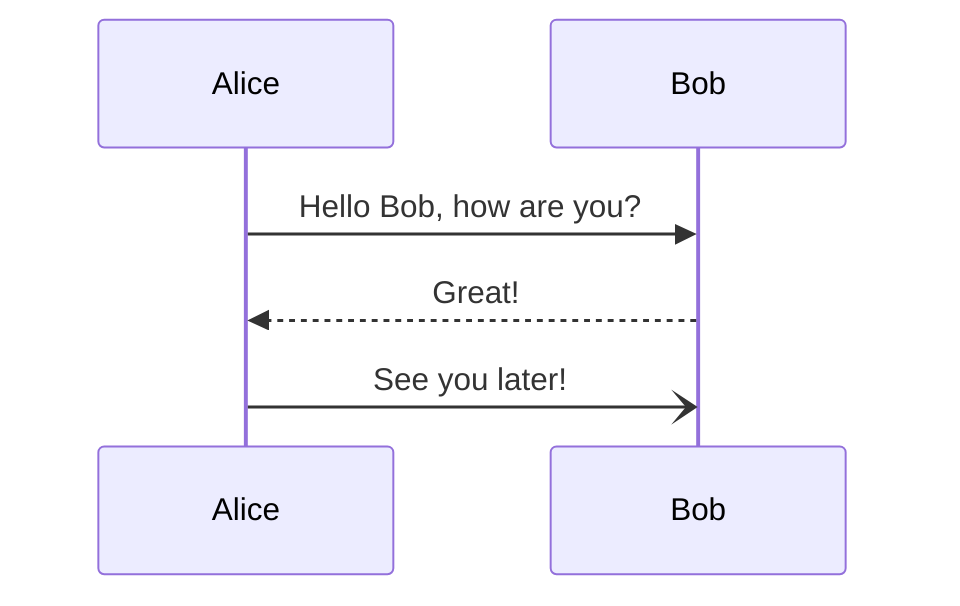

### System Interaction with Database

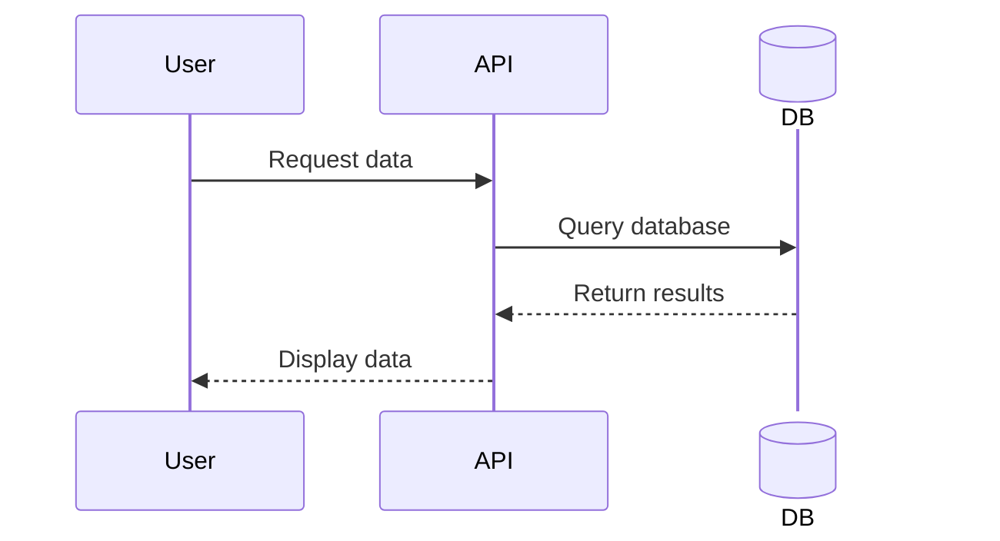

### E-commerce Transaction Flow

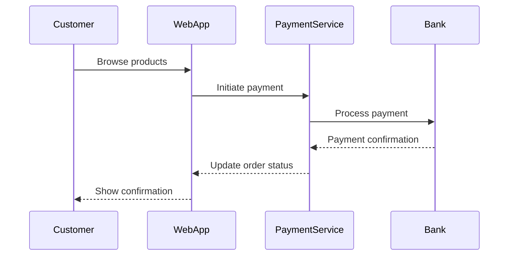

### Error Handling with Critical Region

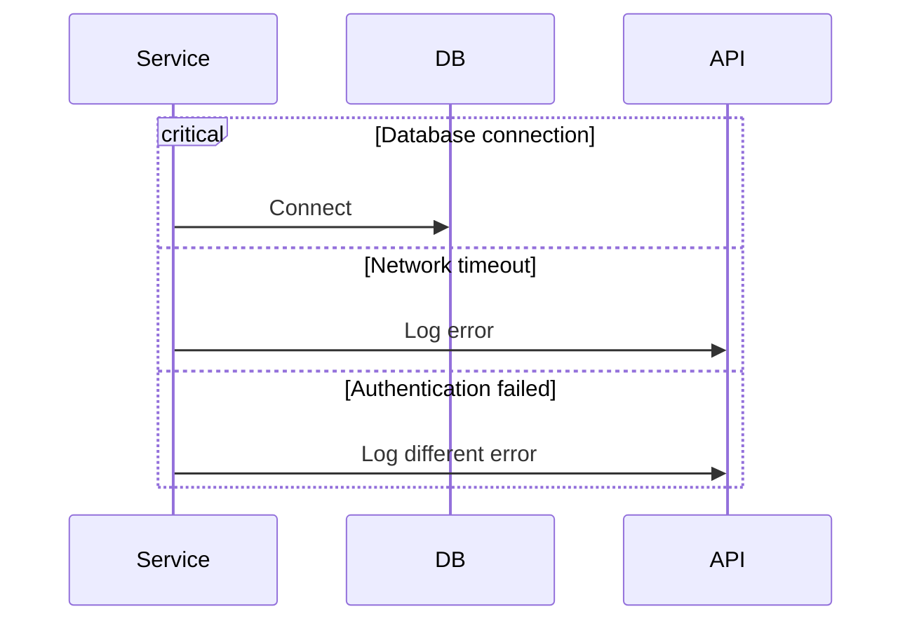

### Parallel Processing Example

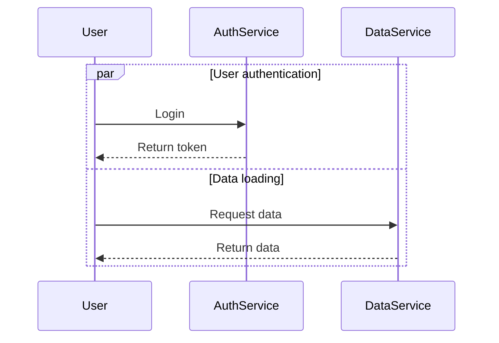

## Tips and Best Practices

1. **Use meaningful participant names** that clearly identify systems or actors
2. **Order participants logically** - place most active participants on the left
3. **Use consistent message naming** - make message purposes clear
4. **Group related interactions** using boxes to organize complex diagrams
5. **Use activations** to show when components are active
6. **Employ alt/opt/par blocks** for conditional, optional, and parallel flows
7. **Add notes** to explain complex interactions or decisions
8. **Use appropriate arrow types** - solid for requests, dotted for replies, open for async
9. **Consider time flow** - arrange messages to show clear temporal progression
10. **Keep diagrams focused** - avoid overcrowding with too many participants or messages

**References:**
- [Mermaid.js Sequence Diagram Documentation](https://mermaid.js.org/syntax/sequenceDiagram.html)
- [Mermaid.js Documentation](https://mermaid.js.org/)