# Sequence Diagram

## Summary

Sequence diagrams are interaction diagrams that show how processes operate with one another and in what order. They are particularly useful for visualizing the chronological flow of messages between different components, actors, or systems in a time-ordered sequence.

### Use Cases

Sequence diagrams are best used for:

- **System Interactions**: Showing how different components or services communicate with each other
- **API Documentation**: Documenting the sequence of API calls between client and server
- **Use Case Modeling**: Visualizing user interactions with a system step by step
- **Protocol Design**: Illustrating communication protocols and message exchanges
- **Object-Oriented Design**: Showing method calls and object interactions in software
- **Business Process Flows**: Mapping out business transactions and handoffs between departments
- **Troubleshooting**: Analyzing communication patterns to identify issues

### When to Use

Sequence diagrams are ideal when you need to:
- Show the order of operations or events over time
- Document communication between multiple actors or systems
- Model complex interactions with clear temporal relationships
- Design and understand system architectures
- Create technical documentation for developers
- Analyze existing systems for improvement opportunities

## Syntax

### Basic Structure

Template (placeholders, not runnable):

```text
sequenceDiagram
    <participant definitions>
    <messages and interactions>
```

Minimal complete diagram:

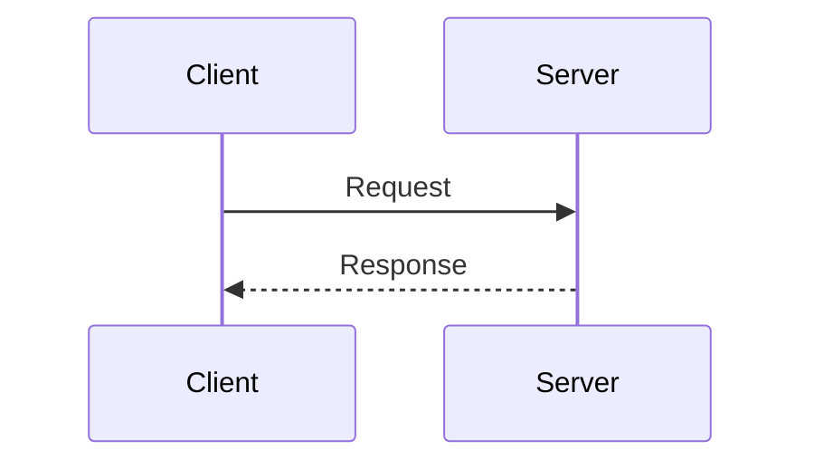

Comments start with `%%` and must stand on a line of their own. Text after a statement, such as `actor Alice % note`, is not a comment: it becomes part of the participant name or message.

### Participants

#### Basic Participants
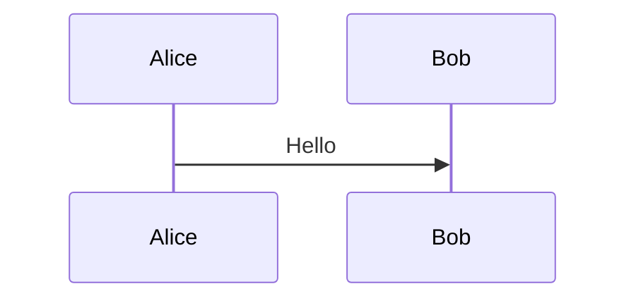

#### Actor vs Participant
`actor` draws a stick figure, `participant` a box. `as` gives a display name that differs from the id.

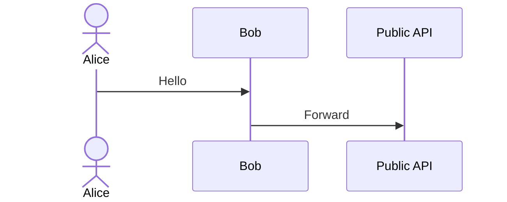

#### Participant Types
The JSON-style suffix `@{ "type": "..." }` selects a symbol: `boundary`, `control`, `entity`, `database`, `collections` or `queue`.

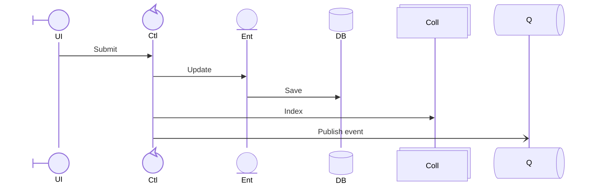

#### Creating and Destroying Participants
`create participant X` (or `create actor X`) directly before a message makes X appear at that message instead of at the top; X must be the receiver. `destroy X` directly before a message ends X's lifeline at that message; X can be sender or receiver.

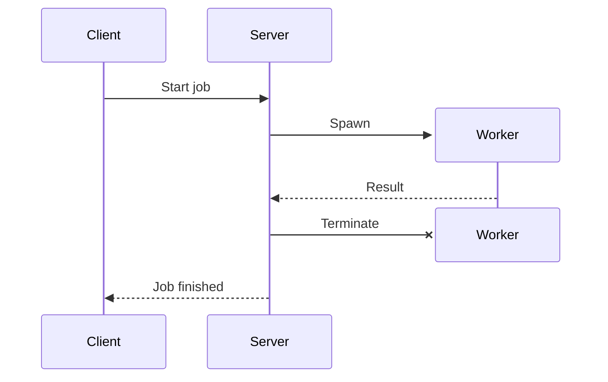

### Message Types

| Arrow Type | Syntax | Description |
|------------|---------|-----------|
| Solid line, no arrowhead | `A->B` | Plain connection |
| Dotted line, no arrowhead | `A-->B` | Plain dotted connection |
| Solid with arrowhead | `A->>B` | Standard message / call |
| Dotted with arrowhead | `A-->>B` | Reply message |
| Solid, arrowheads on both ends | `A<<->>B` | Bidirectional communication |
| Dotted, arrowheads on both ends | `A<<-->>B` | Bidirectional, dotted |
| Solid with cross | `A-xB` | Lost or cancelled message |
| Dotted with cross | `A--xB` | Lost or cancelled reply |
| Solid with open arrow | `A-)B` | Asynchronous message |
| Dotted with open arrow | `A--)B` | Asynchronous reply |

`->` and `-->` have **no** arrowhead; use `->>` and `-->>` for normal messages. `A<->B` and `A-oB` do not exist and are parse errors.

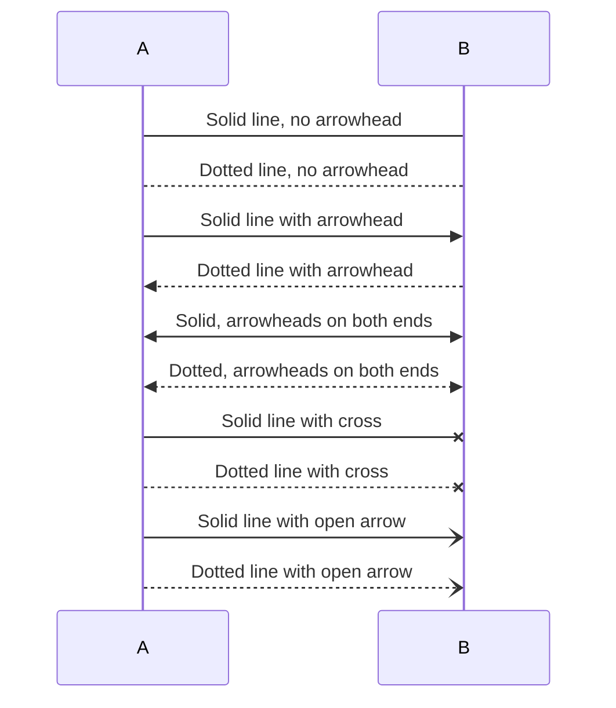

Message text ends at the line end. A semicolon in the text is a parse error, write `#59;` instead; `<br/>` breaks a line.

### Control Structures

#### Loops
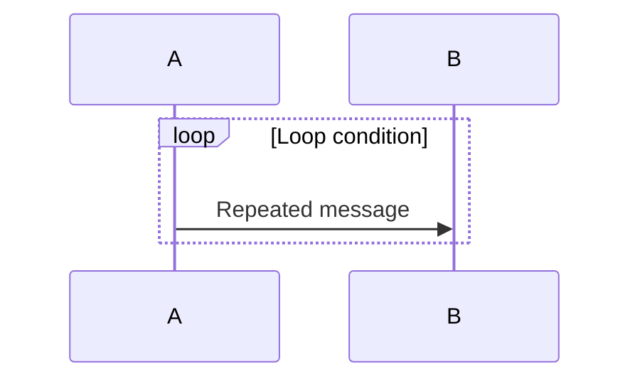

#### Alternative Paths
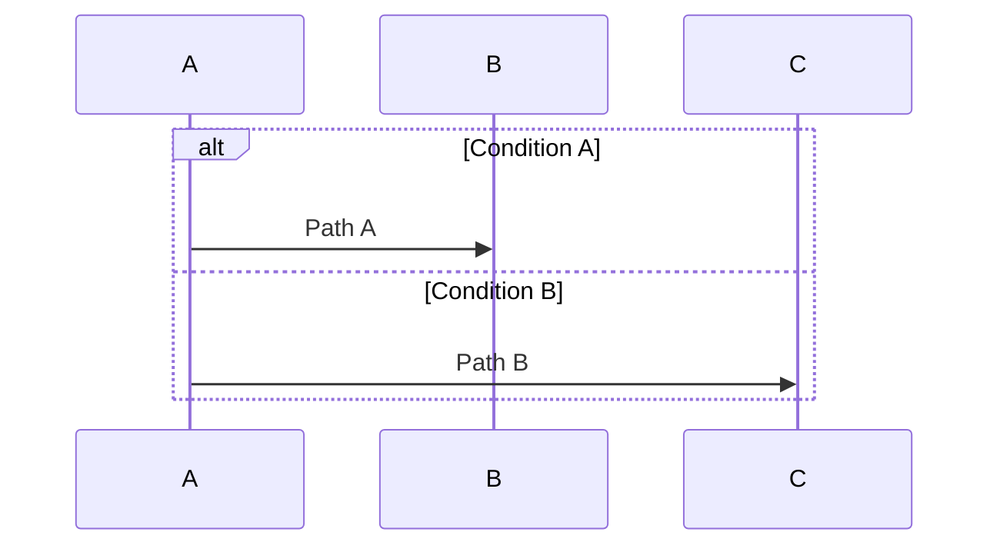

#### Optional Paths
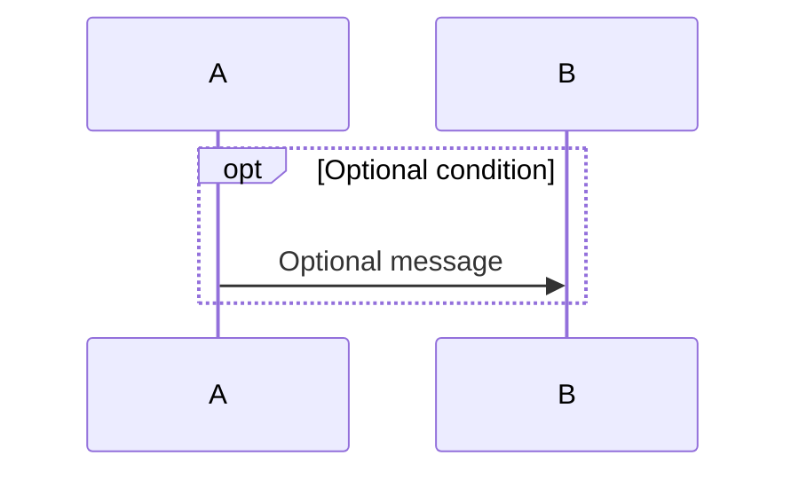

#### Parallel Actions
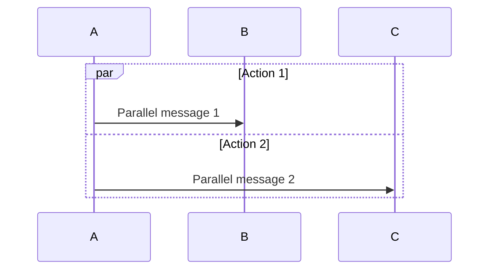

#### Critical Regions
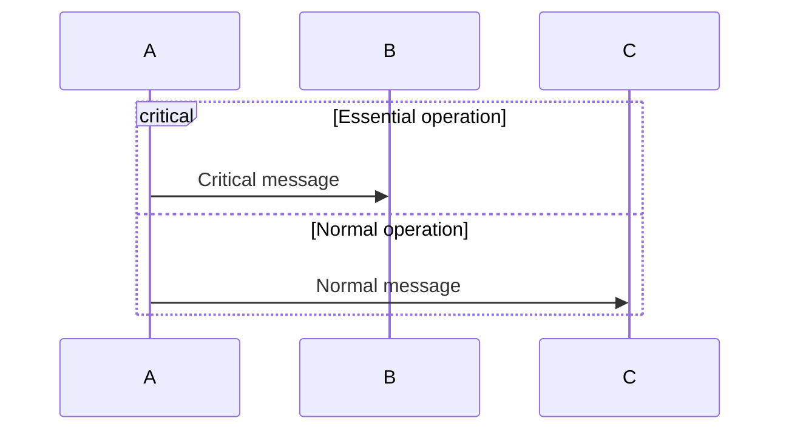

#### Break Points
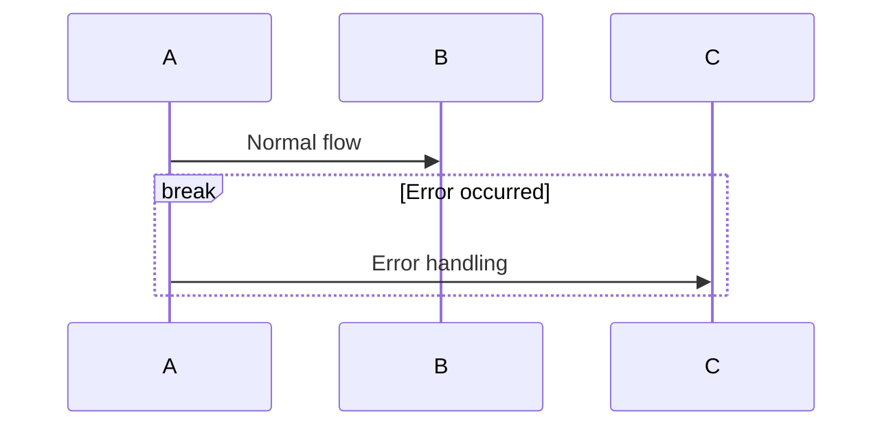

### Advanced Features

#### Activations
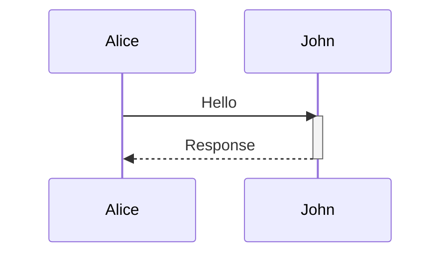

Shorthand: a `+` after the arrow activates the receiver, a `-` deactivates the sender (`App->>+API: call`, `API-->>-App: result`).

#### Sequence Numbers
`autonumber` as the first statement numbers all messages in order.

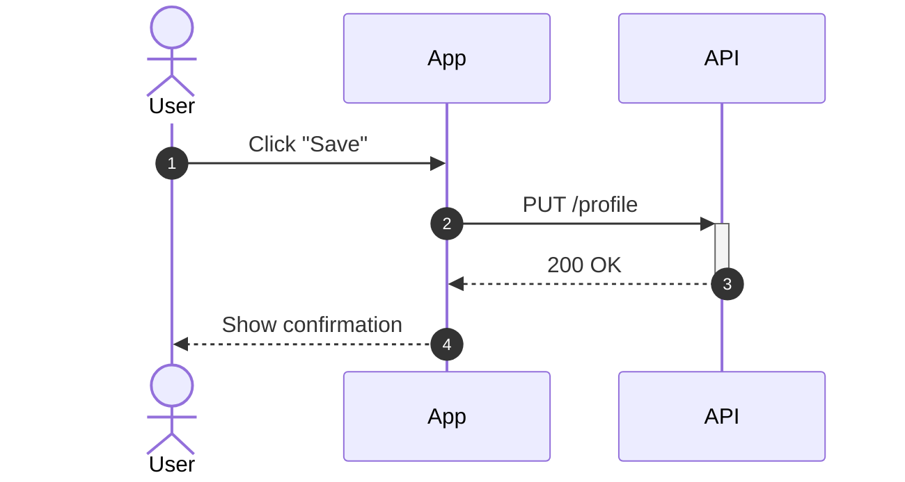

#### Notes
`Note right of X`, `Note left of X` or `Note over X,Y`. `rect rgb(r, g, b) ... end` puts a coloured background behind a group of messages.

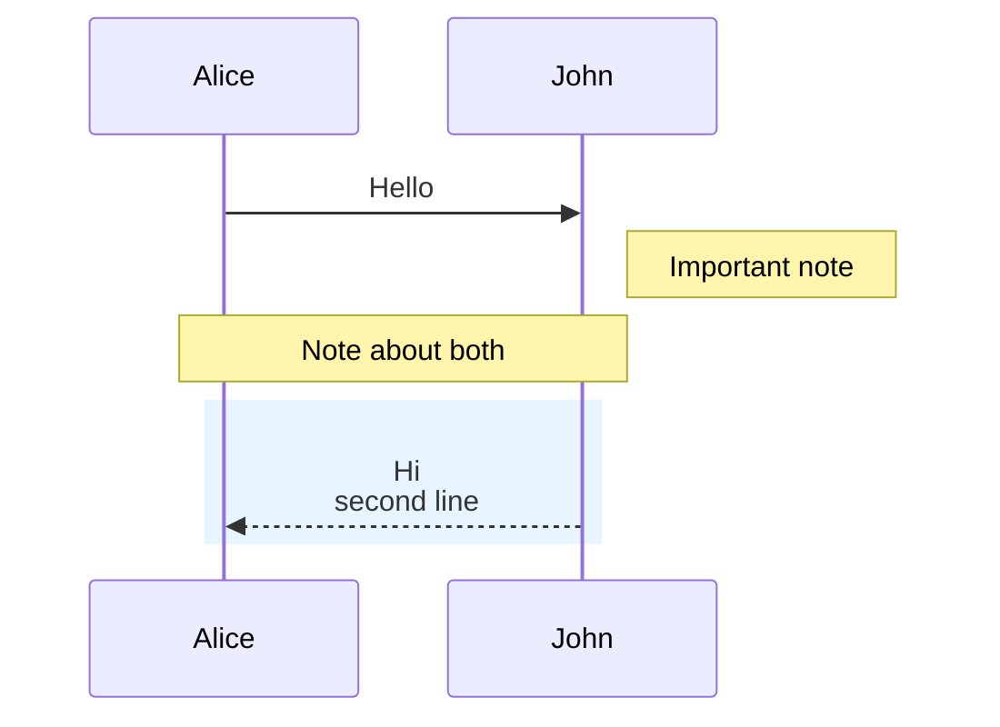

#### Grouping
`box <colour> <title> ... end` frames participants; the colour is optional and comes before the title.

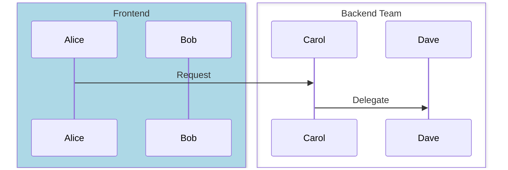

## Examples

### System Interaction with Database

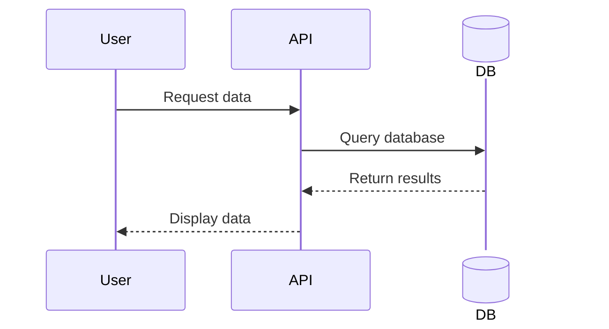

### Error Handling with Critical Region

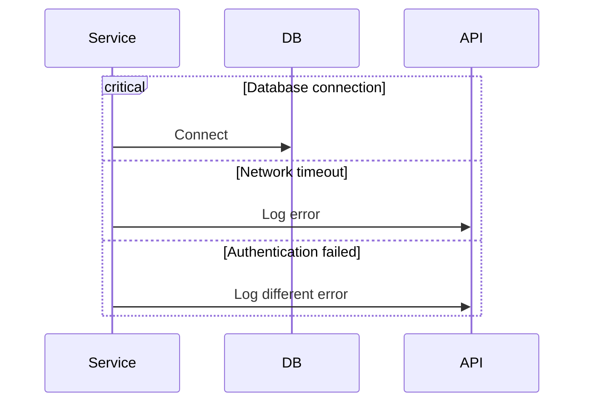

### Parallel Processing Example

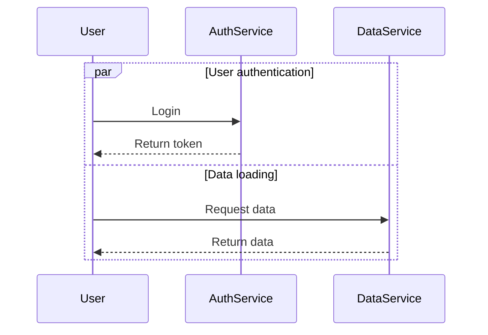

## Tips and Best Practices

1. **Use meaningful participant names** that clearly identify systems or actors
2. **Order participants logically** - place most active participants on the left
3. **Use consistent message naming** - make message purposes clear
4. **Group related interactions** using boxes to organize complex diagrams
5. **Use activations** to show when components are active
6. **Employ alt/opt/par blocks** for conditional, optional, and parallel flows
7. **Add notes** to explain complex interactions or decisions
8. **Use appropriate arrow types** - `->>` for requests, `-->>` for replies, `-)` for async
9. **Consider time flow** - arrange messages to show clear temporal progression
10. **Keep diagrams focused** - avoid overcrowding with too many participants or messages

**References:**
- [Mermaid.js Sequence Diagram Documentation](https://mermaid.js.org/syntax/sequenceDiagram.html)
- [Mermaid.js Documentation](https://mermaid.js.org/)