# State Diagram

## Summary

A state diagram describes a system as a finite set of states and the transitions between them. It is the right choice for lifecycles (order, ticket, document), protocols, UI flows and controllers.

### Use Cases

- **Object Lifecycle**: states of an order, ticket, document or session from creation to the end
- **Finite State Machines**: controllers, protocol handlers, parsers
- **Process and UI Flows**: screens or steps with the events that lead from one to the next
- **Error Handling**: failure states and recovery paths

### When to Use

- The system is in exactly one of a few named states at a time (or in one state per concurrent region)
- The interesting part is which event leads from which state to which
- For step sequences with many decisions but no lasting states, use a flowchart instead

## Syntax

Start with `stateDiagram-v2` (the plain keyword `stateDiagram` renders the same). One statement per line.

### Basic Structure

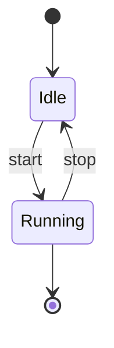

- `A --> B` is a transition; `A --> B : text` labels it. States are created on first use.
- `[*]` is the start state when it is the source and the end state when it is the target.
- `A --> A : text` draws a self-transition.

### State Declaration

A state id may contain letters, digits and underscores only. For any other display text give the state a description:

```text
StateId                               just the id as label
StateId : Text shown in the box       id plus description
state "Text shown in the box" as StateId
```

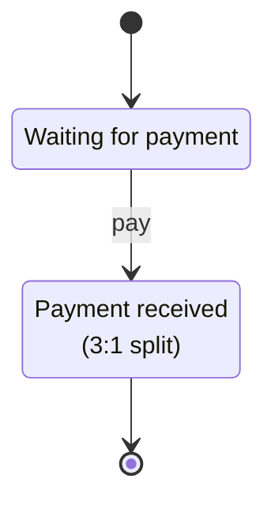

Descriptions and transition labels may contain spaces, colons, quotes, parentheses, `<`, `>` and `<br>` for a line break.

### Composite States

`state Id { ... }` nests a state machine inside a state. Transitions to and from the composite use its id. Composites can be nested and can get a display text like simple states.

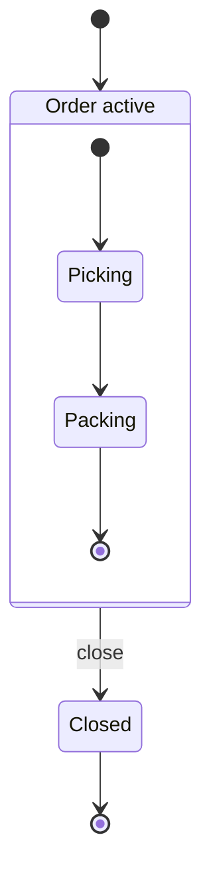

### Choice States

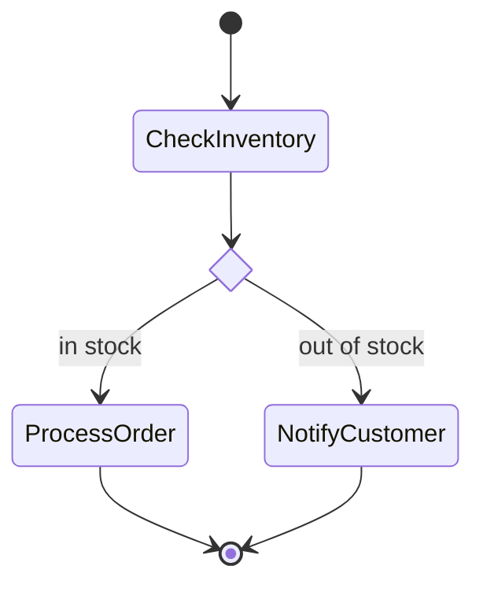

Declare the choice state with `<<choice>>` **before** its first use in a transition, then use it like any other state. There is no `if`/`end` syntax in state diagrams.

### Fork and Join

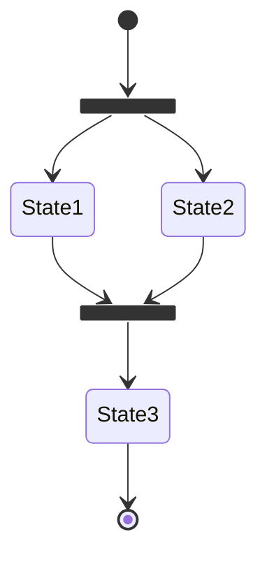

Fork and join are drawn as black bars. Like choice states they must be declared before use.

### Notes

```text
note right of StateId : single line text
note left of StateId
    several lines
    of text
end note
```

A note is a yellow box connected to its state by a dotted line. "left of" places it before the state and "right of" after it along the diagram direction, so the words are only literally true with `direction LR`. In the default top-down layout a "left of" note sits above its state and a "right of" note below it.

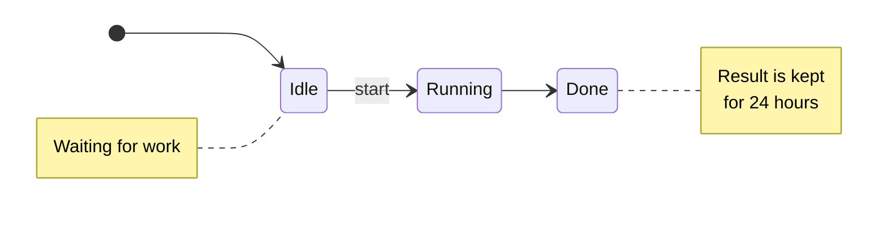

### Concurrency

Inside a composite state, a line with `--` separates regions that are active at the same time.

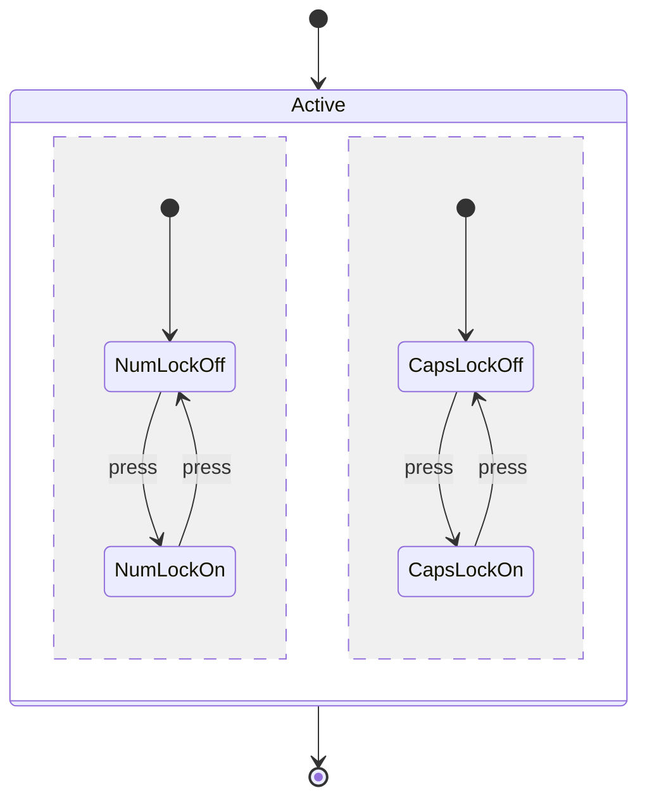

With the default layout, long transition labels stick out of the dashed region frames and a third region wraps into a second row. For three or more regions or long labels, switch this diagram to the Dagre layout, which puts the regions side by side and sizes them to their labels:

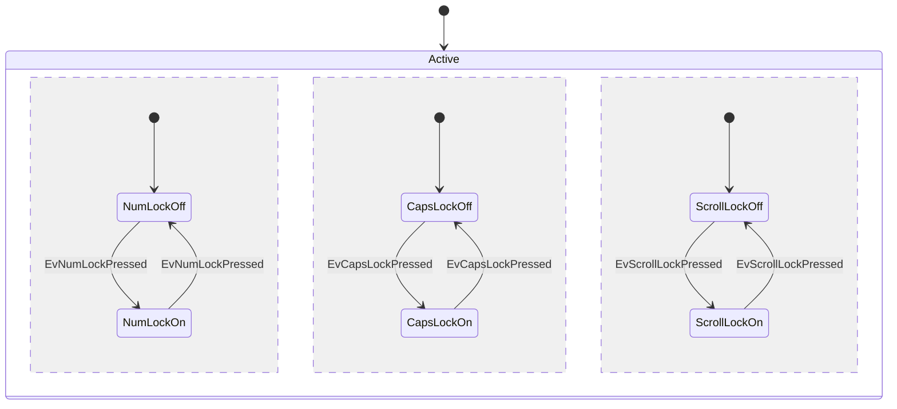

### Direction

`direction LR` (or `TB`, `RL`, `BT`) as a statement sets the flow direction; the default is top to bottom. A composite state can set its own direction inside its braces.

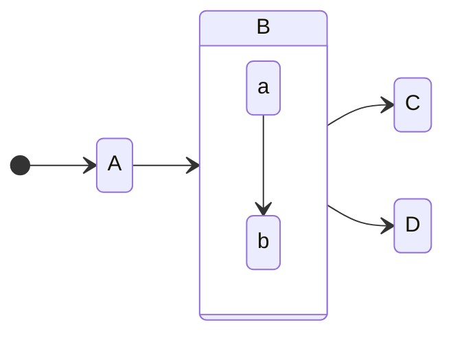

### Styling

Define a style with `classDef name property:value,property:value` (CSS properties such as `fill`, `stroke`, `stroke-width`, `color`, `font-weight`, `font-style`) and apply it in one of two ways:

- `class StateA, StateB name` as a separate statement
- `StateA:::name` appended to a state inside a transition

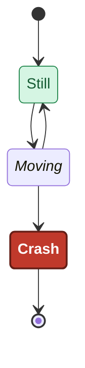

A state can carry several classes. `style StateId fill:#cfc,stroke:#090` styles a single state directly. Start and end states cannot be styled. For states inside a composite, and for the composite itself, use the `class` statement at the top level; `:::` written inside the composite's braces is ignored.

### Title and Comments

A title comes from the front matter (`---`, `title: My Title`, `---` above the diagram keyword). `%%` starts a comment, on its own line or at the end of a statement.

### Layout and Look in Mermaid 12

Since Mermaid 12, state diagrams are laid out by ELK (orthogonal edges with rounded corners) and use a new default look and theme. The syntax is unchanged. The previous appearance (curved edges, lilac boxes) is available per diagram:

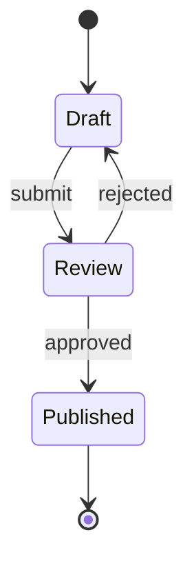

Use `layout: dagre` alone when only the arrangement is the problem (see Concurrency).

## Examples

### Simple State Machine

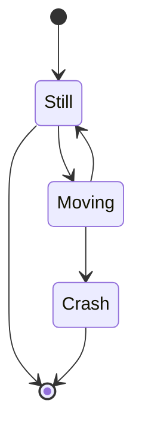

### User Session with Composite State and Choice

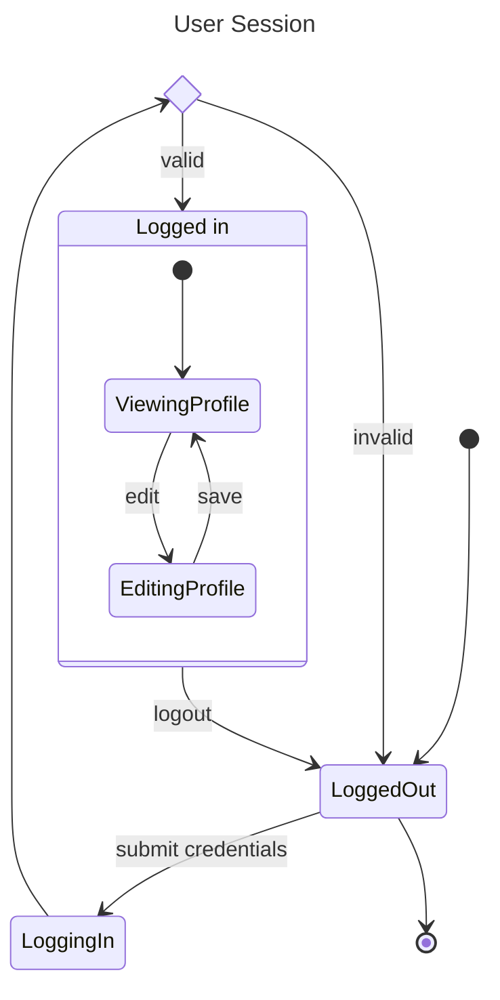

## Rules and Pitfalls

1. **Ids are word characters only.** `my-state` and `State 3` are parse errors. Use `my_state` and put the readable text into a description.
2. **Declare `<<choice>>`, `<<fork>>` and `<<join>>` first.** If the declaration comes after the first transition that uses the id, the state is drawn as an ordinary box, without any error.
3. **Notes follow the flow direction, not the keyword** (see Notes). Attach notes to simple top-level states; a note on a state inside a composite, or on the composite itself, is placed outside the frame and its line is hard to attribute.
4. **Connect composites through their id.** A transition from an inner state to the outside (for example `Idle --> [*]` written after the closing brace) or between inner states of two different composites is drawn, but the arrow cuts through frames and titles. Prefer `Composite --> Target` and an inner `[*]`.
5. **Concurrency regions and long labels** overflow in the default layout; shorten the labels or use `layout: dagre`.
6. **Bidirectional pairs** (`A --> B` and `B --> A`) put their two labels side by side. Give both a label so it is clear which is which, and keep labels short; a long label is wrapped into a grey block that pushes states apart.
7. **Styling limits:** no styling of `[*]`; `:::` only works at the top level.
8. **One statement per line and no trailing semicolons.** `A --> B;` creates a state named "B;". There is no `end` keyword except `end note`.
9. Keep a diagram to about 15 states; group related states into composites beyond that.

**References:**
- [Mermaid.js State Diagram Documentation](https://mermaid.js.org/syntax/stateDiagram.html)
