# State Diagram

## Summary

State diagrams are a type of diagram used in computer science and related fields to describe the behavior of systems. They require that the system described is composed of a finite number of states, and sometimes this is indeed the case, while at other times this is a reasonable abstraction. State diagrams are excellent for modeling the lifecycle of objects, systems, or processes.

### Use Cases

State diagrams are best used for:

- **System Behavior Modeling**: Showing how different components or systems transition between states
- **Object Lifecycle**: Visualizing the lifecycle of objects from creation to destruction
- **Process Flows**: Documenting state transitions in business processes
- **User Interface Design**: Modeling user interactions and screen flows
- **Protocol Design**: Illustrating communication protocols and state changes
- **Finite State Machines**: Representing systems with discrete states and transitions
- **Error Handling**: Modeling exception flows and recovery states

### When to Use

State diagrams are ideal when you need to:
- Model systems with discrete states and transitions
- Show the lifecycle of objects or processes
- Document complex behavior in a clear, visual way
- Design state machines and controllers
- Analyze system behavior and identify edge cases
- Create technical documentation for state-based systems

## Syntax

### Basic Structure

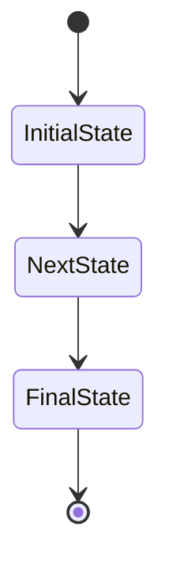

### State Declaration

#### Simple State
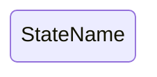

#### State with Description
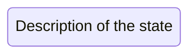

### Transitions

#### Basic Transition
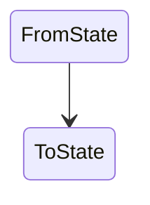

#### Transition with Label
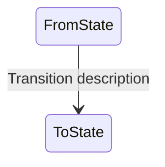

### Start and End States

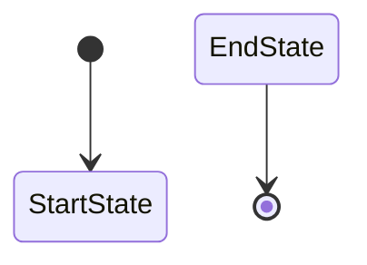

### Composite States

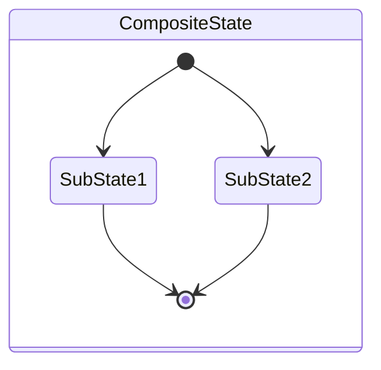

### Choice States

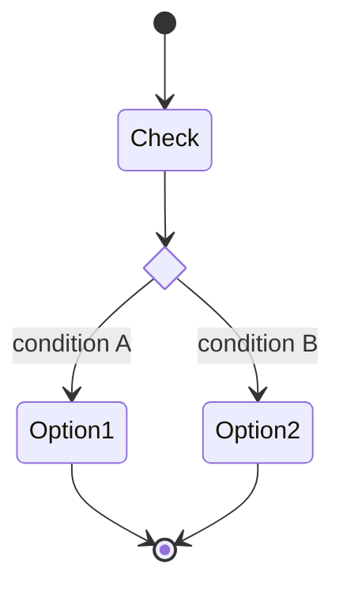

Declare the choice state once with `<<choice>>`, then use it like any other state as the
source of the alternative transitions. There is no `end` keyword in state diagrams.

### Fork and Join

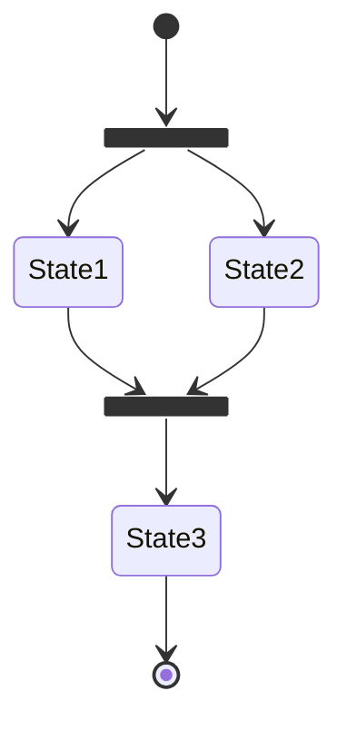

Declare fork and join states on their own lines before using them in transitions.

### Notes

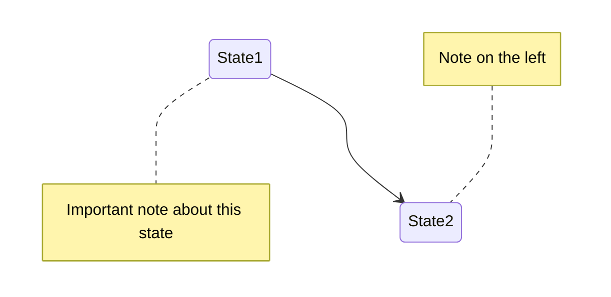

### Concurrency

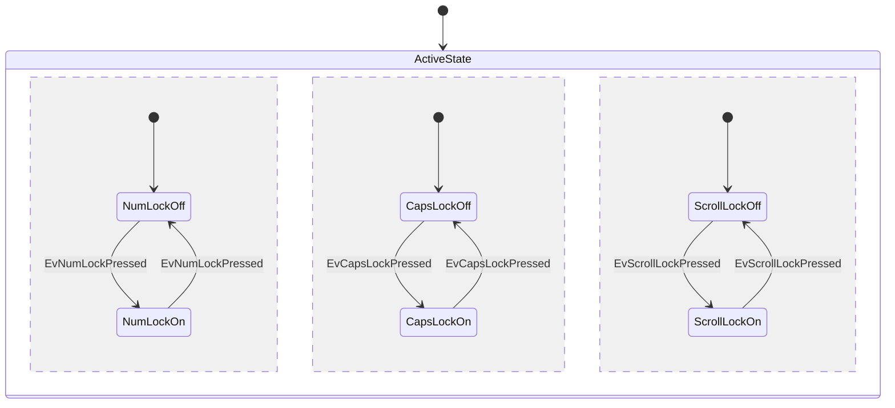

## Examples

### Simple State Machine

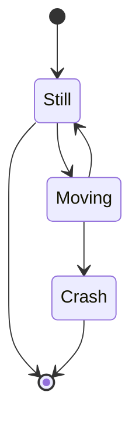

### E-commerce Order State

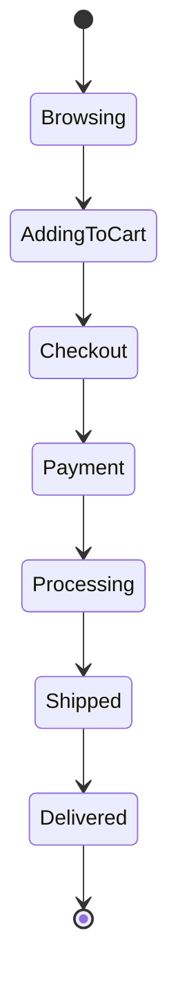

### User Authentication Flow

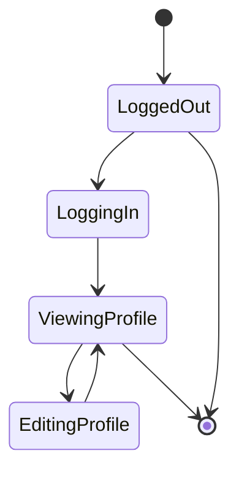

### Composite State Example

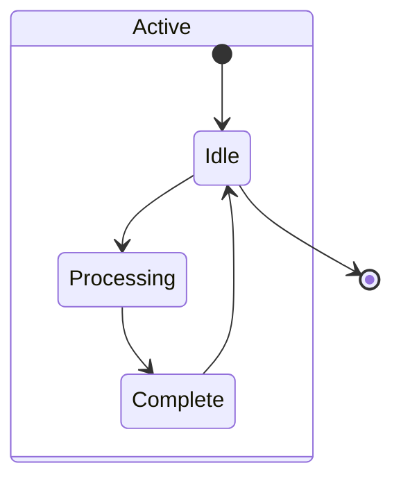

### Choice with Multiple Options

### Concurrent States

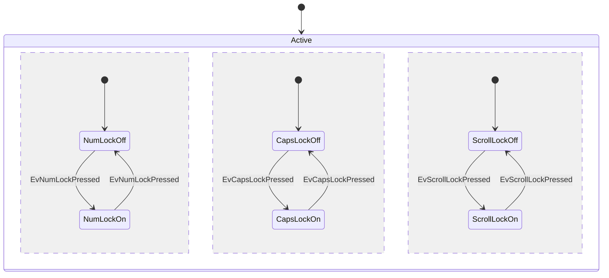

## Tips and Best Practices

1. **Use meaningful state names** that clearly describe the system's condition
2. **Keep diagrams simple** - avoid overcrowding with too many states
3. **Group related states** using composite states for better organization
4. **Use appropriate transitions** - show clear state changes
5. **Document entry and exit points** - clearly mark start and end states
6. **Use choice states** for decision points and conditional logic
7. **Employ fork/join** for parallel processing paths
8. **Add notes** to explain complex transitions or state meanings
9. **Consider state hierarchy** - organize states in logical groups
10. **Use consistent naming** - follow established conventions for state names

**References:**
- [Mermaid.js State Diagram Documentation](https://mermaid.js.org/syntax/stateDiagram.html)
- [Mermaid.js Documentation](https://mermaid.js.org/)