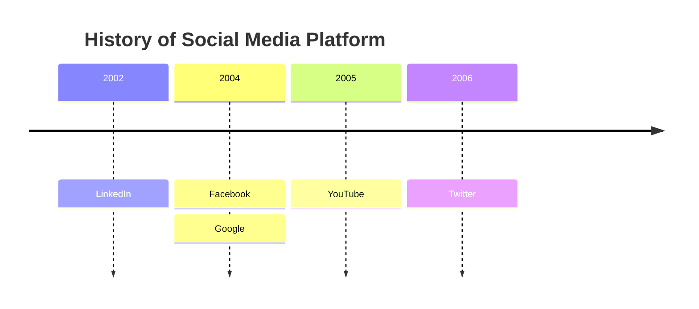
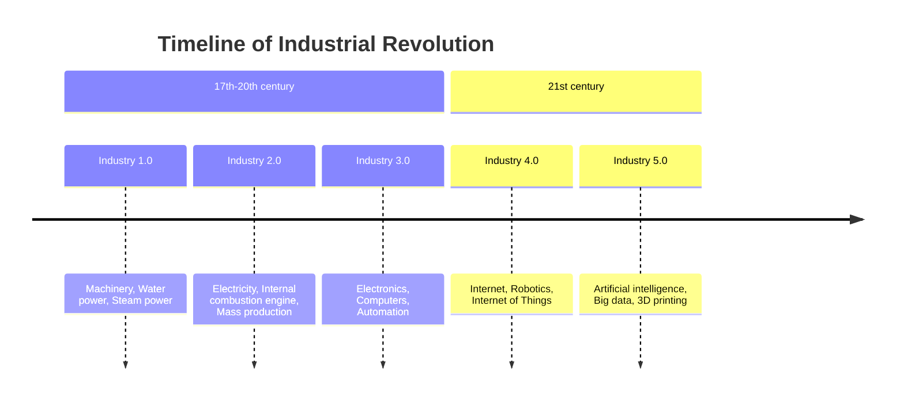
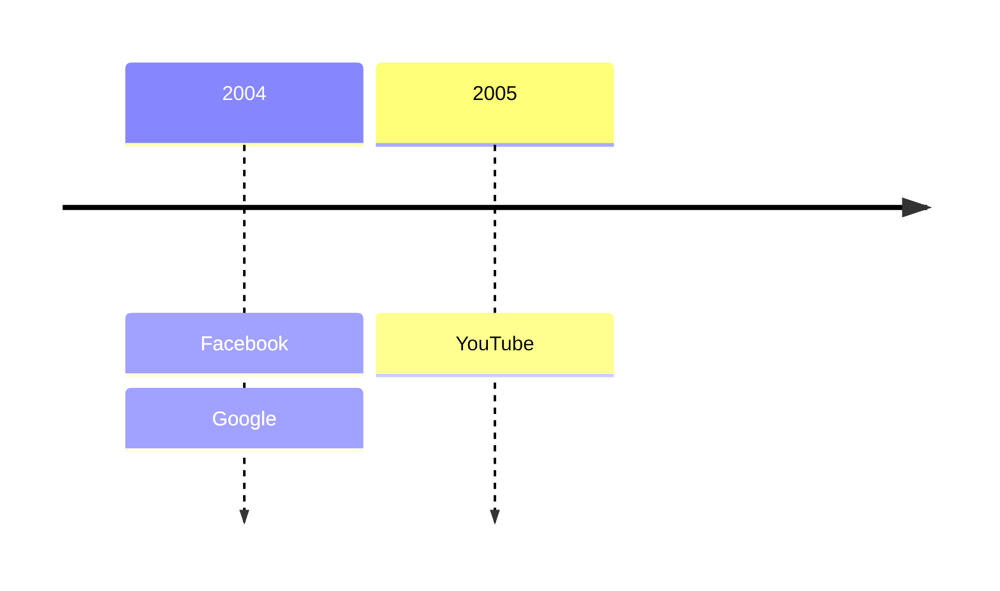
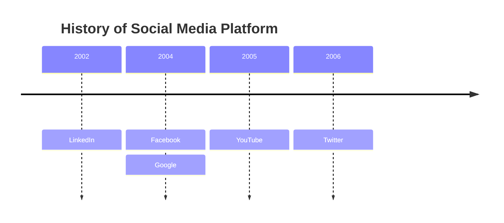
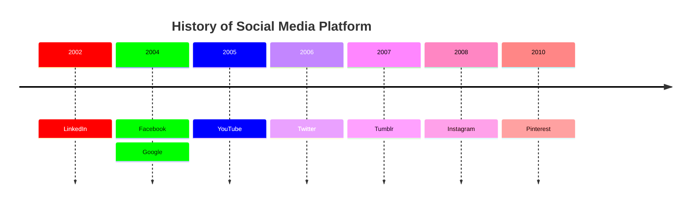

# Timeline Diagram

## Summary

A Timeline diagram is used to illustrate a chronology of events, dates, or periods of time. It presents events in chronological order, making it easy to visualize the sequence and relationship between events. Timeline diagrams are ideal for project planning, historical overviews, and process documentation.

> **Note:** The Timeline diagram in Mermaid is experimental. Syntax and properties may change in future releases.

### Use Cases

- **Project Planning**: Visualize project milestones and deadlines.
- **Historical Overviews**: Show the sequence of historical events.
- **Process Documentation**: Illustrate the order of steps in a process.
- **Product Roadmaps**: Communicate planned features and releases.

### When to Use

- When you need to show the order and timing of events.
- When visualizing dependencies or relationships between events.
- When presenting a chronological narrative.

## Syntax

- Start with the `timeline` keyword.
- Optionally, add a `title`.
- Add time periods and events using `{time period} : {event}`.
- Multiple events for the same period can be added with additional colons or lines.
- Group time periods in sections using `section Section Name`.

### Basic Structure

### Grouping with Sections

### Multiple Events per Period

or

### Wrapping and Line Breaks

- Long text will wrap automatically.
- Use ` ` for manual line breaks.

## Styling

- Each section or time period can have its own color scheme.
- To use a single color scheme, set `disableMulticolor: true` in the config.

### Customizing Colors

Override theme variables (`cScale0` to `cScale11`) for up to 12 sections.

## Tips

- Use sections to group related events.
- Keep event descriptions concise for clarity.
- Experiment with themes for the best visual fit.

**References:**  
- [Mermaid.js Timeline Diagram Documentation](https://mermaid.js.org/syntax/timeline.html)
- [Mermaid.js Documentation](https://mermaid.js.org/)