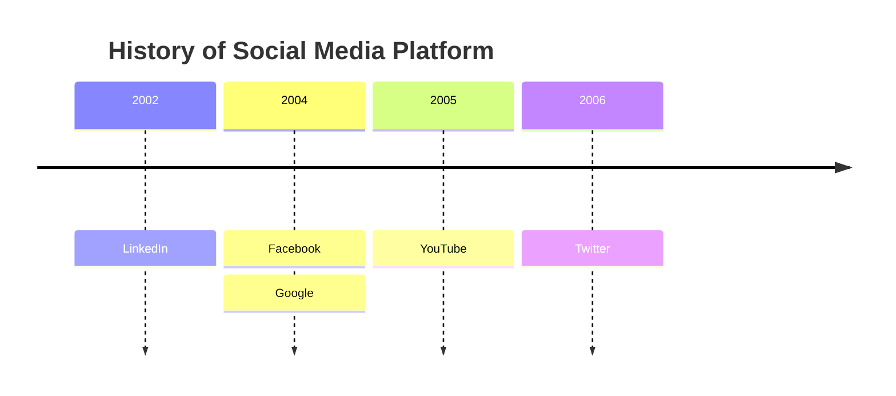
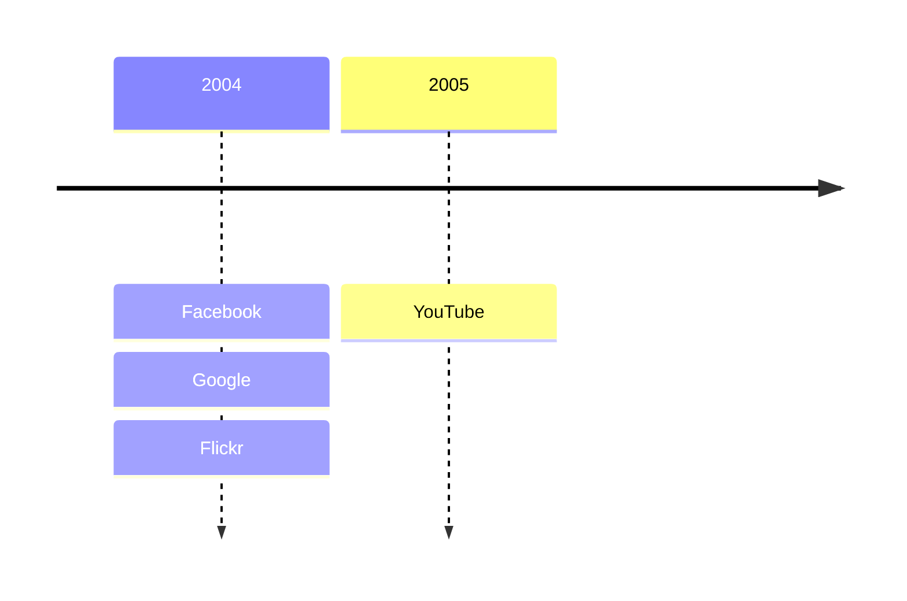
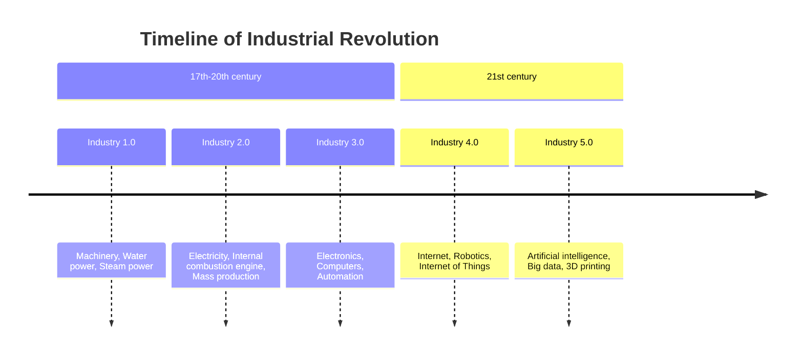
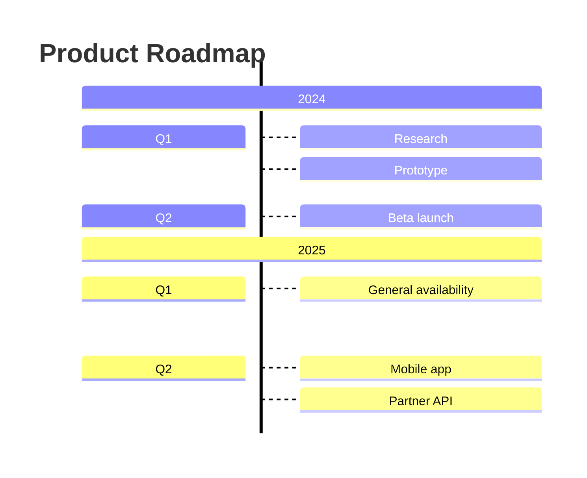
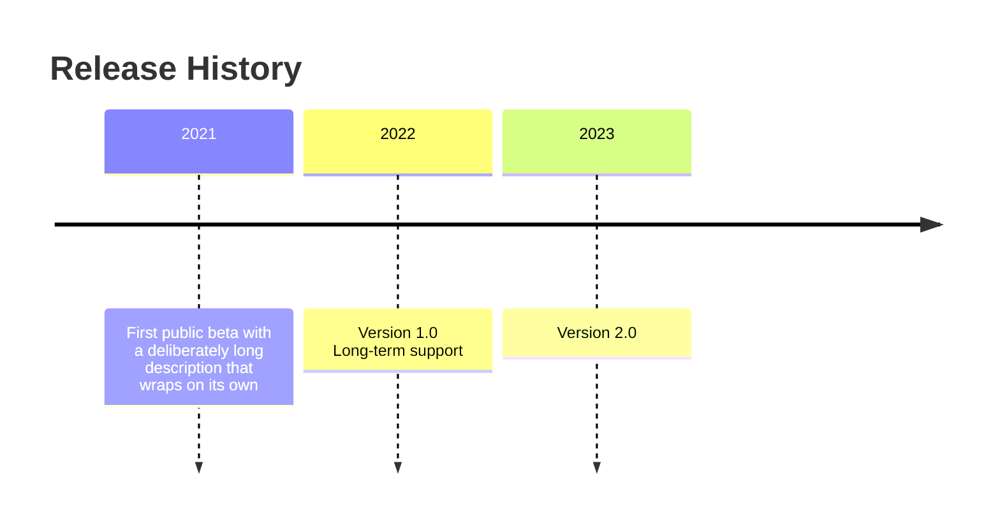
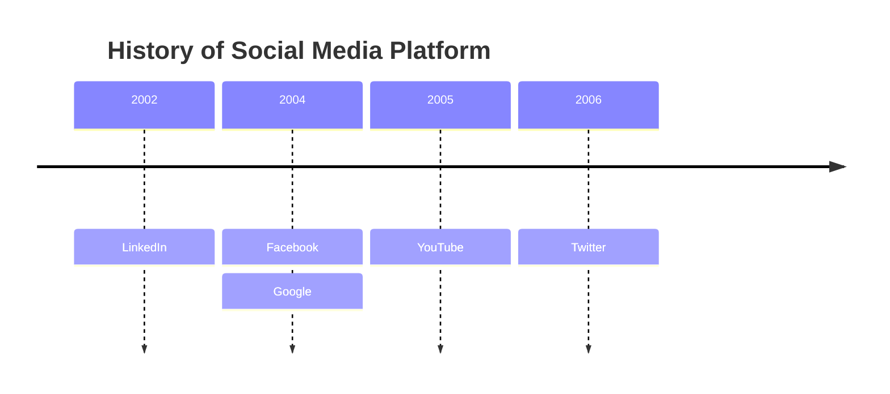
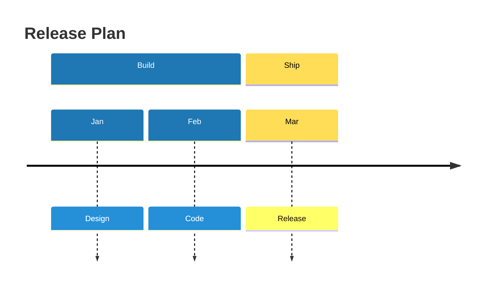

# Timeline Diagram

## Summary

A Timeline diagram shows a chronology: time periods along an axis, each with one or more events attached. Periods can be grouped into sections (eras, phases, quarters).

### Use Cases

- **Project Planning**: Visualize project milestones and deadlines.
- **Historical Overviews**: Show the sequence of historical events.
- **Process Documentation**: Illustrate the order of steps in a process.
- **Product Roadmaps**: Communicate planned features and releases.

### When to Use

- When the order of events matters more than exact durations (for durations and dependencies use a Gantt chart).
- When presenting a chronological narrative with a handful of events per period.

## Syntax

- Start with the `timeline` keyword, optionally followed by a direction: `timeline LR` (default, horizontal) or `timeline TD` (vertical).
- Optionally add a `title` line.
- Each further line is a time period, optionally followed by events, separated by ` : `.
- Group time periods with `section Section Name`; all following periods belong to that section.
- Periods and events are plain text (not only numbers). They are drawn in source order.

```text
timeline [LR|TD]
    title {title text}
    section {section name}
        {time period} : {event}
        {time period} : {event} : {event}
                      : {event}
```

### Basic Structure



Without sections every time period gets its own colour.

### Multiple Events per Period

Events of one period are stacked below it. Write them on one line or continue on the next line with a leading colon; both forms give the same picture.



A period may also have no event at all (just `2003` on its own line).

### Grouping with Sections

A section draws a header bar across its periods, and all periods and events of a section share one colour.



### Direction

`timeline TD` draws the axis from top to bottom, periods on the left and their events on the right. Use it for many periods or long event texts; a horizontal timeline with more than about eight periods becomes very wide and its text tiny.



Only `LR` and `TD` are directions. Any other word (for example `TB`) is not an error, it silently becomes the first time period.

### Wrapping and Line Breaks

Long text wraps automatically inside its box. `<br>` forces a line break. Markdown (`**bold**`) is not interpreted.



## Styling

### Single Colour

To give all periods the same colour (when no sections are used), set `disableMulticolor: true`.



### Customizing Colors

Theme variables `cScale0` to `cScale11` set the background of the first to twelfth section (or, without sections, time period); `cScaleLabel0` to `cScaleLabel11` set the matching text colour. Colours repeat after twelve. Always set the label colour together with a dark or strong background.



A whole theme can be selected the same way with `config: theme: forest` (also `default`, `neutral`, `base`; `dark` is meant for dark backgrounds and its title is barely visible on white).

## Rules and Pitfalls

- **All or nothing with sections.** Time periods written before the first `section` line are dropped from the picture without an error as soon as any section exists. Either put every period into a section or use none.
- **Colon followed by a space splits events.** `2004 : Note: details` yields two events, "Note" and "details". A colon inside a word (`10:30`, `a:b`) is kept. Rephrase or use a dash.
- **Title only via the `title` line.** A `title:` in the front matter is ignored by the timeline.
- **Direction is `LR` or `TD` only.** `TB` is taken as a time period (see above).
- **Width.** In the horizontal layout each period is a column of fixed width; many periods shrink everything. Switch to `timeline TD` or reduce the periods.
- **Keep event text short.** Events wrap in narrow boxes; more than about ten words per event makes tall, hard-to-read boxes.
- **Contrast.** In the default colours some periods have white text on a light background. If readability matters, set `cScaleN`/`cScaleLabelN` yourself.
- Semicolons, commas, `#`, quotes and parentheses in text are rendered literally and need no escaping.

**References:**
- [Mermaid.js Timeline Diagram Documentation](https://mermaid.js.org/syntax/timeline.html)
