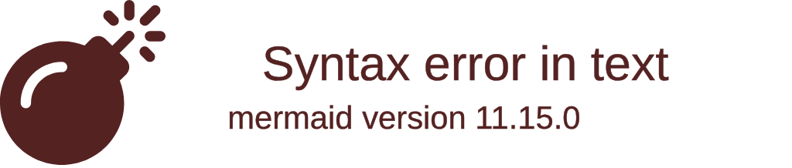

# TreeView Diagram

## Summary

A **TreeView diagram** in Mermaid draws a hierarchy the way a file explorer or the `tree` command does: one row per entry, connector lines, folders in bold, and optionally icons, highlighted rows and a short description next to an entry.

**Use Cases:**
- Folder and file structure of a project or repository
- Showing where new or changed files live (highlighted rows)
- Explaining the purpose of files with a description column
- Any strict hierarchy that reads well as an indented list (menus, bucket layouts, package contents)

**When to Use:**
- When the content is a directory-like tree and names matter more than relations
- When an existing `tree` output should become a picture (box-drawing input is accepted as is)
- Not for hierarchies with cross links or with labels on the connections; use a flowchart or mindmap there

---

## Syntax Description

- Start with the `treeView-beta` keyword.
- One entry per line. The **indentation** alone defines the nesting.
- A trailing `/` marks a folder: it is drawn in bold and the slash itself is not shown.
- Labels are written bare, also with spaces: `release notes.txt`. Quotes are not needed.
- Several entries on the top level are allowed.
- `%%` starts a comment line. Blank lines are ignored.

**Basic Syntax:**
```text
treeView-beta
  <folder>/
    <folder>/
      <file>
    <file> :::highlight ## <description>
  <file>
```

**Annotations** (after the label, separated by a space, in any order):

| Annotation       | Effect                                                                 |
| ---------------- | ---------------------------------------------------------------------- |
| `:::highlight`   | Yellow box around the row (the only built-in class)                    |
| `## text`        | Description in green italics in a second column                        |
| `icon(folder)`   | Force the built-in folder icon on this row                             |
| `icon(file)`     | Force the built-in file icon on this row                               |
| `icon(none)`     | Hide the icon of this row when icons are switched on                   |

**Box-drawing input:** instead of indentation the tree can be written with `├──`, `└──` and `│` (or the heavy variants `┣━━`, `┗━━`, `┃`). The format is detected automatically, and annotations work the same way.

**Configuration (front matter, key `treeView`):**

| Option          | Default | Effect                                             |
| --------------- | ------- | -------------------------------------------------- |
| `showIcons`     | `false` | `true` draws a folder or file icon in front of every row |
| `rowIndent`     | `10`    | Horizontal step per nesting level                  |
| `paddingX`      | `5`     | Horizontal padding of a row                        |
| `paddingY`      | `5`     | Vertical padding of a row                          |
| `lineThickness` | `1`     | Thickness of the connector lines                   |

**Colors:** `themeVariables.treeView` accepts `labelFontSize`, `labelColor`, `lineColor`, `iconColor`, `descriptionColor`, `highlightBg`, `highlightStroke`.

---

## Examples

### Minimal



### Several Top-Level Entries, Descriptions and a Highlight


### Box-Drawing Input (Pasted `tree` Output)


### With Folder and File Icons


### Custom Spacing and Colors


---

## Rules and Pitfalls

- **A root row `/` is always drawn.** The renderer puts a bold `/` above the first entry and hangs all top-level entries below it, even if the tree has a single root folder. It cannot be switched off; do not add a root line of your own just to get one. A tiny connector stub is visible at the left edge of that row; it is a renderer artifact.
- **There is no title.** A `title ...` line is accepted but not drawn, and a `title:` in front matter is not shown either. Put the name into the top folder.
- **Folders need the trailing `/`.** Without it an entry with children is still drawn as a parent, but not in bold and, with `showIcons`, with a file icon.
- **Do not quote names.** A bare label may contain spaces, dots, `@`, `#`, `[`, `]`, `(`, `)`, `'` and `"`. With quotes the slash trick breaks: `"my docs"/` produces a file row `my docs` plus a nameless folder row. If quotes are used at all, the slash goes inside: `"my docs/"`.
- **Inconsistent indentation is not an error.** A line indented by 3 spaces in a 2-space tree is silently attached to the nearest parent, and a first line that is indented deeper than the following ones ends up as their sibling. Use one indentation step throughout and check the picture.
- **Annotations need a space before them.** `file.ts:::highlight` is printed literally as the label. Everything after the first `##` is the description, including further `##` or `:::`.
- **Only `highlight` exists as a class.** There is no `classDef`; a `classDef` line becomes a tree entry with that text, and an unknown class name such as `:::custom` is ignored without a warning.
- **No icon packs.** `icon(logos:react)` and similar `pack:name` references, as well as `defaultIconPack`, `filenameIcons` and `extensionIcons`, need icon packs that are not registered in the command-line renderer; such an icon is drawn as a blue question-mark box. Use only `showIcons` with the built-in `folder`, `file` and `none`.
- **Long rows shrink everything.** The picture is as wide as the longest row including its description, so one long file name with a long description makes all other rows tiny in the PNG. Keep descriptions to a few words.

---

## References

- [Official Mermaid TreeView Diagram Documentation](https://mermaid.js.org/syntax/treeView.html)
- [Mermaid.js Documentation](https://mermaid.js.org/)
