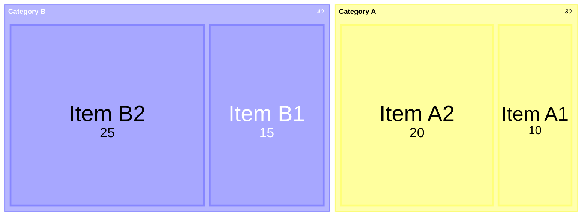
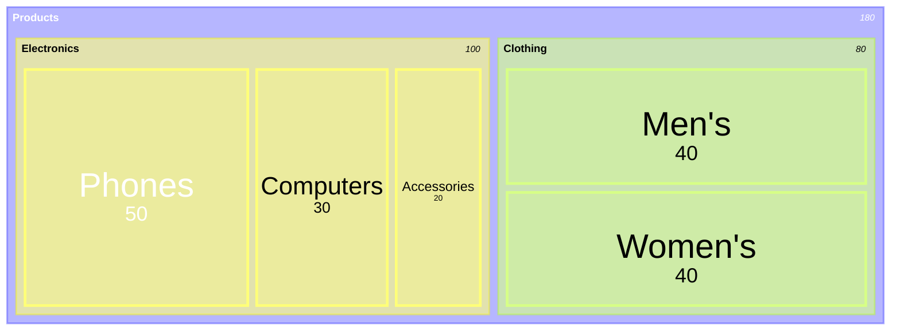
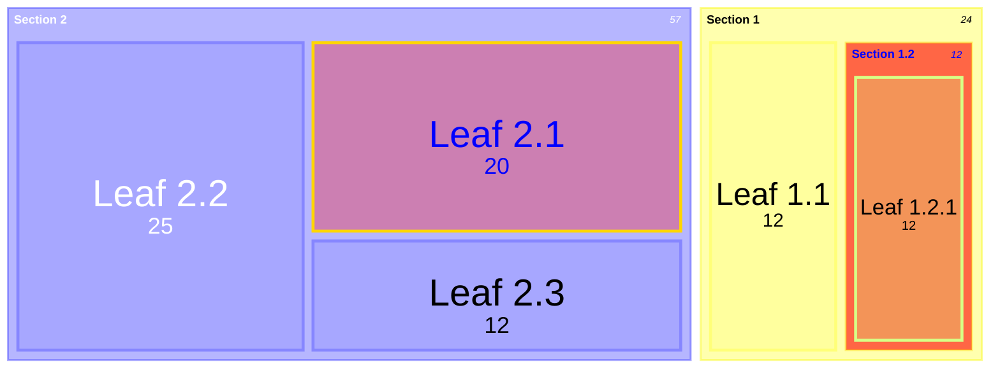
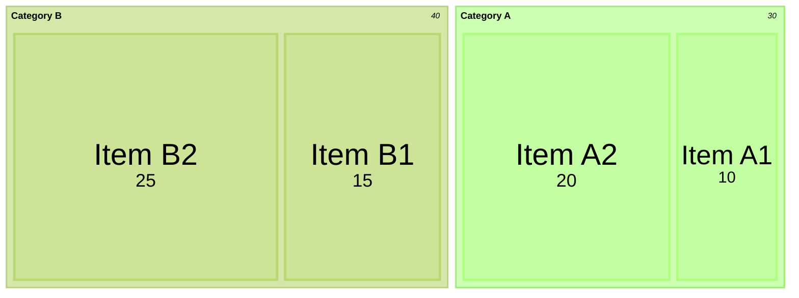
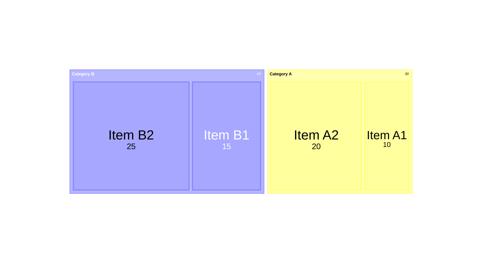
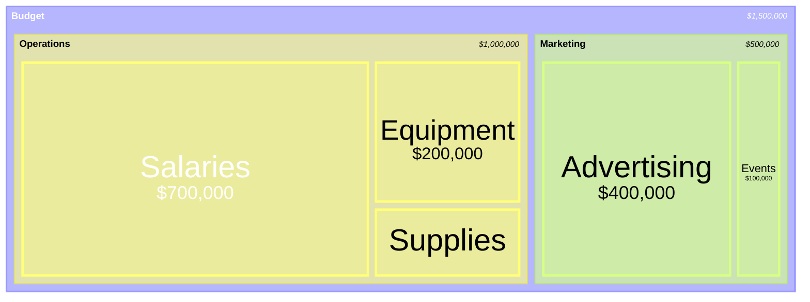
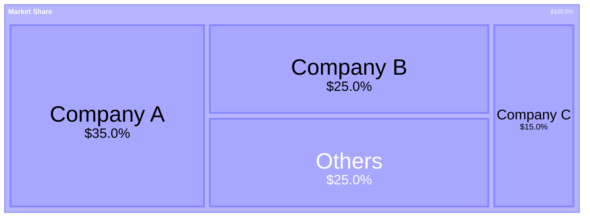

# Treemap Diagram

## Summary

A **Treemap diagram** displays hierarchical data as a set of nested rectangles. Each branch of the tree is represented by a rectangle, which is then tiled with smaller rectangles representing sub-branches. The size of each rectangle is proportional to the value it represents.

**Use Cases:**
- Visualizing hierarchical data structures
- Comparing proportions between categories and subcategories
- Displaying large amounts of hierarchical data in a limited space
- Identifying patterns and outliers in hierarchical data

**When to Use:**
- When you need to show proportions within a hierarchy
- When you want to compare the size of categories and subcategories visually

---

## Syntax Description

- Start with the `treemap-beta` keyword.
- Define sections (parent nodes) and leaves (child nodes with values) using quoted text.
- Use indentation to represent hierarchy.
- Leaf nodes are defined as `"Leaf Name": value`.
- Nodes can be styled using the `:::class` syntax.
- Use `classDef` to define custom styles.

**Basic Syntax:**
```
treemap-beta
"Section 1"
    "Leaf 1.1": 12
    "Section 1.2"
      "Leaf 1.2.1": 12
"Section 2"
    "Leaf 2.1": 20
    "Leaf 2.2": 25
```

---

## Examples

### Basic Treemap



### Hierarchical Treemap



### Treemap with Styling



### Theme Configuration



### Diagram Padding



### Value Formatting (Currency)



### Value Formatting (Percentage)



---

## Tips

- Use indentation to create hierarchy.
- Use `classDef` and `:::` for custom node styling.
- Adjust configuration options for padding, value formatting, and theme to fit your needs.
- Treemaps are best for positive, hierarchical data.

---

## References

- [Official Mermaid Treemap Diagram Documentation](https://mermaid.js.org/syntax/treemap.html)
- [Mermaid.js Documentation](https://mermaid.js.org/)