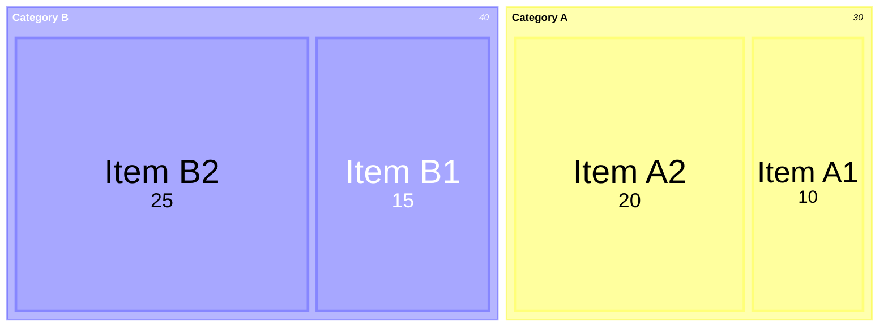
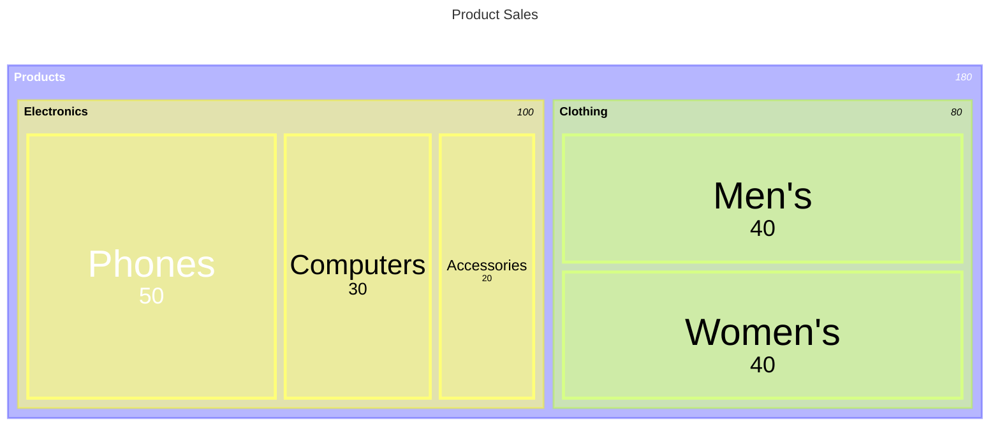
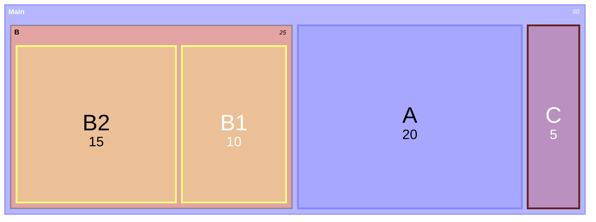
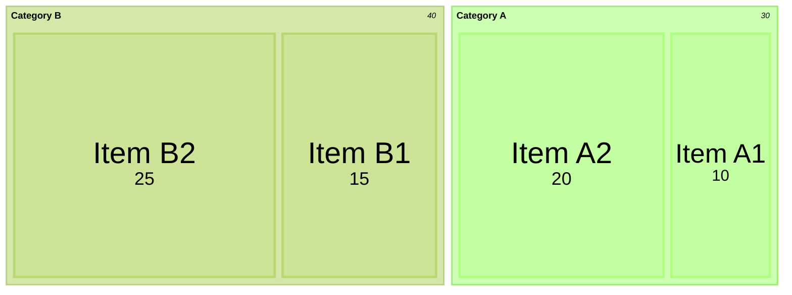
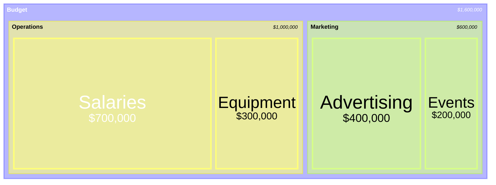
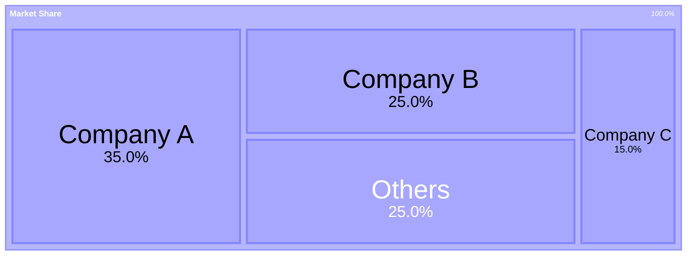

# Treemap Diagram

## Summary

A **Treemap diagram** displays hierarchical data as nested rectangles. Sections (branches) contain leaves; the area of each leaf is proportional to its value, and a section shows the sum of its leaves.

**Use Cases:**
- Comparing proportions between categories and subcategories (budgets, market shares, disk usage, team sizes)
- Displaying a lot of hierarchical data in limited space
- Spotting the dominant items and outliers in a hierarchy

**When to Use:**
- When the data is a hierarchy of positive numbers and the proportions matter
- Not for flat data (use a pie chart) and not for flows (use a Sankey diagram)

---

## Syntax Description

- Start with the `treemap-beta` keyword (`treemap` is accepted as well).
- Every node name is a quoted string; double or single quotes both work, unquoted names are a syntax error.
- A **section** is a quoted name alone on its line: `"Section"`.
- A **leaf** is a quoted name with a number: `"Leaf": 12`. Integers and decimals are allowed.
- Hierarchy comes from indentation (spaces or tabs); a node is the child of the nearest less-indented section above it. Sections can be nested several levels deep.
- An optional `title My Title` line after the keyword (or `title:` in the front matter) puts a title above the diagram.
- `%%` starts a comment line.
- Styling: append `:::className` to a node and define the class with `classDef`.

**Basic Syntax:**
```text
treemap-beta
title Optional Title
"Section 1"
    "Leaf 1.1": 12
    "Section 1.2"
        "Leaf 1.2.1": 12
"Section 2"
    "Leaf 2.1": 20:::className

classDef className fill:#f96,stroke:#333,color:#000
```

The renderer orders siblings by size, largest first, not in source order. Each section shows its name at the top left and the sum of its leaves at the top right.

---

## Examples

### Basic Treemap



"Category B" (40) is drawn before "Category A" (30) because it is larger.

### Hierarchical Treemap



### Treemap with Styling

`:::class` goes directly after a section name, or after the value of a leaf. A class on a section tints the whole section, its leaves included, but the leaf labels keep their own text colour. Always set `color` together with `fill` so the label stays readable.



The fill is drawn semi-transparent, so colours appear lighter than specified. There is no `class Node className` statement in treemaps; it is a syntax error.

### Theme Configuration



### Value Formatting (Currency)

`valueFormat` takes a D3 format specifier and applies to leaf values and section sums.



### Value Formatting (Percentage)



---

## Configuration

Set under `config: treemap:` in the front matter.

| Option | Effect | Default |
| ------ | ------ | ------- |
| `valueFormat` | Number format of the displayed values (table below) | `','` |
| `showValues` | `false` hides all values (leaves and section sums) | `true` |
| `diagramPadding` | Empty margin around the whole diagram in pixels | `8` |

Formats checked with the value 700000.5:

| `valueFormat` | Shown as |
| ------------- | -------- |
| `','` (default) | `700,000.5` |
| `',d'` | `700,001` |
| `',.2f'` | `700,000.50` |
| `'.1f'` | `700000.5` |
| `'.2s'` | `700k` |
| `'$'` | `$700000.5` |
| `'$.2f'` | `$700000.50` |
| `'$0,0'` | `$700,000.5` (dollar sign plus thousands separator) |
| `'.1%'` | value 0.35 becomes `35.0%` |

---

## Rules and Pitfalls

- **Every leaf needs a parent section.** A leaf at the top level (not indented under a section) is drawn without a rectangle or not at all. Wrap everything in at least one section.
- **Quotes are mandatory** around every name. `Category A` without quotes is a syntax error.
- **Positive values only.** A negative value is a syntax error; a leaf with value `0` and a section without leaves silently disappear.
- **Small leaves lose their text.** When a rectangle is too small, first the value and then the label is dropped without warning. Leaves much smaller than their siblings (or with long names) end up as unlabeled slivers; merge tiny items into an "Other" leaf and keep names short.
- **Broken currency formats.** `'$,.2f'` and `'$0,0.00'` render as `$7e+5`. For dollars with separators use `'$0,0'`; otherwise use a format without `$` such as `',.2f'`.
- **Do not combine `$` and `%`.** `'$.1%'` prints `$35.0%`; write `'.1%'`.
- **No line breaks or markup in names.** `<br>` and Markdown are shown literally. Colons, commas, parentheses, `&` and apostrophes inside the quotes are fine.
- **Source order is not kept**; siblings are sorted by value.
- **Contrast.** The default colours give some leaves a white label on a light fill. If a label matters, give the leaf a class with explicit `fill` and `color`.
- Deep hierarchies (more than three levels) leave little room for the innermost labels.

---

## References

- [Official Mermaid Treemap Diagram Documentation](https://mermaid.js.org/syntax/treemap.html)
