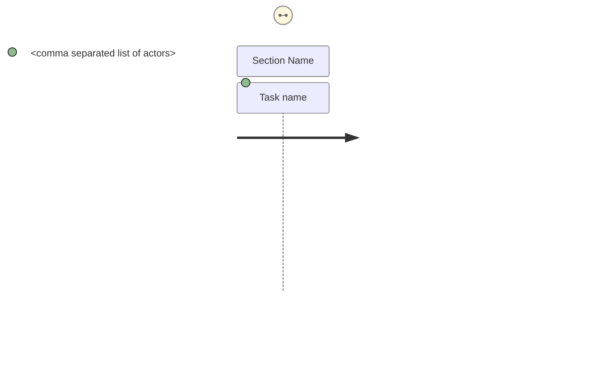
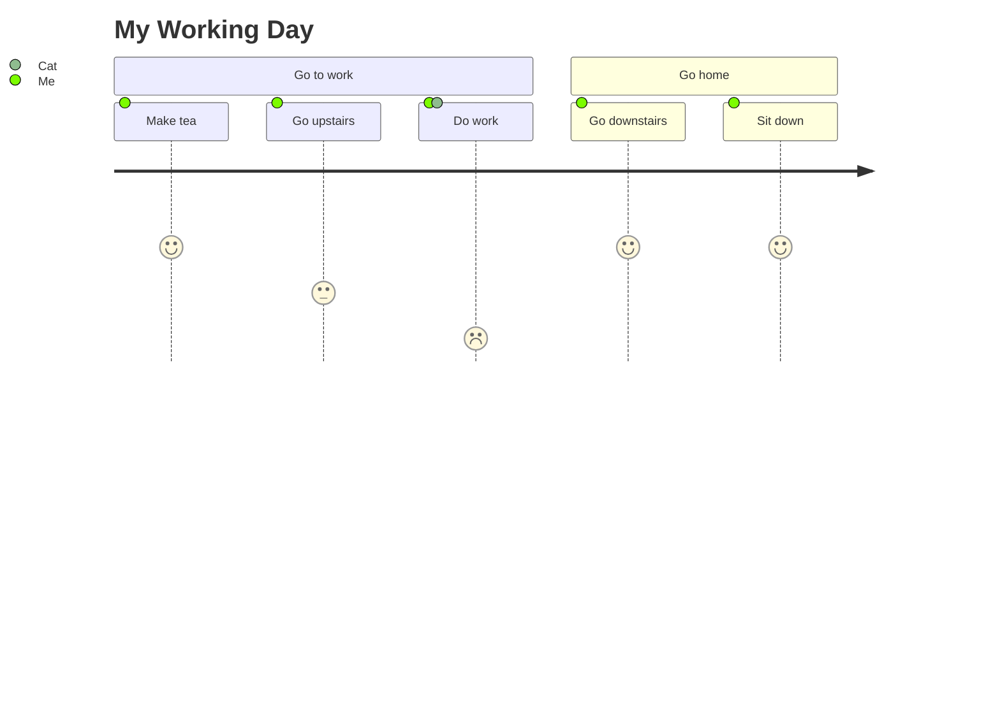
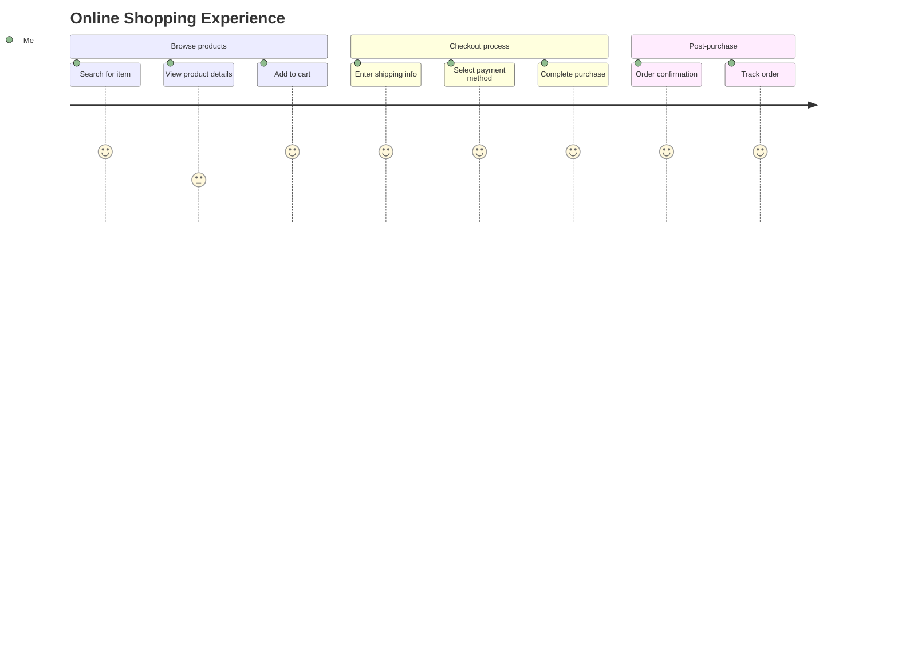
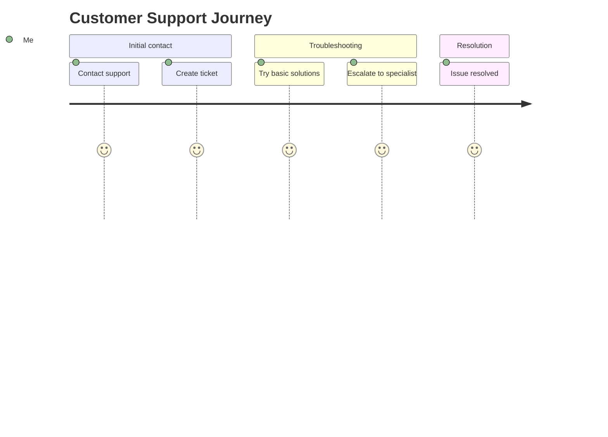

# User Journey Diagram

## Summary

User journey diagrams describe at a high level of detail exactly what steps different users take to complete a specific task within a system, application, or website. This technique shows the current (as-is) user workflow and reveals areas of improvement for the to-be workflow. They are particularly useful for user experience (UX) analysis and optimization.

### Use Cases

User journey diagrams are best used for:

- **User Experience (UX) Design**: Mapping out user interactions and identifying pain points
- **Process Optimization**: Streamlining workflows and eliminating unnecessary steps
- **Feature Planning**: Visualizing user paths through new features
- **E-commerce Analysis**: Understanding customer purchase journeys and conversion funnels
- **Application Onboarding**: Documenting the steps new users take to get started
- **Customer Support**: Modeling support ticket resolution and help desk interactions
- **Website Navigation**: Analyzing how users move through a site or application
- **Multi-platform Experiences**: Showing cross-device user journeys

### When to Use

User journey diagrams are ideal when you need to:
- Analyze and improve user workflows
- Design better user experiences
- Document complex user paths with multiple decision points
- Identify bottlenecks and drop-off points in user processes
- Plan feature implementations based on user behavior patterns
- Create user-centered design documentation

## Syntax

### Basic Structure

```mermaid
journey
    title Journey Title
    [sections]
```

### Section Definition



### Task Definition

```mermaid
journey
    Task name: <score>: <comma separated list of actors>
```

## Examples

### Simple User Journey



### E-commerce Customer Journey



### Multi-Channel User Journey



## Tips and Best Practices

1. **Use descriptive section titles** that clearly indicate the purpose of each journey phase
2. **Score tasks appropriately** - assign meaningful scores that reflect importance or difficulty
3. **Group related tasks** into logical sections for better organization
4. **Include all user personas** - consider different types of users and their needs
5. **Document decision points** - clearly mark where users make choices or drop off
6. **Use consistent scoring** - establish clear criteria for task completion
7. **Identify pain points** - highlight steps where users struggle or abandon the journey
8. **Consider alternative paths** - show different routes users might take
9. **Keep journeys focused** - avoid overcrowding with too many tasks or sections
10. **Add completion criteria** - define what constitutes a successful journey completion

**References:**
- [Mermaid.js User Journey Documentation](https://mermaid.js.org/syntax/userJourney.html)
- [Mermaid.js Documentation](https://mermaid.js.org/)