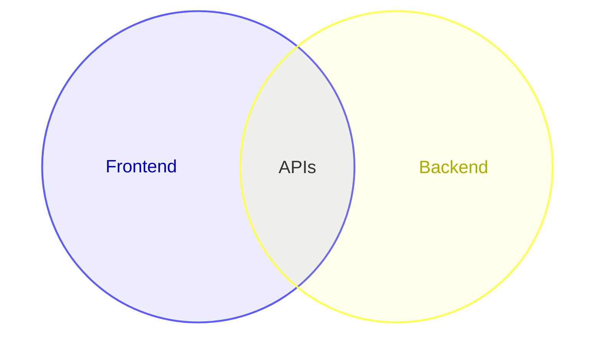
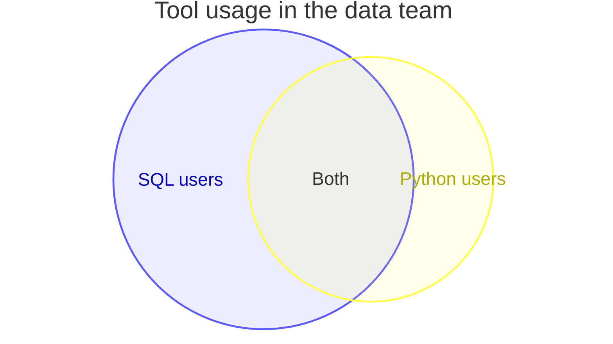
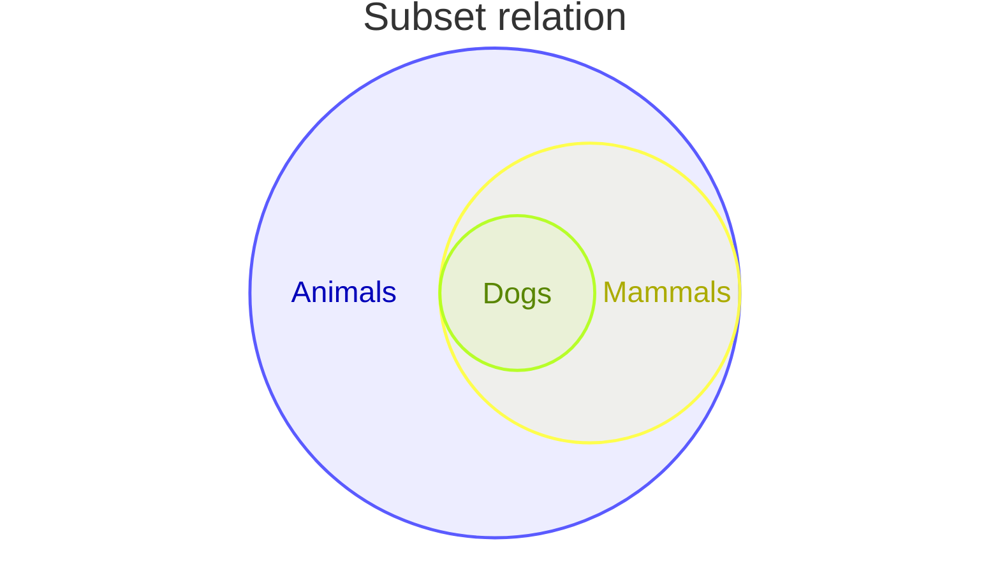
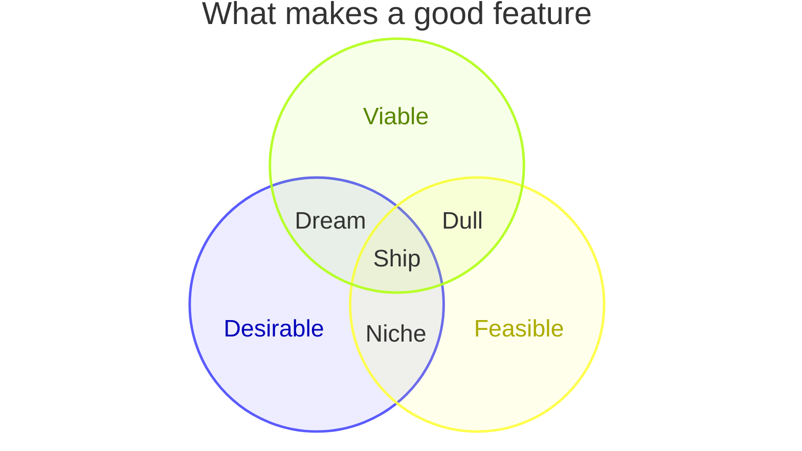
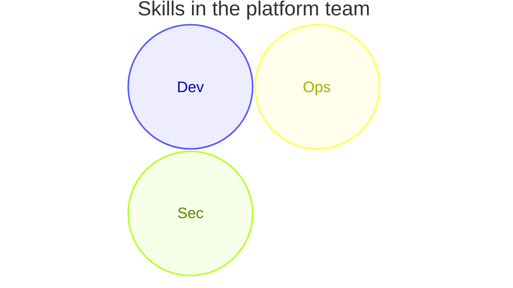
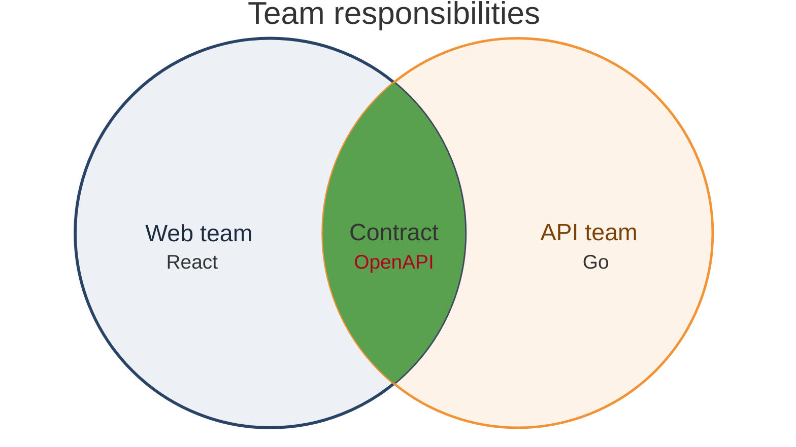
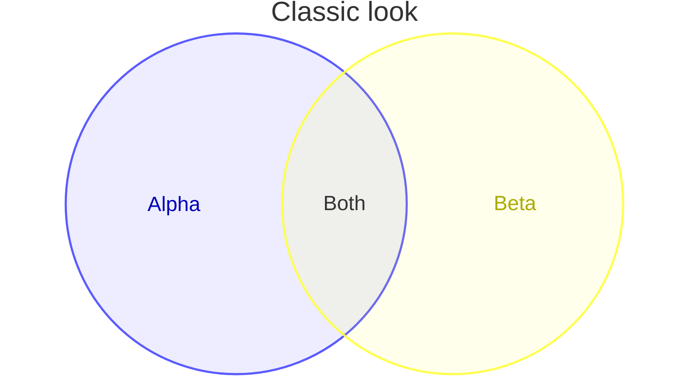

# Venn Diagram

## Summary

A **Venn diagram** in Mermaid draws sets as circles and shows what they have in common as overlapping regions. Every set and every overlap can carry a label, a relative size, extra text items and its own colors.

**Use Cases:**
- Showing what two or three groups, skills, products or concepts share
- "Sweet spot" pictures (desirable / feasible / viable)
- Subset relations (all dogs are mammals, all mammals are animals)
- Rough proportions of overlapping populations

**When to Use:**
- When the message is "what overlaps with what", not a flow or a hierarchy
- When there are two or three sets. With four or more sets the renderer no longer draws every intersection (see Rules and Pitfalls); use a table or a flowchart instead

---

## Syntax Description

- Start with the `venn-beta` keyword.
- `title <text>` is optional. Write the text without quotes.
- `set <id>` declares a set. `set <id>["Label"]` gives it a display label; without a label the id is shown.
- `union <id>,<id>[,<id>...]` declares the overlap of two or more sets that were declared **above** it. A label is optional: `union A,B["Label"]`.
- `:<number>` after a set or union sets its relative size (area): `set A["Alpha"]:20`.
- `text <id>["Label"]`, indented under a `set` or `union`, places an extra small text inside that region.
- `style <target> <property>:<value>,...` colors a set (`style A ...`), an overlap (`style A,B ...`) or a text node (`style t1 ...`).
- `%%` starts a comment line.

**Basic Syntax:**
```text
venn-beta
  title <Title without quotes>
  set <id>["<Label>"]:<size>
    text <textId>["<Text>"]
  union <id>,<id>["<Label>"]:<size>
  style <id> fill:<color>,stroke:<color>
```

**Identifiers:**
- Bare words made of letters, digits, `_` and `-`, starting with a letter: `A`, `Team_1`, `back-end`.
- Or a quoted string, which is then also the label: `set "Front End"` and later `union "Front End","Back End"`.
- The short-id-plus-label form (`set FE["Front End"]`) is easier to reference and is the recommended one.

**Sizes:**
- Sizes are relative areas. Without sizes all circles are equal and overlaps get a default width.
- A union whose size equals the size of the smaller set puts that set completely inside the other one (subset).

**Style properties that work:** `fill`, `fill-opacity`, `stroke`, `stroke-width`, `color` (text color).

**Title via front matter** also works (`title:` in a `---` block) and is equivalent to the `title` line.

---

## Examples

### Minimal: Two Sets



### Labels and Proportional Sizes



### Subsets (Nested Circles)

A union as large as the smaller set nests the circles. Declare every pair and the triple, otherwise the layout is free to pull the circles apart.



### Three Sets with Labeled Overlaps

The regions between three circles are small. Labels of the pair overlaps must be very short (about 6 characters), otherwise they run into each other.



### Three Sets, Only the Center Labeled

A `union` of three sets is enough; the pairwise overlaps are drawn automatically.



### Text Nodes and Styling



### Previous Look (Classic Theme)

Venn diagrams use the `redux-color` theme and the `neo` look by default. Front matter switches back to the older appearance.



---

## Rules and Pitfalls

- **Two or three sets only.** Four or five sets parse and render, but the circles are laid out as a chain: not every intersection exists, and the label of the union of all sets is silently dropped.
- **Declare sets before unions.** A `union` that names a set declared further down fails with `unknown set identifier: B`.
- **A union needs at least two ids** (`union requires multiple identifiers`).
- **Do not quote the title.** `title "Team overlap"` shows the quotation marks in the picture.
- **Reserved words are not valid ids:** `set`, `union`, `text`, `style`, `title` (for example `set set` is a parse error). Ids must not start with a digit (`set 3rd` fails); `team-1` and `team_2` are fine.
- **Labels are never wrapped and `<br/>` is printed literally.** A set label longer than about 12 to 15 characters runs out of its circle and into the neighbor; overlap labels must be shorter still. Shorten the label instead of trying to break it.
- **Few text nodes.** One or two short `text` items per region stay readable; five items in a set or three in an overlap are printed on top of each other.
- **Style colors carefully.** Fills are drawn almost transparent unless `fill-opacity` is set, so `color:#ffffff` on a set makes its label invisible. A union with a high `fill-opacity` can cover a set label that sits near the overlap; keep it at about 0.6 or lower.
- **Declaring the same set twice** does not create a second circle; the later label silently replaces the first.
- Special characters such as `&`, `:`, `,`, `(`, `)`, `%`, `/` and umlauts are fine inside a quoted label.

---

## References

- [Official Mermaid Venn Diagram Documentation](https://mermaid.js.org/syntax/venn.html)
- [Mermaid.js Documentation](https://mermaid.js.org/)
