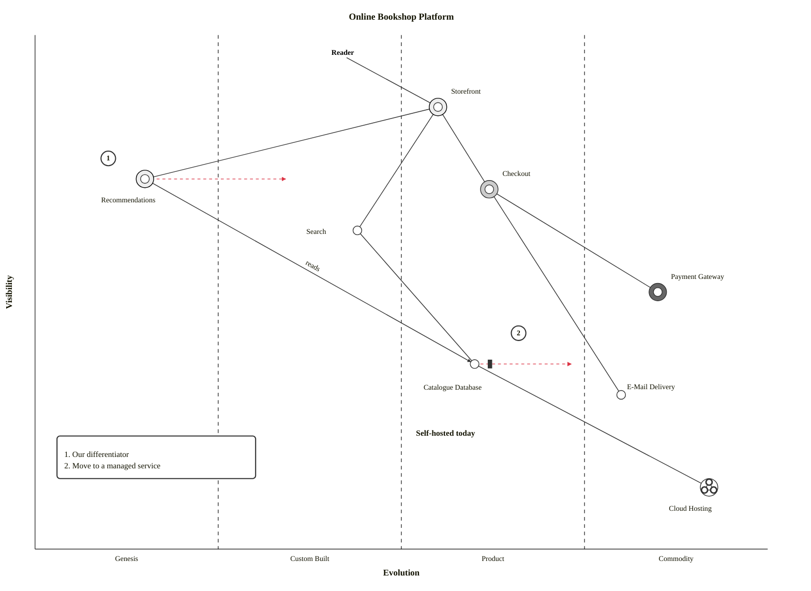

# Wardley Map

## Summary

A **Wardley map** places the components of a value chain on two axes: how visible a component is to the user (vertical) and how evolved it is, from a novel idea to a commodity (horizontal). Lines between components show what depends on what. In Mermaid the diagram is still in beta and starts with `wardley-beta`.

**Use Cases:**
- Strategy discussions: what to build, buy or outsource
- Showing a value chain from the user need down to infrastructure
- Showing where components are moving (evolution) and what resists change (inertia)
- Comparing alternative implementations of one capability (pipeline)

**When to Use:**
- When the position of each component matters, not only the dependencies. You must be able to give every component a visibility and an evolution value.
- For pure dependency graphs without positions, use a flowchart instead.

---

## Syntax Description

- First line: `wardley-beta`. One statement per line. Indentation does not matter. Comments start with `%%`.
- All positions are written as `[visibility, evolution]`. **Visibility comes first** (0.0 = bottom, 1.0 = top), evolution second (0.0 = left, 1.0 = right). This is the reverse of the usual x, y order.
- Write every coordinate as a decimal between `0.0` and `1.0` with a leading zero (`0.5`, `1.0`).

**Header (all optional):**
```text
wardley-beta
title Map Title
size [1100, 800]
evolution Genesis -> Custom Built -> Product -> Commodity
```
- `title`: rest of the line, shown above the map. Do not quote it, quotes are printed.
- `size [width, height]`: canvas in pixels. Default is 1100 x 600; more height gives crowded maps more room.
- `evolution`: names of the stages on the horizontal axis, separated by `->`. Without it the map shows Genesis, Custom Built, Product, Commodity. Any number of stages works. `Name@0.25` sets the right boundary of a stage; `A / B` is printed as a two-part label.

**Components and anchors:**
```text
anchor Name [visibility, evolution]
component Name [visibility, evolution]
component Name [visibility, evolution] label [dx, dy]
component Name [visibility, evolution] label [dx, dy] (decorator)
```
- `anchor`: the user or customer. Drawn as bold text without a circle. Takes neither `label` nor decorators.
- `component`: drawn as a circle with the name up and to the right of it.
- `label [dx, dy]`: moves the name by pixels relative to the circle. Negative `dx` is left, negative `dy` is up. Must come before the decorators.
- Decorators, several allowed one after another:

| Decorator | Drawn as |
| --- | --- |
| `(build)` | light ring around the circle |
| `(buy)` | grey ring |
| `(outsource)` | dark ring |
| `(market)` | circle with three small circles inside |
| `(inertia)` | black bar to the right of the circle |

**Links:**

| Syntax | Result |
| --- | --- |
| `A -> B` or `A --> B` | plain line (dependency) |
| `A -> B; text` | plain line with text along it |
| `A -.-> B` | dashed line |
| `A +> B` | line with arrowhead at B |
| `A +< B` | line with arrowhead at A |
| `A +<> B` | arrowheads at both ends |
| `A +'text'> B` | arrowhead at B and text along the line |

**Movement:**
- `evolve Name 0.85` draws a red dashed arrow from the component to the given evolution value (same visibility). A smaller value points left.

**Pipeline** (variants of one component at the same visibility): `pipeline Parent { ... }` with one `component Name [evolution]` line per variant inside the braces. The parent must be declared as a normal component first. Children take a single number and optionally `label [dx, dy]`; no decorators.

**Notes and markers:**
- `note "text" [visibility, evolution]`: bold text, starting at that point and running to the right.
- `annotation 1,[visibility, evolution] "text"`: numbered circle on the map; the texts are listed in a legend box.
- `annotations [visibility, evolution]`: where the legend box goes.
- `accelerator "text" [visibility, evolution]`: arrow pointing right with a caption.
- `deaccelerator "text" [visibility, evolution]`: arrow pointing left with a caption.

The text of these four elements must be in double quotes.

---

## Examples

### Minimal Map

```mermaid
wardley-beta
title Coffee Stand

anchor Customer [0.95, 0.42]
component Cup of Coffee [0.80, 0.55]
component Espresso Machine [0.55, 0.60]
component Beans [0.50, 0.85]
component Electricity [0.15, 0.92]

Customer -> Cup of Coffee
Cup of Coffee -> Espresso Machine
Cup of Coffee -> Beans
Espresso Machine -> Electricity
```

### Sourcing, Inertia and Evolution

```mermaid
wardley-beta
title Sourcing Decisions

anchor Customer [0.95, 0.30]
component Ordering App [0.80, 0.35] (build)
component Payment Service [0.60, 0.62] (buy)
component Fraud Checks [0.40, 0.42] label [-115, 5] (outsource)
component Mainframe [0.35, 0.20] label [-95, 25] (inertia)
component Cloud Hosting [0.15, 0.90] (market)

Customer -> Ordering App
Ordering App -> Payment Service
Ordering App -> Mainframe
Payment Service -> Fraud Checks
Payment Service -> Cloud Hosting

evolve Mainframe 0.55
evolve Fraud Checks 0.70
```

### Link Types

```mermaid
wardley-beta
title Link Types

component Web Shop [0.90, 0.30]
component Order API [0.70, 0.40]
component Cache [0.50, 0.15] label [-60, 5]
component Event Queue [0.50, 0.62]
component Warehouse System [0.30, 0.55] label [-75, 30]
component Database [0.12, 0.85]

Web Shop -> Order API
Order API +<> Cache
Order API -.-> Event Queue
Event Queue +> Warehouse System
Warehouse System -> Database; nightly export
Order API +'writes'> Database
```

### Pipeline

```mermaid
wardley-beta
title Storage Options

component Reporting [0.85, 0.50]
component Data Store [0.45, 0.55] label [12, -25]
Reporting -> Data Store

pipeline Data Store {
  component File Shares [0.18] label [-35, -22]
  component "SQL Database" [0.42] label [-45, 30]
  component Data Warehouse [0.66] label [-20, -22]
  component "Cloud Lakehouse" [0.88] label [-50, 30]
}
```

### Custom Stages, Notes, Annotations and Forces

```mermaid
wardley-beta
title Annotated Map
evolution Idea@0.15 -> Prototype@0.45 -> Product@0.7 -> Utility@1.0

component Mobile App [0.85, 0.28]
component Sync Service [0.60, 0.55]
component Device Storage [0.35, 0.80]

Mobile App -> Sync Service
Sync Service -> Device Storage

annotations [0.25, 0.05]
annotation 1,[0.85, 0.21] "Main differentiator"
annotation 2,[0.60, 0.50] "Rewrite planned"

note "Offline mode is a must" [0.95, 0.55]
accelerator "Open standards" [0.60, 0.80]
deaccelerator "Vendor lock-in" [0.15, 0.55]
```

### Realistic Map



---

## Rules and Pitfalls

- **Coordinate order:** `[visibility, evolution]`, so `[0.9, 0.1]` is top left. Values above 1 do not fail but land at the wrong place.
- **Number format:** `[1, 0]`, `[.5, .5]`, `[50, 50]` and negative values are syntax errors. Always write `0.x` or `1.0`.
- **Names without quotes** may contain letters, digits inside a word, spaces, hyphens and underscores (`Off-the-shelf Tool`, `S3`). Put the name in double quotes when it
  - has a word starting with a digit (`"Web 2"`, `"3D Printer"`),
  - has other characters such as `/ . & ( ) '` or non-ASCII letters (`"CI/CD"`, `"Node.js"`, `"R&D (24x7)"`, `"Größe"`),
  - starts with a lowercase keyword: `anchor`, `component`, `note`, `title`, `size`, `evolution`, `evolve`, `pipeline`, `label`, `annotation`, `annotations`, `accelerator`, `deaccelerator`, `build`, `buy`, `outsource`, `market`, `inertia`. `Evolve Engine` (capital letter) and `my note` (keyword not first) work unquoted.
  Use the quoted form everywhere the name appears, also in links and `evolve`.
- **Order on a component line:** position, then `label [...]`, then decorators. `(build) label [10, 10]` is a syntax error.
- **Misspelled names fail silently:** a link or `evolve` that names an undeclared component renders OK and is simply not drawn. Check the image for missing lines.
- **Labels are not placed automatically.** The name sits up and to the right of the circle, so a link that leaves a component towards the upper right runs through its name. Place dependencies to the lower right of their consumer or move the name with `label [dx, dy]`. Stage boundaries (dashed vertical lines) also cut through names that sit on them.
- **Pipeline names** overlap the pipeline box at the default position. Give each child a `label` offset, alternating above (`dy` about -22) and below (`dy` about 30).
- **Notes** are a single line: no wrapping, `<br/>` is printed as text, and a long note near the right edge is cut off. Keep notes short and start them at evolution 0.6 or less. Use `annotation` for longer text.
- **Flow labels** use single quotes (`+'text'>`); double quotes fail there. `A +<'text'> B` fails too.
- Only `%%` starts a comment. `//` is a syntax error.
- The trend syntax `Name -.- (x, y)` from the official page is rejected by this version; do not use it.

---

## References

- [Official Mermaid Wardley Map Documentation](https://mermaid.js.org/syntax/wardley.html)
- [Mermaid.js Documentation](https://mermaid.js.org/)
