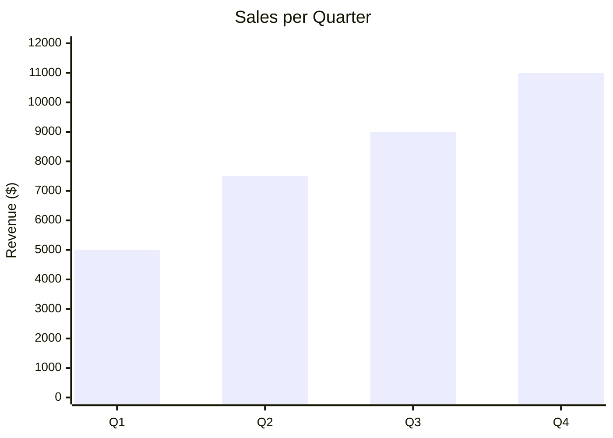
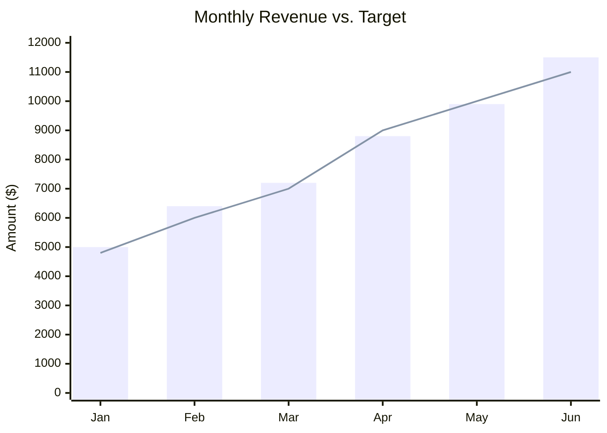
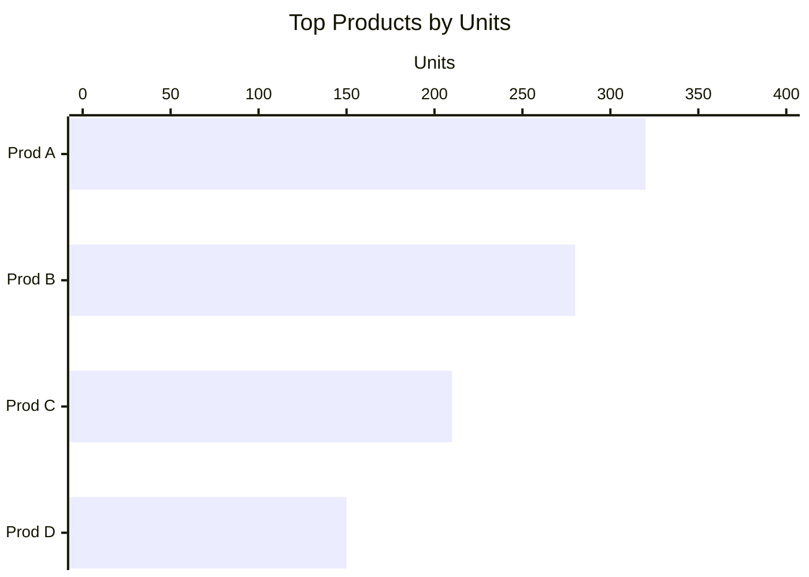
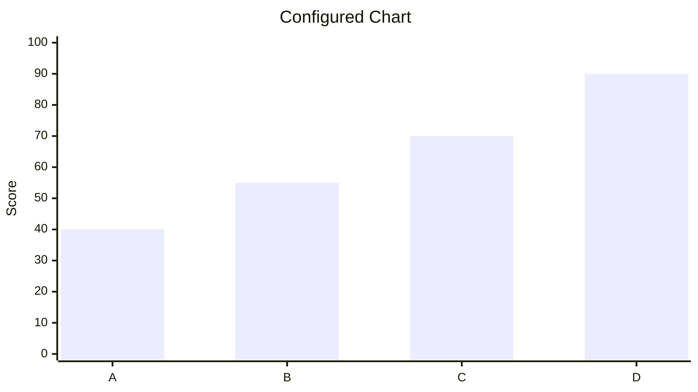

# XY Chart

## Summary

An **XY Chart** in Mermaid is a general charting module for visualizing data along two axes — an X-axis and a Y-axis. It currently supports two fundamental chart types, **bar** and **line**, and is designed to display numeric or categorical series over a shared axis. XY charts are suitable for trend visualization, category comparison, and simple analytics dashboards.

> **Note:** XY charts in Mermaid are evolving. Syntax, configuration, and supported chart types may change in future releases.  
> See the official docs: https://mermaid.js.org/syntax/xyChart.html

### Use Cases

- **Time series / trends**: Show how a value changes over months/quarters.
- **Category comparison**: Compare KPI values across products, regions, or teams.
- **Combined views**: Overlay a line over bars to compare “actual vs. target.”
- **Lightweight dashboards**: Embed simple charts directly in Markdown docs.

### When to Use

- When you have **two dimensions** (category/time on X, numeric values on Y).
- When a **bar or line chart** is sufficient — no need for full BI tooling.
- When you want charts in **text-based documentation** (Git, wikis, code repos).
- When you need to **configure orientation** (vertical/horizontal) for readability.

---

## Syntax

- Start with the `xychart` keyword.
- Optionally specify orientation: `xychart horizontal`.
- Add a `title` to describe the chart.
- Define `x-axis` (categories or labeled axis).
- Define `y-axis` with label and numeric range.
- Add one or more data series: `bar [...]` or `line [...]`.
- Values in a series must align with the X-axis items.

### Basic Structure



This renders a vertical bar chart with four categories.

---

### Example: Bar + Line



- `bar [...]` shows actuals.
- `line [...]` shows target/forecast.
- Both series share the same X-axis.

---

### Orientations

You can switch to a horizontal layout (better for long labels):



---

### Axes

**X-Axis**  
- Typically a **list of categories**:
  ```mermaid
  xychart
      x-axis ["Jan", "Feb", "Mar"]
  ```
- If the label has spaces, wrap it in quotes: `"New York"`, `"Total Sales"`.

**Y-Axis**  
- Always numeric, with a **label** and **range**:
  ```mermaid
  y-axis "Value" 0 --> 100
  ```

Make sure the range covers all your data values; otherwise bars/lines may be clipped.

---

### Configuration (frontmatter style)

You can configure width, height, and theming via Mermaid’s config block:



Some themes allow setting colors via `themeVariables.xyChart`.

---

## Tips

- Keep the number of categories reasonable; rotate to `horizontal` for long names.
- Use a **line** series to show trend or target on top of **bars**.
- Always set a **descriptive title** so readers understand context immediately.
- Ensure the **Y-axis range** includes your max value.
- For multi-word labels, always quote them.

---

**References:**  
- [Mermaid.js XY Chart Documentation](https://mermaid.js.org/syntax/xyChart.html)  
- [Mermaid.js Documentation](https://mermaid.js.org/)
