# ZenUML Diagram

## Summary

**ZenUML** is an alternative sequence diagram syntax in Mermaid. It reads like code: method calls with `{}` blocks instead of arrow lists. It is rendered by a separate plugin with its own look (numbered messages, framed diagram) and its own, very forgiving parser.

**Use Cases:**
- Call flows between services or objects where nesting matters (who calls whom inside which call)
- API calls with return values, loops, alternatives, parallel blocks and try/catch

**When to Use:**
- When the interaction is naturally a call tree (`A.method() { B.other() }`)
- For plain message exchanges, notes, activation control or styling, prefer the classic `sequenceDiagram`

---

## Syntax Description

- Start with the `zenuml` keyword; an optional `title My Title` line follows.
- Participants appear in order of first mention; declare them first to control the order.
- `A->B: text` is an async message, `B.method()` a sync call, `new B` a creation.
- `{ }` after a sync call or a `new` nests the messages sent while that call is active.
- `// text` is a comment; placed directly above a message or block it is drawn there.

This is **not** the `sequenceDiagram` syntax: there is no `participant` keyword, no `->>` / `-->>` arrows, no `Note over`, no `end`.

**Participants:**
```text
Bob                      // plain declaration, fixes the order
@Actor Alice             // annotator: participant drawn with an icon
@Database DB #FFEBE6     // optional background colour
A as "Order Service"     // alias: id A, shown as Order Service
@Starter(User)           // names the caller of sync calls that have no sender
group Backend { API DB } // dashed frame around participants
```

Annotators that draw an icon in this renderer: `@Actor`, `@Boundary`, `@Control`, `@Entity`, `@Database`, and the cloud types `@EC2`, `@Lambda`, `@SQS`, `@SNS`. Other names are accepted but give a plain box.

**Messages:**
```text
Alice->Bob: text           // async message (solid line, open arrow)
Bob.method(arg)            // sync call from the current caller (filled arrow, activation bar)
Alice->Bob.method() { }    // sync call with explicit sender
result = Bob.method()      // sync call plus dashed return arrow labelled "result"
new Order(id)              // creation message
return value               // inside a sync block: dashed return to the caller
@return                    // next async message is drawn as a dashed reply
A->B: text
```

**Blocks:**
```text
while(cond) { }   for(x in list) { }   forEach(x) { }   loop(cond) { }   // Loop frame
if(cond) { } else if(cond2) { } else { }                                 // Alt frame
opt { }   opt(cond) { }                                                  // Opt frame
par { }                                                                  // Par frame
try { } catch(err) { } finally { }                                       // Try frame
```

---

## Examples

### Basic Example

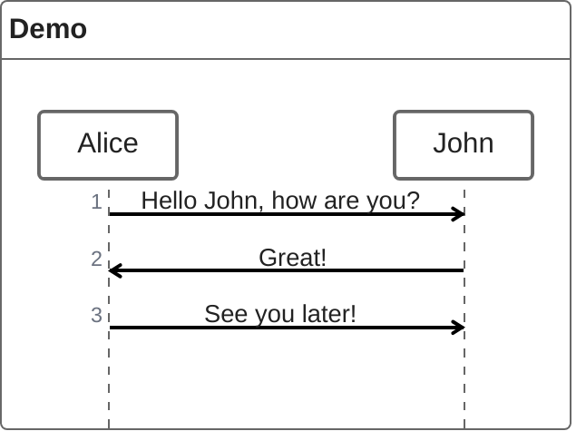

### Participant Order, Annotators and Aliases

Declared participants come first, in declaration order; the rest follow by first use.

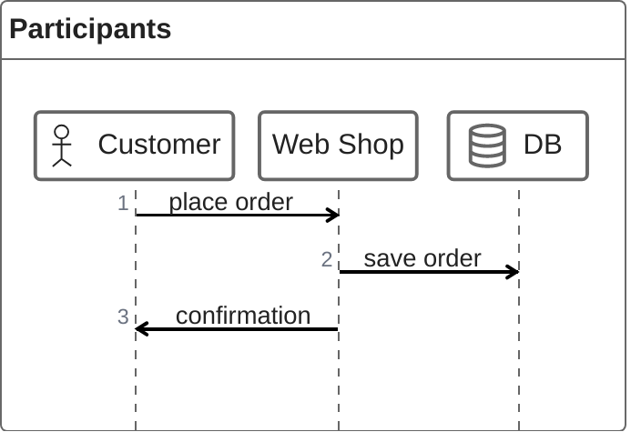

### Sync Calls, Nesting and Replies

A sync call without a sender comes from the current caller: at the top level that is an anonymous stick figure (name it with `@Starter(Name)`), inside a `{}` block it is the receiver of the enclosing call.

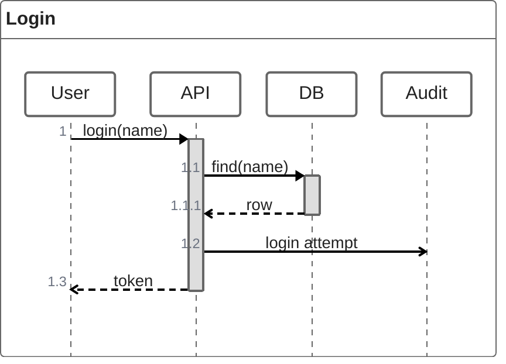

### Explicit Sender and Early Return

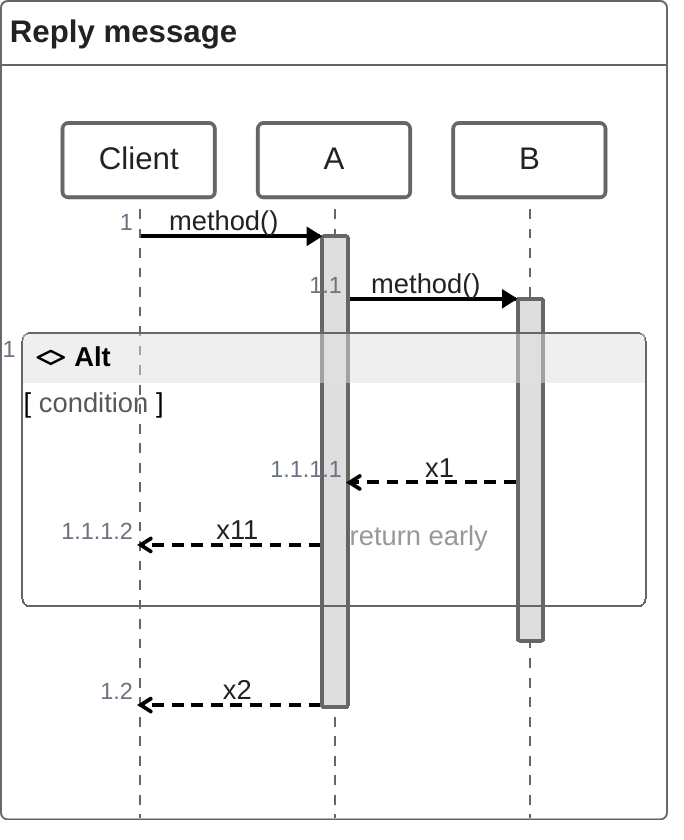

### Creation Message

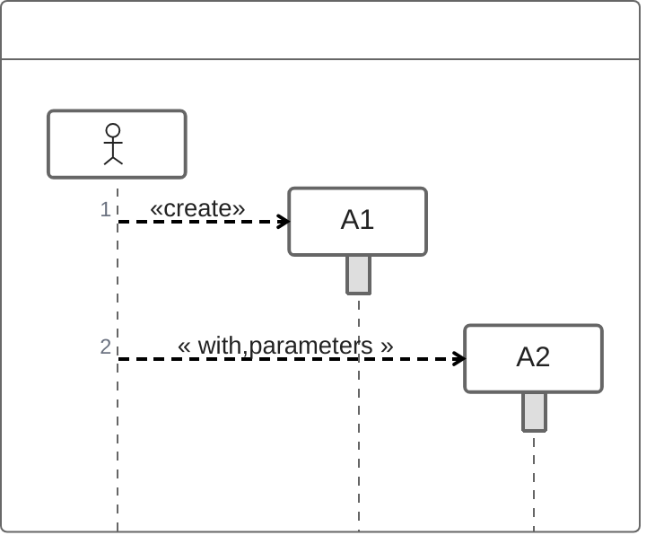

### Comments

A comment directly above a message or block is rendered there in grey; Markdown such as `**bold**` works. Comments above participant declarations are not shown.

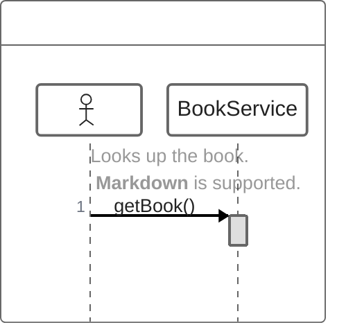

### Loops

`while`, `for`, `forEach`/`foreach` and `loop` all draw the same Loop frame with the condition in brackets.

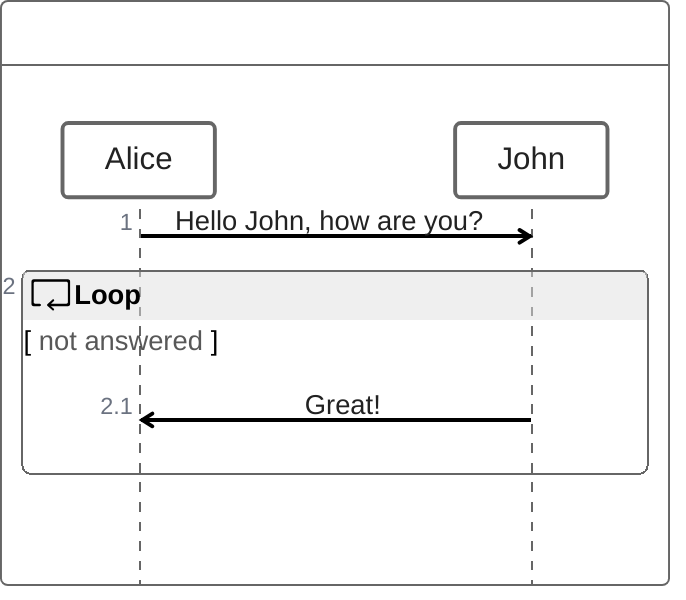

### Alternatives (if/else)

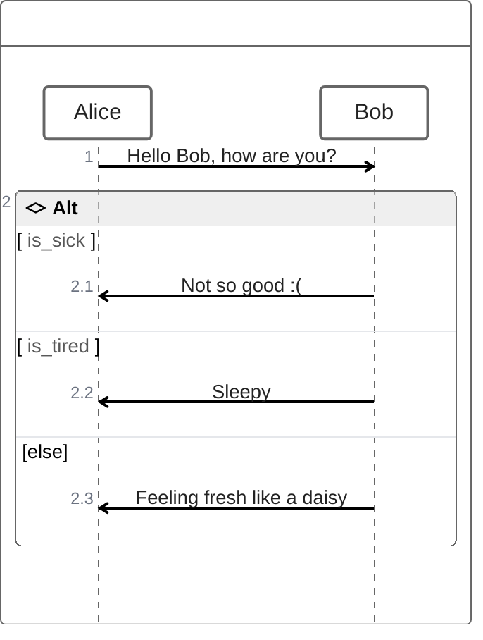

### Option (opt)

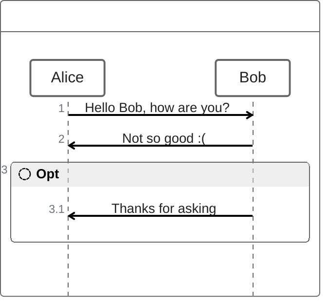

### Parallel

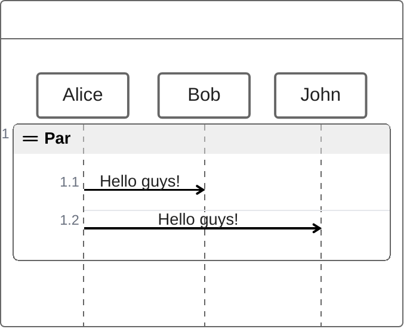

### Try/Catch/Finally

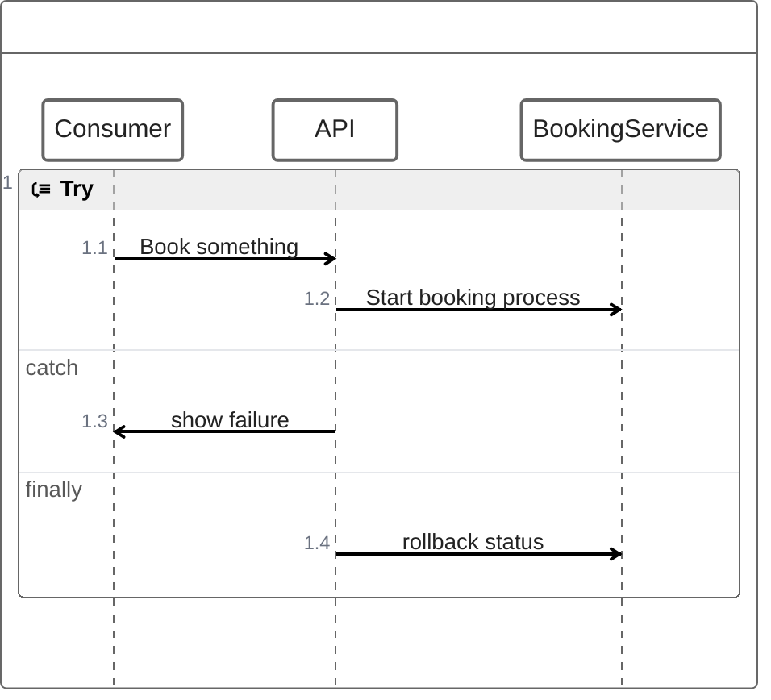

---

## Rules and Pitfalls

- **Wrong syntax does not fail.** The ZenUML parser recovers from almost anything: an unclosed `{`, or `sequenceDiagram` lines like `participant Alice` and `Alice->>John: Hi`, still report OK but draw a wrong picture (missing messages, a participant called "participant", a stray "Section" frame). Always open the PNG and check that every message and block is there.
- **Count the braces.** Every `{` needs its `}`; `} else {` and `} catch {` stay on one line with the closing brace.
- **Conditions must look like an expression or words.** `while(tries < 3)`, `if(order is ready)` and `loop(retries)` work; a condition starting with a number followed by a word, such as `loop(3 times)`, breaks the block (empty frame, body lost). Quote such text: `while("3 times")`.
- **Declarations first.** Participant, alias, `@Starter` and `group` lines belong before the first message. A `group` written after messages is dropped together with the messages that follow it.
- **Sync calls need a caller.** Without a sender and outside any block they start at an anonymous actor on the far left. Use `@Starter(Name)` or write `Sender->Receiver.method()`.
- **`return` only inside a sync block.** It draws the dashed arrow back to the caller of that block.
- **Names with spaces** need double quotes (`"Web App"->A: hi`) or an alias (`A as "Order Service"`). Message text after the colon is free text; colons, semicolons, parentheses and braces in it are fine.
- **Dark participant colours** make the name unreadable; the label colour does not adapt. Use light colours.
- No `Note`, no activation keywords, no `classDef`. If the diagram needs them, use `sequenceDiagram`.

---

## References

- [Official Mermaid ZenUML Documentation](https://mermaid.js.org/syntax/zenuml.html)
