# ZenUML Diagram

## Summary

**ZenUML** is a sequence diagram syntax supported by Mermaid that allows you to describe interactions between participants (actors, systems, objects) in a process, focusing on the order and flow of messages. ZenUML syntax is inspired by code and is more concise and flexible than the classic Mermaid sequence diagram.

**Use Cases:**
- Visualizing interactions between systems, services, or objects
- Modeling API calls, workflows, or business processes
- Documenting synchronous and asynchronous communication, object creation, replies, loops, alternatives, and parallel flows

**When to Use:**
- When you want a code-like, readable way to describe sequence diagrams
- When you need advanced features like nesting, loops, alternatives, parallelism, and try/catch/finally blocks

---

## Syntax Description

- Start with the `zenuml` keyword.
- Participants are defined implicitly by message order, or explicitly by naming.
- Messages use `->` for async, `.` for sync, and `new` for creation.
- Blocks and nesting use `{}`.
- Comments use `//`.
- Supports advanced constructs: loops, alternatives (`if/else`), options (`opt`), parallel (`par`), try/catch/finally.

**Basic Syntax:**
```
zenuml
    title My Sequence
    Alice->Bob: Hello Bob
    Bob->Alice: Hi Alice
```

**Participants:**
- Implicit: Defined by first appearance in a message.
- Explicit: List names at the top for custom order.
- Annotators: Use `@Actor`, `@Database`, etc., for symbols.

**Aliases:**
```
A as Alice
B as Bob
A->B: Message
```

**Messages:**
- Async: `Alice->Bob: Message`
- Sync: `A.SyncMethod()`
- Creation: `new Object`
- Reply: `return value` or `@return`

**Blocks:**
- Nesting: `{ ... }`
- Loops: `while(condition) { ... }`
- Alternatives: `if(cond) { ... } else { ... }`
- Option: `opt { ... }`
- Parallel: `par { ... }`
- Try/Catch/Finally: `try { ... } catch { ... } finally { ... }`

---

## Examples

### Basic Example

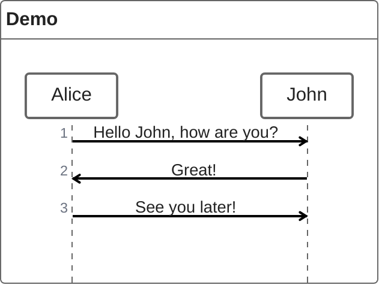

### Participants and Annotators

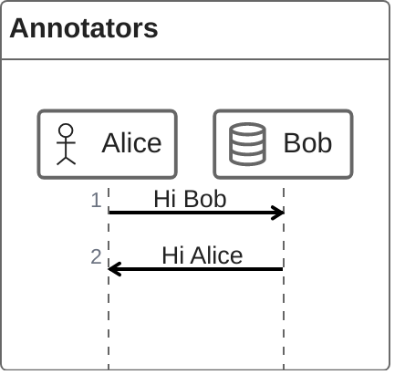

### Aliases

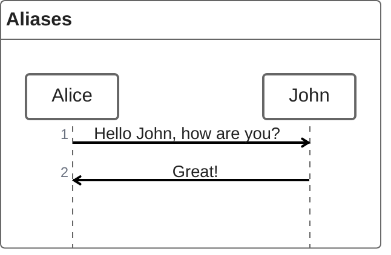

### Sync and Async Messages

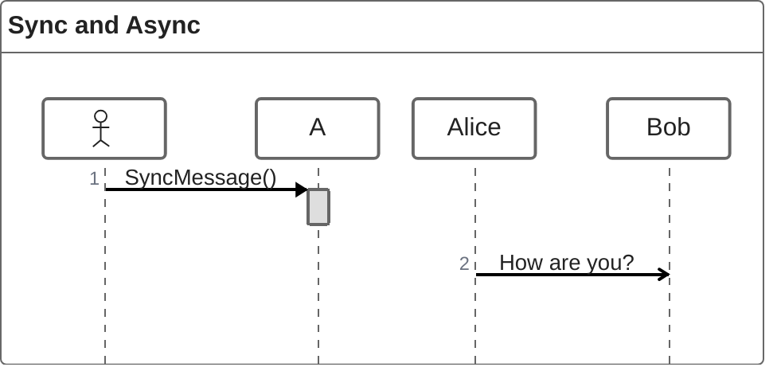

### Creation Message

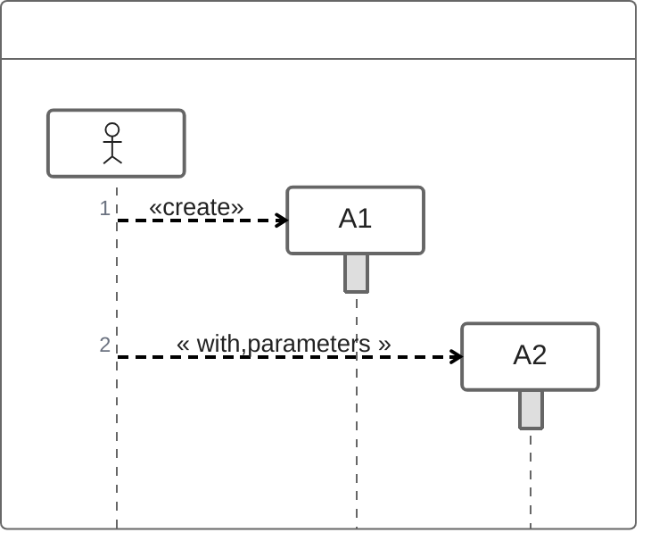

### Reply Message

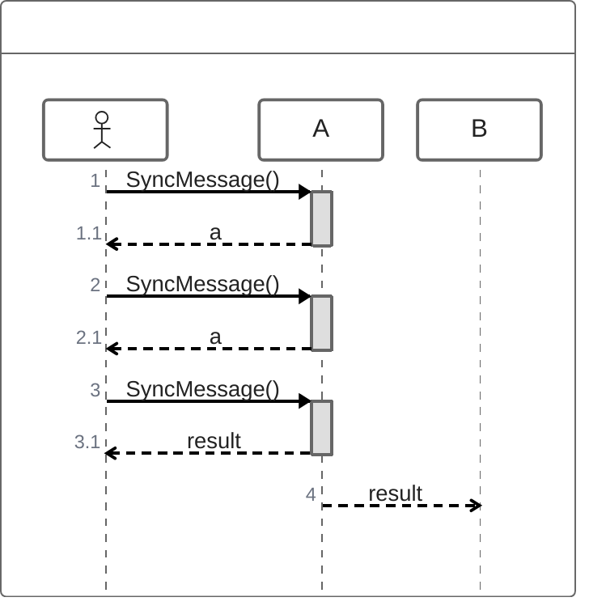

### Nesting

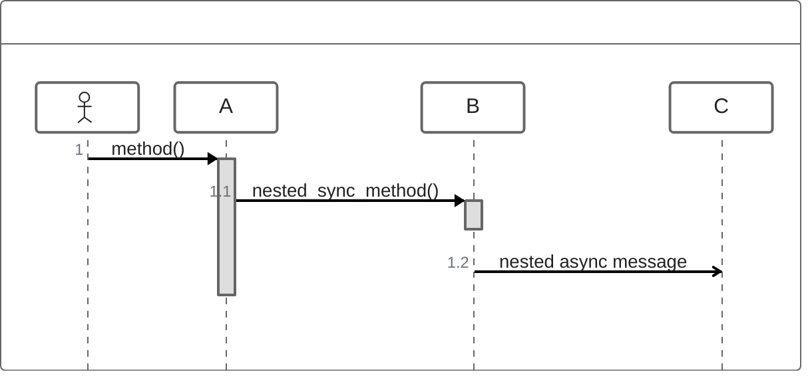

### Loops

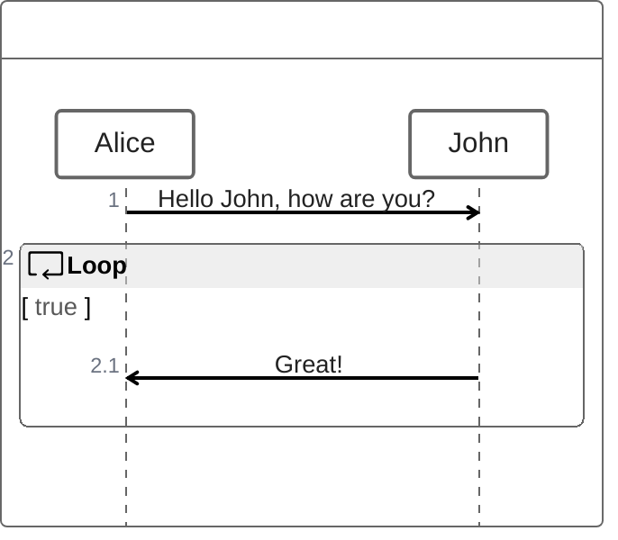

### Alternatives (if/else)

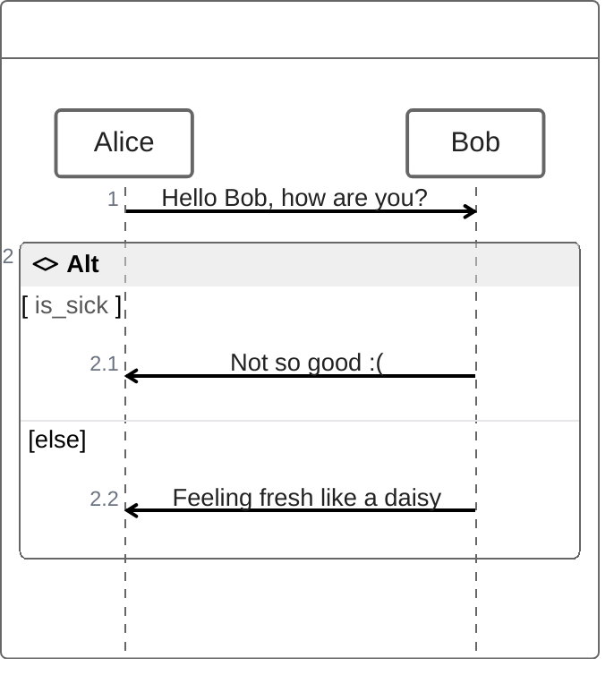

### Option (opt)

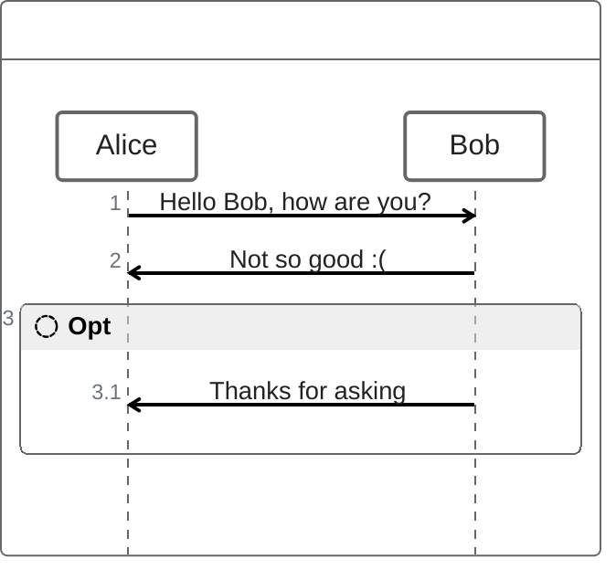

### Parallel

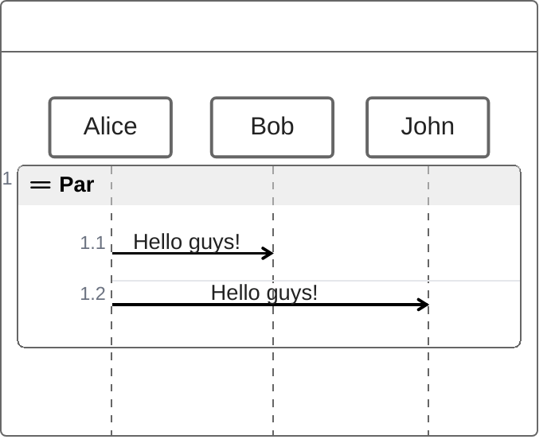

### Try/Catch/Finally

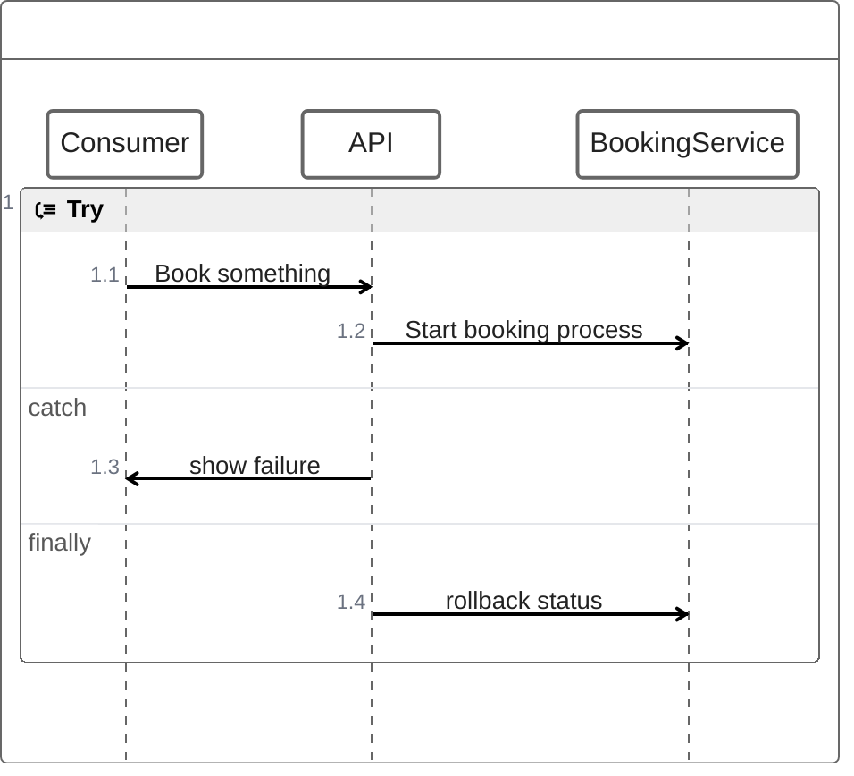

---

## Tips

- Use `{}` for nesting and blocks.
- Use annotators for special participant symbols.
- Comments (`//`) support Markdown and are rendered above messages.

---

## References

- [Official Mermaid ZenUML Documentation](https://mermaid.js.org/syntax/zenuml.html)
- [Mermaid.js Documentation](https://mermaid.js.org/)