# Class Diagram (PlantUML)

## Summary

A **PlantUML Class Diagram** is a UML static structure diagram that shows classes, interfaces, enums, and their relationships such as associations, inheritance, composition, and dependencies.  
It helps visualize the architecture of object-oriented systems and serves as an essential part of software documentation.

> **Note:** Class diagrams in PlantUML are stable and support advanced UML features like visibility modifiers, generics, packages, interfaces, and notes.

### Use Cases

- **Object-Oriented Design:** Model classes, interfaces, and their relationships.  
- **API Documentation:** Represent data models and service structures.  
- **System Architecture:** Show dependencies and interactions between components.  
- **Codebase Visualization:** Reverse-engineer existing code into readable UML.

### When to Use

- When you need to describe static structure (not behavior or sequence).  
- When documenting a system for onboarding or architecture review.  
- When designing new software components or refactoring existing ones.  
- When integrating class diagrams into a PlantUML-based documentation workflow.

---

## Syntax

- Start and end the diagram with `@startuml` and `@enduml`.  
- Define elements: `class`, `interface`, `abstract class`, `enum`.  
- Add attributes, methods, and relationships.  
- Optionally, include notes, packages, and skin parameters for styling.

### Basic Structure

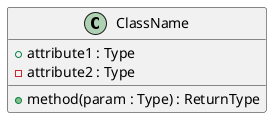

### Example

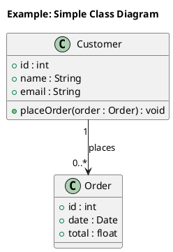

---

## Visibility Modifiers

| Symbol | Meaning    | Description                       |
|--------|-------------|-----------------------------------|
| `+`    | Public      | Visible to all classes.           |
| `-`    | Private     | Accessible only within the class. |
| `#`    | Protected   | Accessible to subclasses.         |
| `~`    | Package     | Accessible within the same package.|

### Example

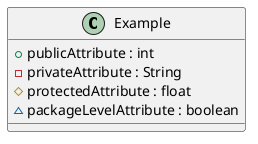

---

## Relationships

PlantUML supports standard UML relationships using arrows and symbols.

| Type | Symbol | Example | Description |
|------|--------|----------|--------------|
| Association | `-->` | `Customer --> Order` | One class references another. |
| Inheritance | `--|>` | `PremiumCustomer --|> Customer` | A subclass inherits from a superclass. |
| Implementation | `..|>` | `Paypal ..|> PaymentProvider` | A class implements an interface. |
| Dependency | `..>` | `Order ..> PaymentService` | A class depends on another transiently. |
| Aggregation | `o--` | `Team o-- Player` | A class contains others (shared ownership). |
| Composition | `*--` | `Order *-- OrderLine` | A class strongly owns its components. |

### Example

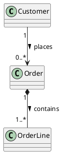

---

## Packages and Grouping

Use `package` blocks to group related classes.

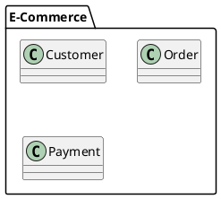

Packages help organize large diagrams into readable domains or layers.

---

## Interfaces and Abstract Classes

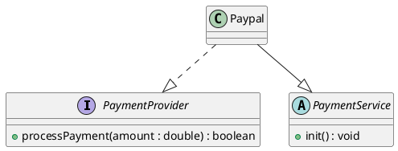

---

## Enums and Constants

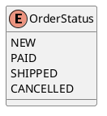

Enums are especially useful for representing states, constants, or type-safe values.

---

## Notes

Add notes to elements or relationships:

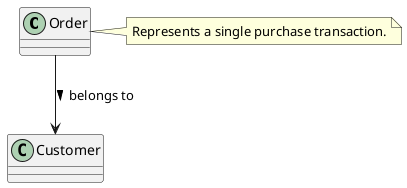

---

## Styling and Themes

### Skin Parameters

```plantuml
@startuml
skinparam classAttributeIconSize 0
skinparam class {
  BackgroundColor #f9f9f9
  BorderColor #333333
  FontColor black
}
@enduml
```

### Themes

PlantUML supports built-in and custom themes:

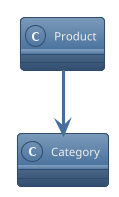

See [PlantUML Themes](https://plantuml.com/theme) for available options.

---

## Advanced Features

### Generics

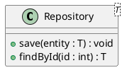

### Abstract Classes and Interfaces in Use

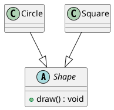

---

## Complete Example

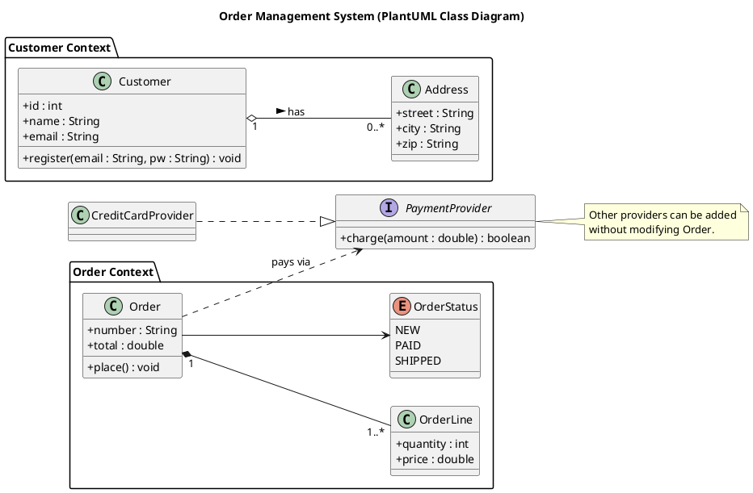

---

## Tips

- Use packages for logical grouping.  
- Apply `left to right direction` for wider layouts.  
- Combine notes and enums for clarity.  
- Customize appearance via `skinparam` or `!theme`.  
- Export with `plantuml -tpng`, `-tsvg`, or `-tpdf` as needed.

---

**References:**  
- [PlantUML Class Diagram Documentation](https://plantuml.com/class-diagram)  
- [PlantUML Themes](https://plantuml.com/theme)  
- [PlantUML Command Line Reference](https://plantuml.com/command-line)
