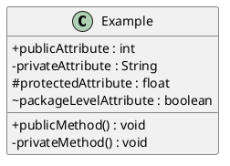
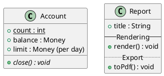
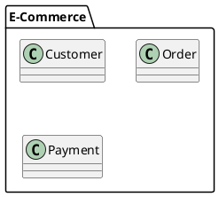
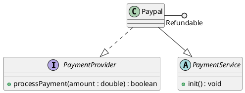
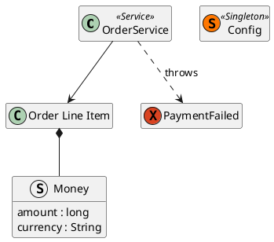
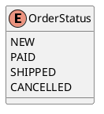
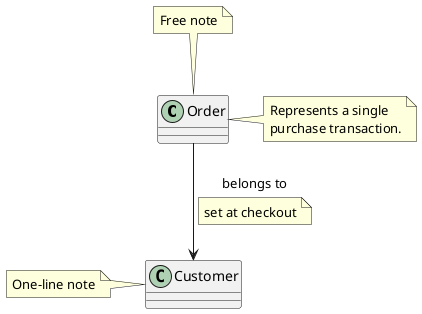
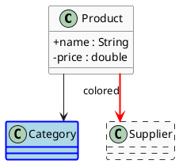
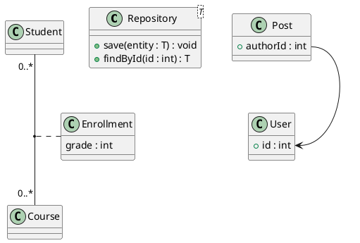
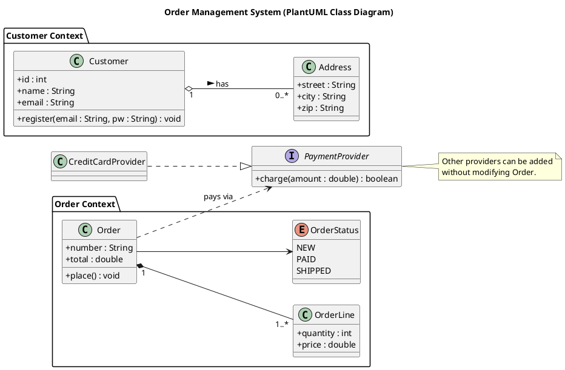

# Class Diagram (PlantUML)

## Summary

A **PlantUML Class Diagram** is a UML static structure diagram that shows classes, interfaces, enums, and their relationships such as associations, inheritance, composition, and dependencies.  
It helps visualize the architecture of object-oriented systems and serves as an essential part of software documentation.

### Use Cases

- **Object-Oriented Design:** Model classes, interfaces, and their relationships.  
- **API Documentation:** Represent data models and service structures.  
- **System Architecture:** Show dependencies and interactions between components.  
- **Codebase Visualization:** Reverse-engineer existing code into readable UML.

### When to Use

- When you need to describe static structure (not behavior or sequence).  
- When documenting a system for onboarding or architecture review.  
- When designing new software components or refactoring existing ones.  
- When integrating class diagrams into a PlantUML-based documentation workflow.

---

## Syntax

- Start and end the diagram with `@startuml` and `@enduml`.  
- Define elements: `class`, `interface`, `abstract class`, `enum` (more kinds under *Element Kinds*).  
- Add attributes, methods, and relationships.  
- Optionally, include notes, packages, and skin parameters for styling.
- A body in braces needs one member per line; the opening `{` ends its line and the closing `}` stands alone.
- A member containing parentheses is a method, any other member is a field. Fields are always drawn in the upper compartment and methods in the lower one, whatever the order in the source.

### Basic Structure

```text
@startuml
class ClassName {
  +attribute1 : Type
  -attribute2 : Type
  +method(param : Type) : ReturnType
}
ClassName --> OtherClass : label
@enduml
```

---

## Visibility Modifiers

| Symbol | Meaning    | Description                       |
|--------|-------------|-----------------------------------|
| `+`    | Public      | Visible to all classes.           |
| `-`    | Private     | Accessible only within the class. |
| `#`    | Protected   | Accessible to subclasses.         |
| `~`    | Package     | Accessible within the same package.|

By default the symbols are drawn as small icons (green circle, red square, yellow diamond, blue triangle; hollow for fields, filled for methods). `skinparam classAttributeIconSize 0` prints the plain characters `+ - # ~` instead, as in standard UML.

### Example



### Static, Abstract and Compartments

`{static}` underlines a member, `{abstract}` sets it in italics. `--`, `..`, `==` and `__` draw a separator line (solid, dotted, double, thin), optionally with a title between two markers. As soon as a body contains a separator, the members stay in source order. `{field}` and `{method}` force the compartment of a member, for example a field whose text contains parentheses.



---

## Relationships

PlantUML supports standard UML relationships using arrows and symbols.

```text
Customer --> Order                 association (open arrow head at Order)
Customer -- Order                  association without direction
PremiumCustomer --|> Customer      inheritance (hollow triangle at Customer)
Paypal ..|> PaymentProvider        implementation (dashed line, hollow triangle)
Order ..> PaymentService           dependency (dashed line, open arrow head)
Team o-- Player                    aggregation (hollow diamond at Team)
Order *-- OrderLine                composition (filled diamond at Order)
```

- Every arrow can be mirrored: `Customer <|-- PremiumCustomer`, `Player --o Team`, `OrderLine --* Order`.
- Multiplicities are quoted strings next to the class they belong to; the label follows after ` : `. A `>` or `<` at the end of the label (`: places >`) draws a small reading-direction triangle.
- Two dashes (`-->`) place the target below the source, a single dash (`->`) places it to the right. `-up->`, `-down->`, `-left->`, `-right->` force a side. With `left to right direction` the two-dash arrows run from left to right.
- `class Dog extends Animal implements Pet` in a declaration draws the same inheritance and implementation arrows.

The *Complete Example* below shows aggregation, composition, multiplicities and a reading-direction label together.

---

## Packages and Grouping

Use `package` blocks to group related classes.



Packages help organize large diagrams into readable domains or layers. Packages can be nested, take a color (`package Billing #lightyellow {`) and another shape through a stereotype: `<<Node>>`, `<<Rectangle>>`, `<<Folder>>`, `<<Frame>>`, `<<Cloud>>`, `<<Database>>`.

A dot in a class name also creates packages: `class com.shop.Order` is drawn as class `Order` inside package `shop` inside package `com`. `set separator none` switches this off and keeps the dotted name as the class name.

---

## Interfaces and Abstract Classes



`Paypal -() Refundable` draws `Refundable` as a lollipop (small circle on a line); `Refundable ()-- Paypal` puts it above the class.

### Element Kinds, Stereotypes and Aliases

Further keywords with their own circle letter: `annotation` (@), `struct` (S), `exception` (X), `protocol` (P), `record` (R), `entity` (E), `metaclass` (M), `dataclass` (D). `abstract` alone works like `abstract class`.



- `<<Name>>` adds a stereotype above the class name; `<< (S,#FF7700) Name >>` also replaces the circle letter and its color.
- A name with spaces is quoted and gets an alias with `as`; relations use the alias.
- `hide empty members` removes the empty compartments of classes without members, `hide circle` removes the circled letter. `hide Foo` removes a class, `hide Foo methods` or `hide Foo fields` one compartment.

---

## Enums and Constants



Enums are especially useful for representing states, constants, or type-safe values. Write one constant per line; a body on one line (`enum E { A; B }`) is a syntax error.

---

## Notes

Add notes to elements or relationships:



- Positions: `note left of`, `right of`, `top of`, `bottom of`. The one-line form uses ` : text`, the block form ends with `end note`.
- `note on link` belongs to the relationship written directly above it.
- `note "text" as N1` creates a free note that is attached with `..` to one or more elements.

---

## Styling and Themes

### Skin Parameters



A color after the class name sets its background (`class Draft #pink`); `line:blue`, `line.bold` and `line.dashed` change the border. `-[#red,bold]->` or `-[#green,dashed]->` styles one relationship.

`skinparam linetype ortho` draws the relationships with right angles. `skinparam nodesep 60` and `skinparam ranksep 40` change the spacing between neighbours and between ranks.

### Themes

`!theme plain` on the first line after `@startuml` applies a built-in theme (`plain`: black and white, no shading). With this skill's renderer the themes `plain`, `mono` and `vibrant` keep the full PNG resolution. `spacelab`, `cerulean`, `materia` and `sketchy-outline` render correctly as SVG, but their PNG comes out at about a fifth of the normal size (a two-class diagram was 122 px wide instead of 684 px). Check the PNG after choosing any other theme, or style with `skinparam` instead.

---

## Advanced Features

### Generics, Association Class and Member Links



- The part in angle brackets is drawn in a dashed box at the top right corner; `class Repository<T extends Entity>` and `class Map<K, V>` work the same way.
- `(A, B) .. C` attaches class `C` with a dashed line to the middle of the relationship between `A` and `B`.
- `Post::authorId --> User::id` starts and ends the arrow at the named members instead of the class border.

---

## Complete Example



---

## Tips

- Use packages for logical grouping.  
- Apply `left to right direction` for wider layouts.  
- Combine notes and enums for clarity.  
- Customize appearance via `skinparam` or `!theme`.  
- `title`, `header`, `footer`, `caption` and a `legend right` ... `end legend` block add text around the diagram.
- `together { ... }` around some class declarations keeps them next to each other.

## Pitfalls

All of these were observed with PlantUML 1.2025.10.

- **Body on one line.** `class B { +x : int }` and `enum E { A; B }` are syntax errors. `package "Shop" { class A }` is worse: it renders without error as an empty package whose title is the whole line. Always break after `{`.
- **No element, no picture.** A diagram that contains only `skinparam` lines renders as an empty image without an error.
- **Parentheses make a method.** `size (cm)` lands in the method compartment below all fields. Prefix it with `{field}` or use separators (`--`) to keep the source order.
- **Only single-dash arrows.** A diagram without any `class` declaration that starts with `A -> B` is drawn as a sequence diagram. Declare the classes or use `-->`.
- **Names are case-sensitive.** `Order` and `order` are two classes; a typo in a relationship silently creates a new, empty class.
- **Dots create packages.** `class com.shop.Order` is not a class with a dotted name unless `set separator none` is set.
- **Themes and PNG size.** Some themes shrink the PNG (see *Themes*).
- **Markers are required.** A file without `@startuml` produces no picture although the render script reports OK.

---

**References:**  
- [PlantUML Class Diagram Documentation](https://plantuml.com/class-diagram)  
- [PlantUML Themes](https://plantuml.com/theme)  
- [PlantUML Skinparam Reference](https://plantuml.com/skinparam)
