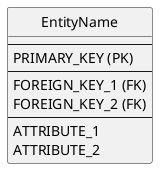
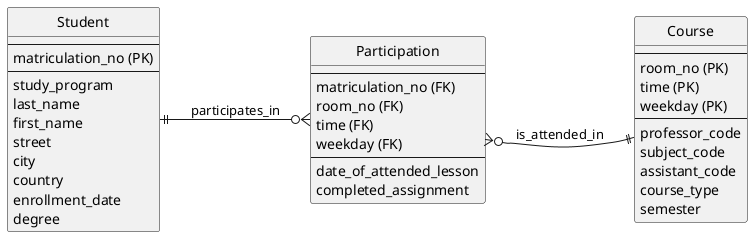

# ER Model (Custom PlantUML Style)

## Summary

A **Custom ER Model in PlantUML** uses the PlantUML class diagram syntax to represent entities, their attributes, and relationships in a way that resembles classic Entity–Relationship diagrams.  
Instead of classes with methods and typed attributes, we model **entities with keys and attributes only**, and use **association multiplicities** to express relationships.

> **Note:** This is a *convention-based* ER style on top of PlantUML class diagrams.  
> It focuses on keys, attributes, and relationships – **no datatypes** and **no methods**.

### Use Cases

- **Database Design (Logical Level):**  
  Model entities, primary keys, foreign keys, and n:m-relationships.
- **Teaching & Exercises:**  
  Visualize simple ER models (students, courses, registrations, etc.).
- **Documentation of Existing Schemas:**  
  Provide a readable picture for onboarding and reviews.
- **Conceptual Modeling:**  
  Sketch structures before translating them into SQL or an ORM.

### When to Use

- When you need a **lightweight ER diagram** inside a PlantUML-based workflow.  
- When exact column types are not important yet (early design).  
- When you want to **highlight primary/foreign keys and relationships** without UML methods.  
- When integrating ER diagrams into markdown, docs-as-code, or CI pipelines via PlantUML.

---

## Syntax and Conventions

We reuse **PlantUML class syntax** but follow these conventions:

- Use `class` to represent **entities**.
- Inside each class:
  - Use a line with `--` as a **visual separator**.
  - List **primary keys (PK)** between the first pair of `--`.
  - List **foreign keys (FK)** and other keys between the same or a second pair of `--`.
  - List remaining **non-key attributes** below the last separator.
- Do **not** specify datatypes or methods.
- Use relationships with multiplicities using the normal class diagram arrows.

### Basic Structure (Entity)



- `PRIMARY_KEY (PK)` marks a primary key column.  
- `... (FK)` marks a foreign key column.  
- Additional attributes are listed without any type annotations.

---

## Relationships and Multiplicities

We use the **class diagram association syntax** with crow’s-foot-style multiplicities:

- `||` for **exactly one** (1)
- `|o` for **zero or one** (0..1)
- `}|` for **one or many** (1..*)
- `}o` for **zero or many** (0..*)

In practice, a common pattern is:

```plantuml
EntityA ||--o{ EntityB : "relationship name"
```

- `EntityA ||` → each `EntityA` instance is on the **one** side.  
- `o{ EntityB` → `EntityB` instances are on the **many** side (possibly zero).  
- The quoted label describes the relationship.

---

## Custom ER Example: Students, Courses, and Attendance

The following diagram models **students**, **courses**, and their **participation** as a classic ER scenario with a join table for the n:m relationship.



### Interpretation

- **Student**  
  - `matriculation_no (PK)` uniquely identifies each student.  
  - All other attributes describe personal details and study-related information.

- **Course**  
  - Composite primary key: `(room_no, time, weekday)`.  
  - Contains metadata such as `professor_code`, `subject_code`, `assistant_code`, `course_type`, and `semester`.

- **Participation**  
  - Contains only **foreign keys** linking a student to a specific course slot:  
    `(matriculation_no, room_no, time, weekday)`.  
  - Includes descriptive attributes like `date_of_attended_lesson` and `completed_assignment`.  
  - Represents the **n:m relationship** between `Student` and `Course`.

### Relationships

- `Student ||--o{ Participation : "participates_in"`  
  → One student may participate in zero or many courses; each participation entry belongs to exactly one student.

- `Course ||--o{ Participation : "is_attended_in"`  
  → One course may have zero or many participation entries; each participation refers to exactly one course.

---

## Layout and Styling

Useful tips for improving diagram readability:

- Use `left to right direction` for wider ER models.  
- Use `hide circle` to produce a cleaner ER-style appearance.  
- Use **hidden links** (`-[hidden]->`) to influence layout without adding real relationships.  
- Group entities and join tables using comments or spacing.

Example layout control:

```plantuml
Student -[hidden]-> Participation
Participation -[hidden]-> Course
```

---

## Tips

- Maintain consistent naming conventions (lowerCamelCase, snake_case, or ALL_CAPS).  
- Avoid datatypes in conceptual ER models — focus on **keys and relationships**.  
- Always model n:m relationships using join tables like `Participation`.  
- Export diagrams with PlantUML (`-tpng`, `-tsvg`, `-tpdf`) to integrate them into documentation or CI pipelines.

---

**References:**  
- [PlantUML Class Diagram Documentation](https://plantuml.com/class-diagram)  
- [General PlantUML Reference](https://plantuml.com/)
