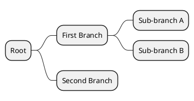
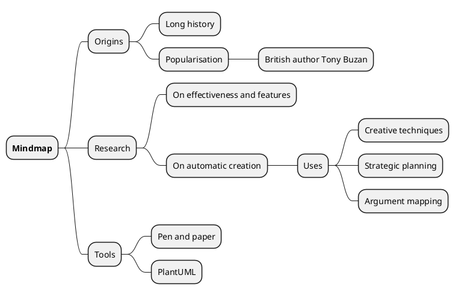
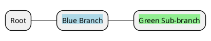
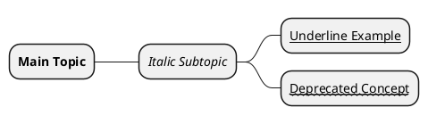
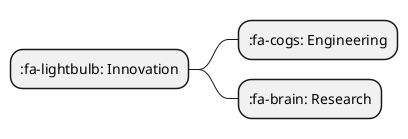
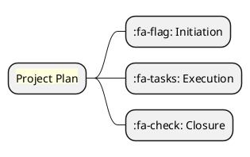
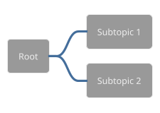
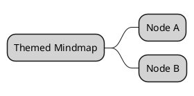

# Mindmap (PlantUML)

## Summary

A **Mindmap** in PlantUML is a hierarchical diagram that visually organizes ideas, concepts, or topics around a central theme.  
Each node represents a concept, and child nodes represent subtopics branching from their parent.  
PlantUML mindmaps provide an elegant, text-based way to model relationships and conceptual hierarchies directly in source code.

> **Note:** Mindmap diagrams in PlantUML are stable and part of the core syntax.  
> They can be rendered in multiple formats (PNG, SVG, PDF, etc.) via the standard `@startmindmap` / `@endmindmap` syntax.

### Use Cases

- **Brainstorming:** Capture ideas and structure them around a main concept.  
- **Project Planning:** Break projects into hierarchical components.  
- **Knowledge Representation:** Show relationships between concepts or entities.  
- **Documentation:** Represent high-level summaries of complex systems or reports.

### When to Use

- When you need to represent hierarchical or tree-like relationships.  
- When visualizing concept hierarchies, system structures, or plans.  
- When integrating conceptual maps directly within technical documentation.

---

## Syntax

- Start and end the diagram with `@startmindmap` and `@endmindmap`.  
- Use indentation (`*`, `**`, `***`, etc.) to define hierarchy levels.  
- Add formatting, icons, or colors for emphasis.  
- Each line defines a node; deeper levels indicate subtopics.

### Basic Structure

### Example

---

## Node Styling and Formatting

### Colors

You can assign background and text colors using standard PlantUML color syntax.

### Fonts and Emphasis

PlantUML supports inline formatting with Markdown-like syntax:

- **Bold:** `**text**`
- *Italic:* `//text//`
- `__Underlined__`
- `~~Strikethrough~~`

---

## Icons

Icons can be added via the [OpenIconic](https://useiconic.com/open) or [Font Awesome](https://fontawesome.com) sets if your renderer supports them.

---

## Layouts and Orientation

By default, PlantUML renders mindmaps **from left to right**.  
You can change the layout using the `!theme` directive or by setting styles.

PlantUML automatically balances branches for tidy tree layouts.  
Unlike Mermaid, layout parameters (e.g., tidy-tree) are **inherent** and not defined via YAML frontmatter.

---

## Themes and Styles

PlantUML mindmaps fully support theming and style sheets:

You can also define your own style blocks:

---

## Tips

- Use consistent indentation to maintain hierarchy clarity.  
- Combine bold and color styling for readability.  
- Themes can drastically change the diagram’s appearance — use `!theme` or custom `<back:color>` tags.  
- Export diagrams with `plantuml -tpng` or `plantuml -tsvg` for different outputs.

---

**References:**  
- [PlantUML Mindmap Documentation](https://plantuml.com/mindmap-diagram)  
- [PlantUML Style and Themes Guide](https://plantuml.com/theme)  
- [PlantUML Command Line Reference](https://plantuml.com/command-line)
