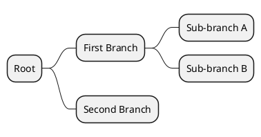
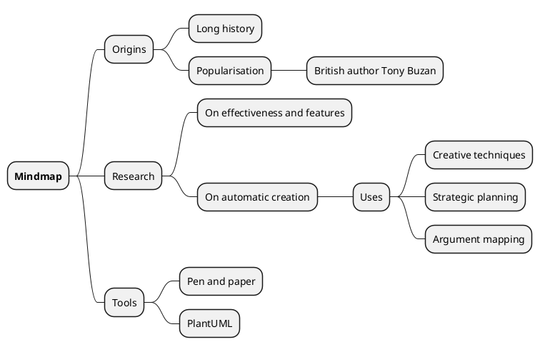
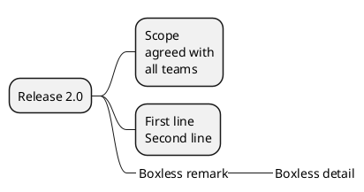
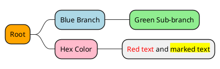
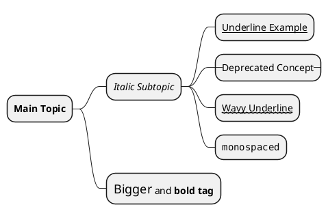
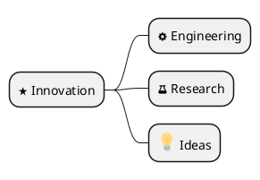
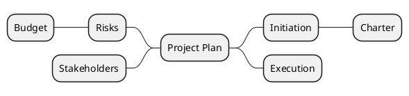
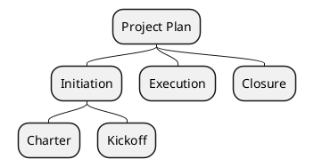
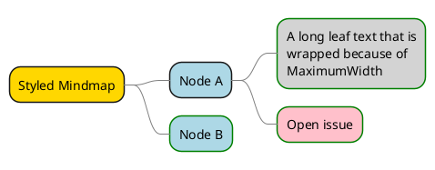

# Mindmap (PlantUML)

## Summary

A **Mindmap** in PlantUML is a hierarchical diagram that visually organizes ideas, concepts, or topics around a central theme.  
Each node represents a concept, and child nodes represent subtopics branching from their parent.  
PlantUML mindmaps provide an elegant, text-based way to model relationships and conceptual hierarchies directly in source code.

> **Note:** Mindmaps have their own markers, `@startmindmap` / `@endmindmap`.

### Use Cases

- **Brainstorming:** Capture ideas and structure them around a main concept.  
- **Project Planning:** Break projects into hierarchical components.  
- **Knowledge Representation:** Show relationships between concepts or entities.  
- **Documentation:** Represent high-level summaries of complex systems or reports.

### When to Use

- When you need to represent hierarchical or tree-like relationships.  
- When visualizing concept hierarchies, system structures, or plans.  
- When integrating conceptual maps directly within technical documentation.

---

## Syntax

- Start and end the diagram with `@startmindmap` and `@endmindmap`.  
- The number of leading stars (`*`, `**`, `***`, etc.) defines the hierarchy level; one space separates the stars from the text.  
- Each line defines a node; deeper levels indicate subtopics. A child follows its parent directly.
- Spaces in front of the stars are ignored, so lines may be indented for readability.
- By default all branches grow to the right of the root.

### Basic Structure

### Example

### Multi-line and Boxless Nodes

- `**:` starts a node that runs over several lines until a line ends with `;`.
- `\n` inside the text breaks the line.
- An underscore after the stars (`**_`) draws the text without a box.

---

## Node Styling and Formatting

### Colors

`[#color]` directly after the stars fills the node; color names and hex values both work. The inline tags `<color:red>` and `<back:yellow>` only color the text or the strip behind the text, not the node.

### Fonts and Emphasis

PlantUML uses its own Creole markup (not Markdown):

- Bold: `**text**`
- Italic: `//text//`
- Underlined: `__text__`
- Strikethrough: `--text--`
- Wavy underline: `~~text~~`
- Monospaced: `""text""`

---

## Icons

Two icon sets are built in: [OpenIconic](https://useiconic.com/open) as `<&name>` and emoji as `<:name:>`. The Font Awesome notation `:fa-name:` known from Mermaid is not supported; it is printed as plain text.

---

## Layouts and Orientation

By default the root stands on the left and every branch grows to the right; nothing is balanced automatically. There are three ways to change that.

`left side` moves all first-level branches written after it to the left of the root:

The same result without `left side`: write the whole tree with `+` (right) and `-` (left) instead of `*`, for example `+ Root`, `++ Right branch`, `-- Left branch`, `--- Left leaf`.

`top to bottom direction` on the first line draws the tree downwards; `right to left direction` puts the root on the right:

---

## Themes and Styles

`!theme plain` on the first line after `@startmindmap` applies a built-in theme (`plain`: white nodes, black lines). With this skill's renderer `plain`, `mono` and `vibrant` keep the full PNG resolution; `spacelab`, `cerulean`, `materia` and `sketchy-outline` render correctly as SVG, but their PNG comes out at about a fifth of the normal size. Check the PNG after choosing any other theme.

A style block gives full control and has no such problem:

- `node` applies to all nodes, `rootNode` to the root, `leafNode` to nodes without children, `:depth(n)` to one level (root is 0), `arrow` to the connecting lines.
- `.name { ... }` defines a class; `<<name>>` at the end of a node line applies it and is not printed. Without a matching class the marker is printed as `«name»`.
- `MaximumWidth` (pixels) wraps long node texts.

`title`, `header`, `footer`, `caption` and a `legend right` ... `end legend` block work as in other PlantUML diagrams.

---

## Tips

- Keep node texts short; use `MaximumWidth` or `\n` for long ones.  
- Color whole branches with `[#color]` or with `:depth(n)` styles rather than node by node.  
- Use `left side` when the root has more than about five branches, so the map stays compact.

## Pitfalls

All of these were observed with PlantUML 1.2025.10.

- **Wrong markers.** Inside `@startuml` / `@enduml` the star lines are not a mindmap; they render without error as two boxes connected by an arrow.
- **`<back:color>` is not a node color.** It only highlights the text. Use `*[#color]`.
- **`~~text~~` is not strikethrough.** It draws a wavy underline; strikethrough is `--text--`.
- **Mermaid icons do not work.** `:fa-flag: Start` is printed literally. An unknown `<$name>` sprite is dropped silently.
- **Skipped levels.** `***` directly below `*` is attached as a direct child without any warning; the intended level is lost.
- **Several roots.** A second line with a single `*` starts a second, unconnected tree.
- **Themes do not change the layout.** Orientation is set only with `left side`, `+`/`-` and the `direction` lines.
- **Themes and PNG size.** Some themes shrink the PNG (see *Themes and Styles*).

---

**References:**  
- [PlantUML Mindmap Documentation](https://plantuml.com/mindmap-diagram)  
- [PlantUML Creole Markup](https://plantuml.com/creole)  
- [PlantUML Style and Themes Guide](https://plantuml.com/theme)
